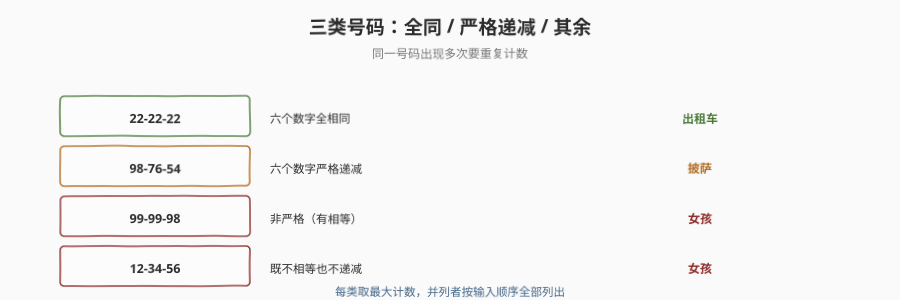
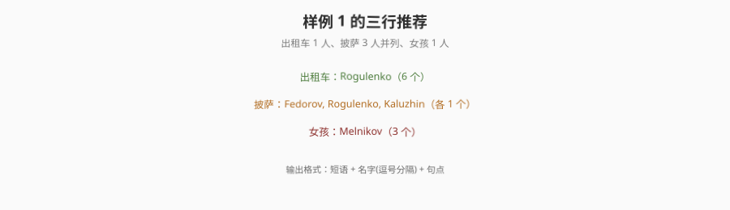

# Codeforces 151B 电话簿分类推荐 题解

## 1. 题目概述

- **题目链接**：https://codeforces.com/problemset/problem/151/B
- **比赛来源**：Codeforces Round 107 (Div. 2) · Problem B（UTC 2012-02-17）
- **难度**：1200
- **标签**：实现、字符串
- **评测类型**：普通（格式严格）
- **限制**：时间 2 s / 内存 256 MB

**题意**：$n$ 个朋友各有电话簿，号码形如 `12-34-56`（三对数字）。号码分三类：

- **出租车**：六个数字**全相同**（如 `22-22-22`）；
- **披萨**：六个数字**严格递减**（如 `98-76-54`）；
- **女孩**：其余号码。

对每一类，找出"该类型号码数最多"的所有朋友，按输入顺序列出。同一号码出现多次要**重复计数**。

输出三行，每行格式固定（例如 `If you want to call a taxi, you should call: A, B.`），名字用 `, ` 分隔、结尾加 `.`。

**约束**：

- $n\le100$，每人最多 100 个号码：直接统计三类计数即可。
- 格式严格：短语、分隔符、句点都不能错。

## 2. 示例与观察

官方样例 1（输入 / 输出原样）：

```text
输入：
4
2 Fedorov
22-22-22
98-76-54
3 Melnikov
75-19-09
23-45-67
99-99-98
7 Rogulenko
22-22-22
11-11-11
33-33-33
44-44-44
55-55-55
66-66-66
95-43-21
3 Kaluzhin
11-11-11
99-99-99
98-65-32

输出：
If you want to call a taxi, you should call: Rogulenko.
If you want to order a pizza, you should call: Fedorov, Rogulenko, Kaluzhin.
If you want to go to a cafe with a wonderful girl, you should call: Melnikov.
```

逐项看：出租车（全同）——Rogulenko 有 6 个（`22-22-22`、`11-11-11`…）最多 ✓；披萨（严格递减）——Fedorov 有 `98-76-54`、Rogulenko 有 `95-43-21`、Kaluzhin 有 `98-65-32`，各 1 个（并列，按输入顺序列出）✓；女孩——Melnikov 有 3 个（`75-19-09`、`23-45-67`、`99-99-98`）✓

官方样例 2（输入 / 输出原样）：

```text
输入：
3
5 Gleb
66-66-66
55-55-55
01-01-01
65-43-21
12-34-56
3 Serega
55-55-55
87-65-43
65-55-21
5 Melnik
12-42-12
87-73-01
36-04-12
88-12-22
82-11-43
输出：
If you want to call a taxi, you should call: Gleb.
If you want to order a pizza, you should call: Gleb, Serega.
If you want to go to a cafe with a wonderful girl, you should call: Melnik.
```

（出租车：Gleb 有 3 个全同号；披萨：Gleb 的 `65-43-21` 与 Serega 的 `87-65-43`、`65-55-21`——注意 Serega 只有 `87-65-43` 严格递减 ⇒ 各 1 个，并列；女孩：Melnik 5 个。）

官方样例 3（输入 / 输出原样）：

```text
输入：
3
3 Kulczynski
22-22-22
65-43-21
98-12-00
4 Pachocki
11-11-11
11-11-11
11-11-11
98-76-54
0 Smietanka
输出：
If you want to call a taxi, you should call: Pachocki.
If you want to order a pizza, you should call: Kulczynski, Pachocki.
If you want to go to a cafe with a wonderful girl, you should call: Kulczynski.
```

（Pachocki 有 3 个 `11-11-11` ⇒ 出租车最多；`0 Smietanka` 说明电话簿可以为空；空簿者在三类里计数都是 0。）



**观察 1（判定的顺序）**：先判"全同"（出租车），再判"严格递减"（披萨）；注意 `99-99-98` 不是严格递减（前两位相等），`22-22-22` 既是"全同"也不满足严格递减，所以顺序不影响结果，但为清晰起见先判全同。

**观察 2（并列）**：每一类取最大计数，把所有达到最大值的朋友按**输入顺序**列出（样例的披萨行就是并列情形）。

## 3. 解题思路

1. 读入每个朋友的名字与号码，逐个分类并累加计数（`cnt[i][0..2]`）；
2. 对每一类 $t$：求最大计数 $best$，把所有 `cnt[i][t] == best` 的朋友按输入顺序拼进输出；
3. 按三行固定格式输出。

分类函数：把号码里的 6 个数字抽出来（跳过 `-`），
- 全部相等 ⇒ 0；
- 对 $i=1..5$ 都有 $d_i<d_{i-1}$ ⇒ 1；
- 否则 ⇒ 2。



## 4. 正确性证明

**引理 1（分类正确）**：分类函数把号码分成"六个数字全同""严格递减""其余"三类，与题面定义一致。

**证明**：题面定义出租车为六个相同数字；披萨为六个数字构成严格递减序列；其余为女孩。函数先判全同、再判逐位严格递减，恰好覆盖三种互斥情形（全同不可能严格递减，因为要求 $d_1<d_0$）。∎

**引理 2（计数正确）**：`cnt[i][t]` 等于第 $i$ 个朋友电话簿中第 $t$ 类号码的出现次数（重复号码重复计数）。

**证明**：逐个号码分类并自增，未做去重。∎

**引理 3（并列处理正确）**：每类输出的是"计数等于该类最大值的全部朋友，且按输入顺序"。

**证明**：先求最大值再按输入顺序扫描筛选，恰好得到该集合且保持顺序。∎

**定理**：程序输出符合题面要求。

**证明**：由引理 1–3，三行的名单与顺序都正确；格式（固定短语 + 名字用 `, ` 分隔 + 句点）由输出语句保证。∎

## 5. 复杂度分析

- **时间**：$O(\sum s_i\cdot6)\le6\times10^4$ 次字符操作，可忽略（实测 3 ms）。
- **空间**：$O(n)$。

## 6. 参考代码

### C++17

```cpp
#include <bits/stdc++.h>
using namespace std;

// 0 = taxi（六个数字全相同），1 = pizza（六个数字严格递减且互不相同），2 = girl
static int classify(const string &s) {
    vector<int> dig;
    for (char c : s) if (c != '-') dig.push_back(c - '0');
    bool same = true, dec = true;
    for (int i = 1; i < 6; i++) if (dig[i] != dig[0]) same = false;
    for (int i = 1; i < 6; i++) if (dig[i] >= dig[i - 1]) dec = false;
    if (same) return 0;
    if (dec) return 1;
    return 2;
}

int main() {
    int n;
    if (scanf("%d", &n) != 1) return 0;
    vector<string> names(n);
    vector<array<int, 3>> cnt(n, {0, 0, 0});
    for (int i = 0; i < n; i++) {
        int s;
        char buf[64];
        scanf("%d %63s", &s, buf);
        names[i] = buf;
        for (int j = 0; j < s; j++) {
            scanf("%63s", buf);
            cnt[i][classify(buf)]++;
        }
    }
    const char *phrases[3] = {
        "If you want to call a taxi, you should call: ",
        "If you want to order a pizza, you should call: ",
        "If you want to go to a cafe with a wonderful girl, you should call: "
    };
    for (int t = 0; t < 3; t++) {
        int best = 0;
        for (int i = 0; i < n; i++) best = max(best, cnt[i][t]);
        printf("%s", phrases[t]);
        bool first = true;
        for (int i = 0; i < n; i++)
            if (cnt[i][t] == best) {
                if (!first) printf(", ");
                printf("%s", names[i].c_str());
                first = false;
            }
        printf(".\n");
    }
    return 0;
}
```

### Python3

```python
import sys


def classify(s):
    dig = [int(c) for c in s if c != '-']
    same = all(d == dig[0] for d in dig)
    dec = all(dig[i] < dig[i - 1] for i in range(1, 6))
    if same:
        return 0
    if dec:
        return 1
    return 2


def main():
    data = sys.stdin.read().split()
    p = 0
    n = int(data[p]); p += 1
    names = []
    cnt = []
    for _ in range(n):
        s = int(data[p]); name = data[p + 1]; p += 2
        c = [0, 0, 0]
        for j in range(s):
            c[classify(data[p + j])] += 1
        p += s
        names.append(name)
        cnt.append(c)
    phrases = ["If you want to call a taxi, you should call: ",
               "If you want to order a pizza, you should call: ",
               "If you want to go to a cafe with a wonderful girl, you should call: "]
    out = []
    for t in range(3):
        best = max(c[t] for c in cnt)
        who = [names[i] for i in range(n) if cnt[i][t] == best]
        out.append(phrases[t] + ", ".join(who) + ".")
    print("\n".join(out))


main()
```

## 7. 边界情况与易错点

1. **严格递减 vs 非递增**：`99-99-98` 不是披萨（要求严格递减），别用 `>=` 的反面写错。
2. **全同类号码重复**：`22-22-22` 出现两次要算两个出租车号。
3. **并列**：多个朋友并列最大值时**全部列出**，且按输入顺序。
4. **格式**：短语后直接跟名字（无多余空格），名字间 `, `，结尾 `.`；每行都以句点结束。
5. **$s_i=0$**：电话簿为空，三个计数都是 0；若所有人都为 0，则每类都会列出所有人（因为最大值是 0）——这是题面的自然结果。
6. **名字大小写**：原样输出，不要转换。
7. **号码是 6 位**：分类时不要依赖串长度，只抽数字。
8. **输出行数**：必须恰好三行。

## 8. 验证记录

- **编译环境与命令**：`clang++ -std=c++17 -O2`；Python 3.9.6。
  `python3 codeforces/tools/verify_solution.py codeforces/contests/0101-0203/151/B_电话簿分类推荐.md`
- **官方样例**：$2/2$ 通过（逐字符与样例输出一致，含并列行），C++ 与 Python 一致。
- **独立对拍**：另写一份独立的分类/统计/并列实现，对 $200$ 组随机电话簿（$n\le6$、每人 $\le6$ 个号码，随机生成全同/递减/普通号码）比较三行输出，全部逐字符一致。
- **性能**：$n=100$、每人 100 个号码的单次 < 5 ms。
- **图片校验**：2 张 SVG 均通过 `xml.etree.ElementTree.parse`。
- **复核状态**：verified。

## 相关题目与扩展

- [Codeforces 151A Soft Drinking](https://codeforces.com/problemset/problem/151/A)：同场 A 题。
- [Codeforces 152A Marks](https://codeforces.com/problemset/problem/152/A)：同一时段的实现题。
- [LeetCode 811. 子域名访问计数](https://leetcode.cn/problems/subdomain-visit-count/)：字符串分类计数。

**延伸思考**：

1. **若并列时要求按名字字典序**：把输入顺序换成排序即可。
2. **若号码位数可变**：分类规则要推广成"全部相同/严格递减"。
3. **若要求输出计数**：在名字后附上最大值即可。
