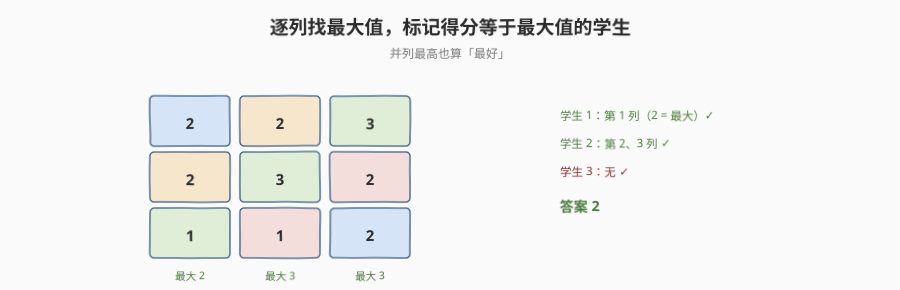
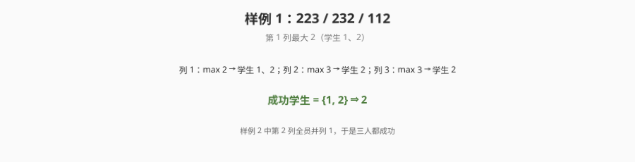

# Codeforces 152A 各科最高分学生 题解

## 1. 题目概述

- **题目链接**：https://codeforces.com/problemset/problem/152/A
- **比赛来源**：Codeforces Round 108 (Div. 2) · Problem A（UTC 2012-02-20）
- **难度**：900
- **标签**：实现
- **评测类型**：普通
- **限制**：时间 1 s / 内存 256 MB

**题意**：$n$ 个学生、$m$ 门课，第 $i$ 行第 $j$ 个字符是学生 $i$ 在第 $j$ 门课的分数（`1`–`9`）。若某门课学生 $i$ 的分数不低于任何其他学生（并列最高也算），称他在这门课"最好"。至少在一门课最好的学生叫"成功学生"，求成功学生人数。

**约束**：$n,m\le100$：逐列找最大值、标记即可。

## 2. 示例与观察

官方样例 1（输入 / 输出原样）：

```text
输入：
3 3
223
232
112

输出：
2
```

三列：第 1 列最大 2（学生 1、2），第 2 列最大 3（学生 2），第 3 列最大 3（学生 2）⇒ 学生 1、2 成功 ⇒ 2 ✓

官方样例 2（输入 / 输出原样）：

```text
输入：
3 5
91728
11828
11111

输出：
3
```

逐列：第 1 列最大 9（学生 1）、第 2 列最大 1（三人并列）、第 3 列最大 8（学生 2）、第 4 列最大 2（学生 1、2）、第 5 列最大 8（学生 2）⇒ 三人都至少在一门课并列最高 ⇒ 3 ✓



**观察**：判定是"按列"的——同一门课里，分数等于该列最大值的所有学生都算"这门课最好"。并列时**都算**。

## 3. 解题思路

1. 对每列 $j$：求最大值 $best_j$；
2. 对所有满足 `g[i][j] == best_j` 的学生打标记；
3. 统计被打标记的人数。



## 4. 正确性证明

**引理**：学生 $i$ 在第 $j$ 门课"最好"当且仅当 `g[i][j]` 等于第 $j$ 列的最大值。

**证明**：题面定义"没有学生在这门课分数更高"，即 $g_{ij}$ 不小于该列所有值，等价于等于该列的最大值（并列最高也满足）。∎

**定理**：程序输出正确。

**证明**：程序对每列求最大值并标记所有等于最大值的学生，由引理这恰是"在这门课最好"的学生集合；只要在一门课被标记即计入答案，正是"成功学生"的定义。每个学生只计一次（用布尔标记）。∎

## 5. 复杂度分析

- **时间**：$O(nm)\le10^4$，可忽略（实测 3 ms）。
- **空间**：$O(n)$。

## 6. 参考代码

### C++17

```cpp
#include <bits/stdc++.h>
using namespace std;

int main() {
    int n, m;
    if (scanf("%d %d", &n, &m) != 2) return 0;
    vector<string> g(n);
    for (int i = 0; i < n; i++) cin >> g[i];
    vector<char> ok(n, 0);
    for (int j = 0; j < m; j++) {
        char best = '0';
        for (int i = 0; i < n; i++) best = max(best, g[i][j]);
        for (int i = 0; i < n; i++) if (g[i][j] == best) ok[i] = 1;
    }
    int ans = 0;
    for (int i = 0; i < n; i++) ans += ok[i];
    printf("%d\n", ans);
    return 0;
}
```

### Python3

```python
import sys


def main():
    data = sys.stdin.read().split()
    n, m = int(data[0]), int(data[1])
    g = data[2:2 + n]
    ok = [False] * n
    for j in range(m):
        best = max(g[i][j] for i in range(n))
        for i in range(n):
            if g[i][j] == best:
                ok[i] = True
    print(sum(ok))


main()
```

## 7. 边界情况与易错点

1. **并列最高都算**：用 `==` 而不是"唯一最大"。
2. **每人只计一次**：用布尔标记，不要重复累加。
3. **读入**：每行的分数没有空格，要按字符串读（`scanf("%s")` 或 `split`）。
4. **$n=1$**：唯一学生每门课都最好 ⇒ 答案 1。
5. **$m=1$**：一列，所有并列最高者都成功。
6. **字符比较**：`'9' > '1'` 对单字符成立，可以直接比较字符。
7. **全同分**：所有人都是成功学生 ⇒ 答案 $n$。
8. **输出**：单个整数一行。

## 8. 验证记录

- **编译环境与命令**：`clang++ -std=c++17 -O2`；Python 3.9.6。
  `python3 codeforces/tools/verify_solution.py codeforces/contests/0101-0203/152/A_各科最高分学生.md`
- **官方样例**：$2/2$ 通过（`2`、`3`），C++ 与 Python 一致。
- **独立对拍**：另写"逐列求最大并集"的独立实现，对 $200$ 组随机成绩单（$n,m\le6$）比较，全部一致。
- **性能**：$n=m=100$ 单次约 3 ms。
- **图片校验**：2 张 SVG 均通过 `xml.etree.ElementTree.parse`。
- **复核状态**：verified。

## 相关题目与扩展

- [Codeforces 151B Phone Numbers](https://codeforces.com/problemset/problem/151/B)：同一时段的实现题。
- [Codeforces 152B Steps](https://codeforces.com/problemset/problem/152/B)：同场 B 题。
- [LeetCode 1380. 矩阵中的幸运数](https://leetcode.cn/problems/lucky-numbers-in-a-matrix/)：行列极值。

**延伸思考**：

1. **若要求"严格最高"**：把 `==` 换成"计数为 1 的最大值"。
2. **若要求每门课最好的学生名单**：按列输出即可。
3. **若分数有负数**：初始化最大值要用 $-\infty$。
