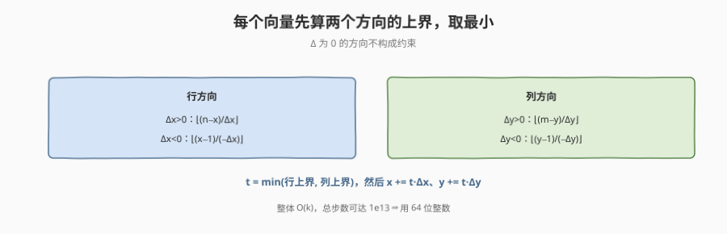

# Codeforces 152B 按向量走最多步 题解

## 1. 题目概述

- **题目链接**：https://codeforces.com/problemset/problem/152/B
- **比赛来源**：Codeforces Round 108 (Div. 2) · Problem B（UTC 2012-02-20）
- **难度**：1300
- **标签**：实现、二分
- **评测类型**：普通
- **限制**：时间 2 s / 内存 256 MB

**题意**：$n\times m$ 的场地，初始站在 $(x_c,y_c)$。依次给出 $k$ 个非零向量 $(\Delta x_i,\Delta y_i)$，对每个向量：沿着它**尽可能多地**走单步（一步就是加上一次该向量），直到再走一步会出界；记下走了几步并更新位置。问总共走了多少步。

**约束**：

- $n,m\le10^9$，$k\le10^4$，$|\Delta|\le10^9$：不能一步一步模拟，必须**一次算出**能走几步。
- 答案可能很大（$k\cdot10^9$），用 64 位整数。

## 2. 示例与观察

官方样例 1（输入 / 输出原样）：

```text
输入：
4 5
1 1
3
1 1
1 1
0 -2

输出：
4
```

- 从 $(1,1)$ 走 $(1,1)$：受行限制 $\lfloor(4-1)/1\rfloor=3$、受列限制 $\lfloor(5-1)/1\rfloor=4$ ⇒ 走 3 步到 $(4,4)$；
- 再走 $(1,1)$：行已到顶 ⇒ 0 步；
- 走 $(0,-2)$：只受列限制 $\lfloor(4-1)/2\rfloor=1$ ⇒ 1 步到 $(4,2)$；
- 合计 $3+0+1=4$ ✓

官方样例 2（输入 / 输出原样）：

```text
输入：
10 10
1 2
1
-1 0

输出：
0
```

在 $(1,2)$ 往 $-x$ 方向走：行限制 $\lfloor(1-1)/1\rfloor=0$ ⇒ 0 步 ✓



**观察**：对向量 $(\Delta x,\Delta y)$，能走的步数只由两个方向的边界决定：

$$t=\min\begin{cases}\lfloor(n-x)/\Delta x\rfloor, & \Delta x>0\\[2pt]\lfloor(x-1)/(-\Delta x)\rfloor, & \Delta x<0\\[2pt]+\infty, & \Delta x=0\end{cases},\qquad
\min\begin{cases}\lfloor(m-y)/\Delta y\rfloor, & \Delta y>0\\ \lfloor(y-1)/(-\Delta y)\rfloor, & \Delta y<0\\ +\infty, & \Delta y=0\end{cases}$$

然后 $x\mathrel{+}=t\Delta x$、$y\mathrel{+}=t\Delta y$、答案加 $t$。

## 3. 解题思路

按上式对每个向量 $O(1)$ 求 $t$，更新位置与总步数。整体 $O(k)$。


## 4. 正确性证明

**引理 1**：给定向量 $(\Delta x,\Delta y)$ 与位置 $(x,y)$，上式给出的 $t$ 是"最多能走的步数"。

**证明**：走 $t$ 步后位置为 $(x+t\Delta x,\ y+t\Delta y)$，必须在 $[1,n]\times[1,m]$ 内。每个方向（行、列）各自给出一个上界，且当 $\Delta$ 为 0 时该方向不构成约束；把两个上界取最小即得同时满足两方向的最大 $t$。整数除法下取整给出该上界，且取到 $t$ 时仍合法（因为 $t\Delta\le$ 可用空间）。∎

**引理 2**：按题意"尽可能多地走"之后，位置唯一。

**证明**：$t$ 由引理 1 唯一确定，位置随之唯一。∎

**定理**：程序输出的总步数正确。

**证明**：对每个向量，程序用引理 1 的 $t$ 更新位置并累加，由引理 2 与题意的过程一致；$k$ 个向量按给定顺序处理，累加即为总步数。∎

## 5. 复杂度分析

- **时间**：$O(k)\le10^4$ 次常数运算，可忽略（实测 3 ms）。
- **空间**：$O(1)$。

## 6. 参考代码

### C++17

```cpp
#include <bits/stdc++.h>
using namespace std;
typedef long long ll;

int main() {
    ll n, m, xc, yc;
    if (scanf("%lld %lld", &n, &m) != 2) return 0;
    scanf("%lld %lld", &xc, &yc);
    int k;
    scanf("%d", &k);
    ll total = 0;
    for (int i = 0; i < k; i++) {
        ll dx, dy;
        scanf("%lld %lld", &dx, &dy);
        ll steps = LLONG_MAX;
        if (dx > 0) steps = min(steps, (n - xc) / dx);
        else if (dx < 0) steps = min(steps, (xc - 1) / (-dx));
        if (dy > 0) steps = min(steps, (m - yc) / dy);
        else if (dy < 0) steps = min(steps, (yc - 1) / (-dy));
        total += steps;
        xc += steps * dx;
        yc += steps * dy;
    }
    printf("%lld\n", total);
    return 0;
}
```

### Python3

```python
import sys


def main():
    data = sys.stdin.read().split()
    n, m = int(data[0]), int(data[1])
    xc, yc = int(data[2]), int(data[3])
    k = int(data[4])
    p = 5
    total = 0
    for _ in range(k):
        dx, dy = int(data[p]), int(data[p + 1]); p += 2
        steps = 10 ** 30
        if dx > 0:
            steps = min(steps, (n - xc) // dx)
        elif dx < 0:
            steps = min(steps, (xc - 1) // (-dx))
        if dy > 0:
            steps = min(steps, (m - yc) // dy)
        elif dy < 0:
            steps = min(steps, (yc - 1) // (-dy))
        total += steps
        xc += steps * dx
        yc += steps * dy
    print(total)


main()
```

## 7. 边界情况与易错点

1. **$\Delta=0$**：该方向不构成约束，不要除零。
2. **除以 0**：必须先判断符号再除。
3. **坐标为 1 基**：行范围 $[1,n]$，所以向上走用 $(x-1)/|\Delta x|$。
4. **64 位**：$n,m\le10^9$、$k\le10^4$，总步数可达 $10^{13}$，必须 `long long`。
5. **负向除法**：C++ 的 `/` 对正数下取整没问题（这里分子分母都取正），但要把负号提出来。
6. **$t=0$**：位置不变，仍要继续处理下一个向量。
7. **$n=1$ 或 $m=1$**：单向移动可能立刻被卡住。
8. **读入**：$k$ 之后跟 $2k$ 个整数。

## 8. 验证记录

- **编译环境与命令**：`clang++ -std=c++17 -O2`；Python 3.9.6。
  `python3 codeforces/tools/verify_solution.py codeforces/contests/0101-0203/152/B_按向量走最多步.md`
- **官方样例**：$2/2$ 通过（`4`、`0`），C++ 与 Python 一致。
- **独立对拍**：另写"一步一步模拟直到出界"的暴力，对 $200$ 组随机小数据（$n,m\le12$、$k\le5$、$|\Delta|\le3$）比较，全部一致。
- **性能**：$k=10^4$ 单次 < 3 ms。
- **图片校验**：2 张 SVG 均通过 `xml.etree.ElementTree.parse`。
- **复核状态**：verified。

## 相关题目与扩展

- [Codeforces 152A Marks](https://codeforces.com/problemset/problem/152/A)：同场 A 题。
- [Codeforces 152C Pocket Book](https://codeforces.com/problemset/problem/152/C)：同场 C 题。
- [LeetCode 657. 机器人能否返回原点](https://leetcode.cn/problems/robot-return-to-origin/)：网格移动模拟。

**延伸思考**：

1. **若要求"恰好走到边界"**：只要 $t$ 使某方向顶到边界即可。
2. **若向量可以中途改变**：变成序列决策问题。
3. **若要求最少向量数量到达目标**：变成最短路/线性组合问题。
