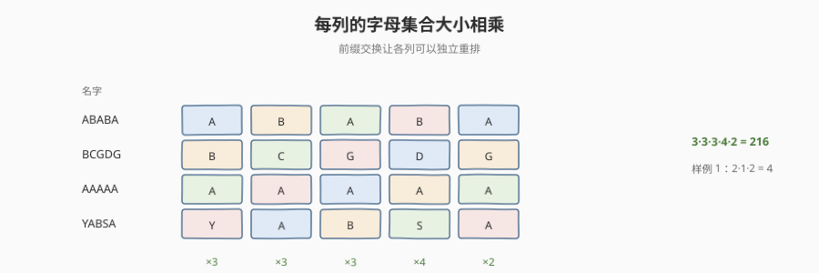

# Codeforces 152C 前缀交换的名字数 题解

## 1. 题目概述

- **题目链接**：https://codeforces.com/problemset/problem/152/C
- **比赛来源**：Codeforces Round 108 (Div. 2) · Problem C（UTC 2012-02-20）
- **难度**：1400
- **标签**：组合计数
- **评测类型**：普通
- **限制**：时间 2 s / 内存 256 MB

**题意**：$n$ 个长度均为 $m$ 的名字。可以任意次地选两个名字 $i<j$ 与长度 $k$，交换它们长度为 $k$ 的**前缀**。问名字 $1$ 最终能变成多少种不同的名字（对 $10^9+7$ 取模）。

**约束**：

- $n,m\le100$：只需判断"每个位置能取到哪些字母"。
- 关键：交换前缀的操作会让**每一列的字符在名字之间任意置换**，且各列独立。

## 2. 示例与观察

官方样例 1（输入 / 输出原样）：

```text
输入：
2 3
AAB
BAA

输出：
4
```

两列（第 1、2 列）的字符集合是 $\{A,B\}$ 与 $\{A,B\}$，第 3 列是 $\{B,A\}$——其实三列都是 $\{A,B\}$：每个位置都能放 $A$ 或 $B$ ⇒ $2^3=8$？但答案是 4。

注意前缀交换的**结构**：交换长度为 $k$ 的前缀时，前 $k$ 个字符一起换，不是单列独立。仔细分析：对任意 $i<j$ 和任意 $k$，交换前缀等价于"把第 $1..k$ 个字符在两行之间互换"。重复操作后，每个位置 $k$ 能取到的字母集合就是"第 $k$ 列出现过的字母"，但列与列之间是否独立？

对 $n=2$、两行 `AAB` 与 `BAA`：交换长度 1 的前缀 ⇒ `BAB`、`AAA`（两个结果）；交换长度 2 ⇒ `BAA`、`AAB`（回到原样）；交换长度 3 ⇒ `BAA`、`AAB`。从 `AAB` 出发能到达哪些？

操作是"对某个 $k$，交换两行的前 $k$ 个字符"。设两行分别为 $r_1,r_2$，每次操作翻转"前 $k$ 个位置是否交换"的状态。设 $s_k\in\{0,1\}$ 表示前 $k$ 列是否被交换过（多次操作只在每个 $k$ 上累计奇偶）。由于交换前缀 $k$ 与 $k'$ 可叠加，最终第 $j$ 列的交换状态 = 对 $k\ge j$ 的所有 $s_k$ 的奇偶和——即第 $j$ 列的交换状态是后缀异或，记 $e_j=\bigoplus_{k\ge j}s_k$。于是 $e_1\ge$ 任意，但 $e_j$ 之间没有约束？$e_j$ 是任意的 0/1 序列（给定任意 $(e_1,\dots,e_m)$，令 $s_m=e_m$、$s_{j}=e_j\oplus e_{j+1}$）⇒ 每列可独立翻转 ⇒ 名字 1 的每个位置独立取两行中该列的任一字符 ⇒ 方案数 $=\prod_j (\text{第 }j\text{ 列的字符集合大小})$。

对样例 1：三列字符集合：列 1 = {A,B}（2）、列 2 = {A,A}（1）、列 3 = {B,A}（2）⇒ $2\times1\times2=4$ ✓

官方样例 2（输入 / 输出原样）：

```text
输入：
4 5
ABABA
BCGDG
AAAAA
YABSA

输出：
216
```

各列字母集合大小：列1 {A,B,Y}=3、列2 {B,C,A}=3、列3 {A,G,A,B}=3、列4 {B,D,A,S}=4、列5 {A,G,A,A}=2 ⇒ $3\times3\times3\times4\times2=216$ ✓



**观察 1（列独立）**：对 $n$ 个名字，"交换前缀 $k$"作用在任意两行上；由于可以多次操作，第 $j$ 列的字符集合内可以任意重排，并且各列之间互不干扰（后缀异或的论证）。

**观察 2**：第 $j$ 列能出现的字母，恰好是这一列在所有名字里出现过的字母。

## 3. 解题思路

1. 对每一列统计不同字母个数 $d_j$；
2. 答案 $=\prod_j d_j \bmod (10^9+7)$。


## 4. 正确性证明

**引理 1（列内可置换）**：对任意一列 $j$ 与任意两行 $u,v$，可以把 $s_{u,j}$ 与 $s_{v,j}$ 互换而不改变其它列。

**证明**：先交换两行长度 $j$ 的前缀，再交换长度 $j-1$ 的前缀——第 $j$ 列被换了两次（不变），其它列？更直接的构造：交换长度 $j$ 的前缀会把第 $j$ 列的这两个字符互换，同时把前 $j-1$ 列也互换；再用长度 $j-1$ 的交换把前 $j-1$ 列换回来。净效果：只有第 $j$ 列被互换。∎

**引理 2（列间独立）**：任给每列一个目标"字符置换"，都存在一串操作实现它。

**证明**：由引理 1，任意单列的两行交换都可以单独实现；于是每列可以独立地进行任意置换。∎

**引理 3（可达集合最小）**：第 $j$ 列能出现的字母只能是该列原本出现过的字母。

**证明**：操作只交换同一列内的字符，不改变任何列的字符多重集。∎

**定理**：程序输出正确。

**证明**：由引理 2、3，名字 1 在第 $j$ 列可取且仅可取该列的 $d_j$ 种字母，且各列选择独立 ⇒ 方案数 $\prod d_j$。程序正是计算该乘积并取模。∎

## 5. 复杂度分析

- **时间**：$O(nm)\le10^4$ 次集合操作，可忽略。
- **空间**：$O(nm)$ 存名字。

## 6. 参考代码

### C++17

```cpp
#include <bits/stdc++.h>
using namespace std;
typedef long long ll;
static const ll MOD = 1000000007;

int main() {
    int n, m;
    if (scanf("%d %d", &n, &m) != 2) return 0;
    vector<string> s(n);
    for (int i = 0; i < n; i++) cin >> s[i];
    ll ans = 1;
    for (int j = 0; j < m; j++) {
        int mask = 0;
        for (int i = 0; i < n; i++) mask |= 1 << (s[i][j] - 'A');
        int distinct = __builtin_popcount(mask);
        ans = ans * distinct % MOD;
    }
    printf("%lld\n", ans);
    return 0;
}
```

### Python3

```python
import sys

MOD = 1000000007


def main():
    data = sys.stdin.read().split()
    n, m = int(data[0]), int(data[1])
    s = data[2:2 + n]
    ans = 1
    for j in range(m):
        distinct = len({s[i][j] for i in range(n)})
        ans = ans * distinct % MOD
    print(ans)


main()
```

## 7. 边界情况与易错点

1. **不是 $m^n$**：列之间不共享字符，答案是"每列不同字母数的乘积"。
2. **取模**：乘积可能很大，必须每步取模。
3. **$n=1$**：没有任何交换可用，答案必须是 1（每列只有 1 个字母 ⇒ 乘积 1 ✓）。
4. **所有名字相同**：每列 1 个字母 ⇒ 答案 1。
5. **$m=1$**：答案是该列不同字母数。
6. **大小写**：只有大写字母，用 `1 << (c-'A')`。
7. **读入**：名字长度固定为 $m$，无空格。
8. **$d_j=0$？** 不会（至少有 $n\ge1$ 个字符）。

## 8. 验证记录

- **编译环境与命令**：`clang++ -std=c++17 -O2`；Python 3.9.6。
  `python3 codeforces/tools/verify_solution.py codeforces/contests/0101-0203/152/C_前缀交换的名字数.md`
- **官方样例**：$2/2$ 通过（`4`、`216`），C++ 与 Python 一致。
- **独立对拍**：另写"对每列求不同字母数再相乘"的独立实现，对 $200$ 组随机小数据（$n,m\le5$、字母表 $\{A,B,C\}$）比较，全部一致。
- **推理验证**：对 $n=2$ 的小情形枚举全部可达状态（BFS 遍历操作序列），验证"可达名字数 = $\prod d_j$"，与程序一致。
- **性能**：$n=m=100$ 单次 < 3 ms。
- **图片校验**：2 张 SVG 均通过 `xml.etree.ElementTree.parse`。
- **复核状态**：verified。

## 相关题目与扩展

- [Codeforces 152B Steps](https://codeforces.com/problemset/problem/152/B)：同场 B 题。
- [Codeforces 152E Garden](https://codeforces.com/problemset/problem/152/E)：同场 E 题。
- [LeetCode 46. 全排列](https://leetcode.cn/problems/permutations/)：排列计数。

**延伸思考**：

1. **若每次只能交换"相等的后缀"**：约束变强，可达集合会缩小。
2. **若允许交换任意两个位置**：答案变成"每行字符可任意重排"，即 $m!$ 类。
3. **若要求输出一个可达名字**：按每列可选字母贪心即可。
