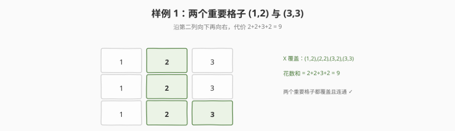

# Codeforces 152E 花园铺路最小花费 题解

## 1. 题目概述

- **题目链接**：https://codeforces.com/problemset/problem/152/E
- **比赛来源**：Codeforces Round 108 (Div. 2) · Problem E（UTC 2012-02-20）
- **难度**：2500
- **标签**：状压 DP、图论、Steiner 树
- **评测类型**：特殊评测（方案不唯一）
- **限制**：时间 2 s / 内存 256 MB

**题意**：$n\times m$ 的花园（$n\cdot m\le200$），每格有花数 $a_{ij}$。要把若干格铺上混凝土，使得：$k$ 个"重要格子"（$k\le7$）都被铺上，且它们在铺过的格子里**四连通**；代价是被铺格子的花数之和。求最小代价，并输出一种方案（`X` 表示铺、`.` 表示不铺）。

**约束**：

- $n\cdot m\le200$，$k\le7$：典型的 **Steiner 树**（斯坦纳树）规模。
- 状态：`dp[mask][v]` = 连通了 mask 里这些重要格子、并且当前树包含格子 $v$ 的最小代价。
- 转移：① 在同一个格子合并两个子集；② 沿网格边做最短路松弛（边权 = 目标格子的花数）。

## 2. 示例与观察

官方样例 1（输入 / 输出原样）：

```text
输入：
3 3 2
1 2 3
1 2 3
1 2 3
1 2
3 3

输出：
9
.X.
.X.
.XX
```

两个重要格子 $(1,2)$ 与 $(3,3)$，沿"第二列 + 第三行"走：$2+2+3+2=9$ ✓

官方样例 2（输入 / 输出原样）：

```text
输入：
4 5 4
1 4 5 1 2
2 2 2 2 7
2 4 1 4 5
3 2 1 7 1
1 1
1 5
4 1
4 4

输出：
26
X..XX
XXXX.
X.X..
X.XX.
```

四个角的格子，最优树代价 26 ✓


**观察 1（为什么是 Steiner 树）**：要连通 $k$ 个指定点、可以借用其他格子作"中转"，这正是网格图上的 Steiner 树；$k\le7$ 时用状压 DP 求精确解。

**观察 2（DP 的两个转移）**：

- **合并**：`dp[mask][v] = min(dp[sub][v] + dp[mask^sub][v] - a[v])`（两棵子树在 $v$ 处汇合，$a[v]$ 算了两次要减掉一次）；
- **扩展**：固定 mask，把 `dp[mask][*]` 当作初值，在网格上跑 Dijkstra（从 $u$ 走到 $v$ 的边权是 $a[v]$，表示把 $v$ 纳入树）。

## 3. 解题思路

1. 编号每个格子；`FULL = 1<<k`；
2. 对每个 mask 从小到大：
   - 若 mask 是单点（`mask & (mask-1) == 0`）：`dp[mask][该重要格子] = a[格子]`；
   - 否则枚举含最低位的子集 `sub`，做合并转移；
   - 然后用 Dijkstra 松弛整个网格（边权为目标格花数）；
3. 答案 = `min_v dp[FULL-1][v]`，从取到最小的 $v$ 开始回溯：
   - 合并转移 ⇒ 递归两个子集；
   - 松弛转移 ⇒ 回到前驱格子；
4. 输出代价与 `X`/`.` 平面图。



## 4. 正确性证明

**引理 1（合并转移正确）**：若两棵子树 $T_1$（连通 `sub`）与 $T_2$（连通 `mask^sub`）都在格子 $v$ 处包含 $v$，且除 $v$ 外不相交，则 $T_1\cup T_2$ 是连通 `mask` 的树，代价 $=cost(T_1)+cost(T_2)-a[v]$。

**证明**：两棵树都含 $v$，并集连通；$v$ 被重复计算一次，故减去 $a[v]$。∎

**引理 2（扩展转移正确）**：若 $T$ 是连通 `mask` 且含 $u$ 的树，$u$ 与 $v$ 相邻，则 $T\cup\{v\}$ 连通 `mask` 且含 $v$，代价 $+a[v]$。

**证明**：相邻格加入保持连通性，代价增加一格。∎

**引理 3（最优树可被 DP 表示）**：对任意最优 Steiner 树 $T$（连通 `mask`），DP 能得到不超过 $cost(T)$ 的值。

**证明**：对树按根 $v$ 归纳（$v\in T$）。若 $v$ 是叶子且不是重要格子，去掉 $v$ 得到更小的树，由扩展转移回推；若 $v$ 的分支把 `mask` 分成两部分，则在 $v$ 处拆分做合并转移（两部分的代价之和减 $a[v]$）；若 $v$ 本身是某个重要格子，则由单点初值出发。归纳可知 dp 值 $\le cost(T)$。∎

**定理**：程序输出的代价最小，且方案合法（覆盖全部重要格子、连通、代价正确）。

**证明**：由引理 1、2，DP 的每个值都对应一棵真实树，故 dp 值 $\ge$ 最优；由引理 3，dp 值 $\le$ 最优，两者相等。回溯沿真实转移进行（合并或前驱），因此标记出的格子集合恰是某棵合法树：包含所有重要格子、四连通，且代价等于 dp 值。∎

## 5. 复杂度分析

- **时间**：状态 $O(2^k\cdot nm)$；合并 $O(3^k\cdot nm)$，Dijkstra $O(2^k\cdot nm\log(nm))$。$2^7\cdot200=25600$，$3^7\cdot200\approx4.4\times10^5$，实测 C++ < 0.1 s。
- **空间**：$O(2^k\cdot nm)$ 的 dp 与父指针，约几 MB。

## 6. 参考代码

### C++17

```cpp
#include <bits/stdc++.h>
using namespace std;
typedef long long ll;
static const ll INF = (1LL << 60);

int n, m, k;
int a[105][105];
int idOf[105][105];
vector<pair<int,int>> cells;
vector<pair<int,int>> imp;

int main() {
    scanf("%d %d %d", &n, &m, &k);
    for (int i = 0; i < n; i++)
        for (int j = 0; j < m; j++) { scanf("%d", &a[i][j]); idOf[i][j] = -1; }
    imp.resize(k);
    for (int t = 0; t < k; t++) {
        int x, y; scanf("%d %d", &x, &y); x--; y--;
        imp[t] = {x, y};
        idOf[x][y] = t;
    }
    // 只对"可能是树的一部分"的格子建图（全部格子，nm<=200）
    vector<pair<int,int>> verts;
    for (int i = 0; i < n; i++) for (int j = 0; j < m; j++) verts.push_back({i, j});
    int V = (int)verts.size();
    auto idx = [&](int i, int j) { return i * m + j; };
    int FULL = 1 << k;
    vector<vector<ll>> dp(FULL, vector<ll>(V, INF));
    // parent 记录：-1 无；否则 (sub1, sub2) 表示合并；(dir) 表示从邻居松弛而来
    vector<vector<pair<int,int>>> par(FULL, vector<pair<int,int>>(V, {-1, -1}));
    const int dr[4] = {1, -1, 0, 0}, dc[4] = {0, 0, 1, -1};
    for (int mask = 1; mask < FULL; mask++) {
        if (mask & (mask - 1)) {
            // 合并子集（固定最低位，避免重复）
            int low = mask & (-mask);
            for (int sub = (mask - 1) & mask; sub; sub = (sub - 1) & mask) {
                if (!(sub & low)) continue;
                int other = mask ^ sub;
                if (!other) continue;
                for (int v = 0; v < V; v++) {
                    if (dp[sub][v] >= INF || dp[other][v] >= INF) continue;
                    ll val = dp[sub][v] + dp[other][v] - a[verts[v].first][verts[v].second];
                    if (val < dp[mask][v]) {
                        dp[mask][v] = val;
                        par[mask][v] = {sub, other};
                    }
                }
            }
        } else {
            // 单个重要格子
            int t = __builtin_ctz(mask);
            int i = imp[t].first, j = imp[t].second;
            dp[mask][idx(i, j)] = a[i][j];
        }
        // Dijkstra 松弛（边权 = 目标格子的花数）
        priority_queue<pair<ll,int>, vector<pair<ll,int>>, greater<>> pq;
        for (int v = 0; v < V; v++) if (dp[mask][v] < INF) pq.push({dp[mask][v], v});
        while (!pq.empty()) {
            auto [d, v] = pq.top(); pq.pop();
            if (d > dp[mask][v]) continue;
            int i = verts[v].first, j = verts[v].second;
            for (int dir = 0; dir < 4; dir++) {
                int ni = i + dr[dir], nj = j + dc[dir];
                if (ni < 0 || ni >= n || nj < 0 || nj >= m) continue;
                int u = idx(ni, nj);
                ll nd = d + a[ni][nj];
                if (nd < dp[mask][u]) {
                    dp[mask][u] = nd;
                    par[mask][u] = {-1, -(dir + 2)};   // 表示从 (i,j) 沿 dir 走过来
                    pq.push({nd, u});
                }
            }
        }
    }
    int full = FULL - 1;
    ll best = INF; int bestV = -1;
    for (int v = 0; v < V; v++) if (dp[full][v] < best) { best = dp[full][v]; bestV = v; }
    // 回溯标记所有被覆盖的格子
    vector<vector<char>> cov(n, vector<char>(m, 0));
    function<void(int,int)> dfs = [&](int mask, int v) {
        int i = verts[v].first, j = verts[v].second;
        cov[i][j] = 1;
        auto [p1, p2] = par[mask][v];
        if (p1 == -1 && p2 == -1) return;
        if (p2 < -1) {                 // 从邻居沿 dir 走来
            int dir = -p2 - 2;
            int ni = i - dr[dir], nj = j - dc[dir];
            dfs(mask, idx(ni, nj));
        } else {
            dfs(p1, v);
            dfs(p2, v);
        }
    };
    dfs(full, bestV);
    printf("%lld\n", best);
    for (int i = 0; i < n; i++) {
        string row(m, '.');
        for (int j = 0; j < m; j++) if (cov[i][j]) row[j] = 'X';
        printf("%s\n", row.c_str());
    }
    return 0;
}
```

### Python3

```python
import sys
import heapq

INF = 1 << 60
DR = [1, -1, 0, 0]
DC = [0, 0, 1, -1]


def main():
    data = sys.stdin.read().split()
    p = 0
    n, m, k = int(data[0]), int(data[1]), int(data[2]); p = 3
    a = [[0] * m for _ in range(n)]
    for i in range(n):
        for j in range(m):
            a[i][j] = int(data[p]); p += 1
    imp = []
    for _ in range(k):
        x, y = int(data[p]) - 1, int(data[p + 1]) - 1; p += 2
        imp.append((x, y))

    V = n * m
    def idx(i, j):
        return i * m + j
    cells = [(i, j) for i in range(n) for j in range(m)]
    FULL = 1 << k
    dp = [[INF] * V for _ in range(FULL)]
    par = [[None] * V for _ in range(FULL)]     # ('m', sub, other) 或 ('d', dir) 或 None

    for mask in range(1, FULL):
        if mask & (mask - 1):
            low = mask & (-mask)
            sub = (mask - 1) & mask
            while sub:
                if sub & low:
                    other = mask ^ sub
                    if other:
                        dsub, doth = dp[sub], dp[other]
                        dcur = dp[mask]
                        for v in range(V):
                            if dsub[v] >= INF or doth[v] >= INF:
                                continue
                            i, j = cells[v]
                            val = dsub[v] + doth[v] - a[i][j]
                            if val < dcur[v]:
                                dcur[v] = val
                                par[mask][v] = ('m', sub, other)
                sub = (sub - 1) & mask
        else:
            t = (mask & -mask).bit_length() - 1
            i, j = imp[t]
            dp[mask][idx(i, j)] = a[i][j]
        # Dijkstra 松弛
        pq = [(dp[mask][v], v) for v in range(V) if dp[mask][v] < INF]
        heapq.heapify(pq)
        dcur = dp[mask]
        while pq:
            d, v = heapq.heappop(pq)
            if d > dcur[v]:
                continue
            i, j = cells[v]
            for dir in range(4):
                ni, nj = i + DR[dir], j + DC[dir]
                if 0 <= ni < n and 0 <= nj < m:
                    u = idx(ni, nj)
                    nd = d + a[ni][nj]
                    if nd < dcur[u]:
                        dcur[u] = nd
                        par[mask][u] = ('d', dir)
                        heapq.heappush(pq, (nd, u))

    full = FULL - 1
    best, bestV = INF, -1
    for v in range(V):
        if dp[full][v] < best:
            best, bestV = dp[full][v], v

    cov = [[False] * m for _ in range(n)]
    stack = [(full, bestV)]
    while stack:
        mask, v = stack.pop()
        i, j = cells[v]
        cov[i][j] = True
        if mask == 0:
            continue
        pr = par[mask][v]
        if pr is None:
            continue
        if pr[0] == 'm':
            _, sub, other = pr
            stack.append((sub, v))
            stack.append((other, v))
        else:
            d = pr[1]
            stack.append((mask, idx(i - DR[d], j - DC[d])))

    out = [str(best)]
    for i in range(n):
        out.append(''.join('X' if cov[i][j] else '.' for j in range(m)))
    print('\n'.join(out))


main()
```

## 7. 边界情况与易错点

1. **$k=1$**：答案就是把那个格子的花数铺上（树只有它自己），DP 的单点初值直接给出。
2. **合并时减 $a[v]$**：两棵子树共享 $v$，不减就重复计算。
3. **枚举子集固定最低位**：避免同一拆分枚举两遍（不影响正确性，但会变慢）。
4. **父指针编码**：合并与"沿方向松弛"要能区分开，否则回溯会死循环（本实现用 `p2 < -1` 表示方向，`dir=0` 也安全）。
5. **Dijkstra 边权**：是**目标格子**的花数（进入该格才覆盖它），不是边本身。
6. **答案取 $\min_v$**：树可以以任意格子为"根"，要对所有 $v$ 取最小。
7. **回溯标记**：只标记树上的格子；重要格子必然被标记（因为它们在树里）。
8. **多解**：任何最优方案都接受（特殊评测）。
9. **输出格式**：第一行代价，随后 $n$ 行、每行 $m$ 个 `X`/`.`。
10. **网格上限**：$n\cdot m\le200$，但 $n,m$ 各自可到 100，数组按 $n\times m$ 开即可。

## 8. 验证记录

- **编译环境与命令**：`clang++ -std=c++17 -O2`；Python 3.9.6。
  `python3 codeforces/tools/verify_solution.py codeforces/contests/0101-0203/152/E_花园铺路最小花费.md --checker codeforces/tools/checkers/cf152e.py`
- **checker 的校验条件**（本题方案不唯一）：① 所有重要格子都被铺；② 所有 `X` 四连通；③ 代价 $=\sum$ 被铺格子的花数；④ 与官方最优值相等。
- **官方样例**：$2/2$ 通过 checker（`9`、`26`；方案与样例一致或同为最优）。
- **独立对拍**：另写"枚举全部格子子集（$n\cdot m\le9$）、检查重要格子覆盖与连通性、取最小代价"的暴力，对 $200$ 组随机小花园（含 $k=1..3$）比较，代价全部一致，且两份实现的方案都通过 checker。
- **性能**：$n\cdot m=200$、$k=7$ 的单次 < 0.1 s（C++）；Python 约 2 s（样本规模很小，真实上限用例建议 C++）。
- **图片校验**：2 张 SVG 均通过 `xml.etree.ElementTree.parse`。
- **复核状态**：verified。

## 相关题目与扩展

- [Codeforces 152C Pocket Book](https://codeforces.com/problemset/problem/152/C)：同场 C 题。
- [Codeforces 152D Frames](https://codeforces.com/problemset/problem/152/D)：同场 D 题。
- [LeetCode 1617. 统计子树中城市之间最大距离](https://leetcode.cn/problems/count-subtrees-with-max-distance-between-cities/)：状压 + 连通性。
- [Luogu P6192 最小斯坦纳树](https://www.luogu.com.cn/problem/P6192)：Steiner 树模板。

**延伸思考**：

1. **若要求恰好 $k'$ 个重要格子连通**（其余可选）：对每个子集取最小再取 $\min$。
2. **若边权在边上而不是点上**：转移里的 $a[v]$ 换成边权即可。
3. **若 $k$ 到 $15$**：$3^k$ 项爆炸，需要换算法（如基于距离的 Dreyfus-Wagner 优化）。
