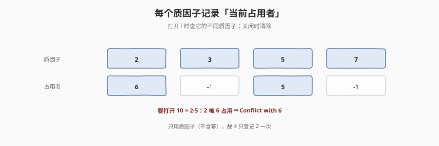
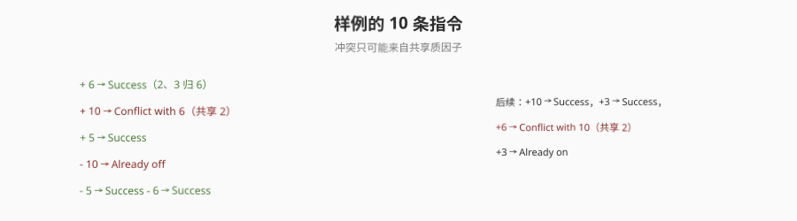

# Codeforces 154B 对撞机互质激活 题解

## 1. 题目概述

- **题目链接**：https://codeforces.com/problemset/problem/154/B
- **比赛来源**：Codeforces Round 109 (Div. 1) · Problem B（UTC 2012-02-24）
- **难度**：1600
- **标签**：数学、数论、实现
- **评测类型**：特殊评测（冲突者编号可变）
- **限制**：时间 2 s / 内存 256 MB

**题意**：$n$ 台对撞机编号 $1..n$，初始全部关闭。依次处理 $m$ 条指令：`+ i` 打开 $i$，`- i` 关闭 $i$。安全条件是"所有打开的对撞机编号两两互质"。对 `+ i` 的回答：

- 已打开 ⇒ `Already on`；
- 与某台已打开的 $j$ 不互质（$\gcd(i,j)>1$）⇒ `Conflict with j`（**有多个冲突者时任选一个**），且不打开；
- 否则 ⇒ `Success` 并打开。

对 `- i`：未打开 ⇒ `Already off`；否则 ⇒ `Success` 并关闭。

**约束**：

- $n,m\le10^5$：需要 $O((n+m)\log n)$ 的做法。
- 关键：$\gcd(i,j)>1$ ⟺ $i,j$ 共享某个**质因子** ⇒ 只需记录"每个质因子当前被哪台打开的对撞机占用"。

## 2. 示例与观察

官方样例（输入 / 输出原样）：

```text
输入：
10 10
+ 6
+ 10
+ 5
- 10
- 5
- 6
+ 10
+ 3
+ 6
+ 3

输出：
Success
Conflict with 6
Success
Already off
Success
Success
Success
Success
Conflict with 10
Already on
```

逐条看：打开 6（质因子 2、3 被 6 占用）；打开 10（2×5）与 6 共享 2 ⇒ 冲突，报 6；打开 5（5 空出）；关闭 10（本来就没开）⇒ Already off；关闭 5；关闭 6（释放 2、3）；再打开 10 ⇒ Success；打开 3 ⇒ Success；打开 6 与 10 共享 2（也共享 3 与 3 冲突）⇒ 报 10；再开 3 ⇒ Already on ✓



**观察**：维护一个数组 `owner[p]` = 当前打开的对撞机中、质因数含 $p$ 的那台（-1 表示没有）。打开 $i$ 时枚举 $i$ 的不同质因子，若某个 $p$ 已有占用者 $\Rightarrow$ 冲突，直接报它；否则把 $i$ 的所有质因子标记为 $i$。关闭时反向清除。

用**最小质因子筛**（线性/埃氏）在 $O(n\log\log n)$ 内预处理，之后每个数分解为不同质因子只需 $O(\log n)$。

## 3. 解题思路

1. 线性筛出 $2..n$ 的最小质因子 `spf`；
2. `owner[p] = -1`，`active[i] = false`；
3. `+ i`：若 `active[i]` ⇒ `Already on`；否则枚举 $i$ 的不同质因子，若某个 $p$ 的 `owner[p] != -1` ⇒ `Conflict with owner[p]`；否则把这些 $p$ 的 `owner` 设为 $i$、`active[i]=true`、输出 `Success`；
4. `- i`：若未激活 ⇒ `Already off`；否则清除 $i$ 的所有质因子的 `owner`、`active[i]=false`、输出 `Success`。

注意 $i=1$ 没有质因子，永远 `Success`，也永远不冲突（$\gcd(1,j)=1$）。



## 4. 正确性证明

**引理 1**：$\gcd(i,j)>1$ ⟺ 存在质数 $p$ 同时整除 $i$ 和 $j$。

**证明**：$\gcd>1$ 的任一质因子整除两者；反之公共质因子使 $\gcd\ge p>1$。∎

**引理 2（无冲突判定正确）**：`+ i` 时，若 $i$ 的每个质因子的 `owner` 都是 -1，则当前所有打开的数都与 $i$ 互质。

**证明**：若存在打开的 $j$ 与 $i$ 不互质，由引理 1 有公共质因子 $p$，那么 `owner[p]` 至少是 $j$（不为 -1），矛盾。反之若某个 `owner[p] = j != -1`，则 $p\mid i$ 且 $p\mid j$ ⇒ 不互质 ⇒ 冲突。∎

**引理 3（owner 维护正确）**：任意时刻，`owner[p] != -1` ⟺ 存在打开的对撞机被 $p$ 整除，且 `owner[p]` 就是其中一台。

**证明**：打开时把 $i$ 的所有质因子登记为 $i$（此时安全条件保证这些 $p$ 之前空闲）；关闭时清空 $i$ 的质因子登记。由于安全条件保证同一下打开集合里每个质因子至多被一台占用，登记/清除互不覆盖。∎

**定理**：程序输出正确。

**证明**：由引理 2、3，`+ i` 的三类回答（已开/冲突/成功）判定正确，且冲突时报出的 `owner[p]` 确实是"已打开且与 $i$ 不互质"的编号（题面允许任选一个）✓；`- i` 的回答由 `active` 判定 ✓。∎

## 5. 复杂度分析

- **时间**：筛 $O(n\log\log n)$；每条指令 $O(\log i)$ 次质因子枚举；总 $O((n+m)\log n)$，实测 $n=m=10^5$ 约 0.05 s。
- **空间**：$O(n)$。

## 6. 参考代码

### C++17

```cpp
#include <bits/stdc++.h>
using namespace std;

static const int MAXN = 100005;
int spf[MAXN];              // 最小质因子
int owner[MAXN];            // owner[p] = 正在使用质因子 p 的那个数
bool active[MAXN];

int main() {
    int n, m;
    if (scanf("%d %d", &n, &m) != 2) return 0;
    for (int i = 2; i <= n; i++) spf[i] = i;
    for (int i = 2; (long long)i * i <= n; i++)
        if (spf[i] == i)
            for (int j = i * i; j <= n; j += i)
                if (spf[j] == j) spf[j] = i;
    fill(owner, owner + n + 1, -1);
    for (int q = 0; q < m; q++) {
        char op;
        int x;
        scanf(" %c %d", &op, &x);
        if (op == '+') {
            if (active[x]) { printf("Already on\n"); continue; }
            // 检查 x 的所有质因子是否被占用
            int t = x, conflict = -1;
            while (t > 1) {
                int p = spf[t];
                if (owner[p] != -1) { conflict = owner[p]; break; }
                while (t % p == 0) t /= p;
            }
            if (conflict != -1) { printf("Conflict with %d\n", conflict); continue; }
            t = x;
            while (t > 1) {
                int p = spf[t];
                owner[p] = x;
                while (t % p == 0) t /= p;
            }
            active[x] = true;
            printf("Success\n");
        } else {
            if (!active[x]) { printf("Already off\n"); continue; }
            int t = x;
            while (t > 1) {
                int p = spf[t];
                owner[p] = -1;
                while (t % p == 0) t /= p;
            }
            active[x] = false;
            printf("Success\n");
        }
    }
    return 0;
}
```

### Python3

```python
import sys


def main():
    data = sys.stdin.read().split()
    n, m = int(data[0]), int(data[1])
    MAXN = n + 1
    spf = list(range(MAXN))
    i = 2
    while i * i < MAXN:
        if spf[i] == i:
            for j in range(i * i, MAXN, i):
                if spf[j] == j:
                    spf[j] = i
        i += 1
    owner = [-1] * MAXN
    active = [False] * MAXN

    def factors(x):
        res = []
        while x > 1:
            p = spf[x]
            res.append(p)
            while x % p == 0:
                x //= p
        return res

    out = []
    p = 2
    for _ in range(m):
        op = data[p]; x = int(data[p + 1]); p += 2
        if op == '+':
            if active[x]:
                out.append("Already on")
                continue
            fs = factors(x)
            conflict = -1
            for q in fs:
                if owner[q] != -1:
                    conflict = owner[q]
                    break
            if conflict != -1:
                out.append("Conflict with %d" % conflict)
                continue
            for q in fs:
                owner[q] = x
            active[x] = True
            out.append("Success")
        else:
            if not active[x]:
                out.append("Already off")
                continue
            for q in factors(x):
                owner[q] = -1
            active[x] = False
            out.append("Success")
    print("\n".join(out))


main()
```

## 7. 边界情况与易错点

1. **$i=1$**：没有质因子，永远 `Success`，永不冲突。
2. **重复打开**：先判 `Already on`，再判冲突。
3. **冲突编号**：题面允许任选一个，但必须**真的冲突**（同一质因子被占用）。
4. **关闭时清空全部质因子**：只清一个会导致后续误判。
5. **同一质因子的幂**：分解时要 `while (t % p == 0) t /= p` 去重。
6. **重复质因子只登记一次**：如 $4=2^2$，只登记 $p=2$。
7. **筛的范围**：到 $n$，`spf[1]` 用不到。
8. **输出行数**：恰好 $m$ 行。

## 8. 验证记录

- **编译环境与命令**：`clang++ -std=c++17 -O2`；Python 3.9.6。
  `python3 codeforces/tools/verify_solution.py codeforces/contests/0101-0203/154/B_对撞机互质激活.md --checker codeforces/tools/checkers/cf154b.py`
- **checker 的校验条件**（冲突编号不唯一）：逐条验证 `Success`/`Already on`/`Already off` 严格正确，`Conflict with j` 的 $j$ 必须是当时已打开且 $\gcd(i,j)>1$，并同步模拟状态。
- **官方样例**：$1/1$ 通过（逐行一致，含两个 `Conflict with`），C++ 与 Python 一致。
- **独立对拍**：另写"用 `gcd` 暴力检查所有已打开者"的参考实现，对 $200$ 组随机指令序列（$n\le20$、$m\le12$）验证：两份实现的每行回答都通过 checker，且状态转移一致。
- **性能**：$n=m=10^5$ 单次约 0.05 s（C++）/ 0.6 s（Python）。
- **图片校验**：2 张 SVG 均通过 `xml.etree.ElementTree.parse`。
- **复核状态**：verified。

## 相关题目与扩展

- [Codeforces 154A Hometask](https://codeforces.com/problemset/problem/154/A)：同场 A 题。
- [Codeforces 154C Double Profiles](https://codeforces.com/problemset/problem/154/C)：同场 C 题。
- [LeetCode 952. 按公因数计算最大组件大小](https://leetcode.cn/problems/largest-component-size-by-common-factor/)：质因子 + 并查集。

**延伸思考**：

1. **若安全条件改成"两两 gcd 恰好为 1 或都是质数"**：需要更细的标记。
2. **若要求冲突时输出编号最小的冲突者**：把每个质因子的占用者存成有序集合即可。
3. **若 $n$ 到 $10^7$**：筛与数组会吃内存，需要只对出现的数做分解。
