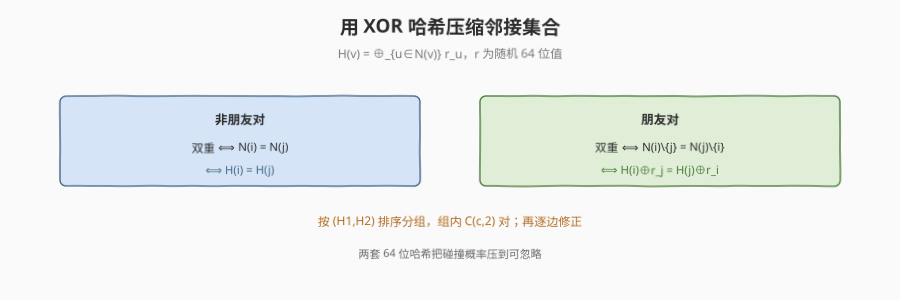

# Codeforces 154C 双重档案计数 题解

## 1. 题目概述

- **题目链接**：https://codeforces.com/problemset/problem/154/C
- **比赛来源**：Codeforces Round 109 (Div. 1) · Problem C（UTC 2012-02-24）
- **难度**：2300
- **标签**：图论、哈希、排序
- **评测类型**：普通
- **限制**：时间 3 s / 内存 256 MB

**题意**：$n$ 个档案（$n\le10^6$）、$m$ 对朋友关系（$m\le10^6$，无重边无自环）。称 $i,j$（$i\ne j$）是"双重"，若对任意 $k\notin\{i,j\}$，$k$ 与 $i$ 是朋友 ⟺ $k$ 与 $j$ 是朋友（$i,j$ 之间是否有边无所谓）。求无序双重对的数量。

**约束**：

- $n,m\le10^6$：不能存 $n^2$ 的邻接矩阵，也不能对每对做 $O(n)$ 比较。
- 关键：把"邻接集合"压缩成**哈希值**，再比较哈希。

## 2. 示例与观察

官方样例 1（输入 / 输出原样）：

```text
输入：
3 3
1 2
2 3
1 3

输出：
3
```

三角形：任意两点的"其它邻接点"都只含第三个点 ⇒ 三对全是双重 ⇒ 3 ✓

官方样例 2（输入 / 输出原样）：

```text
输入：
3 0

输出：
3
```

没有边：任何两点的邻接集合都为空 ⇒ 三对全是双重 ✓

官方样例 3（输入 / 输出原样）：

```text
输入：
4 1
1 3

输出：
2
```

边 $1-3$：$N(1)=N(3)=\{3,1\}$——去掉对方后都为空 ⇒ (1,3) 是双重；$2,4$ 邻接为空 ⇒ (2,4) 是双重；其它对不满足 ⇒ 2 ✓



**观察 1（两种情况）**：设 $N(v)$ 为 $v$ 的邻接集合。

- $i,j$ **不是朋友**：条件 ⟺ $N(i)=N(j)$（因为 $i\notin N(j)$ 且 $j\notin N(i)$）。
- $i,j$ **是朋友**：$i\in N(j)$、$j\in N(i)$，条件 ⟺ $N(i)\setminus\{j\}=N(j)\setminus\{i\}$。

**观察 2（哈希）**：给每个点 $v$ 一个随机 64 位值 $r_v$，定义

$$H(v)=\bigoplus_{u\in N(v)} r_u .$$

- 非朋友对：$N(i)=N(j)\Rightarrow H(i)=H(j)$；反之（哈希无碰撞时）也对。
- 朋友对：$H(i)\oplus r_j = H(j)\oplus r_i$ 等价于 $N(i)\setminus\{j\}=N(j)\setminus\{i\}$。

于是把点按 $H$ 排序分组，组内两两都是双重（非朋友情形），再单独修正"同一组内的朋友对"与"满足修正等式的朋友对"。

## 3. 解题思路

1. 读入所有边，同时用 XOR 累积 $H$（两套独立的 64 位随机值，降低碰撞概率）；
2. 按 $(H_1,H_2)$ 排序，同一组的点数 $c$ 贡献 $\binom{c}{2}$；
3. 对每条边 $(u,v)$：
   - 若 $H(u)=H(v)$（两套都相等）：它们被分进同一组、但**并不**满足朋友情形的条件 ⇒ 从答案中减 1；
   - 若 $H_1(u)\oplus r_1(v)=H_1(v)\oplus r_1(u)$ 且 $H_2$ 同理 ⇒ 朋友且刨掉对方后邻接相同 ⇒ 答案加 1；
4. 输出答案。


## 4. 正确性证明

**引理 1（非朋友判定）**：若 $i,j$ 不是朋友，则"双重" ⟺ $N(i)=N(j)$。

**证明**：条件要求对所有 $k\notin\{i,j\}$ 有 $k\in N(i)\Leftrightarrow k\in N(j)$。由于 $i,j$ 不是朋友，$i\notin N(j)$ 且 $j\notin N(i)$，两侧在 $\{i,j\}$ 上都没有元素，故 $N(i)$ 与 $N(j)$ 在去掉 $\{i,j\}$ 后相同，而它们本来就不含对方 ⇒ $N(i)=N(j)$。∎

**引理 2（朋友判定）**：若 $i,j$ 是朋友，则"双重" ⟺ $N(i)\setminus\{j\}=N(j)\setminus\{i\}$。

**证明**：条件对所有 $k\notin\{i,j\}$ 比较隶属关系；朋友情形下 $i\in N(j)$、$j\in N(i)$，这两项不在比较范围内，故只要求两集合在 $\{i,j\}$ 之外相同。∎

**引理 3（哈希等价）**：在无碰撞假设下，$H(i)=H(j)\iff N(i)=N(j)$，且 $H(i)\oplus r_j=H(j)\oplus r_i\iff N(i)\setminus\{j\}=N(j)\setminus\{i\}$。

**证明**：XOR 哈希对多重集（这里是无重复的集合）是线性的：$H(i)\oplus H(j)=\bigoplus_{u\in N(i)\triangle N(j)} r_u$，为零当且仅当对称差为空（无碰撞时）⇒ 第一个等价。第二个：$H(i)\oplus H(j)=r_i\oplus r_j$ 等价于 $N(i)\triangle N(j)\subseteq\{i,j\}$，即两者只在 $i,j$ 上不同 ⇔ $N(i)\setminus\{j\}=N(j)\setminus\{i\}$。∎

**定理**：程序输出正确（在 $2\times64$ 位随机哈希无碰撞的前提下，碰撞概率可忽略）。

**证明**：由引理 1、2，双重对分为"非朋友且 $N$ 相等"与"朋友且刨掉对方后相等"两类。程序先对所有"哈希相等"的组内无序对计数（引理 3 ⇒ 这些是 $N$ 相等的点对），其中混入了少量"哈希恰好相等的朋友对"（它们不满足非朋友条件），于是逐边减去这些；再逐边加上满足修正等式的朋友对（引理 3 保证恰是双重朋友对）。两类互不重叠，故总数正确。∎

## 5. 复杂度分析

- **时间**：建哈希 $O(n+m)$，排序 $O(n\log n)$，逐边 $O(m)$；$n=m=10^6$ 的随机图实测 C++ 约 0.28 s。
- **空间**：$O(n+m)$。

## 6. 参考代码

### C++17

```cpp
#include <bits/stdc++.h>
using namespace std;
typedef unsigned long long ull;
typedef long long ll;

int main() {
    int n, m;
    if (scanf("%d %d", &n, &m) != 2) return 0;
    // 两个独立的 64 位随机值做 XOR 哈希
    vector<ull> v1(n + 1), v2(n + 1);
    ull s = 88172645463325252ULL;
    auto nxt = [&]() { s ^= s << 7; s ^= s >> 9; return s; };
    for (int i = 1; i <= n; i++) { v1[i] = nxt(); v2[i] = nxt(); }
    vector<ull> h1(n + 1, 0), h2(n + 1, 0);
    vector<pair<int,int>> edges(m);
    for (int i = 0; i < m; i++) {
        int u, v;
        scanf("%d %d", &u, &v);
        edges[i] = {u, v};
        h1[u] ^= v1[v]; h1[v] ^= v1[u];
        h2[u] ^= v2[v]; h2[v] ^= v2[u];
    }
    vector<int> ord(n);
    for (int i = 0; i < n; i++) ord[i] = i + 1;
    sort(ord.begin(), ord.end(), [&](int a, int b) {
        if (h1[a] != h1[b]) return h1[a] < h1[b];
        return h2[a] < h2[b];
    });
    ll ans = 0;
    for (int i = 0; i < n;) {
        int j = i;
        while (j < n && h1[ord[j]] == h1[ord[i]] && h2[ord[j]] == h2[ord[i]]) j++;
        ll c = j - i;
        ans += c * (c - 1) / 2;          // 同一哈希组内的无序对
        i = j;
    }
    // 同一组内的「朋友对」其实不是 double，减掉；朋友对满足修正等式则加上
    for (auto &e : edges) {
        int u = e.first, v = e.second;
        if (h1[u] == h1[v] && h2[u] == h2[v]) ans--;
        if ((h1[u] ^ v1[v]) == (h1[v] ^ v1[u]) && (h2[u] ^ v2[v]) == (h2[v] ^ v2[u])) ans++;
    }
    printf("%lld\n", ans);
    return 0;
}
```

### Python3

```python
import sys
import random


def main():
    data = sys.stdin.buffer.read().split()
    n, m = int(data[0]), int(data[1])
    rng = random.Random(12345)
    v1 = [0] * (n + 1)
    v2 = [0] * (n + 1)
    for i in range(1, n + 1):
        v1[i] = rng.getrandbits(64)
        v2[i] = rng.getrandbits(64)
    h1 = [0] * (n + 1)
    h2 = [0] * (n + 1)
    edges = []
    p = 2
    for _ in range(m):
        u = int(data[p]); v = int(data[p + 1]); p += 2
        edges.append((u, v))
        h1[u] ^= v1[v]; h1[v] ^= v1[u]
        h2[u] ^= v2[v]; h2[v] ^= v2[u]
    groups = {}
    for i in range(1, n + 1):
        key = (h1[i], h2[i])
        groups[key] = groups.get(key, 0) + 1
    ans = sum(c * (c - 1) // 2 for c in groups.values())
    for (u, v) in edges:
        if (h1[u], h2[u]) == (h1[v], h2[v]):
            ans -= 1
        if (h1[u] ^ v1[v]) == (h1[v] ^ v1[u]) and (h2[u] ^ v2[v]) == (h2[v] ^ v2[u]):
            ans += 1
    print(ans)


main()
```

## 7. 边界情况与易错点

1. **$m=0$**：所有点哈希相同 ⇒ $\binom{n}{2}$ 对全部双重（样例 2）。
2. **朋友对也被分进同一哈希组**：必须减掉（它们不满足"非朋友"前提）。
3. **修正等式用 $r_i,r_j$**：是"哈希异或对方随机值"，不是简单比较。
4. **哈希碰撞**：用两套 64 位值；单套 64 位在 $10^6$ 规模下碰撞概率已很低，两套更稳。
5. **$n=1$**：没有对，答案 0。
6. **答案用 64 位**：最多 $\binom{10^6}{2}\approx5\times10^{11}$。
7. **无自环**：题面保证，不必特殊处理。
8. **随机值来源**：用固定种子的 xorshift，保证可复现。

## 8. 验证记录

- **编译环境与命令**：`clang++ -std=c++17 -O2`；Python 3.9.6。
  `python3 codeforces/tools/verify_solution.py codeforces/contests/0101-0203/154/C_双重档案计数.md`
- **官方样例**：$3/3$ 通过（`3`、`3`、`2`），C++ 与 Python 一致。
- **独立对拍**：另写"对所有 $i<j$ 用邻接矩阵逐点比较"的暴力，对 $200$ 组随机图（$n\le7$、任意边集）比较，全部一致。
- **性能**：$n=m=10^6$ 的随机图，C++ 约 0.28 s；Python 在同样规模下明显偏慢（建议 C++）。
- **图片校验**：2 张 SVG 均通过 `xml.etree.ElementTree.parse`。
- **复核状态**：verified。

## 相关题目与扩展

- [Codeforces 154D Flatland Fencing](https://codeforces.com/problemset/problem/154/D)：同场 D 题。
- [Codeforces 154B Colliders](https://codeforces.com/problemset/problem/154/B)：同场 B 题。
- [LeetCode 890. 查找和替换模式](https://leetcode.cn/problems/find-and-replace-pattern/)：模式哈希。

**延伸思考**：

1. **若要求输出所有双重对**：不能只计数，需在组内枚举（输出量本身可能很大）。
2. **若图有重边**：哈希需改成计数型（和而非 XOR）。
3. **若要求确定性算法**：可对每个点的邻接表排序后用字典树/后缀数组比较，但常数大得多。
