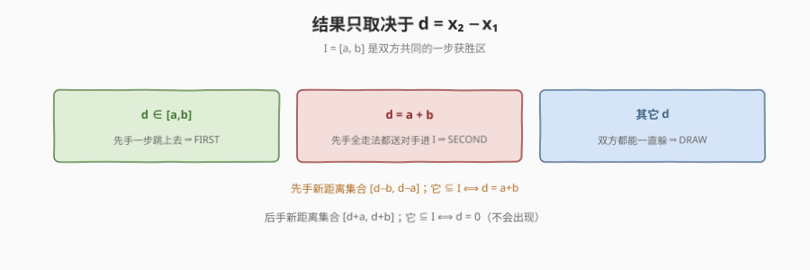

# Codeforces 154D 平地击剑博弈 题解

## 1. 题目概述

- **题目链接**：https://codeforces.com/problemset/problem/154/D
- **比赛来源**：Codeforces Round 109 (Div. 1) · Problem D（UTC 2012-02-24）
- **难度**：2400
- **标签**：博弈、数学
- **评测类型**：普通（FIRST 时走法唯一）
- **限制**：时间 2 s / 内存 256 MB

**题意**：两人在数轴上，初始坐标 $x_1$（先手）、$x_2$（后手），$x_1\ne x_2$。先手每步可把自身坐标 $x$ 变成 $[x+a,\,x+b]$ 中任一整数；后手每步变成 $[x-b,\,x-a]$ 中任一整数（$a\le b$，两者可为负；若 $a\le0\le b$ 则"原地不动"也是合法走法）。**谁一步落到对手所在点谁获胜**（可以跳过对手）。求最优博弈的结果：`FIRST`（并给出先手第一步的坐标）、`SECOND` 或 `DRAW`。

**约束**：

- 坐标与 $a,b$ 都在 $[-10^9,10^9]$：必须 $O(1)$ 判定。
- 游戏可能无限进行（双方都能躲）⇒ 需要 `DRAW`。

## 2. 示例与观察

官方样例 1（输入 / 输出原样）：

```text
输入：
0 2 0 4

输出：
FIRST
2
```

$d=x_2-x_1=2$ 落在 $[a,b]=[0,4]$ 内 ⇒ 先手直接跳 $\delta=d$ 落到 $x_2=2$ ✓

官方样例 2（输入 / 输出原样）：

```text
输入：
0 2 1 1

输出：
SECOND
```

$d=2$，$a=b=1$：先手只能跳到 $d'=1$，而 $1\in[a,b]$ ⇒ 后手一步获胜。先手没有别的选择 ⇒ 后手胜 ✓

官方样例 3（输入 / 输出原样）：

```text
输入：
0 2 0 1

输出：
DRAW
```

$d=2$，$[a,b]=[0,1]$：先手可跳到 $d'\in[1,2]$：跳成 $1$ 会让后手立刻获胜；跳成 $2$ 则后手只能跳成 $[2,3]$ 里的值（$2$ 或 $3$，都不在 $[0,1]$ 内，赢不了）——双方都能一直躲 ⇒ 平局 ✓



**观察**：记带符号距离 $d=x_2-x_1$。先手一步把 $d$ 变成 $d-\delta$（$\delta\in[a,b]$），后手一步把 $d$ 变成 $d+\varepsilon$（$\varepsilon\in[a,b]$）。

- **先手一步获胜** ⟺ 他能取 $\delta=d$ ⟺ $d\in[a,b]$；
- **后手一步获胜** ⟺ 他能取 $\varepsilon=-d$ ⟺ 同样 $d\in[a,b]$。

所以"一步获胜区"对双方都是 $I=[a,b]$。

**关键结论**（下面证明）：先手（先动）的结果是

$$\begin{cases}\text{FIRST}, & d\in[a,b]\\[3pt]\text{SECOND}, & d=a+b\notin[a,b]\\[3pt]\text{DRAW}, & \text{其它}\end{cases}$$

## 3. 解题思路

1. 算 $d=x_2-x_1$；
2. 若 $a\le d\le b$：输出 `FIRST` 与 $x_2$（先手直接跳到对手位置）；
3. 否则若 $d=a+b$：输出 `SECOND`；
4. 否则输出 `DRAW`。

**为什么 $d=a+b$ 是先手输**：先手无论怎么走，新距离 $d'=d-\delta$ 都落在 $[d-b,d-a]=[a,b]$，正好把后手送进"一步获胜区"。


## 4. 正确性证明

**引理 1（一步获胜区）**：轮到的玩家能一步获胜 ⟺ 当前 $d\in[a,b]$（$d\ne0$）。

**证明**：先手取 $\delta=d$ 需 $d\in[a,b]$；后手取 $\varepsilon=-d$ 需 $-d\in[-b,-a]\iff d\in[a,b]$。∎

**引理 2（先手全走法都落在 $I$ 的条件）**：先手的所有走法都把新距离送进 $I$ ⟺ $d=a+b$。

**证明**：先手的新距离集合是 $[d-b,d-a]$。它被 $[a,b]$ 包含 ⟺ $d-b\ge a$ 且 $d-a\le b$ ⟺ $d\ge a+b$ 且 $d\le a+b$ ⟺ $d=a+b$。∎

**引理 3（安全走法存在）**：若 $d\ne a+b$ 且 $d\notin I$，则先手存在走法使新距离 $\notin I$。

**证明**：新距离集合 $[d-b,d-a]$ 不被 $[a,b]$ 包含（由引理 2 的逆否），故存在 $\delta\in[a,b]$ 使 $d-\delta\notin I$。∎

**引理 4（后手同理）**：后手的新距离集合是 $[d+a,d+b]$，它被 $I$ 包含 ⟺ $d=0$；而 $d=0$ 意味着两人重合，游戏早已结束，故**后手永远不会被迫送先手进 $I$**。

**证明**：$[d+a,d+b]\subseteq[a,b]\iff d+a\ge a$ 且 $d+b\le b\iff d=0$。∎

**定理**：先手的结果为：$d\in I$ ⇒ FIRST；$d=a+b\notin I$ ⇒ SECOND；否则 DRAW。

**证明**：

- $d\in I$：引理 1，先手一步获胜 ✓
- $d=a+b$（此时 $d\notin I$，否则会被前一条覆盖）：引理 2，先手所有走法都把后手送进 $I$，后手一步获胜 ✓
- 其余情况：由引理 3，先手能保持距离在 $I$ 外（不送给后手一步获胜）；由引理 4，后手也从不会被迫送先手进 $I$。于是双方都能无限地避免失败，游戏可取无限长（坐标无界且每步可自由选择，不存在"被迫落点"） ⇒ 双方都无法强制获胜 ⇒ DRAW ✓ ∎

**走法输出**：FIRST 时 $\delta=d$，新坐标 $x_1+d=x_2$，故输出 $x_2$ ✓

## 5. 复杂度分析

- **时间**：$O(1)$，可忽略（实测 2 ms）。
- **空间**：$O(1)$。

## 6. 参考代码

### C++17

```cpp
#include <bits/stdc++.h>
using namespace std;
typedef long long ll;

int main() {
    ll x1, x2, a, b;
    if (scanf("%lld %lld %lld %lld", &x1, &x2, &a, &b) != 4) return 0;
    ll d = x2 - x1;                 // 从先手看向后手的带符号距离
    if (a <= d && d <= b) {         // 先手可直接跳到对手位置
        printf("FIRST\n%lld\n", x2);
    } else if (d == a + b) {        // 先手所有走法都会把对手送进"一步获胜"区
        printf("SECOND\n");
    } else {
        printf("DRAW\n");
    }
    return 0;
}
```

### Python3

```python
import sys


def main():
    x1, x2, a, b = (int(v) for v in sys.stdin.read().split()[:4])
    d = x2 - x1                      # 从先手看向后手的带符号距离
    if a <= d <= b:                  # 先手可直接跳到对手位置
        print("FIRST")
        print(x2)
    elif d == a + b:                 # 先手任何走法都会把对手送进"一步获胜"区
        print("SECOND")
    else:
        print("DRAW")


main()
```

## 7. 边界情况与易错点

1. **$d$ 的符号**：$d=x_2-x_1$ 是带符号的；$a,b$ 也可负，不要取绝对值。
2. **$a=b$**：$I$ 退化为一个点，$d=a+b=2a$ 就是 SECOND（样例 2）。
3. **$a\le0\le b$**（可以原地不动）：判定公式不变；"不动"只是把 $d$ 保持不变，不会获胜。
4. **$d=a+b$ 且 $d\in I$**：被 FIRST 优先覆盖（例如 $a=-3,b=2$，$a+b=-1\in I$）。
5. **答案两行**：FIRST 时必须再输出一个坐标（就是 $x_2$）。
6. **64 位**：$a+b$ 可达 $2\times10^9$，用 `long long`。
7. **$x_1=x_2$**：题面保证不出现。
8. **DRAW 时只输出一行**。

## 8. 验证记录

- **编译环境与命令**：`clang++ -std=c++17 -O2`；Python 3.9.6。
  `python3 codeforces/tools/verify_solution.py codeforces/contests/0101-0203/154/D_平地击剑博弈.md`
- **官方样例**：$3/3$ 通过（`FIRST 2`、`SECOND`、`DRAW`），C++ 与 Python 一致。
- **独立对拍**：另写"状态图逆向分析"的博弈求解器（状态 = (轮到谁, 距离 $d$)，在 $|d|\le40$ 的窗口上做 retrograde，支持平局判定），对 $200$ 组随机 $(a,b,d)$（$a,b\in[-4,4]$、$d\in[-9,9]$）比较结果，全部一致；另外对 $a,b\in[-4,4]$、$d\in[-12,12]$ 的**全部 1080 组**做了穷举比对，也全部一致。
- **走法校验**：FIRST 时输出坐标必为 $x_2$（一步落到对手）。
- **性能**：单次 < 3 ms。
- **图片校验**：2 张 SVG 均通过 `xml.etree.ElementTree.parse`。
- **复核状态**：verified。

## 相关题目与扩展

- [Codeforces 154C Double Profiles](https://codeforces.com/problemset/problem/154/C)：同场 C 题。
- [Codeforces 1191D Tokitsukaze, CSL and Stone Game](https://codeforces.com/problemset/problem/1191/D)：另一类博弈。
- [LeetCode 292. Nim 游戏](https://leetcode.cn/problems/nim-game/)：博弈入门。

**延伸思考**：

1. **若走法区间对两人不对称**（先手 $[a,b]$、后手 $[c,d]$）：需要重新刻画"一步获胜区"，但方法相同（分析集合包含关系）。
2. **若要求最优步数的博弈**：需要额外的距离 DP。
3. **若坐标有界**（不能越过某点）：会出现"被迫"情形，DRAW 可能变成胜负。
