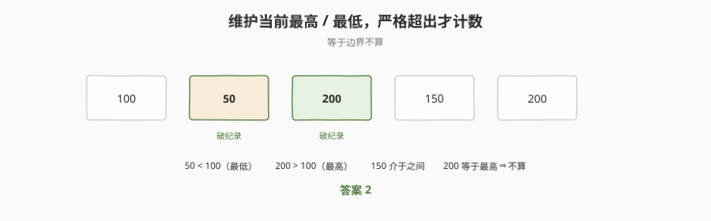
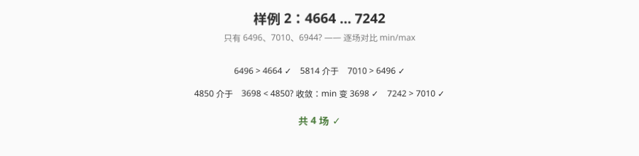

# Codeforces 155A 破纪录次数统计 题解

## 1. 题目概述

- **题目链接**：https://codeforces.com/problemset/problem/155/A
- **比赛来源**：Codeforces Round 109 (Div. 2) · Problem A（UTC 2012-02-24）
- **难度**：800
- **标签**：暴力枚举、实现
- **评测类型**：普通
- **限制**：时间 2 s / 内存 256 MB

**题意**：按时间顺序给出 $n$ 场比赛的得分 $a_1..a_n$。某场"惊人"当且仅当它的分数**严格大于**此前所有场次（破最高纪录）或**严格小于**此前所有场次（破最低纪录）。第一场不算。求惊人场次的数量。

**约束**：$n\le1000$，得分 $\le10^4$：$O(n)$ 扫描即可。

## 2. 示例与观察

官方样例 1（输入 / 输出原样）：

```text
输入：
5
100 50 200 150 200

输出：
2
```

- $50<100$ ⇒ 破最低纪录（1）；
- $200>100$ ⇒ 破最高纪录（2）；
- $150$：介于 $50$ 与 $200$ 之间 ⇒ 不是；
- $200$：等于当前最高 ⇒ **不是**（要求严格大于）✓

官方样例 2（输入 / 输出原样）：

```text
输入：
10
4664 6496 5814 7010 5762 5736 6944 4850 3698 7242

输出：
4
```

逐场维护当前最小/最大即可得到 4 ✓



**观察**：只需维护到当前位置为止的 $\min$ 与 $\max$；新元素若严格超出范围就计数并更新。因为要"严格"破纪录，等于边界的不算。

## 3. 解题思路

1. 读入 $n$ 与数组；`mn = mx = a[0]`，`ans = 0`；
2. 对 $i=1..n-1$：若 $a_i>mx$ 则 `mx=a_i, ans++`；否则若 $a_i<mn$ 则 `mn=a_i, ans++`；
3. 输出 `ans`。



## 4. 正确性证明

**引理 1**：第 $i$ 场破最高纪录 ⟺ $a_i>\max_{j<i}a_j$；破最低纪录 ⟺ $a_i<\min_{j<i}a_j$。

**证明**：题面定义"严格大于此前每一场"即严格大于前缀最大值；"严格小于此前每一场"即严格小于前缀最小值。∎

**引理 2（不变式）**：循环到第 $i$ 场前，`mn` 与 `mx` 分别等于 $\min_{j<i}a_j$ 与 $\max_{j<i}a_j$。

**证明**：初始 $i=1$ 时 `mn=mx=a_0` ✓；每步只在严格超出时更新并同步维护，故不变式保持。∎

**定理**：程序输出正确。

**证明**：由引理 1、2，每次判断与更新都恰好对应题面定义的"惊人"，且每场只计一次，累加即答案。∎

## 5. 复杂度分析

- **时间**：$O(n)\le1000$，可忽略（实测 2 ms）。
- **空间**：$O(n)$（也可流式 $O(1)$）。

## 6. 参考代码

### C++17

```cpp
#include <bits/stdc++.h>
using namespace std;

int main() {
    int n;
    if (scanf("%d", &n) != 1) return 0;
    vector<int> a(n);
    for (int i = 0; i < n; i++) scanf("%d", &a[i]);
    int mn = a[0], mx = a[0], ans = 0;
    for (int i = 1; i < n; i++) {
        if (a[i] > mx) { mx = a[i]; ans++; }
        else if (a[i] < mn) { mn = a[i]; ans++; }
    }
    printf("%d\n", ans);
    return 0;
}
```

### Python3

```python
import sys


def main():
    data = sys.stdin.read().split()
    n = int(data[0])
    a = [int(x) for x in data[1:1 + n]]
    mn = mx = a[0]
    ans = 0
    for x in a[1:]:
        if x > mx:
            mx = x
            ans += 1
        elif x < mn:
            mn = x
            ans += 1
    print(ans)


main()
```

## 7. 边界情况与易错点

1. **严格大于/小于**：等于当前最高或最低都**不算**（样例 1 的第二个 200）。
2. **$n=1$**：第一场不算，答案 0。
3. **全部相同**：答案 0。
4. **第一场**：不参与计数，但它是初始的 min/max。
5. **单调递增**：除第一场外每场都破最高纪录。
6. **得分可为 0**：min 初始为 $a_0$，不要用 0 当哨兵。
7. **读入**：第二行 $n$ 个数。

## 8. 验证记录

- **编译环境与命令**：`clang++ -std=c++17 -O2`；Python 3.9.6。
  `python3 codeforces/tools/verify_solution.py codeforces/contests/0101-0203/155/A_破纪录次数统计.md`
- **官方样例**：$2/2$ 通过（`2`、`4`），C++ 与 Python 一致。
- **独立对拍**：另写"对每个 $i$ 用 `max(a[:i])`/`min(a[:i])` 重新计算"的暴力，对 $200$ 组随机数据（$n\le12$、得分 $0..20$）比较，全部一致。
- **性能**：$n=1000$ 单次约 2 ms。
- **图片校验**：2 张 SVG 均通过 `xml.etree.ElementTree.parse`。
- **复核状态**：verified。

## 相关题目与扩展

- [Codeforces 155B Combination](https://codeforces.com/problemset/problem/155/B)：同场 B 题。
- [Codeforces 156A Message](https://codeforces.com/problemset/problem/156/A)：同一时段的字符串题。
- [LeetCode 1299. 将每个元素替换为右侧最大元素](https://leetcode.cn/problems/replace-elements-with-greatest-element-on-right-side/)：前缀极值。

**延伸思考**：

1. **若要求"至少破一项纪录"的场次数**（含等于）：把严格比较改成 `>=`/`<=`，但要注意"等于"可能需要单独定义。
2. **若要求输出每场是否惊人**：扫描时记录标记即可。
3. **若要求"破纪录次数的期望"**（随机排列）：经典结论是调和级数 $\sum 1/i$。
