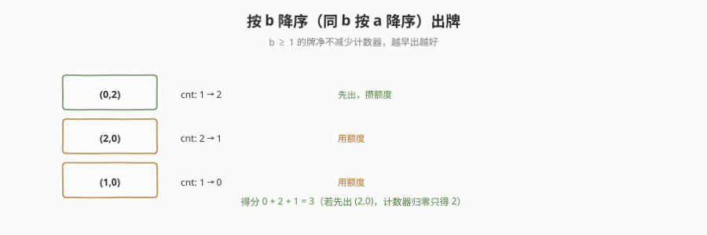

# Codeforces 155B 出牌组合最大得分 题解

## 1. 题目概述

- **题目链接**：https://codeforces.com/problemset/problem/155/B
- **比赛来源**：Codeforces Round 109 (Div. 2) · Problem B（UTC 2012-02-24）
- **难度**：1100
- **标签**：贪心、排序
- **评测类型**：普通
- **限制**：时间 2 s / 内存 256 MB

**题意**：$n$ 张牌，第 $i$ 张牌正面 $a_i$、背面 $b_i$。回合开始时"可出牌计数器"为 1；每出一张牌，得分加 $a_i$、计数器减 1 再加 $b_i$（净变化 $b_i-1$）；计数器为 0 或没牌可出时回合结束。求最大总得分。

**约束**：

- $n\le1000$，$a_i,b_i\le10^4$：可以排序贪心。
- $b_i\ge1$ 的牌"净不减少计数器"，应当尽早出；$b_i=0$ 的牌消耗计数器。

## 2. 示例与观察

官方样例 1（输入 / 输出原样）：

```text
输入：
2
1 0
2 0

输出：
2
```

两张牌 $b=0$，计数器只有 1 ⇒ 只能出一张 ⇒ 选 $a$ 大的那张（2）✓

官方样例 2（输入 / 输出原样）：

```text
输入：
3
1 0
2 0
0 2

输出：
3
```

先出 $(0,2)$：计数器 $1-1+2=2$，得分 0；再出 $(2,0)$ 与 $(1,0)$：得分 $0+2+1=3$ ✓（若先出 $(2,0)$ 则计数器归零，只得 2）



**观察**：出牌顺序只影响"能出多少张"，不影响每张的分数。把牌按 $b$ 降序排（$b$ 相同按 $a$ 降序），然后依次出牌直到计数器归零，就是最优。

## 3. 解题思路

1. 按 $(b$ 降序$, a$ 降序$)$ 排序；
2. `cnt=1, score=0`，遍历排序后的牌：若 `cnt>0` 则 `score+=a`、`cnt+=b-1`，否则停止；
3. 输出 `score`。

**为什么这样贪心**：

- 出 $b\ge1$ 的牌净增加（或不减少）计数器，越早出越能"解锁"后面的牌；
- $b$ 相同的牌对计数器的影响完全相同，因此应优先拿 $a$ 大的；
- 任何最优方案都可以通过"交换相邻的逆序对（前者的 $b$ 小于后者）"变成 $b$ 降序且不劣。


## 4. 正确性证明

**引理 1（可交换性）**：若在某个可行出牌序列中相邻两张牌 $x,y$ 满足 $b_x<b_y$，交换二者后序列仍然可行，总得分不变。

**证明**：设出 $x$ 前计数器为 $c\ge1$。原序列要求出 $x$ 后 $c-1+b_x\ge1$（若还要出 $y$），交换后出 $y$ 后计数器为 $c-1+b_y\ge c-1+b_x\ge1$ ✓，且出 $x$ 后为 $c-1+b_y-1+b_x=c-1+b_x-1+b_y$，与原来终值相同 ⇒ 后续可行性不变。得分是 $a_x+a_y$，与顺序无关。∎

**引理 2（$b$ 相同的顺序）**：$b$ 相同的牌中，先出 $a$ 大的是最优。

**证明**：$b$ 相同则任何顺序对计数器的影响相同，能出的张数相同；为使得分最大应优先纳入 $a$ 大的（若张数受限）。∎

**引理 3（贪心选出的张数最多）**：按 $b$ 降序依次出牌，能出的张数不少于任何其它顺序。

**证明**：由引理 1，最优序列可化为 $b$ 降序；贪心枚举的正是这个前缀，且"计数器 $>0$ 就继续出"是唯一能继续的条件，故贪心张数 = 降序序列能出的张数 ≥ 其它顺序。∎

**定理**：程序输出最大得分。

**证明**：由引理 1–3，存在一个 $b$ 降序（同 $b$ 内 $a$ 降序）的最优序列，且其长度不超过贪心能出的张数；贪心在能出的张数内取的是这些牌（同 $b$ 取 $a$ 大者），故得分不小于最优；而贪心本身是一个合法序列 ⇒ 等于最优。∎

## 5. 复杂度分析

- **时间**：排序 $O(n\log n)$，模拟 $O(n)$；实测 < 3 ms。
- **空间**：$O(n)$。

## 6. 参考代码

### C++17

```cpp
#include <bits/stdc++.h>
using namespace std;

int main() {
    int n;
    if (scanf("%d", &n) != 1) return 0;
    vector<pair<int,int>> cards(n);      // (b, a)
    for (int i = 0; i < n; i++) scanf("%d %d", &cards[i].second, &cards[i].first);
    // 按 b 降序、a 降序
    sort(cards.begin(), cards.end(), [](const pair<int,int> &x, const pair<int,int> &y) {
        if (x.first != y.first) return x.first > y.first;
        return x.second > y.second;
    });
    long long cnt = 1, score = 0;
    for (int i = 0; i < n && cnt > 0; i++) {
        score += cards[i].second;
        cnt += cards[i].first - 1;
    }
    printf("%lld\n", score);
    return 0;
}
```

### Python3

```python
import sys


def main():
    data = sys.stdin.read().split()
    n = int(data[0])
    cards = []
    p = 1
    for _ in range(n):
        a = int(data[p]); b = int(data[p + 1]); p += 2
        cards.append((b, a))
    cards.sort(key=lambda t: (-t[0], -t[1]))   # b 降序、a 降序
    cnt, score = 1, 0
    for b, a in cards:
        if cnt <= 0:
            break
        score += a
        cnt += b - 1
    print(score)


main()
```

## 7. 边界情况与易错点

1. **$b=0$ 的牌**：每出一张消耗 1 个计数器。
2. **$b\ge1$**：净不减少，一定能全部出完（若不考虑其它牌）。
3. **同 $b$ 时按 $a$ 降序**：否则样例 1 会输出 1。
4. **计数器可能变大**：$b$ 可达 $10^4$，用 `long long`。
5. **没有牌可出**：$n=0$ 不会出现（$n\ge1$）。
6. **得分可为 0**：所有 $a=0$。
7. **排序比较器**：两个关键字都要处理，且方向一致。

## 8. 验证记录

- **编译环境与命令**：`clang++ -std=c++17 -O2`；Python 3.9.6。
  `python3 codeforces/tools/verify_solution.py codeforces/contests/0101-0203/155/B_出牌组合最大得分.md`
- **官方样例**：$2/2$ 通过（`2`、`3`），C++ 与 Python 一致。
- **独立对拍**：另写"枚举所有出牌顺序（DFS，$n\le6$）取最大得分"的暴力，对 $200$ 组随机牌（$a\le9$、$b\le2$）比较，全部一致。
- **性能**：$n=1000$ 单次 < 3 ms。
- **图片校验**：2 张 SVG 均通过 `xml.etree.ElementTree.parse`。
- **复核状态**：verified。

## 相关题目与扩展

- [Codeforces 155A I_love_%username%](https://codeforces.com/problemset/problem/155/A)：同场 A 题。
- [Codeforces 156B Suspects](https://codeforces.com/problemset/problem/156/B)：同一时段的逻辑题。
- [LeetCode 452. 用最少数量的箭引爆气球](https://leetcode.cn/problems/minimum-number-of-arrows-to-burst-balloons/)：排序贪心。

**延伸思考**：

1. **若 $b_i$ 可以为负**：贪心规则要变（先出 $b$ 大的仍然正确，但可能出现"出不起"）。
2. **若每张牌只能用一次且要求恰好出 $k$ 张**：变成背包。
3. **若要求输出出牌顺序**：贪心序列本身就是一个答案。
