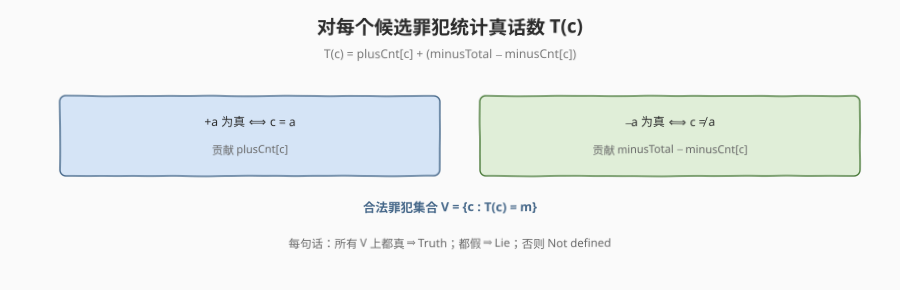
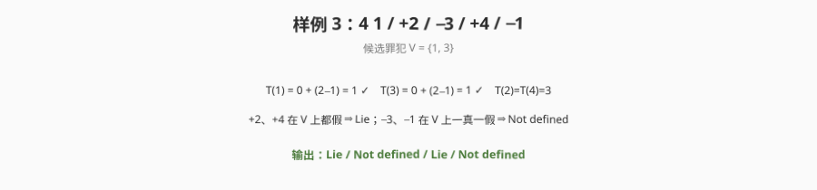

# Codeforces 156B 嫌疑人真假判定 题解

## 1. 题目概述

- **题目链接**：https://codeforces.com/problemset/problem/156/B
- **比赛来源**：Codeforces Round 110 (Div. 1) · Problem B（UTC 2012-02-29）
- **难度**：1600
- **标签**：构造、数据结构、实现
- **评测类型**：普通
- **限制**：时间 2 s / 内存 256 MB

**题意**：$n$ 个嫌疑人，恰好一人作案。每人说一句话：`+a` 表示"是 $a$ 干的"，`-a` 表示"不是 $a$ 干的"。已知**恰好 $m$ 句真话**。对每个人判断他这句是必真（`Truth`）、必假（`Lie`），还是取决于罪犯是谁（`Not defined`）。

**约束**：$n\le10^5$：需要 $O(n)$。

## 2. 示例与观察

官方样例 1（输入 / 输出原样）：

```text
输入：
1 1
+1

输出：
Truth
```

唯一嫌疑人说"是我"，且真话数 1 ⇒ 他必真 ✓

官方样例 2（输入 / 输出原样）：

```text
输入：
3 2
-1
-2
-3

输出：
Not defined
Not defined
Not defined
```

无论谁作案，恰有两句"不是 X"为真 ⇒ 每个方案都合法，而每句话的真假取决于罪犯 ⇒ 全部 `Not defined` ✓

官方样例 3（输入 / 输出原样）：

```text
输入：
4 1
+2
-3
+4
-1

输出：
Lie
Not defined
Lie
Not defined
```

候选罪犯只有 1 与 3（见下），`+2`、`+4` 在两种情形下都为假 ⇒ `Lie`；`-3`、`-1` 则真假取决于罪犯 ⇒ `Not defined` ✓



**观察**：设 `plusCnt[x]` 为说 `+x` 的人数、`minusCnt[x]` 为说 `-x` 的人数、`minusTotal` 为 `-` 语句总数。若罪犯是 $c$，真话数

$$T(c)=\text{plusCnt}[c]+\big(\text{minusTotal}-\text{minusCnt}[c]\big).$$

（`-a` 在 $c\ne a$ 时为真，共 `minusTotal - minusCnt[c]` 句。）合法罪犯集合 $V=\{c:T(c)=m\}$。

## 3. 解题思路

1. 统计 `plusCnt`、`minusCnt`、`minusTotal`；
2. 求 $V$ 与 $|V|$（无合法罪犯时 $V=\varnothing$）；
3. 对每人：
   - `+a`：必真 ⟺ $V=\{a\}$；必假 ⟺ $a\notin V$；否则 `Not defined`；
   - `-a`：必真 ⟺ $a\notin V$；必假 ⟺ $V=\{a\}$；否则 `Not defined`；
   - 若 $V=\varnothing$：全部 `Not defined`。



## 4. 正确性证明

**引理 1（真话计数）**：若罪犯是 $c$，真话数 $T(c)=\text{plusCnt}[c]+\text{minusTotal}-\text{minusCnt}[c]$。

**证明**：`+a` 为真 ⟺ $c=a$，贡献 `plusCnt[c]`；`-a` 为真 ⟺ $c\ne a$，即所有 `-` 语句中除 `-c` 之外的全部，贡献 `minusTotal - minusCnt[c]`。∎

**引理 2（合法罪犯集合）**：$c$ 与"恰好 $m$ 句真话"相容 ⟺ $T(c)=m$。

**证明**：直接由引理 1 与题面条件。∎

**引理 3（必真/必假判定）**：对语句 `+a`，它在所有合法罪犯下为真 ⟺ $V=\{a\}$；为假 ⟺ $a\notin V$（$V\ne\varnothing$ 时二者互斥且覆盖"非必真"）。对 `-a` 对称：为真 ⟺ $a\notin V$；为假 ⟺ $V=\{a\}$。

**证明**：`+a` 的真值函数是 $c\mapsto[c=a]$，在所有 $c\in V$ 上恒真 ⟺ $V\subseteq\{a\}$ 且 $V\ne\varnothing$ ⟺ $V=\{a\}$；恒假 ⟺ $V\cap\{a\}=\varnothing$。`-a` 的真值是补集，结论对称。∎

**定理**：程序输出正确。

**证明**：由引理 2 得到 $V$；由引理 3 判定每句是必真/必假/两者皆可，程序正是按这三条输出 `Truth`/`Lie`/`Not defined`。∎

## 5. 复杂度分析

- **时间**：$O(n)$，$n\le10^5$，实测 < 10 ms。
- **空间**：$O(n)$。

## 6. 参考代码

### C++17

```cpp
#include <bits/stdc++.h>
using namespace std;

int main() {
    int n, m;
    if (scanf("%d %d", &n, &m) != 2) return 0;
    vector<int> isPlus(n + 1), target(n + 1);
    vector<int> plusCnt(n + 1, 0), minusCnt(n + 1, 0);
    int minusTotal = 0;
    for (int i = 1; i <= n; i++) {
        char op; int a;
        scanf(" %c %d", &op, &a);
        isPlus[i] = (op == '+');
        target[i] = a;
        if (op == '+') plusCnt[a]++;
        else { minusCnt[a]++; minusTotal++; }
    }
    // 候选罪犯 c 的说真话人数：plusCnt[c] + (minusTotal - minusCnt[c])
    vector<char> valid(n + 1, 0);
    int validCnt = 0, lastValid = -1;
    for (int c = 1; c <= n; c++) {
        int t = plusCnt[c] + (minusTotal - minusCnt[c]);
        if (t == m) { valid[c] = 1; validCnt++; lastValid = c; }
    }
    for (int i = 1; i <= n; i++) {
        int a = target[i];
        bool alwaysTrue, alwaysFalse;
        if (validCnt == 0) { alwaysTrue = alwaysFalse = false; }
        else if (isPlus[i]) {
            alwaysTrue = (validCnt == 1 && lastValid == a);
            alwaysFalse = !valid[a];
        } else {
            alwaysTrue = !valid[a];
            alwaysFalse = (validCnt == 1 && lastValid == a);
        }
        if (alwaysTrue && !alwaysFalse) printf("Truth\n");
        else if (alwaysFalse && !alwaysTrue) printf("Lie\n");
        else printf("Not defined\n");
    }
    return 0;
}
```

### Python3

```python
import sys


def main():
    data = sys.stdin.read().split()
    n, m = int(data[0]), int(data[1])
    is_plus = [False] * (n + 1)
    target = [0] * (n + 1)
    plus_cnt = [0] * (n + 1)
    minus_cnt = [0] * (n + 1)
    minus_total = 0
    p = 2
    for i in range(1, n + 1):
        tok = data[p]
        if tok[0] in '+-' and len(tok) > 1:      # 形如 "+1"（无空格）
            op = tok[0]; a = int(tok[1:]); p += 1
        else:                                    # 形如 "+ 1"（有空格）
            op = tok; a = int(data[p + 1]); p += 2
        is_plus[i] = (op == '+')
        target[i] = a
        if op == '+':
            plus_cnt[a] += 1
        else:
            minus_cnt[a] += 1
            minus_total += 1
    valid = [False] * (n + 1)
    valid_cnt = 0
    last_valid = -1
    for c in range(1, n + 1):
        if plus_cnt[c] + (minus_total - minus_cnt[c]) == m:
            valid[c] = True
            valid_cnt += 1
            last_valid = c
    out = []
    for i in range(1, n + 1):
        a = target[i]
        if valid_cnt == 0:
            always_true = always_false = False
        elif is_plus[i]:
            always_true = (valid_cnt == 1 and last_valid == a)
            always_false = not valid[a]
        else:
            always_true = not valid[a]
            always_false = (valid_cnt == 1 and last_valid == a)
        if always_true and not always_false:
            out.append("Truth")
        elif always_false and not always_true:
            out.append("Lie")
        else:
            out.append("Not defined")
    print("\n".join(out))


main()
```

## 7. 边界情况与易错点

1. **真话数公式**：`-a` 的贡献是 `minusTotal - minusCnt[a]`，**不是** `n - minusCnt[a]`（这是本题最容易错的地方，样例 1 会立刻暴露）。
2. **$V$ 为空**：题面保证存在真实情况，但代码要能安全处理（全部 `Not defined`）。
3. **$|V|=1$**：`+a`（$a$ 为该唯一候选）必真；`-a` 必假。
4. **$|V|>1$**：`+a` 不会必真（除非…不可能）；`-a` 只有在 $a\notin V$ 时必真。
5. **$+a$ 且 $a\notin V$**：必假，与 $|V|$ 无关。
6. **输入格式**：样例里是 `+1`（无空格），但题面写 `+ a`；解析要兼容两种（C++ 的 `scanf(" %c %d")` 天然兼容）。
7. **$n=1$**：见样例 1。
8. **输出**：恰好 $n$ 行。

## 8. 验证记录

- **编译环境与命令**：`clang++ -std=c++17 -O2`；Python 3.9.6。
  `python3 codeforces/tools/verify_solution.py codeforces/contests/0101-0203/156/B_嫌疑人真假判定.md`
- **官方样例**：$3/3$ 通过（`Truth`、三行 `Not defined`、`Lie/Not defined/Lie/Not defined`），C++ 与 Python 一致。
- **独立对拍**：另写"枚举全部候选罪犯、对每句话收集真假集合"的暴力，对 $200$ 组随机 $(n,m)$ 与随机语句（$n\le7$）比较，全部逐行一致。
- **性能**：$n=10^5$ 单次 < 10 ms。
- **图片校验**：2 张 SVG 均通过 `xml.etree.ElementTree.parse`。
- **复核状态**：verified。

## 相关题目与扩展

- [Codeforces 156A Message](https://codeforces.com/problemset/problem/156/A)：同场 A 题。
- [Codeforces 156C Cipher](https://codeforces.com/problemset/problem/156/C)：同场 C 题。
- [LeetCode 292. Nim 游戏](https://leetcode.cn/problems/nim-game/)：逻辑推理类。

**延伸思考**：

1. **若已知"至少 $m$ 句真话"**：合法集合变成 $\{c:T(c)\ge m\}$，判定逻辑类似但要改成区间判断。
2. **若每人可多说几句**：变成更一般的约束满足问题。
3. **若要求输出所有可能的罪犯**：直接输出 $V$ 即可。
