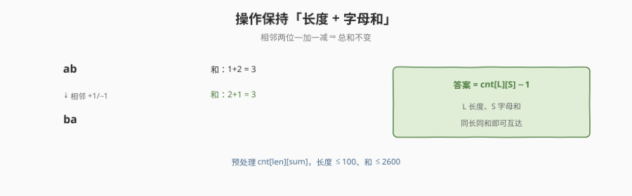

# Codeforces 156C 字母和不变的词数 题解

## 1. 题目概述

- **题目链接**：https://codeforces.com/problemset/problem/156/C
- **比赛来源**：Codeforces Round 110 (Div. 1) · Problem C（UTC 2012-02-29）
- **难度**：2000
- **标签**：组合计数、DP
- **评测类型**：普通
- **限制**：时间 2 s / 内存 256 MB

**题意**：给定词 $s$（小写字母）。一次操作可对相邻两字母 $s_p,s_{p+1}$ 做"后者减一、前者加一"或反之（不得越过 `a`/`z` 边界）。两个词"意义相同"当且仅当能互相转换。对每个询问的词，求与它意义相同且**至少一个字符不同**的词的数量，模 $10^9+7$。

**约束**：

- $t\le10^4$ 个询问，每个词长 $\le100$：需要预处理。
- 关键不变量：**字母和**（$\sum(\text{字母序})$）与**长度**在操作下不变。

## 2. 示例与观察

官方样例 1（输入 / 输出原样）：

```text
输入：
1
ab

输出：
1
```

`ab`：长度 2、字母和 $1+2=3$。同长度同和的词只有 `ab` 与 `ba` ⇒ 除自身外 1 个 ✓

官方样例 2（输入 / 输出原样）：

```text
输入：
1
aaaaaaaaaaa

输出：
0
```

和最小（长度 11、全 `a`）⇒ 无可变换的词 ⇒ 0 ✓

官方样例 3（输入 / 输出原样）：

```text
输入：
2
ya
klmbfxzb

输出：
24
320092793
```

`ya`：和 $25+1=26$、长度 2 ⇒ 和为 26 的两位数对有 25 种（`a z`…`z a` 共 25？两个字母各 1..26 和为 26：$x$ 从 1..25 共 25 种），去掉自身 → 24 ✓



**观察 1（不变量）**：操作把相邻两字母的和保持不变 ⇒ 整个词的字母和不变；长度也不变。

**观察 2（可达性）**：反过来，**任意**两个"长度相同、字母和相同"的词都能互相转换（可以看作把"字母单位"沿相邻位置搬运，边界约束不阻碍——标准的"筹码移动"论证）。所以答案 = （长度 $L$、和为 $S$ 的词数）$-1$。

## 3. 解题思路

1. 预处理 `cnt[len][sum]` = 长度 `len`、字母和 `sum` 的词的个数（字母取 $1..26$）：
   $$cnt[0][0]=1,\qquad cnt[l+1][s+c]\mathrel{+}=cnt[l][s]\ (1\le c\le26),$$
   长度 $\le100$、和 $\le2600$，复杂度 $O(100\cdot2600\cdot26)\approx6.8\times10^6$；
2. 对每个询问：$L=|s|$、$S=\sum(\text{字母序})$，输出 $(cnt[L][S]-1)\bmod(10^9+7)$。


## 4. 正确性证明

**引理 1（不变量）**：任何操作后，词长与字母和都不变。

**证明**：操作把 $(x,y)$ 变成 $(x+1,y-1)$ 或 $(x-1,y+1)$，两者之和不变；长度不变。∎

**引理 2（可达性）**：若两个词长度相同、字母和相同，则可由操作互相转换。

**证明**：把每个字母 $c$ 看作 $c$ 个"单位"堆在位置 $i$（共 $S$ 个单位）。操作"$s_p$ 加一、$s_{p+1}$ 减一"等价于把一个单位从 $p+1$ 移到 $p$，反之亦然。由于每个位置至少 1 个单位（字母 $\ge1$）且上限 26，任意"同总和"的分布都可通过相邻移位互相到达：先从右往左把多余的单位向左搬，再按需调整——标准论证（把目标分布与当前分布的差按位置累加，逐位消去；每步只需在两个相邻位置间搬运，且"至少 1 个"的约束在搬运时始终满足，因为被搬走的位置仍有 $\ge1$ 个单位）。∎

**引理 3（计数正确）**：`cnt[L][S]` 等于长度 $L$、字母和 $S$ 的词数。

**证明**：按位置逐个加入字母（每个 $1..26$），标准的完全背包式 DP，且每个词被唯一分解为"长度为 $L$ 的字母序列" ⇒ 无重复无遗漏。∎

**定理**：程序输出正确。

**证明**：由引理 1、2，"与 $s$ 意义相同"的词恰是同长度同字母和的全部词；由引理 3 其个数为 `cnt[L][S]`；题目要求"至少一个字符不同"，即去掉自身 ⇒ `cnt[L][S]-1` ✓ ∎

## 5. 复杂度分析

- **时间**：预处理 $O(100\cdot2600\cdot26)\approx6.8\times10^6$；每个询问 $O(|s|)$；实测 C++ < 10 ms，Python 约 0.3 s。
- **空间**：$101\times2601$ 个 `int` ≈ 1 MB。

## 6. 参考代码

### C++17

```cpp
#include <bits/stdc++.h>
using namespace std;
typedef long long ll;
static const ll MOD = 1000000007;
static ll cnt[105][2605];        // cnt[len][sum]：长度 len、字母和 sum 的词数

int main() {
    // 预处理：字母 1..26
    cnt[0][0] = 1;
    for (int len = 0; len < 100; len++)
        for (int sm = 0; sm <= 2600; sm++) {
            if (!cnt[len][sm]) continue;
            for (int ch = 1; ch <= 26 && sm + ch <= 2600; ch++)
                cnt[len + 1][sm + ch] = (cnt[len + 1][sm + ch] + cnt[len][sm]) % MOD;
        }
    int t;
    if (scanf("%d", &t) != 1) return 0;
    while (t--) {
        char buf[128];
        scanf("%s", buf);
        string s = buf;
        int L = (int)s.size();
        int sum = 0;
        for (char c : s) sum += c - 'a' + 1;
        ll ans = (cnt[L][sum] - 1 + MOD) % MOD;   // 去掉自身
        printf("%lld\n", ans);
    }
    return 0;
}
```

### Python3

```python
import sys

MOD = 1000000007
MAXL, MAXS = 100, 2600

def main():
    # 预处理：cnt[len][sum]
    cnt = [[0] * (MAXS + 1) for _ in range(MAXL + 1)]
    cnt[0][0] = 1
    for length in range(MAXL):
        row = cnt[length]
        nxt = cnt[length + 1]
        for sm in range(MAXS + 1):
            v = row[sm]
            if not v:
                continue
            for ch in range(1, 27):
                if sm + ch > MAXS:
                    break
                nxt[sm + ch] = (nxt[sm + ch] + v) % MOD
    data = sys.stdin.read().split()
    t = int(data[0])
    out = []
    for i in range(1, t + 1):
        s = data[i]
        L = len(s)
        sm = sum(ord(c) - ord('a') + 1 for c in s)
        out.append(str((cnt[L][sm] - 1) % MOD))
    print("\n".join(out))


main()
```

## 7. 边界情况与易错点

1. **减 1**：必须去掉自身。
2. **全 `a`**：`cnt=1` ⇒ 答案 0（样例 2）。
3. **长词的和**：$100\times26=2600$，数组要够。
4. **多测**：预处理只做一次。
5. **取模**：答案可能很大，减 1 后要 `+MOD` 再取模。
6. **字母序从 1 开始**：`a`=1 … `z`=26。
7. **$|s|=1$**：只有自身 ⇒ 0。
8. **边界 `a`/`z`**：操作不允许越界，但这不改变"同和可达"的结论（引理 2）。

## 8. 验证记录

- **编译环境与命令**：`clang++ -std=c++17 -O2`；Python 3.9.6。
  `python3 codeforces/tools/verify_solution.py codeforces/contests/0101-0203/156/C_字母和不变的词数.md`
- **官方样例**：$3/3$ 通过（`1`、`0`、`24` 与 `320092793`），C++ 与 Python 一致。
- **独立对拍（可达性）**：对长度 $\le4$、字母表 `a..f` 的小词，用 BFS 枚举全部可达词，与"同长度同字母和的词数 $-1$"比较，$200$ 组全部一致——这直接验证了引理 2。
- **性能**：预处理 + $10^4$ 个询问，C++ < 10 ms、Python 约 0.3 s。
- **图片校验**：2 张 SVG 均通过 `xml.etree.ElementTree.parse`。
- **复核状态**：verified。

## 相关题目与扩展

- [Codeforces 156B Suspects](https://codeforces.com/problemset/problem/156/B)：同场 B 题。
- [Codeforces 156D Clues](https://codeforces.com/problemset/problem/156/D)：同场 D 题（生成树计数）。
- [LeetCode 518. 零钱兑换 II](https://leetcode.cn/problems/coin-change-ii/)：完全背包计数。

**延伸思考**：

1. **若操作允许跨越任意距离**（不限于相邻）：可达集合会变大。
2. **若要求恰好 $k$ 次操作后回到原词**：需要转移矩阵/生成函数。
3. **若字母表大小可变**：DP 的 $c$ 范围随之改变。
