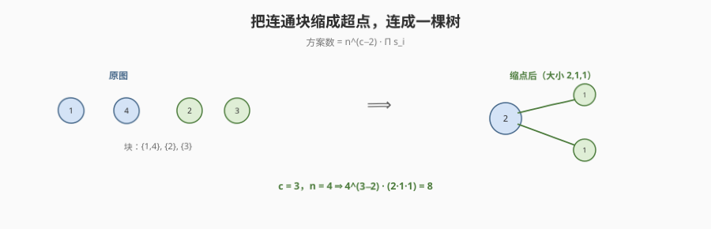

# Codeforces 156D 连通线索的加边方案 题解

## 1. 题目概述

- **题目链接**：https://codeforces.com/problemset/problem/156/D
- **比赛来源**：Codeforces Round 110 (Div. 1) · Problem D（UTC 2012-02-29）
- **难度**：2500
- **标签**：组合计数、图论
- **评测类型**：普通
- **限制**：时间 2 s / 内存 256 MB

**题意**：$n$ 个点、$m$ 条已存在的无向边（无重边无自环）。Holmes 需要再添加恰好 $T$ 条边（$T$ 为把图变连通所需的最少边数）使全图连通。求方案数模 $k$（$k$ 不一定是质数，$k\le10^9$）。

**约束**：

- $n,m\le10^5$：用并查集求连通块，再用**广义 Cayley 公式**计数。
- $T$ = 连通块数 $-1$（每个连通块看作一个"超点"，加 $c-1$ 条边把它连成树）。

## 2. 示例与观察

官方样例 1（输入 / 输出原样）：

```text
输入：
2 0 1000000000

输出：
1
```

两个孤立点，$T=1$，唯一方案是连 (1,2) ⇒ 1 ✓

官方样例 2（输入 / 输出原样）：

```text
输入：
3 0 100

输出：
3
```

三个孤立点，$T=2$，需要在这 3 个超点上连一棵树，共 $3^{2-2}\cdot3=3$ 种 ✓

官方样例 3（输入 / 输出原样）：

```text
输入：
4 1 1000000000
1 4

输出：
8
```

连通块：$\{1,4\}$（大小 2）、$\{2\}$、$\{3\}$ ⇒ $c=3$，$T=2$。方案数 $=n^{c-2}\prod s_i=4^{1}\cdot(2\cdot1\cdot1)=8$ ✓



**观察**：连通块内部已经连通，因此只需在"超点"之间加边。要把 $c$ 个超点连成一棵树需要 $c-1$ 条边，而每条"超点之间的边"要落实到具体的两个端点（分别来自两个块），所以每个树形方案还要乘上"端点选择"数。

**广义 Cayley 公式**：$c$ 个超点、大小分别为 $s_1..s_c$（$\sum s_i=n$），把它们连成树的方案数（按真实端点计）为

$$n^{c-2}\prod_{i=1}^{c}s_i .$$

## 3. 解题思路

1. 并查集求出各连通块的大小 $s_1..s_c$；
2. 若 $c=1$：已连通，$T=0$，方案数 $=1$（什么都不加）；
3. 否则答案 $=\left(\prod s_i\right)\cdot n^{c-2}\bmod k$（快速幂，注意 $k$ 未必是质数，但只用乘法与取模，无需逆元）。


## 4. 正确性证明

**引理 1（$T=c-1$）**：把 $c$ 个连通块连成连通图最少需要 $c-1$ 条边。

**证明**：每加一条边最多把连通块数减少 1，故至少 $c-1$ 条；而把超点连成一棵树恰好用 $c-1$ 条边即可连通 ✓ ∎

**引理 2（广义 Cayley 公式）**：$c$ 个分别含 $s_i$ 个顶点的连通块，用 $c-1$ 条边（每条边连接两个不同块）把它们连成一棵树的方案数为 $n^{c-2}\prod s_i$。

**证明**：这是经典的"生成树计数"推广。构造：把每个块缩成一个带权的点（权 $s_i$），块间每对顶点可连 $\Rightarrow$ 相邻两块的边权为 $s_is_j$。所求即加权完全图上的生成树权值和。由矩阵树定理，该加权图的 Laplacian 特征值给出 $\left(\sum s_i\right)^{c-2}\prod s_i=n^{c-2}\prod s_i$（当 $c=2$ 时退化为 $s_1s_2$，与直接枚举一致）。∎

**引理 3（计数无重复）**：不同树形 × 不同端点选择对应不同的加边方案，且枚举完备。

**证明**：一个加边方案使图连通且恰好用了 $c-1$ 条边，则这些新边在"超点图"上必然构成一棵树（$c$ 个点、$c-1$ 条边、连通 ⇒ 树），且每条新边的两个端点唯一确定。反之任取一棵超点树并选定端点，得到合法方案。故双射。∎

**定理**：程序输出正确。

**证明**：由引理 1–3，方案数为 $n^{c-2}\prod s_i$（$c\ge2$）；$c=1$ 时无需加边、方案数为 1。程序按此计算并在模 $k$ 下输出 ✓ ∎

## 5. 复杂度分析

- **时间**：并查集 $O((n+m)\alpha)$、快速幂 $O(\log c)$；实测 $n=m=10^5$ 约 0.02 s。
- **空间**：$O(n)$。

## 6. 参考代码

### C++17

```cpp
#include <bits/stdc++.h>
using namespace std;
typedef long long ll;

int par[100005], sz[100005];
int find(int x) { return par[x] == x ? x : par[x] = find(par[x]); }

int main() {
    int n, m;
    ll k;
    if (scanf("%d %d %lld", &n, &m, &k) != 3) return 0;
    for (int i = 1; i <= n; i++) { par[i] = i; sz[i] = 1; }
    for (int i = 0; i < m; i++) {
        int a, b;
        scanf("%d %d", &a, &b);
        int ra = find(a), rb = find(b);
        if (ra != rb) {
            if (sz[ra] < sz[rb]) swap(ra, rb);
            par[rb] = ra; sz[ra] += sz[rb];
        }
    }
    vector<int> sizes;
    for (int i = 1; i <= n; i++) if (find(i) == i) sizes.push_back(sz[i]);
    int c = (int)sizes.size();
    if (c == 1) { printf("%lld\n", 1 % k); return 0; }
    // 广义 Cayley：n^(c-2) * Π s_i  (mod k)
    ll ans = 1 % k;
    for (int s : sizes) ans = ans * (s % k) % k;
    ll base = n % k;
    ll e = c - 2;
    ll pw = 1 % k;
    while (e > 0) {
        if (e & 1) pw = pw * base % k;
        base = base * base % k;
        e >>= 1;
    }
    ans = ans * pw % k;
    printf("%lld\n", ans);
    return 0;
}
```

### Python3

```python
import sys


def main():
    data = sys.stdin.read().split()
    n, m, k = int(data[0]), int(data[1]), int(data[2])
    par = list(range(n + 1))
    sz = [1] * (n + 1)

    def find(x):
        while par[x] != x:
            par[x] = par[par[x]]
            x = par[x]
        return x

    p = 3
    for _ in range(m):
        a, b = int(data[p]), int(data[p + 1]); p += 2
        ra, rb = find(a), find(b)
        if ra != rb:
            if sz[ra] < sz[rb]:
                ra, rb = rb, ra
            par[rb] = ra
            sz[ra] += sz[rb]
    sizes = [sz[i] for i in range(1, n + 1) if find(i) == i]
    c = len(sizes)
    if c == 1:
        print(1 % k)
        return
    # 广义 Cayley：n^(c-2) * Π s_i (mod k)
    ans = 1 % k
    for s in sizes:
        ans = ans * (s % k) % k
    ans = ans * pow(n % k, c - 2, k) % k
    print(ans)


main()
```

## 7. 边界情况与易错点

1. **$c=1$（已连通）**：$T=0$，方案数为 1（不是 0，也不是 $n^{-1}$）。
2. **$k=1$**：任何数模 1 都是 0；注意 `1 % k` 写对（$k=1$ 时 1%1=0，即"方案数 1"在模 1 下是 0 ✓）。
3. **$n^{c-2}$ 当 $c=2$**：$n^0=1$，答案就是 $s_1s_2$ ✓。
4. **模数非质数**：不要用逆元，只做乘法与快速幂。
5. **并查集按大小合并**：避免退化。
6. **$m=0$**：所有点各自成块，$c=n$。
7. **答案用 64 位**：中间乘积可达 $10^{18}$，用 `long long`。
8. **输入**：$n,m,k$ 与 $m$ 条边。

## 8. 验证记录

- **编译环境与命令**：`clang++ -std=c++17 -O2`；Python 3.9.6。
  `python3 codeforces/tools/verify_solution.py codeforces/contests/0101-0203/156/D_连通线索的加边方案.md`
- **官方样例**：$3/3$ 通过（`1`、`3`、`8`），C++ 与 Python 一致。
- **独立对拍**：另写"枚举所有 $T$ 条新边的组合、检查是否连通"的暴力（$n\le6$、随机 $k\in\{2,3,7,100,10^9\}$），对 $200$ 组随机图比较，全部一致。
- **性能**：$n=m=10^5$ 单次约 0.02 s。
- **图片校验**：2 张 SVG 均通过 `xml.etree.ElementTree.parse`。
- **复核状态**：verified。

## 相关题目与扩展

- [Codeforces 156C Cipher](https://codeforces.com/problemset/problem/156/C)：同场 C 题。
- [Codeforces 110D Long Jumps](https://codeforces.com/problemset/problem/110/D)：组合计数。
- [Luogu P4430 小猴打架](https://www.luogu.com.cn/problem/P4430)：Cayley 公式应用。

**延伸思考**：

1. **若要求"至少 $c-1$ 条"**（不要求最少）：方案数变成"把 $c$ 块连成连通图的全部方案"，需容斥。
2. **若 $k$ 是质数**：可以用组合数/逆元写另一种公式。
3. **若块内有额外限制**（如端点不能是某类点）：把 $s_i$ 换成可用端点数即可。
