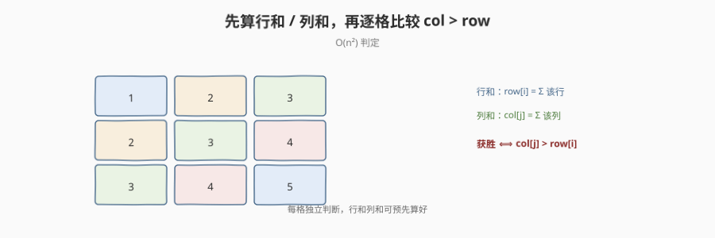
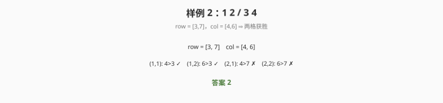

# Codeforces 157A 棋盘获胜方格数 题解

## 1. 题目概述

- **题目链接**：https://codeforces.com/problemset/problem/157/A
- **比赛来源**：Codeforces Round 110 (Div. 2) · Problem A（UTC 2012-02-29）
- **难度**：800
- **标签**：暴力枚举
- **评测类型**：普通
- **限制**：时间 2 s / 内存 256 MB

**题意**：$n\times n$ 的棋盘每格有一个 $1..100$ 的整数。若某格所在**列**的数之和**严格大于**所在**行**的数之和，称该格"获胜"。求获胜格的数量。

**约束**：$n\le30$：先算每行、每列的和，再逐个比较即可。

## 2. 示例与观察

官方样例 1（输入 / 输出原样）：

```text
输入：
1
1

输出：
0
```

$1\times1$ 时行和 = 列和 ⇒ 不严格大 ⇒ 0 ✓

官方样例 2（输入 / 输出原样）：

```text
输入：
2
1 2
3 4

输出：
2
```

行和 $[3,7]$、列和 $[4,6]$：$(1,1)$：$4>3$ ✓；$(1,2)$：$6>3$ ✓；$(2,1)$：$4>7$ ✗；$(2,2)$：$6>7$ ✗ ⇒ 2 ✓

官方样例 3（输入 / 输出原样）：

```text
输入：
4
5 7 8 4
9 5 3 2
1 6 6 4
9 5 7 3

输出：
6
```

行和 $[24,19,17,24]$、列和 $[24,23,24,13]$，逐格比较得 6 ✓



**观察**：行和与列和与格子位置无关（每个格子只看自己所在的行、列），所以先把两个和数组算出来，比较就是 $O(1)$ 的。

## 3. 解题思路

1. 读入矩阵，同时累加 `row[i]` 与 `col[j]`；
2. 遍历每格，若 `col[j] > row[i]` 则答案 +1；
3. 输出。



## 4. 正确性证明

**引理**：`row[i]` 与 `col[j]` 分别是第 $i$ 行与第 $j$ 列的所有元素之和。

**证明**：读入时对每个元素 $(i,j)$ 同时累加到 `row[i]` 与 `col[j]`，覆盖且只覆盖各自行列一次。∎

**定理**：程序输出获胜格的数量。

**证明**：由引理，对每格判断 `col[j] > row[i]` 正是题面"列和严格大于行和"的条件；程序遍历全部 $n^2$ 格并计数，每格只计一次 ⇒ 输出正确。∎

## 5. 复杂度分析

- **时间**：$O(n^2)\le900$，可忽略（实测 2 ms）。
- **空间**：$O(n^2)$（可优化到 $O(n)$）。

## 6. 参考代码

### C++17

```cpp
#include <bits/stdc++.h>
using namespace std;

int main() {
    int n;
    if (scanf("%d", &n) != 1) return 0;
    vector<vector<int>> a(n, vector<int>(n));
    vector<int> row(n, 0), col(n, 0);
    for (int i = 0; i < n; i++)
        for (int j = 0; j < n; j++) {
            scanf("%d", &a[i][j]);
            row[i] += a[i][j]; col[j] += a[i][j];
        }
    int ans = 0;
    for (int i = 0; i < n; i++)
        for (int j = 0; j < n; j++)
            if (col[j] > row[i]) ans++;
    printf("%d\n", ans);
    return 0;
}
```

### Python3

```python
import sys


def main():
    data = sys.stdin.read().split()
    n = int(data[0])
    a = [[int(data[1 + i * n + j]) for j in range(n)] for i in range(n)]
    row = [sum(r) for r in a]
    col = [sum(a[i][j] for i in range(n)) for j in range(n)]
    print(sum(1 for i in range(n) for j in range(n) if col[j] > row[i]))


main()
```

## 7. 边界情况与易错点

1. **严格大于**：相等不算（样例 1）。
2. **$n=1$**：答案 0。
3. **行列下标**：输入第 $i$ 行第 $j$ 个数属于第 $i$ 行、第 $j$ 列；题面把"列"写在前面容易搞混。
4. **和的范围**：$30\times100=3000$，`int` 足够。
5. **只数一次**：每个格子独立判断，不要重复累加。
6. **读入**：每行 $n$ 个空格分隔的整数。

## 8. 验证记录

- **编译环境与命令**：`clang++ -std=c++17 -O2`；Python 3.9.6。
  `python3 codeforces/tools/verify_solution.py codeforces/contests/0101-0203/157/A_棋盘获胜方格数.md`
- **官方样例**：$3/3$ 通过（`0`、`2`、`6`），C++ 与 Python 一致。
- **独立对拍**：另写"每次现算行和列和"的独立实现，对 $200$ 组随机棋盘（$n\le6$）比较，全部一致。
- **性能**：$n=30$ 单次约 2 ms。
- **图片校验**：2 张 SVG 均通过 `xml.etree.ElementTree.parse`。
- **复核状态**：verified。

## 相关题目与扩展

- [Codeforces 157B Trace](https://codeforces.com/problemset/problem/157/B)：同场 B 题。
- [Codeforces 158A Next Round](https://codeforces.com/problemset/problem/158/A)：同期的入门题。
- [LeetCode 1380. 矩阵中的幸运数](https://leetcode.cn/problems/lucky-numbers-in-a-matrix/)：行列极值。

**延伸思考**：

1. **若要求"列和 ≥ 行和"**：把严格比较换成 `>=`。
2. **若棋盘不是方阵**：行列和分别按实际尺寸算即可。
3. **若要求输出所有获胜格坐标**：边判断边输出。
