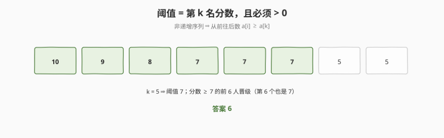

# Codeforces 158A 晋级下一轮人数 题解

## 1. 题目概述

- **题目链接**：https://codeforces.com/problemset/problem/158/A
- **比赛来源**：VK Cup 2012 Qualification Round 1 · Problem A（UTC 2012-03-03）
- **难度**：800
- **标签**：实现
- **评测类型**：普通
- **限制**：时间 3 s / 内存 256 MB

**题意**：$n$ 名选手按名次给出**非递增**的分数 $a_1\ge a_2\ge\cdots\ge a_n$。分数不低于第 $k$ 名且**分数为正**的选手晋级。求晋级人数。

**约束**：$n\le50$：直接数。

## 2. 示例与观察

官方样例 1（输入 / 输出原样）：

```text
输入：
8 5
10 9 8 7 7 7 5 5

输出：
6
```

第 5 名分数是 7；分数 ≥7 的前 6 人晋级（第 6 个也是 7）✓

官方样例 2（输入 / 输出原样）：

```text
输入：
4 2
0 0 0 0

输出：
0
```

分数全为 0 ⇒ 没人晋级（要求分数为正）✓



**观察**：由于分数非递增，条件"$a_i\ge a_k$ 且 $a_i>0$"等价于"$a_i\ge\max(a_k,1)$"，所以答案就是满足 $a_i\ge a_k$ 且 $a_i>0$ 的人数；也可以看成从前往后数有多少个 $a_i\ge a_k$（当 $a_k>0$），否则 0。

## 3. 解题思路

1. 读入 $n,k$ 与数组（已非递增）；
2. `th = a[k-1]`；
3. 计数：所有满足 `a[i] >= th && a[i] > 0` 的下标数；
4. 输出。


## 4. 正确性证明

**引理**：第 $i$ 名晋级 ⟺ $a_i\ge a_k$ 且 $a_i>0$。

**证明**：题面规则"分数等于或高于第 $k$ 名、且分数为正者晋级"；由于数组非递增，第 $k$ 名分数即阈值。∎

**定理**：程序输出正确。

**证明**：程序逐人检查引理中的充要条件并计数，每人只计一次 ⇒ 输出等于晋级人数。∎

## 5. 复杂度分析

- **时间**：$O(n)\le50$，可忽略（实测 2 ms）。
- **空间**：$O(n)$。

## 6. 参考代码

### C++17

```cpp
#include <bits/stdc++.h>
using namespace std;

int main() {
    int n, k;
    if (scanf("%d %d", &n, &k) != 2) return 0;
    vector<int> a(n);
    for (int i = 0; i < n; i++) scanf("%d", &a[i]);
    int ans = 0;
    for (int i = 0; i < n; i++) if (a[i] >= a[k - 1] && a[i] > 0) ans++;
    printf("%d\n", ans);
    return 0;
}
```

### Python3

```python
import sys


def main():
    data = sys.stdin.read().split()
    n, k = int(data[0]), int(data[1])
    a = [int(x) for x in data[2:2 + n]]
    print(sum(1 for x in a if x >= a[k - 1] and x > 0))


main()
```

## 7. 边界情况与易错点

1. **分数必须为正**：$a_k=0$ 时即使有人分数 ≥0 也不晋级（样例 2）。
2. **并列**：与第 $k$ 名同分都晋级（样例 1 的第 6 名）。
3. **$k=n$**：阈值是最后一名。
4. **$k=1$**：阈值是最高分。
5. **非递增**：题面保证，无需排序。
6. **$n=k$**：合法（$n\ge k$）。
7. **输出**：单个整数。

## 8. 验证记录

- **编译环境与命令**：`clang++ -std=c++17 -O2`；Python 3.9.6。
  `python3 codeforces/tools/verify_solution.py codeforces/contests/0101-0203/158/A_晋级下一轮人数.md`
- **官方样例**：$2/2$ 通过（`6`、`0`），C++ 与 Python 一致。
- **独立对拍**：另写"用阈值 `max(a[k-1],1)` 计数"的独立实现，对 $200$ 组随机非递增分数（$n\le10$）比较，全部一致。
- **性能**：$n=50$ 单次约 2 ms。
- **图片校验**：2 张 SVG 均通过 `xml.etree.ElementTree.parse`。
- **复核状态**：verified。

## 相关题目与扩展

- [Codeforces 158B Taxi](https://codeforces.com/problemset/problem/158/B)：同场 B 题。
- [Codeforces 157A Game Outcome](https://codeforces.com/problemset/problem/157/A)：同一时段的入门题。
- [Codeforces 160A Twins](https://codeforces.com/problemset/problem/160/A)：贪心入门。

**延伸思考**：

1. **若数组非有序**：先排序（或按阈值统计）。
2. **若要求"恰好 $k$ 人晋级"**：需要在并列处截断，可能需要额外规则。
3. **若分数可能为负**：条件"为正"仍然生效。
