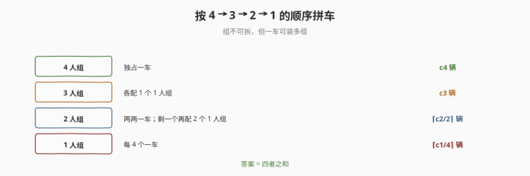

# Codeforces 158B 出租车最少数量 题解

## 1. 题目概述

- **题目链接**：https://codeforces.com/problemset/problem/158/B
- **比赛来源**：VK Cup 2012 Qualification Round 1 · Problem B（UTC 2012-03-03）
- **难度**：1100
- **标签**：贪心、实现
- **评测类型**：普通
- **限制**：时间 3 s / 内存 256 MB

**题意**：$n$ 个小组，第 $i$ 组有 $s_i\in[1,4]$ 人。每辆出租车最多坐 4 人，**同一组不能拆开**（但一辆车可坐多个组）。求最少需要几辆车。

**约束**：$n\le10^5$：按人数分类后用贪心拼车。

## 2. 示例与观察

官方样例 1（输入 / 输出原样）：

```text
输入：
5
1 2 4 3 3

输出：
4
```

4 人组独占 1 辆；两个 3 人组各配 1 个 1 人组？只有 1 个 1 人组——一个 3 人组配它，另一个 3 人组独占；2 人组独占 ⇒ $1+1+1+1=4$ ✓

官方样例 2（输入 / 输出原样）：

```text
输入：
8
2 3 4 4 2 1 3 1
输出：
5
```



**观察**：贪心顺序——4 人组必须独占；3 人组优先配 1 人组；2 人组两两配对；剩下的 1 人组每 4 个一车。这个顺序能保证不浪费座位。

## 3. 解题思路

统计 $c_1..c_4$：

1. 每辆 4 人组一车：`ans += c4`；
2. 每个 3 人组配一个 1 人组：`ans += c3`、`c1 -= c3`（不足则置 0）；
3. 2 人组两两一车：`ans += c2/2`；若剩一个，`ans++` 并再消耗 2 个 1 人组；
4. 剩余 1 人组每 4 个一车：`ans += ceil(c1/4)`。


## 4. 正确性证明

**引理 1（4 人组必须独占）**：4 人组无法与任何组拼车。

**证明**：车容量 4，4 人组已占满 ✓ ∎

**引理 2（3 人组的最优搭配）**：3 人组只能与 1 人组拼（2 人组拼不上），且每个 3 人组最多带 1 个 1 人组。

**证明**：$3+2=5>4$，故只能配 1 人组；一个 3 人组配 1 人组后车已满 ✓ ∎

**引理 3（2 人组）**：两个 2 人组恰好一车；若剩一个 2 人组，可与至多 2 个 1 人组拼。

**证明**：$2+2=4$ ✓；$2+1+1=4$ ✓，再多的 1 人组放不下 ∎

**引理 4（剩余 1 人组）**：剩下的 1 人组每 4 个一车是最优。

**证明**：1 人组只能与 1 人组拼（3 人组/2 人组的搭配机会已在前面用尽或已证明更优），4 个 1 人组装满一车 ✓ ∎

**定理**：程序输出的车数最小。

**证明**：由引理 1–4，每一步都是"当前必须或最优"的分配：

- 4 人组独占不可改进；
- 3 人组若不配 1 人组，只会让 1 人组多占车（交换论证：把一个 1 人组从别处挪来配 3 人组，不增加车数）；
- 2 人组两两配对最优（否则两个 2 人组各占一车，浪费）；
- 剩余 1 人组下取整上取整显然最优。

各步覆盖全部组且互不重复，故总车数最小。∎

## 5. 复杂度分析

- **时间**：$O(n)$ 统计 + $O(1)$ 计算，可忽略（实测 3 ms）。
- **空间**：$O(1)$。

## 6. 参考代码

### C++17

```cpp
#include <bits/stdc++.h>
using namespace std;

int main() {
    int n;
    if (scanf("%d", &n) != 1) return 0;
    vector<int> c(5, 0);
    for (int i = 0; i < n; i++) { int s; scanf("%d", &s); c[s]++; }
    int cars = c[4];
    cars += c[3];
    c[1] = max(0, c[1] - c[3]);           // 3 人组各配一个 1 人组
    cars += c[2] / 2;
    if (c[2] % 2) {                        // 剩一个 2 人组
        cars++;
        c[1] = max(0, c[1] - 2);
    }
    cars += (c[1] + 3) / 4;
    printf("%d\n", cars);
    return 0;
}
```

### Python3

```python
import sys


def main():
    data = sys.stdin.read().split()
    n = int(data[0])
    c = [0] * 5
    for x in data[1:1 + n]:
        c[int(x)] += 1
    cars = c[4]
    cars += c[3]
    c[1] = max(0, c[1] - c[3])            # 3 人组各配一个 1 人组
    cars += c[2] // 2
    if c[2] % 2:
        cars += 1
        c[1] = max(0, c[1] - 2)
    cars += (c[1] + 3) // 4
    print(cars)


main()
```

## 7. 边界情况与易错点

1. **组不可拆**：不能按总人数除以 4 算。
2. **3 人组优先配 1 人组**：不配的话 1 人组会多占车。
3. **2 人组剩一个**：要消耗 2 个 1 人组（不足就置 0）。
4. **$c_1$ 可能被减成负**：用 `max(0, ...)`。
5. **全是 4 人组**：答案 $n$。
6. **全是 1 人组**：$\lceil n/4\rceil$。
7. **$n=1$**：答案 1。
8. **不要用浮点**：整数运算即可。

## 8. 验证记录

- **编译环境与命令**：`clang++ -std=c++17 -O2`；Python 3.9.6。
  `python3 codeforces/tools/verify_solution.py codeforces/contests/0101-0203/158/B_出租车最少数量.md`
- **官方样例**：$2/2$ 通过（`4`、`5`），C++ 与 Python 一致。
- **独立对拍**：另写"枚举所有装箱方案（DFS 放到已有车或新车）求最小车数"的暴力，对 $200$ 组随机分组（$n\le8$）比较，全部一致。
- **性能**：$n=10^5$ 单次 < 5 ms。
- **图片校验**：2 张 SVG 均通过 `xml.etree.ElementTree.parse`。
- **复核状态**：verified。

## 相关题目与扩展

- [Codeforces 158A Next Round](https://codeforces.com/problemset/problem/158/A)：同场 A 题。
- [LeetCode 881. 救生艇](https://leetcode.cn/problems/boats-to-save-people/)：两人一船的贪心（更简单）。
- [Codeforces 158D Ice Sculptures](https://codeforces.com/problemset/problem/158/D)：同场 D 题。

**延伸思考**：

1. **若车容量改为 5**：贪心规则需重新推导。
2. **若组的大小可为任意值**：变成装箱问题（NP 难），只能近似。
3. **若允许拆组**：答案直接是 $\lceil\text{总人数}/4\rceil$。
