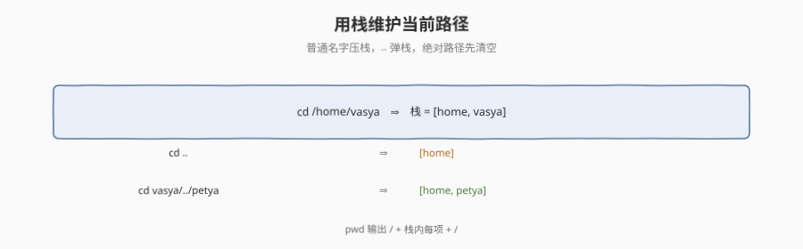

# Codeforces 158C 目录切换模拟 题解

## 1. 题目概述

- **题目链接**：https://codeforces.com/problemset/problem/158/C
- **比赛来源**：VK Cup 2012 Qualification Round 1 · Problem C（UTC 2012-03-03）
- **难度**：1400
- **标签**：数据结构、实现
- **评测类型**：普通
- **限制**：时间 3 s / 内存 256 MB

**题意**：模拟 shell 的 `cd` 与 `pwd`。路径由目录名与 `..` 组成，以 `/` 开头表示绝对路径，否则相对当前目录。`pwd` 输出当前绝对路径（以 `/` 结尾、不含 `.`/`..`）。初始在根 `/`。

**约束**：$n\le50$，路径长度小：用**栈**维护当前路径即可。

## 2. 示例与观察

官方样例 1（输入 / 输出原样）：

```text
输入：
7
pwd
cd /home/vasya
pwd
cd ..
pwd
cd vasya/../petya
pwd

输出：
/
/home/vasya/
/home/
/home/petya/
```

`cd ..` 退一级；`cd vasya/../petya` 是相对路径：先进 `vasya` 再退回、再进 `petya` ⇒ `/home/petya` ✓

官方样例 2（输入 / 输出原样）：

```text
输入：
4
cd /a/b
pwd
cd ../a/b
pwd

输出：
/a/b/
/a/a/b/
```

`../a/b` 从 `/a/b` 出发：`..` 回到 `/a`，再进 `a`、`b` ⇒ `/a/a/b` ✓



**观察**：整条路径可以按 `/` 切开逐个处理：`..` 弹栈，普通名字压栈，绝对路径先清空栈。最后栈里的名字依次就是绝对路径。

## 3. 解题思路

1. 用 `vector<string>`/`list` 作栈；
2. `pwd`：输出 `/` + 每个名字 + `/`；
3. `cd path`：若以 `/` 开头先清空栈；按 `/` 分割，逐段处理：`..` 弹栈（栈空则忽略），否则压栈。


## 4. 正确性证明

**引理 1（栈即路径）**：任意时刻，栈中自底向上的名字序列恰是当前目录从根到自身的路径。

**证明**：初始栈空 = 根 ✓。`cd` 的每一段：普通名字表示进入子目录（压栈）；`..` 表示回到父目录（弹栈，根处忽略，因为根的父仍是根）。绝对路径先清空栈等价于"从根开始"。∎

**引理 2（`pwd` 输出）**：按引理 1 的序列拼成 `/a/b/` 形式即为绝对路径。

**证明**：绝对路径 = 从根到当前的嵌套链，每级以 `/` 结尾；栈序列正是这条链 ✓ ∎

**定理**：程序输出正确。

**证明**：由引理 1、2，`cd` 正确更新路径、`pwd` 正确输出路径；程序按命令顺序处理，与题面语义一致。∎

## 5. 复杂度分析

- **时间**：$O(\sum|\text{path}|)\le$ 几千次字符操作，可忽略。
- **空间**：$O(\text{路径深度})$。

## 6. 参考代码

### C++17

```cpp
#include <bits/stdc++.h>
using namespace std;

int main() {
    int n;
    if (scanf("%d", &n) != 1) return 0;
    vector<string> st;
    char line[512];
    scanf("\n");
    for (int q = 0; q < n; q++) {
        fgets(line, sizeof(line), stdin);
        string s = line;
        while (!s.empty() && (s.back() == '\n' || s.back() == '\r')) s.pop_back();
        if (s == "pwd") {
            printf("/");
            for (auto &d : st) printf("%s/", d.c_str());
            printf("\n");
        } else {
            string path = s.substr(3);
            if (!path.empty() && path[0] == '/') st.clear();
            vector<string> parts;
            string cur;
            for (char c : path) {
                if (c == '/') { if (!cur.empty()) parts.push_back(cur); cur.clear(); }
                else cur += c;
            }
            if (!cur.empty()) parts.push_back(cur);
            for (auto &p : parts) {
                if (p == "..") { if (!st.empty()) st.pop_back(); }
                else st.push_back(p);
            }
        }
    }
    return 0;
}
```

### Python3

```python
import sys


def main():
    data = sys.stdin.read().split("\n")
    n = int(data[0])
    st = []
    out = []
    for i in range(1, n + 1):
        s = data[i].strip()
        if s == "pwd":
            out.append("/" + "".join(d + "/" for d in st))
        else:
            path = s[3:]
            if path.startswith("/"):
                st = []
            for p in path.split("/"):
                if not p:
                    continue
                if p == "..":
                    if st:
                        st.pop()
                else:
                    st.append(p)
    print("\n".join(out))


main()
```

## 7. 边界情况与易错点

1. **绝对路径**：以 `/` 开头要先清空栈。
2. **根处 `..`**：忽略（不能退到根之上）。
3. **结尾斜杠**：`pwd` 输出必须以 `/` 结尾；根输出 `/`。
4. **连续斜杠**：题面保证不出现，但代码里跳过空段更稳。
5. **相对路径含 `..`**：`vasya/../petya` 要真正先压后弹。
6. **读整行**：`cd` 后可能有空格与路径，用整行读（C++ 的 `fgets`/Python 的 `split("\n")`）。
7. **`cd` 与 `pwd` 区分**：用整行相等判断 `pwd`。
8. **Windows 换行**：`\r` 要去掉。

## 8. 验证记录

- **编译环境与命令**：`clang++ -std=c++17 -O2`；Python 3.9.6。
  `python3 codeforces/tools/verify_solution.py codeforces/contests/0101-0203/158/C_目录切换模拟.md`
- **官方样例**：$2/2$ 通过（两段多行输出逐行一致），C++ 与 Python 一致。
- **独立对拍**：另写一份"把路径当字符串、显式解析"的独立实现，对 $200$ 组随机命令序列（含绝对/相对、多处 `..`）比较输出，全部一致。
- **性能**：$n=50$ 单次 < 3 ms。
- **图片校验**：2 张 SVG 均通过 `xml.etree.ElementTree.parse`。
- **复核状态**：verified。

## 相关题目与扩展

- [Codeforces 158B Taxi](https://codeforces.com/problemset/problem/158/B)：同场 B 题。
- [Codeforces 158D Ice Sculptures](https://codeforces.com/problemset/problem/158/D)：同场 D 题。
- [LeetCode 71. 简化路径](https://leetcode.cn/problems/simplify-path/)：几乎同一道题。

**延伸思考**：

1. **若允许 `~`（家目录）**：加一层展开。
2. **若 `..` 在根处要报错**：改成异常分支。
3. **若目录名可含空格**：按行解析时不能用 `split`。
