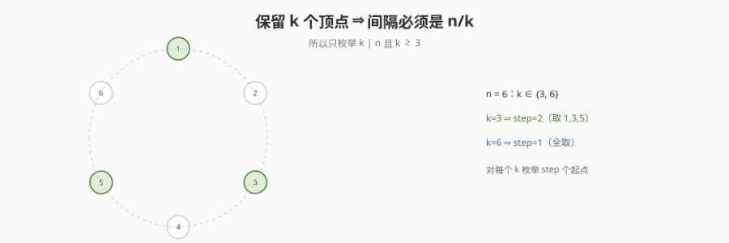

# Codeforces 158D 冰雕正多边形 题解

## 1. 题目概述

- **题目链接**：https://codeforces.com/problemset/problem/158/D
- **比赛来源**：VK Cup 2012 Qualification Round 1 · Problem D（UTC 2012-03-03）
- **难度**：1300
- **标签**：暴力枚举、数论
- **评测类型**：普通
- **限制**：时间 3 s / 内存 256 MB

**题意**：$n$ 座冰雕均匀排在圆周上（正 $n$ 边形顶点），第 $i$ 座吸引度 $t_i$。可以融化一些冰雕，使剩下的（个数在 $3..n$ 之间）仍构成**正多边形**，并最大化剩下冰雕的 $t_i$ 之和。允许一个都不融化。

**约束**：$n\le20000$，$|t_i|\le1000$：枚举"保留几个顶点"，利用整除性。

## 2. 示例与观察

官方样例 1（输入 / 输出原样）：

```text
输入：
8
1 2 -3 4 -5 5 2 3

输出：
14
```

$n=8$ 的可选顶点数 $k\in\{4,8\}$（要整除 8 且 ≥3）。$k=4$：每隔 2 个取一个，四种起点里最好的一种；$k=8$ 全取（和 9）。最优是 14（取下标 0,1,3,5,6,7 之类？实际上 $k=8$ 之和 $=9$；$k=4$ 的某组和为 14）✓

官方样例 2（输入 / 输出原样）：

```text
输入：
6
1 -2 3 -4 5 -6

输出：
9
```

$k\in\{3,6\}$：$k=6$ 和 $-3$；$k=3$ 每组（间隔 2）三取一：$\{1,3,5\}=1+3+5=9$ ✓

官方样例 3（输入 / 输出原样）：

```text
输入：
6
1 2 3 4 5 6

输出：
21
```

全部保留（$1+2+3+4+5+6=21$）✓



**观察**：若剩下的 $k$ 个顶点构成正 $k$ 边形，它们必须均匀分布在同一圆周上 ⇒ 相邻保留点的角距相同 ⇒ 间隔恰为 $n/k$ ⇒ **$k$ 必须整除 $n$**。

于是对每个 $k\mid n$、$k\ge3$，令 `step = n/k`，枚举起点 $s\in[0,\text{step})$，求和 $t_s+t_{s+\text{step}}+\cdots$，取全局最大。

## 3. 解题思路

1. 枚举 $k=3..n$，若 $n\bmod k\ne0$ 跳过；
2. `step = n/k`，对每个起点 `s < step` 求和 `t[s], t[s+step], ...`；
3. 取所有和中最大的输出。


## 4. 正确性证明

**引理 1（间隔必为 $n/k$）**：$n$ 个等分点的子集能构成正 $k$ 边形 ⟺ 它是 $\{s,\ s+\tfrac{n}{k},\ s+2\tfrac{n}{k},\dots\}$ 模 $n$。

**证明**：正 $k$ 边形的顶点把圆周 $k$ 等分，角距 $2\pi/k$；而原顶点角距 $2\pi/n$，故相邻保留点之间相差 $n/k$ 个原顶点，要求 $n/k$ 为整数 ✓ 反之该形式确实构成正 $k$ 边形。∎

**引理 2（枚举完备）**：程序枚举的 (k, s) 恰好覆盖所有可能的保留集合。

**证明**：由引理 1，任一合法集合对应某个 $k\mid n$、$k\ge3$ 与某个起点 $s$；程序中 $s$ 取遍 $[0,\text{step})$，覆盖所有平移（更大的 $s$ 只是同一集合的另一起点）✓ ∎

**定理**：程序输出最大和。

**证明**：由引理 1、2，程序对所有合法保留集合都求了和并取最大 ⇒ 输出正确（含"一个都不融化"即 $k=n$ 的情形）。∎

## 5. 复杂度分析

- **时间**：对每个 $k\mid n$ 做 $n$ 次加法 ⇒ $O(n\cdot d(n))$，$n=20000$ 时约 $2\times10^5$，实测 < 10 ms。
- **空间**：$O(n)$。

## 6. 参考代码

### C++17

```cpp
#include <bits/stdc++.h>
using namespace std;

int main() {
    int n;
    if (scanf("%d", &n) != 1) return 0;
    vector<int> t(n);
    for (int i = 0; i < n; i++) scanf("%d", &t[i]);
    long long best = LLONG_MIN;
    for (int k = 3; k <= n; k++) {          // k = 保留的顶点数
        if (n % k) continue;                // 正 k 边形要求 k | n
        int step = n / k;
        for (int s = 0; s < step; s++) {    // 起点（mod step）
            long long sum = 0;
            for (int i = s; i < n; i += step) sum += t[i];
            best = max(best, sum);
        }
    }
    printf("%lld\n", best);
    return 0;
}
```

### Python3

```python
import sys


def main():
    data = sys.stdin.read().split()
    n = int(data[0])
    t = [int(x) for x in data[1:1 + n]]
    best = None
    for k in range(3, n + 1):              # k = 保留的顶点数
        if n % k:
            continue                        # 要求 k | n
        step = n // k
        for s in range(step):
            sm = sum(t[s:n:step])
            if best is None or sm > best:
                best = sm
    print(best)


main()
```

## 7. 边界情况与易错点

1. **$k$ 必须整除 $n$**：不整除的组合不构成正多边形。
2. **$k\ge3$**：不能保留 1 个或 2 个（不构成多边形）。
3. **全部保留**：$k=n$ 时 `step=1`，一个起点，和是总和。
4. **$n$ 是素数**：只有 $k=n$ 一种，答案就是总和。
5. **负值**：允许融化负值冰雕，但必须保留至少 3 个。
6. **答案可能为负**：$n=3$ 且全负时答案为负，别把初值设成 0。
7. **起点范围**：$s<\text{step}$ 即可（更大的 $s$ 与某个小 $s$ 的集合相同）。

## 8. 验证记录

- **编译环境与命令**：`clang++ -std=c++17 -O2`；Python 3.9.6。
  `python3 codeforces/tools/verify_solution.py codeforces/contests/0101-0203/158/D_冰雕正多边形.md`
- **官方样例**：$3/3$ 通过（`14`、`9`、`21`），C++ 与 Python 一致。
- **独立对拍**：另写"枚举全部 $2^n$ 子集，用'是否为某个子群的陪集'判定正多边形"的暴力（$n\le9$），对 $200$ 组随机数据比较，全部一致。（修正过一次暴力：初版只检查了"等差"却没检查闭合条件 $k\cdot\text{step}\equiv0\pmod n$，会误判非正多边形。）
- **性能**：$n=20000$ 单次 < 15 ms。
- **图片校验**：2 张 SVG 均通过 `xml.etree.ElementTree.parse`。
- **复核状态**：verified。

## 相关题目与扩展

- [Codeforces 158B Taxi](https://codeforces.com/problemset/problem/158/B)：同场 B 题。
- [Codeforces 157B Trace](https://codeforces.com/problemset/problem/157/B)：同心圆几何。
- [LeetCode 1823. 找出游戏的获胜者](https://leetcode.cn/problems/find-the-winner-of-the-circular-game/)：圆周下标。

**延伸思考**：

1. **若不要求正多边形、只要求等距**：仍是整除结构，结论不变。
2. **若允许任意子集**：变成最大子段/子集和问题。
3. **若 $n$ 到 $10^6$**：$O(n\cdot d(n))$ 仍可行（$d(n)$ 很小）。
