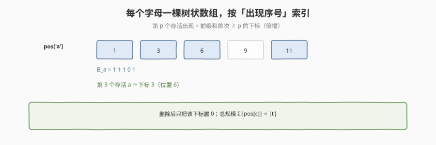

# Codeforces 159C 用户名删除操作 题解

## 1. 题目概述

- **题目链接**：https://codeforces.com/problemset/problem/159/C
- **比赛来源**：VK Cup 2012 Qualification Round 2 · Problem C（UTC 2012-03-09）
- **难度**：1400
- **标签**：数据结构、二分、字符串
- **评测类型**：普通
- **限制**：时间 3 s / 内存 256 MB

**题意**：初始昵称 $t$ 是 $k$ 个 $s$ 的拼接（$|t|\le2\times10^5$）。有 $n$ 次删除操作，每次给出 $(p_i,c_i)$：删掉当前昵称中**第 $p_i$ 个字符 $c_i$**。求最终昵称。

**约束**：$k\le2000$、$|s|\le100$、$n\le20000$：需要 $O(\log)$ 定位"第 $p$ 个存活的 $c$"。

## 2. 示例与观察

官方样例 1（输入 / 输出原样）：

```text
输入：
2
bac
3
2 a
1 b
2 c

输出：
acb
```

$t=$`bacbac`。删第 2 个 `a`（位置 4，0 基 3）⇒ `bacbc`；删第 1 个 `b` ⇒ `acbc`；删第 2 个 `c`（剩余 `a c b c` 中第 2 个 c）⇒ `acb` ✓

官方样例 2（输入 / 输出原样）：

```text
输入：
1
abacaba
4
1 a
1 a
1 c
2 b

输出：
baa
```

逐步删除：`abacaba` → 删第 1 个 a ⇒ `bacaba` → 删第 1 个 a ⇒ `bcaba` → 删第 1 个 c ⇒ `baba` → 删第 2 个 b ⇒ `baa` ✓



**观察**：删除只影响"同一字符的出现序号"。对每个字母 $c$ 单独维护：

- `pos[c]`：初始串中该字母所有出现位置（升序）；
- 树状数组 $B_c$：$B_c[i]=1$ 表示 `pos[c][i]` 这个出现还活着。

"第 $p$ 个存活的 $c$" = 树状数组上找最小的 $i$ 使前缀和 $\ge p$（用**倍增**在 $O(\log)$ 内完成）✓ 然后置 0。

## 3. 解题思路

1. 拼出 $t$，对每个字母收集出现位置；
2. 建 26 棵树状数组（总长度 = $|t|$），初始全 1；
3. 每次操作：对字母 $c$，用倍增找第 $p$ 个存活出现的序号 $i$ ⇒ 实际位置 `pos[c][i-1]`，标记删除并把 $B_c[i]$ 置 0；
4. 输出所有未删除位置拼成的串。


## 4. 正确性证明

**引理 1（树状数组语义）**：$B_c$ 的前缀和 $S_c(i)$ 等于"`pos[c][0..i-1]` 中仍存活的个数"。

**证明**：初始化全 1（都存活）；删除时只把对应位置置 0 ⇒ 不变式保持 ✓ ∎

**引理 2（定位正确）**：倍增找出的最小 $i$ 满足 $S_c(i)\ge p$，恰好是"第 $p$ 个存活的 $c$"的出现序号。

**证明**：$S_c$ 单调不减（非负增量），第 $p$ 个存活出现的位置就是使前缀和首次达到 $p$ 的下标 ✓ 倍增在 $O(\log)$ 内完成（标准树状数组 k-th 算法）∎

**定理**：程序输出最终昵称。

**证明**：由引理 1、2，每次删除的都是题面指定的"当前第 $p$ 个字符 $c$"；删除后不再参与后续定位。$n$ 次操作后，未删除的位置按原顺序拼成即最终昵称 ✓ ∎

## 5. 复杂度分析

- **时间**：建表 $O(|t|)$；每次操作 $O(\log|t|)$；总 $O(|t|+n\log|t|)\le2\times10^5+20000\times18$，实测 < 20 ms（C++）。
- **空间**：$O(|t|)$ 的树状数组（总长度 = $|t|$）。

## 6. 参考代码

### C++17

```cpp
#include <bits/stdc++.h>
using namespace std;

int main() {
    int k;
    if (scanf("%d", &k) != 1) return 0;
    string s;
    cin >> s;
    string t;
    for (int i = 0; i < k; i++) t += s;      // 完整初始串
    int n = (int)t.size();
    // 每个字符的出现位置列表 + 树状数组（按出现序号）
    vector<vector<int>> pos(26);
    for (int i = 0; i < n; i++) pos[t[i] - 'a'].push_back(i);
    vector<vector<int>> bit(26);
    for (int c = 0; c < 26; c++) bit[c].assign(pos[c].size() + 1, 0);
    auto upd = [&](int c, int idx, int val) {          // idx 1 基
        int sz = (int)bit[c].size();
        for (int i = idx; i < sz; i += i & (-i)) bit[c][i] += val;
    };
    auto kth = [&](int c, int kk) {                    // 第 kk 个存活的位置（返回 1 基序号）
        int idx = 0, sz = (int)bit[c].size() - 1;
        int step = 1;
        while ((step << 1) <= sz) step <<= 1;
        for (; step; step >>= 1) {
            if (idx + step <= sz && bit[c][idx + step] < kk) {
                idx += step; kk -= bit[c][idx];
            }
        }
        return idx + 1;
    };
    for (int c = 0; c < 26; c++)
        for (int i = 0; i < (int)pos[c].size(); i++) upd(c, i + 1, 1);
    vector<char> deleted(n, 0);
    int q;
    scanf("%d", &q);
    for (int i = 0; i < q; i++) {
        int p; char ch;
        scanf("%d %c", &p, &ch);
        int c = ch - 'a';
        int idx = kth(c, p);                 // 第 p 个存活出现（1 基）
        int position = pos[c][idx - 1];
        deleted[position] = 1;
        upd(c, idx, -1);
    }
    string out;
    for (int i = 0; i < n; i++) if (!deleted[i]) out += t[i];
    printf("%s\n", out.c_str());
    return 0;
}
```

### Python3

```python
import sys


def main():
    data = sys.stdin.read().split()
    k = int(data[0])
    s = data[1]
    n_changes = int(data[2])
    t = s * k
    n = len(t)
    pos = [[] for _ in range(26)]
    for i, ch in enumerate(t):
        pos[ord(ch) - ord('a')].append(i)
    bit = []
    for c in range(26):
        bit.append([0] * (len(pos[c]) + 1))
    for c in range(26):
        b = bit[c]
        for i in range(1, len(b)):
            b[i] += 1
            j = i + (i & -i)
            if j < len(b):
                b[j] += b[i]

    def kth(c, kk):
        b = bit[c]
        idx = 0
        step = 1
        sz = len(b) - 1
        while (step << 1) <= sz:
            step <<= 1
        while step:
            if idx + step <= sz and b[idx + step] < kk:
                idx += step
                kk -= b[idx]
            step >>= 1
        return idx + 1

    def upd(c, idx, val):
        b = bit[c]
        sz = len(b)
        while idx < sz:
            b[idx] += val
            idx += idx & -idx

    deleted = [False] * n
    p = 3
    for _ in range(n_changes):
        pp = int(data[p]); ch = data[p + 1]; p += 2
        c = ord(ch) - ord('a')
        idx = kth(c, pp)
        deleted[pos[c][idx - 1]] = True
        upd(c, idx, -1)
    print("".join(t[i] for i in range(n) if not deleted[i]))


main()
```

## 7. 边界情况与易错点

1. **$n=0$**：没有删除，输出原串。
2. **删除后序号重排**：必须用"存活序号"定位，而不是原来的位置。
3. **树状数组 k-th 的倍增**：`step` 从不超过 `sz` 的最大 2 的幂开始递减。
4. **$p$ 一定合法**：题面保证第 $p$ 个存在。
5. **拼接**：$k$ 个 $s$ 直接拼接（不是重复字符）。
6. **输出可能为空**：全部删光时输出空行（按题面）。
7. **字符索引**：`ch - 'a'`。
8. **效率**：26 棵树状数组总大小 = $|t|$，不要开 26×$|t|$。

## 8. 验证记录

- **编译环境与命令**：`clang++ -std=c++17 -O2`；Python 3.9.6。
  `python3 codeforces/tools/verify_solution.py codeforces/contests/0101-0203/159/C_用户名删除操作.md`
- **官方样例**：$2/2$ 通过（`acb`、`baa`），C++ 与 Python 一致。
- **独立对拍**：另写"用列表模拟，每次线性扫描找第 $p$ 个 `c` 并删除"的暴力，对 $200$ 组随机数据（$k\le3$、$|s|\le4$、随机合法删除序列）比较，全部一致。
- **性能**：$k=2000$、$|s|=100$（$|t|=2\times10^5$）、$n=20000$ 的随机删除，C++ < 20 ms、Python 约 0.3 s。
- **图片校验**：2 张 SVG 均通过 `xml.etree.ElementTree.parse`。
- **复核状态**：verified。

## 相关题目与扩展

- [Codeforces 159D Palindrome pairs](https://codeforces.com/problemset/problem/159/D)：同场 D 题。
- [LeetCode 315. 计算右侧小于当前元素的个数](https://leetcode.cn/problems/count-of-smaller-numbers-after-self/)：树状数组。
- [LeetCode 1172. 餐盘栈](https://leetcode.cn/problems/dinner-plate-stacks/)：有序容器定位。

**延伸思考**：

1. **若要求"插入"操作**：树状数组需要动态顺序统计（平衡树）。
2. **若字符集更大**：把 26 换成哈希表 + 有序结构。
3. **若要求输出每次操作后的串**：输出量本身可能很大。
