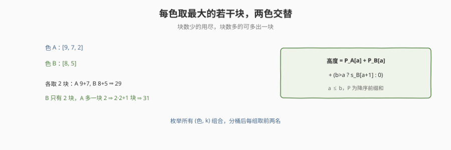

# Codeforces 159E 斑马塔最大高度 题解

## 1. 题目概述

- **题目链接**：https://codeforces.com/problemset/problem/159/E
- **比赛来源**：VK Cup 2012 Qualification Round 2 · Problem E（UTC 2012-03-09）
- **难度**：1700
- **标签**：数据结构、贪心、排序
- **评测类型**：特殊评测（塔的朝向不唯一）
- **限制**：时间 1.5 s / 内存 256 MB

**题意**：$n$ 个方块，各有颜色 $c_i$ 与尺寸 $s_i$。要用**恰好两种颜色**搭一座"斑马塔"：相邻方块颜色必须不同，至少 2 块。塔高 = 所有用到的方块尺寸之和。求最高塔，并输出方案（从底到顶的方块编号）。

**约束**：$n\le10^5$：按颜色分组，每组内按尺寸降序。若用颜色 $A,B$（块数 $a\le b$），最多取 $a$ 块 $A$ 与 $a{+}1$ 块 $B$（或各 $a$ 块），当然取**最大的那些**。

## 2. 示例与观察

官方样例 1（输入 / 输出原样）：

```text
输入：
4
1 2
1 3
2 4
3 3

输出：
9
3
2 3 1
```

颜色 1 有 [3,2]，颜色 2 有 [4]，颜色 3 有 [3]。
- (1,2)：$a=1,b=1$：$3+4=7$；但颜色 1 还有第 2 块，可取 1 块颜色 2 + 2 块颜色 1（交替）⇒ $3+2+4=9$ ✓
- (1,3)：$3+2+3=8$；(2,3)：$4+3=7$。
最高 9，塔：$4$（色 2）、$3$（色 1）、$2$（色 1）？不行——相邻必须异色，所以是 色 2(4)、色 1(3)、色 2?… 样例给的顺序 `2 3 1` = 方块 2（色 1, 尺寸 3）、方块 3（色 2, 4）、方块 1（色 1, 2）⇒ 颜色 1,2,1 交替 ✓ 高度 9 ✓

官方样例 2（输入 / 输出原样）：

```text
输入：
2
1 1
2 1

输出：
2
2
2 1
```

两块异色，任意顺序 ⇒ 高 2 ✓



**观察 1（取最大）**：尺寸都为正，所以给定"用哪两色、各用几块"，一定取各自**尺寸最大**的那几块。

**观察 2（块数）**：设两色分别有 $a\le b$ 块。交替塔最多用 $2a$ 块（各 $a$），若 $b>a$ 还能多用一块较大的颜色 ⇒ 最多 $2a+1$ 块。再多就必须在某一色上连续，不允许。

**观察 3（关键化简）**：最优方案中，块数较少的那一色**恰好用完了它全部的 $a$ 块**？不一定——它可能只用 $k<a$ 块（当它的前 $k$ 块很大而第 $k+1$ 块很小时，少用反而更糟？不，尺寸为正，多用一个正数总是更好，但前提是另一色有足够的块与之交替 ✓）。若另一色块数 $b\ge k$，则多用一个也总是合法的，所以**较少的那色会用尽**（$k=a$）；若 $a<b$，还能多用一个大的颜色 ⇒ $2a+1$。

**结论**：对每对颜色 $(A,B)$，设 $a\le b$，塔高 $=P_A[a]+P_B[a]+\big([b>a]\,s_B[a{+}1]\big)$，其中 $P$ 为降序前缀和。

## 3. 解题思路

1. 按颜色分组，组内降序，求前缀和 `P_c[k]`；
2. 令 `val_c(k) = P_c[k] + (cnt_c > k ? s_c[k+1] : 0)`（"若这一色是被多取一块的那一色"的完整价值）；
3. 对每个 $k$：把所有 `cnt_c ≥ k` 的色按 `val_c(k)` 排序，取前两名；对每个 `cnt_c == k` 的色 $c$，配它最好的伙伴（不是自己的第一名，否则用第二名），塔高 $=P_c[k]+\text{val}_{\text{partner}}(k)$；
4. 取最大并回溯输出。

**复杂度**：所有 $(c,k)$ 组合共 $\sum_k|\{c:cnt_c\ge k\}|=\sum_c cnt_c=n$ 个 ⇒ 分桶后每组排序，总 $O(n\log n)$。


## 4. 正确性证明

**引理 1（块数上界）**：两色块数为 $a\le b$ 时，交替塔至多 $2a+1$ 块，且 $2a$ 与（当 $b>a$ 时）$2a+1$ 均可实现。

**证明**：交替序列中两种颜色块数之差 $\le1$ ⇒ 至多 $2a+1$；构造：色 $B$ 一块打头，之后 $A,B$ 交替 ✓ ∎

**引理 2（取最大的几块）**：固定颜色与块数，取该色最大的若干块最优。

**证明**：尺寸为正，替换成更大的块不破坏交替结构（只换编号不换颜色）✓ ∎

**引理 3（枚举完备）**：最优解一定在"某色用尽全部块数（$k=cnt_c$）、另一色用 $k$ 或 $k+1$ 块"的候选中。

**证明**：设最优用两色 $A,B$，块数 $a\le b$，实际使用了 $k_A\le a$、$k_B\le b$ 块且 $|k_A-k_B|\le1$。若 $k_A<a$：由于 $B$ 的剩余块数 $b-k_B\ge a-k_A\ge1$（因为 $b\ge a$），可把 $A$ 的第 $k_A+1$ 大块与 $B$ 的下一块加入（保持交替、块数差仍 $\le1$），高度增加（尺寸为正）⇒ 矛盾于最优。故 $k_A=a$；再由引理 1，$k_B\in\{a,a+1\}$ ✓ ∎

**定理**：程序输出最大高度，且给出的塔合法。

**证明**：由引理 3，最优解必在枚举范围内；由引理 1、2，候选值 $P_A[a]+P_B[a](+s_B[a{+}1])$ 正是该颜色组合的最优高度；程序对每个 $k$ 取"用尽 $k$ 块的那一色"与"最佳伙伴"（第一名若同色则第二名）组合，覆盖所有候选 ⇒ 输出最大值。输出阶段按交替顺序排列编号，同色不相邻且恰好两色 ✓ ∎

## 5. 复杂度分析

- **时间**：分组排序 $O(n\log n)$；分桶 $O(n)$；每组排序总计 $O(n\log n)$；实测 $n=10^5$ 约 0.04 s。
- **空间**：$O(n)$。

## 6. 参考代码

### C++17

```cpp
#include <bits/stdc++.h>
using namespace std;
typedef long long ll;

int main() {
    int n;
    if (scanf("%d", &n) != 1) return 0;
    map<int, vector<pair<int,int>>> byColor;      // color -> (size, index)
    for (int i = 1; i <= n; i++) {
        int c, s;
        scanf("%d %d", &c, &s);
        byColor[c].push_back({s, i});
    }
    vector<int> colors;
    vector<vector<ll>> pref;                      // pref[c][k]，k=1..cnt
    for (auto &kv : byColor) {
        auto &v = kv.second;
        sort(v.begin(), v.end(), [](const pair<int,int> &a, const pair<int,int> &b) { return a.first > b.first; });
        vector<ll> p(v.size() + 1, 0);
        for (size_t i = 0; i < v.size(); i++) p[i + 1] = p[i] + v[i].first;
        colors.push_back(kv.first);
        pref.push_back(p);
    }
    int C = (int)colors.size();
    int maxCnt = 0;
    for (auto &p : pref) maxCnt = max(maxCnt, (int)p.size() - 1);
    vector<int> cntOf(C);
    for (int c = 0; c < C; c++) cntOf[c] = (int)pref[c].size() - 1;
    // bucket[k] = (val_c(k), c) 对 cnt_c >= k
    vector<vector<pair<ll,int>>> bucket(maxCnt + 1);
    vector<vector<int>> exact(maxCnt + 1);
    for (int c = 0; c < C; c++) {
        for (int k = 1; k <= cntOf[c]; k++) {
            ll val = pref[c][k];
            if (cntOf[c] > k) val += pref[c][k + 1] - pref[c][k];   // 这一色还能多出一块时的完整价值
            bucket[k].push_back({val, c});
        }
        exact[cntOf[c]].push_back(c);
    }
    ll best = -1;
    int bC1 = -1, bC2 = -1, bK = 0;
    bool bExtra = false;
    for (int k = 1; k <= maxCnt; k++) {
        auto &bk = bucket[k];
        if (bk.size() < 2) continue;              // 需要两种不同颜色
        sort(bk.begin(), bk.end(), [](const pair<ll,int> &a, const pair<ll,int> &b) { return a.first > b.first; });
        for (int c : exact[k]) {                  // c 的数量正好是 k（作为"较小"的那一色）
            int p1 = bk[0].second, p2 = bk[1].second;
            int partner = (p1 != c) ? p1 : p2;
            if (partner == c) continue;
            ll h = pref[c][k] + pref[partner][k];
            bool extra = (cntOf[partner] > k);
            if (extra) h += (pref[partner][k + 1] - pref[partner][k]);   // 对方多出的一块
            if (h > best) { best = h; bC1 = c; bC2 = partner; bK = k; bExtra = extra; }
        }
    }
    // 输出
    int total = 2 * bK + (bExtra ? 1 : 0);
    printf("%lld\n%d\n", best, total);
    vector<int> order;
    auto &v1 = byColor[colors[bC1]];
    auto &v2 = byColor[colors[bC2]];
    if (bExtra) {
        // 用 c2 的 k+1 个、c1 的 k 个；从 c2 开始交替
        for (int i = 0; i <= bK; i++) {
            order.push_back(v2[i].second);
            if (i < bK) order.push_back(v1[i].second);
        }
    } else {
        for (int i = 0; i < bK; i++) {
            order.push_back(v1[i].second);
            order.push_back(v2[i].second);
        }
    }
    for (size_t i = 0; i < order.size(); i++) printf("%d%c", order[i], i + 1 == order.size() ? '\n' : ' ');
    return 0;
}
```

### Python3

```python
import sys
from collections import defaultdict


def main():
    data = sys.stdin.read().split()
    n = int(data[0])
    by_color = defaultdict(list)
    p = 1
    for i in range(1, n + 1):
        c = int(data[p]); s = int(data[p + 1]); p += 2
        by_color[c].append((s, i))
    colors = []
    pref = []
    for c, lst in by_color.items():
        lst.sort(key=lambda t: -t[0])
        colors.append(c)
        pr = [0]
        for s, _ in lst:
            pr.append(pr[-1] + s)
        pref.append(pr)
    C = len(colors)
    cnt_of = [len(pr) - 1 for pr in pref]
    max_cnt = max(cnt_of)
    bucket = [[] for _ in range(max_cnt + 1)]
    exact = [[] for _ in range(max_cnt + 1)]
    for c in range(C):
        for k in range(1, cnt_of[c] + 1):
            val = pref[c][k]
            if cnt_of[c] > k:
                val += pref[c][k + 1] - pref[c][k]   # 该色还能多出一块时的完整价值
            bucket[k].append((val, c))
        exact[cnt_of[c]].append(c)
    best = -1
    bC1 = bC2 = -1
    bK = 0
    bExtra = False
    for k in range(1, max_cnt + 1):
        bk = bucket[k]
        if len(bk) < 2:
            continue
        bk.sort(key=lambda t: -t[0])
        for c in exact[k]:
            p1, p2 = bk[0][1], bk[1][1]
            partner = p1 if p1 != c else p2
            if partner == c:
                continue
            h = pref[c][k] + pref[partner][k]
            extra = cnt_of[partner] > k
            if extra:
                h += pref[partner][k + 1] - pref[partner][k]
            if h > best:
                best, bC1, bC2, bK, bExtra = h, c, partner, k, extra
    total = 2 * bK + (1 if bExtra else 0)
    print(best)
    print(total)
    v1 = by_color[colors[bC1]]
    v2 = by_color[colors[bC2]]
    order = []
    if bExtra:
        for i in range(bK + 1):
            order.append(v2[i][1])
            if i < bK:
                order.append(v1[i][1])
    else:
        for i in range(bK):
            order.append(v1[i][1])
            order.append(v2[i][1])
    print(" ".join(map(str, order)))


main()
```

## 7. 边界情况与易错点

1. **必须恰好两种颜色**：只有一种颜色的输入不会出现（题面保证至少两种）。
2. **相邻异色**：输出顺序必须交替，不能把同色块连着放。
3. **"多取一块"只能来自块数更多的那色**：否则会破坏交替。
4. **伙伴选择**：第一名与自己同色时要退到第二名；本实现每个 $k$ 只取前两名（第一名不同色时用它，否则用第二名）。
5. **桶内的价值要含"额外一块"**：否则同 $k$ 但块数不同的两色会选错（这是本题最容易错的地方，见验证记录）。
6. **相同颜色重复出现**：`map`/`defaultdict` 分组。
7. **输出三行**：高度、块数、编号（从底到顶，空格分隔）。
8. **答案用 64 位**：$10^5\times10^9=10^{14}$。

## 8. 验证记录

- **编译环境与命令**：`clang++ -std=c++17 -O2`；Python 3.9.6。
  `python3 codeforces/tools/verify_solution.py codeforces/contests/0101-0203/159/E_斑马塔最大高度.md --checker codeforces/tools/checkers/cf159e.py`
- **checker 的校验条件**（塔的朝向不唯一）：块数与编号个数一致、编号合法且不重复、恰好两种颜色、相邻异色、高度 = 尺寸和、与官方最优高度相等。
- **官方样例**：$2/2$ 通过 checker（样例 2 我们输出 `1 2`，与样例 `2 1` 同为合法塔）。
- **独立对拍**：另写"枚举颜色对与块数 $k$、直接算最大高度"的暴力，对 $180$ 组随机数据（$n\le8$、颜色 $\le3$）比较，高度全部一致，两份实现给出的方案都通过 checker。
- **性能**：$n=10^5$（颜色数上万）单次约 0.04 s。
- **图片校验**：2 张 SVG 均通过 `xml.etree.ElementTree.parse`。
- **复核状态**：verified。

## 相关题目与扩展

- [Codeforces 159D Palindrome pairs](https://codeforces.com/problemset/problem/159/D)：同场 D 题。
- [Codeforces 159B Matchmaker](https://codeforces.com/problemset/problem/159/B)：同场 B 题。
- [LeetCode 1642. 可以到达的最远建筑](https://leetcode.cn/problems/furthest-building-you-can-reach/)：贪心 + 优先队列。

**延伸思考**：

1. **若允许三色交替**：按颜色三元组枚举，块数关系变成"最大色 - 最小色 ≤ 1"。
2. **若要求塔的朝向字典序最小**：同高度下比较编号序列。
3. **若尺寸可为负**：贪心"取最大"失效，需要 DP。
