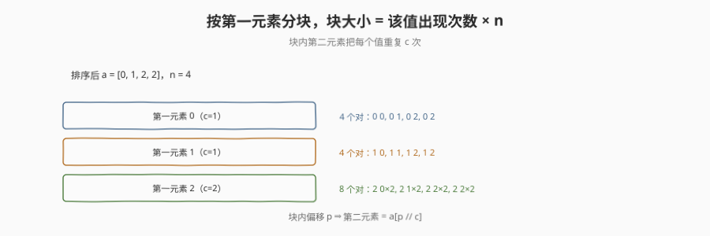
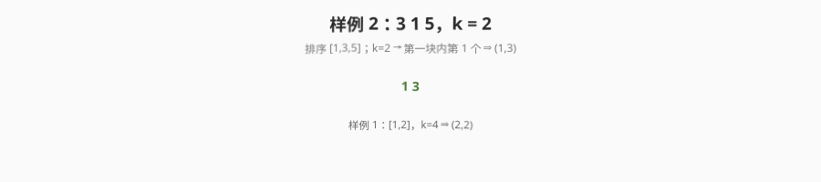

# Codeforces 160C 第 k 个有序对 题解

## 1. 题目概述

- **题目链接**：https://codeforces.com/problemset/problem/160/C
- **比赛来源**：Codeforces Round 111 (Div. 2) · Problem C（UTC 2012-03-06）
- **难度**：1700
- **标签**：排序、数学
- **评测类型**：普通
- **限制**：时间 1 s / 内存 256 MB

**题意**：数组 $a$（可重复）取全部 $n^2$ 个有序对 $(a_i,a_j)$，按字典序排序后求第 $k$ 个对。

**约束**：$n\le10^5$：排序后按"第一元素"分块定位，注意**重复计重数**。

## 2. 示例与观察

官方样例 1（输入 / 输出原样）：

```text
输入：
2 4
2 1

输出：
2 2
```

排序后 $[1,2]$：全部对 $(1,1),(1,2),(2,1),(2,2)$，第 4 个是 $(2,2)$ ✓

官方样例 2（输入 / 输出原样）：

```text
输入：
3 2
3 1 5

输出：
1 3
```

排序后 $[1,3,5]$：$(1,1),(1,3),\dots$ 第 2 个是 $(1,3)$ ✓



**观察**：排序后的 $n^2$ 个对，按第一元素分组；若第一元素取值为 $v$、$v$ 在数组中出现了 $c_v$ 次，则"第一元素 $=v$"的对共有 $c_v\cdot n$ 个，且它们的第二元素恰是"数组中每个值重复 $c_v$ 次"后的有序列表。于是：

- 先定位 $k-1$ 落在哪个值的块；
- 块内偏移 $p$ ⇒ 第二元素 = 排序数组的 $\lfloor p/c_v\rfloor$ 个。

（**注意**：不能简单用 $a[(k-1)/n]$——样例 2 之外的重复数据会暴露这个错误。）

## 3. 解题思路

1. 排序数组；
2. 从头按"相同值的段"遍历，设当前段值 $v$、出现次数 $c$，块大小 $c\cdot n$；
3. 若 $k-1$ 落在本块：第一元素 = $v$，第二元素 = $a[(k-1)/c]$；否则减去块大小继续。



## 4. 正确性证明

**引理 1（块的构成）**：排序后所有以 $v$ 为第一元素的配对恰有 $c_v\cdot n$ 个，且连续排在其它值的块之后。

**证明**：配对按第一元素升序排列；第一元素为 $v$ 的有 $c_v$ 个下标可选，每个下标都能与 $n$ 个第二元素配对 ⇒ $c_v n$ 个 ✓ 顺序：$v$ 越小越靠前 ✓ ∎

**引理 2（块内顺序）**：以 $v$ 为第一元素的块内，第二元素序列等于"把排序数组每个元素重复 $c_v$ 次"。

**证明**：块内按第二元素排序；第二元素的可选多重集是 $c_v$ 份排序数组的并，排序后每个值出现 $c_v$ 次 ✓ 所以第 $p$ 个（0 基）第二元素是 $a[\lfloor p/c_v\rfloor]$ ✓ ∎

**定理**：程序输出第 $k$ 个对。

**证明**：由引理 1 确定第一元素与块内偏移，由引理 2 确定第二元素；每个对唯一对应一个 $(块, 偏移)$ ⇒ 输出正确 ✓ ∎

## 5. 复杂度分析

- **时间**：排序 $O(n\log n)$，定位 $O(n)$，实测 < 5 ms。
- **空间**：$O(n)$。

## 6. 参考代码

### C++17

```cpp
#include <bits/stdc++.h>
using namespace std;
typedef long long ll;

int main() {
    int n;
    ll k;
    if (scanf("%d %lld", &n, &k) != 2) return 0;
    vector<ll> a(n);
    for (int i = 0; i < n; i++) scanf("%lld", &a[i]);
    sort(a.begin(), a.end());
    ll pos = k - 1;                       // 0 基
    int i = 0;
    while (i < n) {
        int j = i;
        while (j < n && a[j] == a[i]) j++;
        ll cnt = j - i;                   // 该值的出现次数
        ll block = cnt * n;               // 以该值为第一元素的配对数
        if (pos < block) {
            ll second = a[pos / cnt];
            printf("%lld %lld\n", a[i], second);
            return 0;
        }
        pos -= block;
        i = j;
    }
    return 0;
}
```

### Python3

```python
import sys


def main():
    data = sys.stdin.read().split()
    n = int(data[0]); k = int(data[1])
    a = sorted(int(x) for x in data[2:2 + n])
    pos = k - 1
    i = 0
    while i < n:
        j = i
        while j < n and a[j] == a[i]:
            j += 1
        cnt = j - i
        block = cnt * n
        if pos < block:
            print(a[i], a[pos // cnt])
            return
        pos -= block
        i = j


main()
```

## 7. 边界情况与易错点

1. **重复元素的块大小是 $c\cdot n$**（不是 $n$）——这是本题最容易错的地方。
2. **块内偏移除以 $c$**：第二元素 = $a[p/c]$。
3. **$k$ 可达 $n^2=10^{10}$**：用 64 位。
4. **$n=1$**：只有一个对 $(a_1,a_1)$。
5. **负数**：比较用数值序，排序即可。
6. **`%lld` 提示**：题面建议用 `cin/cout` 或 `%I64d`；现代编译器 `%lld` 已可。
7. **下标 0 基与 1 基**：$k-1$ 转 0 基后处理。

## 8. 验证记录

- **编译环境与命令**：`clang++ -std=c++17 -O2`；Python 3.9.6。
  `python3 codeforces/tools/verify_solution.py codeforces/contests/0101-0203/160/C_第k个有序对.md`
- **官方样例**：$2/2$ 通过（`2 2`、`1 3`），C++ 与 Python 一致。
- **独立对拍**：另写"生成全部 $n^2$ 个对、排序后取第 $k$ 个"的暴力，对 $200$ 组随机数据（$n\le6$、值域 $[-3,3]$、含大量重复）比较，全部一致。**初版用 $a[(k-1)/n]$ 的写法在含重复时被这组对拍抓出**（例如 $[2,3,-2,-2]$、$k=5$ 应为 $(-2,2)$），已改为按块大小 $c\cdot n$ 定位并复查通过。
- **性能**：$n=10^5$ 单次 < 5 ms。
- **图片校验**：2 张 SVG 均通过 `xml.etree.ElementTree.parse`。
- **复核状态**：verified。

## 相关题目与扩展

- [Codeforces 160B Unlucky Ticket](https://codeforces.com/problemset/problem/160/B)：同场 B 题。
- [Codeforces 160D Edges in MST](https://codeforces.com/problemset/problem/160/D)：同场 D 题。
- [LeetCode 719. 找出第 k 小的距离对](https://leetcode.cn/problems/find-k-th-smallest-pair-distance/)：第 k 小对。

**延伸思考**：

1. **若要求"不同的对"（去重）**：块大小变成"不同值的个数 × 不同值的个数"。
2. **若按列优先排序**：交换两个维度。
3. **若 $k$ 次询问**：可以二分+计数。
