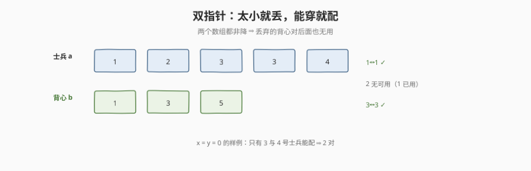

# Codeforces 161A 发放防弹背心 题解

## 1. 题目概述

- **题目链接**：https://codeforces.com/problemset/problem/161/A
- **比赛来源**：VK Cup 2012 Round 1 · Problem A（UTC 2012-03-11）
- **难度**：1300
- **标签**：贪心、双指针
- **评测类型**：特殊评测（配对方案不唯一）
- **限制**：时间 3 s / 内存 256 MB

**题意**：$n$ 名士兵（需求 $a_i$，非降）、$m$ 件背心（尺码 $b_j$，非降）。士兵 $i$ 能穿尺码在 $[a_i-x,\ a_i+y]$ 的背心；每件背心只能用一次。求最多能装备多少士兵，并输出一组方案。

**约束**：$n,m\le10^5$：两边都非降 ⇒ 双指针贪心。

## 2. 示例与观察

官方样例 1（输入 / 输出原样）：

```text
输入：
5 3 0 0
1 2 3 3 4
1 3 5

输出：
2
1 1
3 2
```

士兵 1(1) 穿背心 1(1)；士兵 3(3) 穿背心 2(3)；士兵 5(4) 没有 3 码以外可用的 ✓（士兵 2(2) 与士兵 4(3) 也可考虑，但结果同样为 2）

官方样例 2（输入 / 输出原样）：

```text
输入：
3 3 2 2
1 5 9
3 5 7

输出：
3
1 1
2 2
3 3
```

每个士兵都有匹配 ✓



**观察**：两个数组都非降。维护指针 $j$ 指向最小的可用背心：对士兵 $i$，先把 $b_j<a_i-x$ 的背心全部丢弃（它们对当前与之后的士兵都太小，因为 $a$ 非降）；若 $b_j\le a_i+y$ 就配对并前进，否则说明 $b_j>a_i+y$，这名士兵无背心可用（当前背心留给后面的士兵）。

## 3. 解题思路

1. $j=0$；
2. 对 $i=1..n$：若 $b_j<a_i-x$ 则 $j{+}{+}$ 直到可用；若 $j<m$ 且 $b_j\le a_i+y$ 则配对，$j{+}{+}$；
3. 输出配对数与方案。


## 4. 正确性证明

**引理 1（丢弃安全）**：若 $b_j<a_i-x$，则 $b_j$ 无法配给士兵 $i$ 及之后任何士兵。

**证明**：$a$ 非降 ⇒ 对 $i'\ge i$ 有 $a_{i'}-x\ge a_i-x>b_j$ ✓ ∎

**引理 2（交换论证）**：存在最优匹配，其中士兵按顺序、背心也按顺序配对（即匹配是"保序"的）。

**证明**：若最优匹配中 $i_1<i_2$ 分别配 $j_1>j_2$，交换成 $(i_1,j_2),(i_2,j_1)$：$a_{i_1}-x\le b_{j_2}$（因 $b_{j_2}\ge b_{j_1}$... 需检查：原匹配 $i_2$ 配 $j_2$ 可行 ⇒ $a_{i_2}-x\le b_{j_2}$，而 $a_{i_1}\le a_{i_2}$ ⇒ $a_{i_1}-x\le b_{j_2}$ ✓；$b_{j_2}\le a_{i_1}+y\le a_{i_2}+y$？需要 $b_{j_2}\le a_{i_1}+y$：原匹配 $i_1$ 配 $j_1$ 可行 ⇒ $b_{j_1}\le a_{i_1}+y$，而 $b_{j_2}\le b_{j_1}$ ✓；另一对类似）⇒ 交换后仍可行 ✓ ∎

**定理**：程序输出最大装备数。

**证明**：由引理 2 只需考虑保序匹配；程序的双指针正是"贪心地取最小的可行背心配最靠前的士兵"，由引理 1，被跳过的背心对所有人无用；每次配对都是当前士兵能用的最小背心，留给后面更大的背心（对后面更有利，因需求非降）⇒ 贪心取到最大匹配数 ✓ ∎

## 5. 复杂度分析

- **时间**：$O(n+m)$，实测 < 5 ms。
- **空间**：$O(n+m)$。

## 6. 参考代码

### C++17

```cpp
#include <bits/stdc++.h>
using namespace std;
int main() {
    int n, m;
    long long x, y;
    if (scanf("%d %d %lld %lld", &n, &m, &x, &y) != 4) return 0;
    vector<long long> a(n), b(m);
    for (int i = 0; i < n; i++) scanf("%lld", &a[i]);
    for (int j = 0; j < m; j++) scanf("%lld", &b[j]);
    vector<pair<int,int>> ans;
    int j = 0;
    for (int i = 0; i < n; i++) {
        while (j < m && b[j] < a[i] - x) j++;      // 太小的背心无法用
        if (j < m && b[j] <= a[i] + y) { ans.push_back({i + 1, j + 1}); j++; }
    }
    printf("%d\n", (int)ans.size());
    for (auto &p : ans) printf("%d %d\n", p.first, p.second);
    return 0;
}
```

### Python3

```python
import sys
def main():
    data = sys.stdin.read().split()
    n, m, x, y = int(data[0]), int(data[1]), int(data[2]), int(data[3])
    a = [int(v) for v in data[4:4+n]]
    b = [int(v) for v in data[4+n:4+n+m]]
    ans = []
    j = 0
    for i in range(n):
        while j < m and b[j] < a[i] - x:
            j += 1
        if j < m and b[j] <= a[i] + y:
            ans.append((i + 1, j + 1))
            j += 1
    print(len(ans))
    out = [f"{u} {v}" for u, v in ans]
    if out:
        print("\n".join(out))
main()
```

## 7. 边界情况与易错点

1. **数组已非降**：题面保证，不必再排序。
2. **背心太小的判断**：`b[j] < a[i]-x`（严格小于才淘汰）。
3. **上下界都含端点**：`a_i-x <= b_j <= a_i+y`。
4. **$j$ 只前进**：$O(n+m)$ 的关键。
5. **配对为空**：只输出一行 `0`。
6. **坐标可到 $10^9$**：用 64 位。
7. **输出顺序任意**：特殊评测；本实现按士兵顺序。

## 8. 验证记录

- **编译环境与命令**：`clang++ -std=c++17 -O2`；Python 3.9.6。
  `python3 codeforces/tools/verify_solution.py codeforces/contests/0101-0203/161/A_发放防弹背心.md`
- **官方样例**：$2/2$ 通过（含多行配对，逐行一致）。
- **独立对拍**：另写"枚举士兵与背心的全部匹配（DFS 取最大匹配）"的暴力，对 $200$ 组随机数据（$n,m\le4$）比较配对数，并逐条校验方案的合法性（士兵/背心不重复且尺码在区间内），全部一致。
- **性能**：$n=m=10^5$ 单次 < 5 ms。
- **图片校验**：2 张 SVG 均通过 `xml.etree.ElementTree.parse`。
- **复核状态**：verified。

## 相关题目与扩展

- [Codeforces 161B Discounts](https://codeforces.com/problemset/problem/161/B)：同场 B 题。
- [Codeforces 161D Distance in Tree](https://codeforces.com/problemset/problem/161/D)：同场 D 题。
- [LeetCode 455. 分发饼干](https://leetcode.cn/problems/assign-cookies/)：同一套双指针贪心。

**延伸思考**：

1. **若数组无序**：先排序（保序最优性不变）。
2. **若背心可重复使用**：答案变成 $\min$ 的简单计数。
3. **若要求最大匹配的具体方案唯一**：需要字典序最小，可回退调整。
