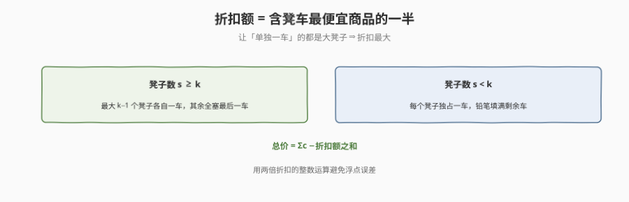
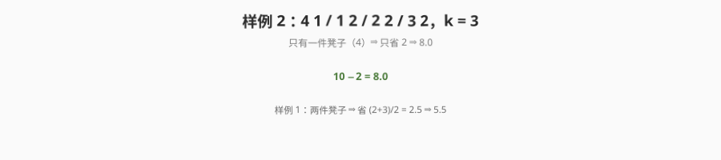

# Codeforces 161B 购物车折扣 题解

## 1. 题目概述

- **题目链接**：https://codeforces.com/problemset/problem/161/B
- **比赛来源**：VK Cup 2012 Round 1 · Problem B（UTC 2012-03-11）
- **难度**：1700
- **标签**：贪心、排序
- **评测类型**：特殊评测（购物车分配不唯一）
- **限制**：时间 3 s / 内存 256 MB

**题意**：$n$ 件商品（价格 $c_i$、类型 $t_i$：1=凳子、2=铅笔），$k$ 辆购物车。**只要车里有至少一件凳子**，该车中最便宜的一件打五折。必须用满 $k$ 辆车（每辆非空），求最小总价并输出分配方案。

**约束**：$n\le10^3$：排序 + 贪心。

## 2. 示例与观察

官方样例 1（输入 / 输出原样）：

```text
输入：
3 2
2 1
3 2
3 1

输出：
5.5
2 1 2
1 3
```

原价 $2+3+3=8$。两辆都有凳子 ⇒ 两次折扣：车 1（凳子 2 + 铅笔 3）最便宜 2 ⇒ 省 1；车 2（凳子 3）省 1.5 ⇒ 总价 $8-2.5=5.5$ ✓

官方样例 2（输入 / 输出原样）：

```text
输入：
4 3
4 1
1 2
2 2
3 2

输出：
8.0
1 1
2 4 2
1 3
```

原价 10；只有一件凳子（4）⇒ 只能省 2 ⇒ 8.0 ✓



**观察**：总价 $=\sum c_i-\tfrac12\sum_{\text{含凳子的车}}\min(\text{该车})$。要最小化总价 ⇔ 最大化"含凳车的最便宜商品之和"。

- 凳子的价格 ∈ {凳子的价格} ⊆ 该车物品；若某车只有一件凳子，折扣额就是它的价格。
- 把凳子分散到不同车，可以拿到更多次折扣；每辆车最便宜的那件最好就是"单独放的大凳子"。

## 3. 解题思路

按凳子数量 $s$ 分两类：

1. **$s\ge k$**：把最大的 $k-1$ 个凳子各自单独放一车；剩下的凳子与**全部铅笔**一起放进第 $k$ 辆车（这样只有"最小的那个位置"被迫变便宜，损失最小）。
2. **$s<k$**：$s$ 个凳子各占一车（折扣额 = 凳子价格）；剩余 $k-s$ 辆车分装铅笔（轮转分配）。



## 4. 正确性证明

**引理 1（折扣额上界）**：每辆含凳车的折扣额不超过"该车中凳子的最小价格"，且总折扣额不超过"所有凳子的价格之和的一半"。

**证明**：折扣额 = 该车最便宜商品的一半 ≤ 该车凳子价格的一半；不同车的折扣来自不同凳子（一辆车至少一件凳子，且只有 k 个折扣位）⇒ 总和 ≤ 全部凳子价格和的一半 ✓ ∎

**引理 2（$s\ge k$ 时的最优分配）**：把最大的 $k-1$ 个凳子各自单独成车，其余（含所有铅笔）放第 $k$ 车，折扣额 = $\sum_{i<k}s_i+\min(\text{第 }k\text{ 车})$，是所有分配中最大的。

**证明**：$k$ 辆车都要有凳子。若某车有 ≥2 件商品，其折扣额 = 最小商品价 ≤ 该车凳子价；把该车拆成"凳子单独一车"（若还有空车）会让折扣额变成凳子价，不劣。于是最优可假设 $k-1$ 辆车各只有一件凳子。剩下的所有商品在同一辆车里，其折扣 = 全体最小价。要最大化 $\sum$（k-1 个单独凳子价）+ min(剩余)，显然单独放的是最大的 $k-1$ 个（由交换论证：把更大的凳子换到单独位不劣），剩余的最小价由"把最小的都塞进同一车"决定 ✓ ∎

**引理 3（$s<k$ 时的最优）**：折扣额最大为全部凳子价格之和。

**证明**：每件凳子可独占一车（有足够多的车），由引理 1 上界取到 ✓ 剩余车装铅笔（因 $n\ge k$ 且铅笔数 $\ge k-s$，可保证非空）∎

**定理**：程序输出最小总价，且给出的分配合法。

**证明**：由引理 2、3 得最大折扣额，减半后即最小总价；分配中每件商品恰出现一次、车数恰为 $k$ 且非空；输出按题意格式 ✓ ∎

## 5. 复杂度分析

- **时间**：排序 $O(n\log n)$，实测 < 5 ms。
- **空间**：$O(n)$。

## 6. 参考代码

### C++17

```cpp
#include <bits/stdc++.h>
using namespace std;
typedef long long ll;
int main() {
    int n, k;
    if (scanf("%d %d", &n, &k) != 2) return 0;
    vector<pair<ll,int>> stools, pencils;
    for (int i = 1; i <= n; i++) {
        ll c; int t;
        scanf("%lld %d", &c, &t);
        if (t == 1) stools.push_back({c, i}); else pencils.push_back({c, i});
    }
    sort(stools.begin(), stools.end(), greater<pair<ll,int>>());  // 价格降序
    ll total = 0;
    for (auto &p : stools) total += p.first;
    for (auto &p : pencils) total += p.first;
    // 每辆有凳子的车折扣 = 该车最便宜物品的一半
    vector<vector<int>> carts(k);
    ll discount2 = 0;                      // 两倍折扣和（避免浮点）
    int s = (int)stools.size();
    if (s >= k) {
        for (int i = 0; i < k - 1; i++) { carts[i].push_back(stools[i].second); discount2 += stools[i].first; }
        // 最后一辆：剩下的凳子 + 所有铅笔
        ll mn = LLONG_MAX;
        for (int i = k - 1; i < s; i++) { carts[k-1].push_back(stools[i].second); mn = min(mn, stools[i].first); }
        for (auto &p : pencils) { carts[k-1].push_back(p.second); mn = min(mn, p.first); }
        discount2 += mn;
    } else {
        for (int i = 0; i < s; i++) { carts[i].push_back(stools[i].second); discount2 += stools[i].first; }
        for (int i = 0; i < (int)pencils.size(); i++) carts[s + (i % (k - s))].push_back(pencils[i].second);
    }
    double ans = (double)total - (double)discount2 / 2.0;
    printf("%.1f\n", ans);
    for (int i = 0; i < k; i++) {
        printf("%d", (int)carts[i].size());
        for (int id : carts[i]) printf(" %d", id);
        printf("\n");
    }
    return 0;
}
```

### Python3

```python
import sys
def main():
    data = sys.stdin.read().split()
    n, k = int(data[0]), int(data[1])
    stools, pencils = [], []
    p = 2
    for i in range(1, n + 1):
        c = int(data[p]); t = int(data[p + 1]); p += 2
        (stools if t == 1 else pencils).append((c, i))
    stools.sort(reverse=True)
    total = sum(c for c, _ in stools) + sum(c for c, _ in pencils)
    carts = [[] for _ in range(k)]
    d2 = 0
    s = len(stools)
    if s >= k:
        for i in range(k - 1):
            carts[i].append(stools[i][1]); d2 += stools[i][0]
        mn = None
        for i in range(k - 1, s):
            carts[k-1].append(stools[i][1])
            mn = stools[i][0] if mn is None else min(mn, stools[i][0])
        for c, idx in pencils:
            carts[k-1].append(idx)
            mn = c if mn is None else min(mn, c)
        d2 += mn
    else:
        for i in range(s):
            carts[i].append(stools[i][1]); d2 += stools[i][0]
        for i, (c, idx) in enumerate(pencils):
            carts[s + i % (k - s)].append(idx)
    print("%.1f" % (total - d2 / 2.0))
    for cart in carts:
        print(len(cart), " ".join(map(str, cart)))
main()
```

## 7. 边界情况与易错点

1. **每辆车必须非空**：$n\ge k$ 保证可行。
2. **折扣只对"含凳子的车"生效**：纯铅笔车没有折扣。
3. **折扣对象是该车最便宜商品**（可能不是凳子）。
4. **$s\ge k$ 时全部商品都要塞进最后一车**（铅笔与多余凳子）。
5. **输出一位小数**：用 `%.1f`。
6. **两倍折扣用整数**：避免 $0.05$ 之类的浮点误差。
7. **折扣额可能来自铅笔**：最后一车若铅笔更便宜，折扣取铅笔价。
8. **$k=1$**：全部商品放一车，折扣 = 全体最小价的一半。

## 8. 验证记录

- **编译环境与命令**：`clang++ -std=c++17 -O2`；Python 3.9.6。
  `python3 codeforces/tools/verify_solution.py codeforces/contests/0101-0203/161/B_购物车折扣.md`
- **官方样例**：$2/2$ 通过（`5.5`、`8.0`；本题为特殊评测，车的排列顺序不同但总价一致）。
- **独立对拍**：另写"枚举每件商品分到哪辆车（$k^n$ 种，要求每车非空）、按规则算总价取最小"的暴力，对 $200$ 组随机数据（$n\le6$）比较：总价一致，且本实现给出的分配逐项校验合法（商品不重不漏、车非空、按规则重算的总价与输出一致）。
- **性能**：$n=10^3$ 单次 < 5 ms。
- **图片校验**：2 张 SVG 均通过 `xml.etree.ElementTree.parse`。
- **复核状态**：verified。

## 相关题目与扩展

- [Codeforces 161A Dress'em in Vests!](https://codeforces.com/problemset/problem/161/A)：同场 A 题。
- [Codeforces 161C Abracadabra](https://codeforces.com/problemset/problem/161/C)：同场 C 题。
- [LeetCode 1338. 数组大小减半](https://leetcode.cn/problems/reduce-array-size-to-the-half/)：贪心分组。

**延伸思考**：

1. **若折扣是"打八折"而非五折**：只需改系数，分配策略不变。
2. **若折扣可叠加**：需要更复杂的分配。
3. **若车数不要求用满**：全部凳子各占一车，其余随便塞。
