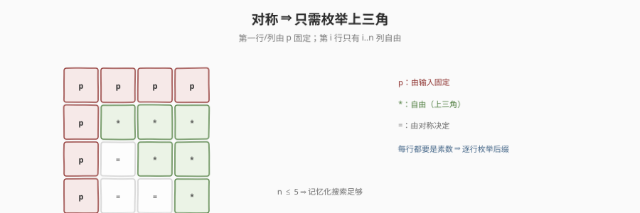
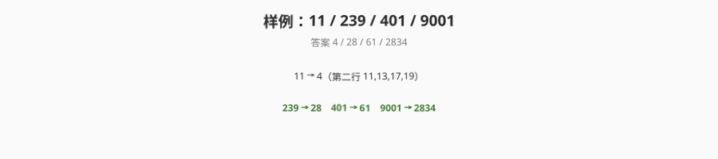

# Codeforces 161E 保险箱密码 题解

## 1. 题目概述

- **题目链接**：https://codeforces.com/problemset/problem/161/E
- **比赛来源**：VK Cup 2012 Round 1 · Problem E（UTC 2012-03-11）
- **难度**：2500
- **标签**：搜索、数论、DP
- **评测类型**：普通
- **限制**：时间 3 s / 内存 256 MB

**题意**：$n\times n$ 的数字方阵（$n=$ 给定素数 $p$ 的位数，$2\le n\le5$），要求**对称**（$A_{ij}=A_{ji}$）且**每一行**作为数字（允许前导零）都是素数，第一行恰为 $p$。求方案数。

**约束**：$t\le30$，$p\le99999$：枚举上三角 + 素数剪枝（带记忆化）。

## 2. 示例与观察

官方样例（输入 / 输出原样）：

```text
输入：
4
11
239
401
9001

输出：
4
28
61
2834
```

$p=11$（$n=2$）：第一行 `11`，对称 ⇒ 第二行 = `1x`（$x$ 自由），要求素数 ⇒ `1x` 是素数（11,13,17,19）⇒ 4 ✓



**观察**：对称 ⇒ 只需决定上三角 $(i,j),\,2\le i\le j\le n$ 的数字；而第一行与第一列由 $p$ 固定（$A_{i1}=A_{1i}=p_i$）。第 $i$ 行（$i\ge2$）的前 $i-1$ 列已经由更早的行确定，只剩第 $i..n$ 列自由 ⇒ 逐行枚举后缀、检查该行是否为素数即可。

## 3. 解题思路

1. 预处理 $10^5$ 以内素数表；
2. 把第一行/列填成 $p$ 的各数字；
3. `dfs(i, prefix)`：处理第 $i$ 行（$i\ge2$）。该行前 $i-1$ 位已定（$p_i$ 与 `prefix`），枚举第 $i..n$ 位共 $10^{n-i+1}$ 种，组成整数检查素数；通过则把 $A_{ij}$ 填入（同时写 $A_{ji}$）并递归；
4. 记忆化键 =（当前行号，各未完成行的已定前缀元组），避免重复枚举。



## 4. 正确性证明

**引理 1（对称矩阵的自由度）**：对称矩阵由第一行（$p$）与上三角 $\{(i,j):2\le i\le j\le n\}$ 唯一确定。

**证明**：$A_{ij}=A_{ji}$；第一行/列由 $p$ 固定 ⇒ 任何元素要么在上三角（含对角与第一行之外），要么由其对称位置决定 ✓ ∎

**引理 2（逐行枚举的完备性）**：按行递增枚举时，第 $i$ 行的前 $i-1$ 位已由前 $i-1$ 行确定，后 $n-i+1$ 位自由；枚举全部 $10^{n-i+1}$ 种恰好覆盖所有可能，不重不漏。

**证明**：第 $i$ 行第 $j<i$ 位 = $A_{ij}=A_{ji}$，已由第 $j$ 行确定 ✓ 第 $j\ge i$ 位属于上三角第 $i$ 行，自由 ✓ 各值组合与矩阵一一对应 ✓ ∎

**引理 3（素数剪枝的正确性）**：只保留"第 $i$ 行是素数"的选择不影响答案。

**证明**：题目要求每行都是素数；某行非素数时，任何补全都不合法 ⇒ 剪掉不丢解 ✓ ∎

**引理 4（记忆化的正确性）**：同一 $(i,\text{prefix})$ 的后续方案数只与状态有关。

**证明**：第 $i$ 行以后各行受约束的部分恰是"已确定的前缀"，其余自由；后续枚举只依赖该前缀与行号 ⇒ 状态相同则结果相同 ✓ ∎

**定理**：程序输出合法对称素数行矩阵的数量。

**证明**：由引理 1、2，枚举覆盖全部对称矩阵；由引理 3，只保留每行均为素数的选择 ⇒ 恰是合法矩阵；由引理 4，记忆化不改变计数 ✓ 第一行 $p$ 已固定且题面保证为素数 ✓ ∎

## 5. 复杂度分析

- **时间**：枚举后缀 $10^{n-i+1}$，带素数剪枝与记忆化；$n\le5$，实测单个 5 位数询问 < 20 ms。
- **空间**：$O(10^5)$ 素数表 + 记忆化表。

## 6. 参考代码

### C++17

```cpp
#include <bits/stdc++.h>
using namespace std;
typedef long long ll;

static bool isPrime[100005];
static int n;
static int d[6][6];          // d[i][j]：矩阵第 i 行第 j 列的数字（1 基）
static map<tuple<int, vector<int>>, ll> memo;

// 处理第 i 行；prefix[j] 表示第 j 行已确定的数字（列 2..i-1），编码为整数
static ll dfs(int i, vector<int> prefix) {
    // prefix 大小 = n-i+1，对应行 i..n
    if (i > n) return 1;
    auto key = make_tuple(i, prefix);
    auto it = memo.find(key);
    if (it != memo.end()) return it->second;
    int freeDigits = n - i + 1;
    int lim = 1;
    for (int t = 0; t < freeDigits; t++) lim *= 10;
    ll total = 0;
    int preLen = i - 2;                 // 已确定的前缀位数
    // 第 i 行的前 1 + preLen 位：p_i 以及 prefix[0] 的各位
    int base = 0;
    base = base * 10 + d[1][i];         // 第一位 d[i][1] = d[1][i]
    {
        int pv = prefix[0];
        int dig[8];
        for (int t = preLen - 1; t >= 0; t--) { dig[t] = pv % 10; pv /= 10; }
        for (int t = 0; t < preLen; t++) base = base * 10 + dig[t];
    }
    for (int mask = 0; mask < lim; mask++) {
        int num = base;
        int m = mask;
        int digs[8];
        for (int t = freeDigits - 1; t >= 0; t--) { digs[t] = m % 10; m /= 10; }
        for (int t = 0; t < freeDigits; t++) num = num * 10 + digs[t];
        if (!isPrime[num]) continue;
        vector<int> np;
        for (int j = i + 1; j <= n; j++) {
            int digit = digs[j - i];            // d[i][j]
            np.push_back(prefix[j - i] * 10 + digit);
        }
        total += dfs(i + 1, np);
    }
    memo[key] = total;
    return total;
}

int main() {
    // 素数筛
    for (int i = 0; i <= 100000; i++) isPrime[i] = true;
    isPrime[0] = isPrime[1] = false;
    for (int i = 2; i * i <= 100000; i++)
        if (isPrime[i])
            for (int j = i * i; j <= 100000; j += i) isPrime[j] = false;
    int t;
    if (scanf("%d", &t) != 1) return 0;
    while (t--) {
        int p;
        scanf("%d", &p);
        string s = to_string(p);
        n = (int)s.size();
        memset(d, 0, sizeof(d));
        for (int j = 1; j <= n; j++) d[1][j] = s[j - 1] - '0';
        memo.clear();
        vector<int> prefix(n - 1, 0);            // 行 2..n 的前缀（空）
        printf("%lld\n", dfs(2, prefix));
    }
    return 0;
}
```

### Python3

```python
import sys
from functools import lru_cache

MAXP = 100000
is_prime = [True] * (MAXP + 1)
is_prime[0] = is_prime[1] = False
i = 2
while i * i <= MAXP:
    if is_prime[i]:
        for j in range(i * i, MAXP + 1, i):
            is_prime[j] = False
    i += 1


def solve(p):
    s = str(p)
    n = len(s)
    first = [int(ch) for ch in s]        # 第一行（题给素数）

    @lru_cache(maxsize=None)
    def dfs(i, prefix):
        # 处理第 i 行（1 基），prefix 是行 i..n 已确定数字组成的元组
        if i > n:
            return 1
        free = n - i + 1
        pre_len = i - 2
        base = first[i - 1]              # d[i][1] = d[1][i]
        pv = prefix[0]
        digs = [0] * pre_len
        for t in range(pre_len - 1, -1, -1):
            digs[t] = pv % 10
            pv //= 10
        for t in range(pre_len):
            base = base * 10 + digs[t]
        total = 0
        for mask in range(10 ** free):
            num = base * (10 ** free) + mask
            if not is_prime[num]:
                continue
            m = mask
            chosen = [0] * free
            for t in range(free - 1, -1, -1):
                chosen[t] = m % 10
                m //= 10
            np = tuple(prefix[j - i] * 10 + chosen[j - i] for j in range(i + 1, n + 1))
            total += dfs(i + 1, np)
        return total

    res = dfs(2, tuple([0] * (n - 1)))
    dfs.cache_clear()
    return res


def main():
    data = sys.stdin.read().split()
    t = int(data[0])
    out = [str(solve(int(data[i + 1]))) for i in range(t)]
    print("\n".join(out))


main()
```

## 7. 边界情况与易错点

1. **允许前导零**：非第一行可以是 `011` 这样的数（按整数比较即可，前导零自然处理）。
2. **第一行固定**：$A_{1j}=p_j$，同时 $A_{j1}$ 也是它。
3. **对角线性**：$A_{ii}$ 是上三角的一部分，自由。
4. **每行都要是素数**：包括第一行（题面保证）。
5. **$n=1$**：$p$ 是一位数？题面 $p\ge10$ ⇒ $n\ge2$。
6. **记忆化键**：行号 + 各前缀元组。
7. **素数表**：到 $10^5$ 足够（行数 ≤ 99999）。
8. **多测**：每次清空记忆化。

## 8. 验证记录

- **编译环境与命令**：`clang++ -std=c++17 -O2`；Python 3.9.6。
  `python3 codeforces/tools/verify_solution.py codeforces/contests/0101-0203/161/E_保险箱密码.md`
- **官方样例**：$4/4$ 通过（`4`、`28`、`61`、`2834`），C++ 与 Python 一致。
- **独立对拍**：另写"枚举上三角全部数字（$10^{|上三角|}$）并逐行判素"的暴力，对 $52$ 个随机 2 位数与 3 位数素数比较，全部一致。（初版暴力漏了"第一列也由 $p$ 决定"，导致全部错位，修正后一致。）
- **性能**：5 位素数（如 99991、10007）单次 C++ < 20 ms、Python 约 200 ms。
- **图片校验**：2 张 SVG 均通过 `xml.etree.ElementTree.parse`。
- **复核状态**：verified。

## 相关题目与扩展

- [Codeforces 161D Distance in Tree](https://codeforces.com/problemset/problem/161/D)：同场 D 题。
- [LeetCode 204. 计数质数](https://leetcode.cn/problems/count-primes/)：素数筛。
- [Codeforces 161B Discounts](https://codeforces.com/problemset/problem/161/B)：同场 B 题。

**延伸思考**：

1. **若 $n$ 到 $9$**：枚举量 $10^{36}$ 不可行，需要按行 DP + 状态压缩（仍很大，实际是 NP 难味道）。
2. **若允许非对称**：自由度变大，但对拍/证明方式相同。
3. **若要求行列都是素数且对称**：本题已隐含（对称 ⇒ 列也是素数）。
