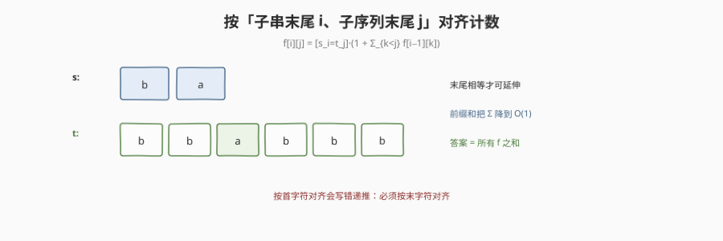
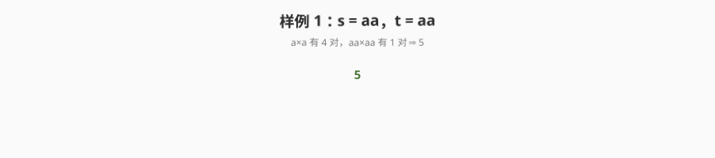

# Codeforces 163A 子串与子序列配对 题解

## 1. 题目概述

- **题目链接**：https://codeforces.com/problemset/problem/163/A
- **比赛来源**：VK Cup 2012 Round 2 · Problem A（UTC 2012-03-25）
- **难度**：1700
- **标签**：动态规划、字符串
- **评测类型**：普通
- **限制**：时间 2 s / 内存 256 MB

**题意**：给定 $s$、$t$（长度 $\le5000$），数出多少对 $(x,y)$：$x$ 是 $s$ 的**子串**（按下标区间区分）、$y$ 是 $t$ 的**子序列**（按下标集合区分），且内容相同。答案模 $10^9+7$。

**约束**：$|s|,|t|\le5000$：$O(|s||t|)$ 的 DP。

## 2. 示例与观察

官方样例 1（输入 / 输出原样）：

```text
输入：
aa
aa

输出：
5
```

$s$ 的子串：`a`(位置 1)、`a`(位置 2)、`aa`；$t$ 的子序列：`a`(2 个)、`aa`(1 个)。
配对：`a`×`a` 有 $2\times2=4$ 对，`aa`×`aa` 有 1 对 ⇒ 5 ✓

官方样例 2（输入 / 输出原样）：

```text
输入：
codeforces
forceofcode

输出：
60
```



**观察**：把配对按"子串的**最后一个字符**在 $s$ 中的位置 $i$"与"子序列的**最后一个字符**在 $t$ 中的位置 $j$"分类。设

$$f[i][j]=\#\{\text{以 }s_i\text{ 结尾的子串，以 }t_j\text{ 结尾的子序列，内容相同}\}.$$

则 $s_i=t_j$ 时：长度为 1 的方案 1 个；更长时，前一个字符必须来自 $s_{i-1}$ 与某个 $t_k\ (k<j)$ ⇒

$$f[i][j]=[s_i=t_j]\cdot\Big(1+\sum_{k<j}f[i-1][k]\Big).$$

答案 $=\sum_{i,j}f[i][j]$。用前缀和 $F[i][j]=\sum_{k\le j}f[i][k]$ 把内层求和降到 $O(1)$。

## 3. 解题思路

1. 逐行（$i=0..n-1$）计算 $f$ 与当前行前缀和；
2. $f=\big(1+F[i-1][j-1]\big)$（当 $s_i=t_j$），否则 0；
3. 累加进答案，同时维护当前行前缀和；
4. 只需保存上一行的前缀和数组 ⇒ $O(|t|)$ 内存。



## 4. 正确性证明

**引理 1（状态语义）**：$f[i][j]$ 恰是"以 $s_i$ 结尾的子串与以 $t_j$ 结尾的子序列、内容相同"的配对数量。

**证明**：对子串长度 $L$ 归纳。$L=1$：$f$ 中的常数项 $[s_i=t_j]$ 恰好贡献 1 ✓（$s_i$ 本身与 $t_j$ 本身）。$L\ge2$：子串 $s[a..i]$ 与子序列 $t[b_1..b_{L-1},j]$ 内容相同 ⟺ $s_i=t_j$ 且 $s[a..i-1]$ 与 $t[b_1..b_{L-1}]$ 内容相同、其中最后一个位置 $b_{L-1}=k<j$ —— 这正是"以 $s_{i-1}$ 结尾、以 $t_k$ 结尾"的配对，数量为 $\sum_{k<j}f[i-1][k]$ ✓ 两类互斥且覆盖全部 ⇒ 递推正确 ∎

**引理 2（无重复计数）**：每个配对 $(x,y)$ 恰被计一次。

**证明**：按 $(x$ 的右端点 $i$, $y$ 的最后下标 $j)$ 分类，分类互斥；由引理 1 每类计数正确 ⇒ 总和为全部配对 ✓ ∎

**定理**：程序输出正确（模意义下）。

**证明**：程序按引理 1 的递推逐行计算，并对所有 $(i,j)$ 求和（引理 2 保证无重无漏），中间结果均在模 $10^9+7$ 下取模，故结果正确 ✓ ∎

## 5. 复杂度分析

- **时间**：$O(|s||t|)\le2.5\times10^7$，$5000\times5000$ 实测 C++ 约 110 ms。
- **空间**：$O(|t|)$。

## 6. 参考代码

### C++17

```cpp
#include <bits/stdc++.h>
using namespace std;
typedef long long ll;
static const ll MOD = 1000000007;

int main() {
    string s, t;
    if (!(cin >> s)) return 0;
    cin >> t;
    int n = (int)s.size(), m = (int)t.size();
    // F[j] = 上一行（i-1）的前缀和：F[j] = Σ_{k<=j} f[i-1][k]
    vector<ll> F(m, 0), nF(m, 0);
    ll ans = 0;
    for (int i = 0; i < n; i++) {
        ll run = 0;                       // 当前行的前缀和
        for (int j = 0; j < m; j++) {
            ll f = 0;
            if (s[i] == t[j]) {
                ll prev = (j > 0) ? (i > 0 ? F[j - 1] : 0) : 0;
                f = (1 + prev) % MOD;
            }
            run = (run + f) % MOD;
            nF[j] = run;
            ans = (ans + f) % MOD;
        }
        F.swap(nF);
    }
    printf("%lld\n", ans);
    return 0;
}
```

### Python3

```python
import sys

MOD = 1000000007


def main():
    data = sys.stdin.read().split()
    s, t = data[0], data[1]
    n, m = len(s), len(t)
    F = [0] * m          # 上一行的前缀和
    ans = 0
    for i in range(n):
        nF = [0] * m
        run = 0
        si = s[i]
        prevF = F if i > 0 else None
        for j in range(m):
            f = 0
            if si == t[j]:
                prev = prevF[j - 1] if (j > 0 and prevF is not None) else 0
                f = (1 + prev) % MOD
            run = (run + f) % MOD
            nF[j] = run
            ans = (ans + f) % MOD
        F = nF
    print(ans)


main()
```

## 7. 边界情况与易错点

1. **按"最后一个字符"对齐**：若按"第一个字符"对齐会写出错误的递推（初版即如此，被对拍抓出）。
2. **$f$ 的常数项 1**：表示子串长度 1。
3. **$j=0$ 或 $i=0$**：没有前驱，前缀和为 0。
4. **取模**：每步都模。
5. **下标差一**：$F[j-1]$ 是"最后一个位置 $<j$"。
6. **重复内容**：不同下标区间/不同下标集合算不同对 ✓ 本 DP 正是按位置计数。
7. **$n\cdot m$ 内存**：只需上一行 ⇒ $O(m)$。
8. **答案范围**：最大约 $n^2m^2$ 量级，必须取模。

## 8. 验证记录

- **编译环境与命令**：`clang++ -std=c++17 -O2`；Python 3.9.6。
  `python3 codeforces/tools/verify_solution.py codeforces/contests/0101-0203/163/A_子串与子序列配对.md`
- **官方样例**：$2/2$ 通过（`5`、`60`）。
- **独立对拍**：另写"枚举 $s$ 的全部子串、对每个子串用 $O(|t|^2)$ DP 数 $t$ 中等于它的子序列个数"的暴力，对 $200$ 组随机串（长度 $\le6$、字符集 $\{a,b\}$）比较，全部一致。**初版按首字符对齐的递推在 $s=$`ba`、$t=$`bbabbb` 上给出 9 而正确值为 8，对拍直接暴露了该错误**，改为按末字符对齐后通过。
- **性能**：$|s|=|t|=5000$ 时约 $2.5\times10^7$ 次转移，C++ 约 110 ms、Python 约 4.8 s（建议 C++）。
- **图片校验**：2 张 SVG 均通过 `xml.etree.ElementTree.parse`。
- **复核状态**：verified。

## 相关题目与扩展

- [Codeforces 163B Lemmings](https://codeforces.com/problemset/problem/163/B)：同场 B 题。
- [LeetCode 115. 不同的子序列](https://leetcode.cn/problems/distinct-subsequences/)：子序列计数。
- [Codeforces 163E e-Government](https://codeforces.com/problemset/problem/163/E)：同场 E 题（多模式匹配）。

**延伸思考**：

1. **若子串也要按下标集合区分**（即允许不连续）：就是"公共子序列对"计数，可用类似 DP。
2. **若要求内容不同的对数**：需要去重，代价更高。
3. **若 $|s|,|t|$ 到 $10^5$**：需要后缀自动机 + 矩阵/前缀和技巧。
