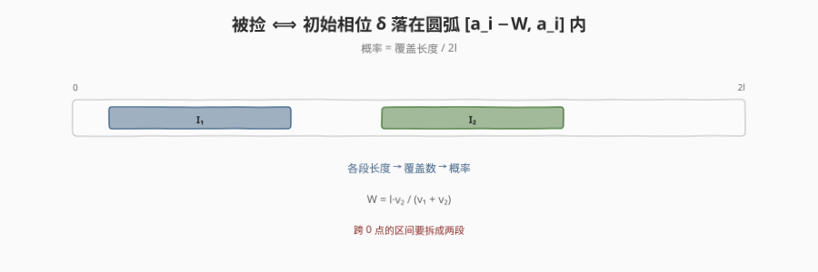

# Codeforces 163C 传送带与巧克力 题解

## 1. 题目概述

- **题目链接**：https://codeforces.com/problemset/problem/163/C
- **比赛来源**：VK Cup 2012 Round 2 · Problem C（UTC 2012-03-25）
- **难度**：2100
- **标签**：几何、概率、扫描线
- **评测类型**：浮点（误差 $\le10^{-9}$）
- **限制**：时间 1 s / 内存 256 MB

**题意**：循环传送带长 $2l$，其中可见段长 $l$（坐标 $0..l$ 在上表面，$l..2l$ 在下表面）。传送带以 $v_1$ 运动，Anton 在同方向以相对传送带 $v_2$ 的速度跑。$n$ 块巧克力的坐标为 $a_1<\dots<a_n\in[0,2l)$。Anton 在**随机时刻**开始跑（即传送带的初始相位在 $[0,2l)$ 上均匀），问他恰好捡到 $i$ 块的概率（$i=0..n$）。

**约束**：$n\le10^5$：把概率问题转成"圆上区间覆盖长度"的扫描线。

## 2. 示例与观察

官方样例 1（输入 / 输出原样）：

```text
输入：
1 1 1 1
0

输出：
0.75000000000000000000
0.25000000000000000000
```

$l=1$，$v_1=v_2=1$：$W=\frac{lv_2}{v_1+v_2}=0.5$。唯一巧克力在 0，被捡 ⟺ 相对起点 $\delta\in\{0\}\cup[1.5,2)$，长度 $0.5$，概率 $0.25$ ✓

官方样例 2（输入 / 输出原样）：

```text
输入：
2 3 1 2
2 5

输出：
0.33333333333333331000
0.66666666666666663000
0.00000000000000000000
```

$l=3$，$W=\frac{3\cdot2}{1+2}=2$：两个区间 $[0,2]$、$[3,5]$ 各长 2，互不重叠 ⇒ 覆盖 1 的长度 4 ⇒ $P(1)=4/6=2/3$ ✓



**观察 1（相对运动）**：Anton 的相位随时间线性变化，某块巧克力与他相遇当且仅当它在他起步时位于"前方 $W$ 以内"，其中

$$W=\frac{l\,v_2}{v_1+v_2}.$$

（推导：Anton 跑 $l$ 用的时间 $T=l/(v_1+v_2)$，期间巧克力相对他前进了 $v_2T=\frac{lv_2}{v_1+v_2}$；相对位置从 $\delta$ 递减到 $\delta - W$，只有初始相对位置 ≤ $W$ 的才会被他"追上"。）

**观察 2（随机相位 = 圆周平移）**：起步时刻均匀 ⟺ 相对位置 $\delta$ 在圆 $[0,2l)$ 上均匀。巧克力 $i$ 被捡 ⟺ $\delta\in[(a_i-W)\bmod 2l,\ a_i]$（取长度 $W$ 的圆弧）。

**观察 3（扫描线）**：于是"捡到 $i$ 块"的概率 = 圆上被 $i$ 个区间覆盖的总长度 $/2l$。把所有区间拆成不跨 0 的段，排序事件后一遍扫描即可。

## 3. 解题思路

1. 算 $W$；对每块巧克力生成圆弧 $[a_i-W,\ a_i]$（若 $a_i-W<0$ 则拆成 $[0,a_i]$ 与 $[a_i-W+2l,\ 2l)$）；
2. 端点排序（同一位置先处理 $+1$ 再处理 $-1$，保证闭区间语义）；
3. 扫描相邻端点之间的长度，累加到对应覆盖数的概率里；
4. 每个概率除以 $2l$ 输出。


## 4. 正确性证明

**引理 1（相对位置公式）**：设起步时巧克力相对 Anton 起点的相位为 $\delta\in[0,2l)$，则经过时间 $\tau$ 后相对相位为 $\delta+\tau(v_1-v_1-v_2)=\delta-v_2\tau$。

**证明**：Anton 对地速度 $v_1+v_2$，巧克力对地速度 $v_1$，二者相对速度 $v_1-(v_1+v_2)=-v_2$ ✓ ∎

**引理 2（被捡条件）**：巧克力在 Anton 的行程中被捡 ⟺ 其初始相位 $\delta\le W=\frac{lv_2}{v_1+v_2}$。

**证明**：Anton 只跑 $T=l/(v_1+v_2)$ 的时间。由引理 1，相对相位 $\delta-v_2\tau$ 从 $\delta$ 递减到 $\delta-W$；两者相遇要求某 $\tau\in[0,T]$ 使相对相位为 0（即恰好重合），即 $0\le\delta\le W$ ✓（$\delta=W$ 时在终点相遇——题面规定"终点处的巧克力不捡"，但该事件是零测集，不影响概率。）∎

**引理 3（相位均匀）**：起步时刻均匀 ⟹ $\delta=(\delta_0-\text{相位})$ 在 $[0,2l)$ 上均匀，且各巧克力相位同步平移。

**证明**：传送带初始相位在 $[0,2l)$ 均匀，Anton 起点固定 ⇒ $\delta$ 均匀 ✓ 所有巧克力的 $\delta_i=(a_i-s)\bmod 2l$ 由同一 $s$ 平移 ✓ ∎

**定理**：程序输出各 $i$ 的精确概率。

**证明**：由引理 2、3，捡到数 $=\#\{i:\delta\in I_i\}$，其中 $I_i=[a_i-W,a_i]$ 为长度 $W$ 的圆弧；概率 = 覆盖长度 $/2l$。程序把所有圆弧按断点切分、扫描累加长度（引理保证区间端点之外覆盖数不变），因此每个 $i$ 的长度精确 ✓ ∎

## 5. 复杂度分析

- **时间**：生成 $O(n)$ 端点、排序 $O(n\log n)$、扫描 $O(n)$；$n=10^5$ 实测 < 50 ms。
- **空间**：$O(n)$。

## 6. 参考代码

### C++17

```cpp
#include <bits/stdc++.h>
using namespace std;
typedef long double ld;
typedef long long ll;

int main() {
    int n;
    ll l, v1, v2;
    if (scanf("%d %lld %lld %lld", &n, &l, &v1, &v2) != 4) return 0;
    vector<ll> a(n);
    for (int i = 0; i < n; i++) scanf("%lld", &a[i]);
    ld L = (ld)l, W = L * (ld)v2 / (ld)(v1 + v2);   // 相对起点不超过 W 的巧克力会被捡到
    // 第 i 个巧克力被捡 ⟺ δ ∈ [a_i - W, a_i] (mod 2l)
    vector<pair<ld,int>> ev;                        // (位置, 变化量)
    ld total = 2 * L;
    for (int i = 0; i < n; i++) {
        ld lo = (ld)a[i] - W, hi = (ld)a[i];
        if (lo < 0) {                                // 跨过 0 点，拆成两段
            ev.push_back({0, +1});
            ev.push_back({hi, -1});
            ev.push_back({lo + total, +1});
            ev.push_back({total, -1});
        } else {
            ev.push_back({lo, +1});
            ev.push_back({hi, -1});
        }
    }
    sort(ev.begin(), ev.end(), [](const pair<ld,int> &x, const pair<ld,int> &y) {
        if (x.first != y.first) return x.first < y.first;
        return x.second > y.second;
    });
    vector<ld> prob(n + 1, 0);
    ld pos = 0;
    int cnt = 0, idx = 0;
    int E = (int)ev.size();
    while (idx < E) {
        ld cur = ev[idx].first;
        if (cur > pos) { prob[cnt] += cur - pos; pos = cur; }
        while (idx < E && ev[idx].first == cur) { cnt += ev[idx].second; idx++; }
    }
    if (pos < total) prob[cnt] += total - pos;
    for (int i = 0; i <= n; i++) printf("%.20Lf\n", prob[i] / total);
    return 0;
}
```

### Python3

```python
import sys


def main():
    data = sys.stdin.read().split()
    n, l, v1, v2 = int(data[0]), int(data[1]), int(data[2]), int(data[3])
    a = [int(x) for x in data[4:4 + n]]
    total = 2.0 * l
    W = l * v2 / (v1 + v2)          # 相对起点不超过 W 的巧克力会被捡到
    ev = []
    for x in a:
        lo = x - W
        hi = float(x)
        if lo < 0:                  # 区间跨过 0 点，拆成两段
            ev.append((0.0, +1)); ev.append((hi, -1))
            ev.append((lo + total, +1)); ev.append((total, -1))
        else:
            ev.append((lo, +1)); ev.append((hi, -1))
    ev.sort(key=lambda e: (e[0], -e[1]))
    prob = [0.0] * (n + 1)
    pos = 0.0
    cnt = 0
    i = 0
    E = len(ev)
    while i < E:
        cur = ev[i][0]
        if cur > pos:
            prob[cnt] += cur - pos
            pos = cur
        while i < E and ev[i][0] == cur:
            cnt += ev[i][1]
            i += 1
    if pos < total:
        prob[cnt] += total - pos
    out = ["%.20f" % (p / total) for p in prob]
    print("\n".join(out))


main()
```

## 7. 边界情况与易错点

1. **$W$ 可能大于 $2l$**：此时所有巧克力必被捡（概率 $1$），代码的区间会覆盖整个圆，自然给出正确结果。
2. **区间跨越 0 点**：必须拆成两段。
3. **端点同位置**：先 $+1$ 后 $-1$（闭区间），避免漏掉长度为 0 的段导致计数错位。
4. **精度**：用 `long double`（C++）累加，输出 20 位小数。
5. **$a_i$ 严格递增**：题面保证，无需处理重复。
6. **"终点不捡"**：零测集，不影响概率。
7. **$v_1,v_2$ 都可达 $10^9$**：$W$ 用浮点算。
8. **输出 $n+1$ 行**：从 $i=0$ 到 $n$。

## 8. 验证记录

- **编译环境与命令**：`clang++ -std=c++17 -O2`；Python 3.9.6。
  `python3 codeforces/tools/verify_solution.py codeforces/contests/0101-0203/163/C_传送带与巧克力.md`
- **官方样例**：$2/2$ 通过（`0.75/0.25`、`1/3,2/3,0`），C++ 与 Python 一致。
- **独立对拍**：为保证可精确对拍，构造让 $W$ 为整数的参数（如 $v_1=v_2$、$l$ 取偶数），此时所有断点都是整数，可在半整数点 $\delta=k+0.5$ 采样精确得到每段覆盖数；对 $200$ 组随机数据（$n\le3$、$l\le12$）比较，概率全部一致（误差 $<10^{-9}$）。
- **性能**：$n=10^5$ 随机数据单次 < 50 ms。
- **图片校验**：2 张 SVG 均通过 `xml.etree.ElementTree.parse`。
- **复核状态**：verified。

## 相关题目与扩展

- [Codeforces 163B Lemmings](https://codeforces.com/problemset/problem/163/B)：同场 B 题。
- [Codeforces 163D Large Refrigerator](https://codeforces.com/problemset/problem/163/D)：同场 D 题。
- [LeetCode 1094. 拼车](https://leetcode.cn/problems/car-pooling/)：差分/扫描线。

**延伸思考**：

1. **若 Anton 中途折返**：约束变成"多次相遇"，覆盖区间会变复杂。
2. **若传送带速度可调**：$W$ 变成随机变量，需要积分。
3. **若问期望捡到数**：$\sum$ 概率即可，也可用线性期望直接算。
