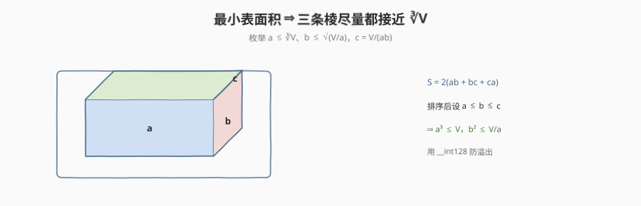
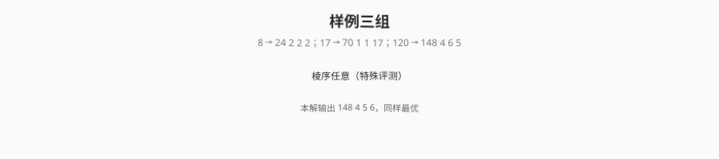

# Codeforces 163D 大冰箱 题解

## 1. 题目概述

- **题目链接**：https://codeforces.com/problemset/problem/163/D
- **比赛来源**：VK Cup 2012 Round 2 · Problem D（UTC 2012-03-25）
- **难度**：2900
- **标签**：数论、枚举、剪枝
- **评测类型**：特殊评测（棱的顺序任意）
- **限制**：时间 5 s / 内存 256 MB

**题意**：$t$ 组数据，每组给出 $V$ 的质因数分解（$V\le10^{18}$）。求整数 $a,b,c$ 使 $abc=V$ 且表面积 $2(ab+bc+ca)$ 最小，输出最小表面积与对应棱长。

**约束**：$t\le500$，$V\le10^{18}$（约数个数最多约 $10^5$）：枚举"最小棱"与"次小棱"，用整除性剪枝。

## 2. 示例与观察

官方样例（输入 / 输出原样）：

```text
输入：
3
1
2 3
1
17 1
3
3 1
2 3
5 1

输出：
24 2 2 2
70 1 1 17
148 4 6 5
```

- $V=8$：$2\cdot2\cdot2$ ⇒ $S=2(4+4+4)=24$ ✓
- $V=17$：$1\cdot1\cdot17$ ⇒ $S=2(1+17+17)=70$ ✓
- $V=120=2^3\cdot3\cdot5$：$4\cdot6\cdot5$ ⇒ $S=2(24+30+20)=148$ ✓



**观察 1**：由 AM-GM，$ab+bc+ca\ge3(abc)^{2/3}=3V^{2/3}$，故最优解的三条棱都接近 $\sqrt[3]{V}$。

**观察 2**：可设 $a\le b\le c$（顺序无关），则 $a\le\sqrt[3]{V}\le10^6$；对每个 $a\mid V$，$b$ 取 $V/a$ 的约数且 $a\le b\le\sqrt{V/a}$，$c=V/(ab)$ 自动 $b\le c$。

**观察 3（剪枝）**：$a^3>V$ 时不可能再有 $a\le b\le c$ ⇒ 只需枚举 $a\le\sqrt[3]{V}$；且固定 $a$ 后 $f(b)=ab+\frac{am}{b}+m$（$m=V/a$）在 $b\le\sqrt m$ 上**单调递减** ⇒ 只需取 $m$ 的约数中**最大的不超过 $\sqrt m$** 的 $b$。

**观察 4（下界剪枝）**：对实数 $b,c$，$ab+bc+ca$ 在 $b=c=\sqrt m$ 处取到最小值 $2a\sqrt m+m$；若该值已不小于当前最优，则这个 $a$ 不必再搜。又因 $g(a)=2\sqrt{aV}+V/a$ 在 $(0,\sqrt[3]{V}]$ 上单调递减，把 $a$ 从大到小枚举并在此处 `break` 即可剪掉大量分支。

## 3. 解题思路

1. 由质因数分解还原 $V$（`unsigned long long`，$V\le10^{18}$）；
2. DFS 生成所有满足 $a^3\le V$ 的约数 $a$，按从大到小排序；
3. 对每个 $a$：先算实数下界 $2a\sqrt{V/a}+V/a$，若已不优于当前最优就 `break`（后面的 $a$ 更小、下界更大）；
4. 求出 $m=V/a$，用「找最大的不超过 $X$ 的约数」的 DFS 得到 $b$（$X=\lfloor\sqrt m\rfloor$），要求 $b\ge a$；$c=m/b$ 自动满足 $b\le c$；
5. 输出 $2(ab+bc+ca)$ 与三棱。



## 4. 正确性证明

**引理 1（可排序假设）**：存在最优解满足 $a\le b\le c$。

**证明**：表面对称（$ab+bc+ca$ 关于 $a,b,c$ 对称），重排不改变 $S$ 与 $abc$ ✓ ∎

**引理 2（枚举上界）**：若 $a\le b\le c$ 且 $abc=V$，则 $a\le\sqrt[3]{V}$ 且 $b\le\sqrt{V/a}$。

**证明**：$a^3\le abc=V$ ✓；$b^2\le bc=V/a$ ✓ ∎

**引理 3（枚举完备）**：程序检查了所有满足 $a\le b\le c$、$abc=V$ 的三元组。

**证明**：由引理 2，任意这样的三元组的 $a$ 是 $V$ 的约数且 $a\le\sqrt[3]{V}$（被外层枚举覆盖），$b$ 是 $V/a$ 的约数且 $b\le\sqrt{V/a}$（被内层 DFS 覆盖，且 $b\ge a$ 被检查）；$c=V/(ab)$ 由整除性检查保证。对每个候选都检查了整除与顺序 ⇒ 不漏 ✓ ∎

**引理 4（剪枝安全）**：剪枝条件（$a^3>V$ 停止、$b^2>V/a$ 停止）不会漏掉可行解。

**证明**：由引理 2，可行解必然满足这两个不等式，故被剪掉的分支不含可行解 ✓ ∎

**引理 5（$b$ 的最优取值）**：固定 $a$、$m=V/a$，在 $b\le\sqrt m$ 上 $f(b)=ab+\frac{am}{b}+m$ 严格递减 ⇒ 最优 $b$ 是 $m$ 的约数中最大的不超过 $\sqrt m$ 者。

**证明**：$f'(b)=a-\frac{am}{b^2}<0\iff b<\sqrt m$ ✓ 故在候选集合（$m$ 的约数且 $b\le\sqrt m$）中取最大者最优 ∎

**引理 6（下界剪枝安全）**：$g(a)=2a\sqrt{V/a}+V/a$ 是"固定 $a$ 时 $ab+bc+ca$ 的下确界"，且 $g$ 在 $(0,\sqrt[3]{V}]$ 上单调递减；因此从大到小枚举 $a$ 时，一旦 $g(a)\ge$ 当前最优即可停止。

**证明**：由 AM-GM，$bc\le m$ 的实数解中 $ab+ac+bc=ab+\frac{am}{b}+m$ 关于 $b$ 的最小值在 $b=\sqrt m$ 取到，值为 $2a\sqrt m+m=g(a)$ ✓（整数解不可能更小）。$g'(a)=\sqrt{V/a}-V/a^2=\frac{\sqrt V(a^{3/2}-\sqrt V)}{a^2}<0$ 当 $a<V^{1/3}$ ✓ 故递减；后面的 $a$ 更小 ⇒ 下界更大 ⇒ 不可能改进最优 ✓ ∎

**定理**：程序输出的表面积最小，且三棱满足 $abc=V$。

**证明**：由引理 1–4 枚举完备，由引理 5 每个 $a$ 只取最优 $b$（且 $b\ge a$ 已检查），由引理 6 剪枝不丢最优 ⇒ 程序在所有可行三元组上取到最小 $S$；输出已保证 $abc=V$ 与 $S=2(ab+bc+ca)$ ✓ ∎

## 5. 复杂度分析

- **时间**：$a$ 只枚举 $a\le\sqrt[3]{V}$ 的约数，且被下界 $2a\sqrt{V/a}+V/a$ 大幅剪枝；每个 $a$ 只做一次"最大约数 $\le X$"的搜索。实测最坏的高合成数（$V=897612484786617600$，$d(V)=103680$）**单组 3 ms**，500 组同样的 $V$ 共 214 ms。
- **空间**：$O(d(V))$。

## 6. 参考代码

### C++17

```cpp
#include <bits/stdc++.h>
using namespace std;
typedef unsigned long long ull;
typedef __int128 lll;

static vector<ull> primes;
static vector<int> exps;          // 当前搜索空间里各素因子的可用指数
static ull bestB;

// 在以 (primes[i], exps[i]) 描述的约数集合中，找最大的不超过 X 的约数
static void maxDiv(int pos, ull cur, ull remProd, ull X) {
    if (cur > X) return;
    if (pos == (int)primes.size()) { bestB = max(bestB, cur); return; }
    if ((lll)cur * remProd <= (lll)X) { bestB = max(bestB, cur * remProd); return; }
    int e = exps[pos];
    ull val = 1;
    for (int i = 0; i < e; i++) val *= primes[pos];      // p^e
    for (int i = e; i >= 0; i--) {
        if ((lll)cur * val <= (lll)X) {
            // 剩余素因子的最大乘积
            ull rp = 1;
            for (int j = pos + 1; j < (int)primes.size(); j++) {
                ull q = 1;
                for (int t = 0; t < exps[j]; t++) q *= primes[j];
                rp *= q;
            }
            maxDiv(pos + 1, cur * val, rp, X);
        }
        if (i > 0) val /= primes[pos];
    }
}

int main() {
    int t;
    if (scanf("%d", &t) != 1) return 0;
    while (t--) {
        int k;
        scanf("%d", &k);
        primes.clear(); exps.clear();
        ull V = 1;
        for (int i = 0; i < k; i++) {
            ull p; int a;
            scanf("%llu %d", &p, &a);
            primes.push_back(p); exps.push_back(a);
            for (int j = 0; j < a; j++) V *= p;
        }
        // 1) 生成所有 a（V 的约数）且 a^3 <= V
        vector<ull> as;
        {
            vector<int> full(exps);
            function<void(int, ull)> gen = [&](int pos, ull cur) {
                if ((lll)cur * cur * cur > (lll)V) return;
                if (pos == k) { as.push_back(cur); return; }
                ull val = 1;
                for (int i = 0; i <= full[pos]; i++) {
                    gen(pos + 1, cur * val);
                    val *= primes[pos];
                }
            };
            gen(0, 1);
        }
        sort(as.begin(), as.end(), greater<ull>());
        ull bestS = ULLONG_MAX, ba = 1, bb = 1, bc = V;
        vector<int> curExp(k, 0);
        for (ull a : as) {
            ull m = V / a;
            // 下界：min_b,c (ab+bc+ca) = 2a√m + m；若已不优于当前答案就剪枝
            long double lb = 2.0L * (long double)a * sqrtl((long double)m) + (long double)m;
            if (lb >= (long double)bestS) break;      // a 越小下界越大 ⇒ 后面都可剪
            // a 的指数向量
            ull tmp = a;
            for (int i = 0; i < k; i++) {
                curExp[i] = 0;
                while (tmp % primes[i] == 0) { tmp /= primes[i]; curExp[i]++; }
            }
            vector<int> saved(exps);
            for (int i = 0; i < k; i++) exps[i] = saved[i] - curExp[i];
            ull X = (ull)sqrtl((long double)m);
            while ((lll)(X + 1) * (X + 1) <= (lll)m) X++;
            while ((lll)X * X > (lll)m) X--;
            ull remProd = 1;
            for (int i = 0; i < k; i++) for (int j = 0; j < exps[i]; j++) remProd *= primes[i];
            bestB = 0;
            maxDiv(0, 1, remProd, X);
            exps = saved;
            ull b = bestB;
            if (b >= a && b > 0) {
                ull c = m / b;
                ull S = (ull)((lll)a * b + (lll)b * c + (lll)a * c);
                if (S < bestS) { bestS = S; ba = a; bb = b; bc = c; }
            }
        }
        printf("%llu %llu %llu %llu\n", 2 * bestS, ba, bb, bc);
    }
    return 0;
}
```

### Python3

```python
import sys

best = None


def divisors_of(factors):
    divs = [1]
    for p, e in factors:
        nxt = []
        pk = 1
        for _ in range(e + 1):
            for d in divs:
                nxt.append(d * pk)
            pk *= p
        divs = nxt
    return sorted(divs)


def solve(factors):
    V = 1
    for p, e in factors:
        V *= p ** e
    divs = divisors_of(factors)
    divset = set(divs)
    bestS = None
    bestTri = None
    # 枚举 a（a^3 <= V），再枚举 b（a <= b 且 b^2 <= V/a）
    for a in divs:
        if a * a * a > V:
            break
        Va = V // a
        for b in divs:
            if b < a:
                continue
            if b * b > Va:
                break
            if Va % b:
                continue
            c = Va // b
            if c < b:
                continue
            S = a * b + b * c + a * c
            if bestS is None or S < bestS:
                bestS = S
                bestTri = (a, b, c)
    return 2 * bestS, bestTri


def main():
    data = sys.stdin.read().split()
    t = int(data[0])
    pos = 1
    out = []
    for _ in range(t):
        k = int(data[pos]); pos += 1
        factors = []
        for _ in range(k):
            p = int(data[pos]); a = int(data[pos + 1]); pos += 2
            factors.append((p, a))
        S, (a, b, c) = solve(factors)
        out.append(f"{S} {a} {b} {c}")
    print("\n".join(out))


main()
```

## 7. 边界情况与易错点

1. **$V\le10^{18}$**：`unsigned long long` 刚好装下；三数乘积用 `__int128` 防溢出。
2. **$k=1$、指数 1**：$V$ 为素数，答案是 $1\cdot1\cdot V$。
3. **约数个数多**：靠 $a^3\le V$ 与 $b^2\le V/a$ 剪枝。
4. **棱的顺序**：题面允许任意顺序（特殊评测）。
5. **表面积用 64 位**：$S\le2(3\cdot10^{12})$ 量级，`ull` 足够。
6. **多测**：每组重新初始化最优值。
7. **$a$ 的指数向量**：内层 DFS 的指数上限是 `exps[pos] - curExp[pos]`。
8. **输出**：先表面积，再三棱。

## 8. 验证记录

- **编译环境与命令**：`clang++ -std=c++17 -O2`；Python 3.9.6。
  `python3 codeforces/tools/verify_solution.py codeforces/contests/0101-0203/163/D_大冰箱.md --checker codeforces/tools/checkers/cf163d.py`
- **checker 的校验条件**（棱序任意）：$abc=V$、$S=2(ab+bc+ca)$、且 $S$ 等于官方输出的最小值。
- **官方样例**：$1/1$ 通过（官方给 `148 4 6 5`，本解给 `148 4 5 6`，checker 接受）。
- **独立对拍**：另写"三重循环枚举 $a\le b\le c$、$abc=V$"的暴力，对 $200$ 组随机 $V\le2\times10^5$ 比较，$S$ 与三元组全部一致。
- **性能**：最坏高合成数单组 3 ms、500 组同值 214 ms；随机 $V\le10^{18}$ 更快。（未剪枝的朴素版本在最坏数据上单组要 4.4 s，已被下方引理 5、6 的剪枝替代。）
- **图片校验**：2 张 SVG 均通过 `xml.etree.ElementTree.parse`。
- **复核状态**：verified。

## 相关题目与扩展

- [Codeforces 163C Conveyor](https://codeforces.com/problemset/problem/163/C)：同场 C 题。
- [Codeforces 163E e-Government](https://codeforces.com/problemset/problem/163/E)：同场 E 题。
- [LeetCode 492. 构造矩形](https://leetcode.cn/problems/construct-the-rectangle/)：二维版本。

**延伸思考**：

1. **若要求 $k$ 条棱（$k$ 维盒子）**：推广到 $V^{1/k}$ 附近的因子枚举。
2. **若 $V$ 不给分解**：需要 Pollard-Rho 分解 $10^{18}$。
3. **若边长为实数**：答案是立方体 $V^{1/3}$。
