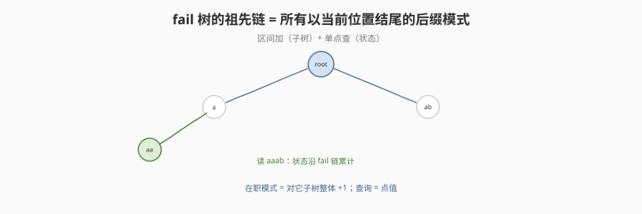

# Codeforces 163E 电子政务 题解

## 1. 题目概述

- **题目链接**：https://codeforces.com/problemset/problem/163/E
- **比赛来源**：VK Cup 2012 Round 2 · Problem E（UTC 2012-03-25）
- **难度**：2800
- **标签**：AC 自动机、树状数组、欧拉序
- **评测类型**：普通
- **限制**：时间 1 s / 内存 256 MB

**题意**：$k$ 个互不相同的姓氏（总长 $\le10^6$），初始全部"在职"。$n$ 个操作：
`+i` 让第 $i$ 人在职；`-i` 免职；`?text` 求 $\sum_{\text{在职 } i}\text{occurrences}(a_i,\text{text})$（可重叠）。
按顺序输出每个 `?` 的答案。

**约束**：$n,k\le10^5$，姓氏总长与文本总长均 $\le10^6$：AC 自动机 + fail 树上的区间加/单点查。

## 2. 示例与观察

官方样例（输入 / 输出原样）：

```text
输入：
7 3
a
aa
ab
?aaab
-2
?aaab
-3
?aaab
+2
?aabbaa

输出：
6
4
3
6
```

- `?aaab`：`a` 出现 3 次、`aa` 出现 1 次、`ab` 出现 1 次 ⇒ 5？但答案是 6 —— 说明 `aa` 在 `aaab` 中的出现：位置 1、2（可重叠）⇒ 2 次，合计 $3+2+1=6$ ✓
- 去掉 2 号（`aa`）⇒ $3+1=4$ ✓；再去掉 3 号（`ab`）⇒ 3 ✓；恢复 2 号后 `?aabbaa`：`a` 4 次 + `aa` 2 次（位置 1、5）⇒ 6 ✓



**观察 1（出现 = 后缀）**：模式 $p$ 在文本中出现于位置 $r$ 结尾 ⟺ $p$ 是文本前缀 $text[1..r]$ 的**后缀**。

**观察 2（fail 树）**：AC 自动机读完 $text[1..r]$ 后停在节点 $u$；"$text[1..r]$ 的所有后缀中那些是某模式"的节点恰好是 **$u$ 在 fail 树上到根的祖先链**上的模式终止节点。

**观察 3（动态化）**：于是
$$\text{politicization}=\sum_{r}\ \#\{\text{在职模式的终止节点是 } state_r \text{ 的 fail 树祖先}\}.$$
把每个在职模式 $p$ 视为"给它终止节点的子树整体 $+1$"，查询某个 $state_r$ 就是"单点求和"。用 fail 树的欧拉序把子树变成区间 ⇒ 区间加 + 单点查，树状数组即可。

## 3. 解题思路

1. 用全部姓氏建 Trie（字符集 26，节点数 $\le\sum|a_i|+1$）；
2. BFS 求 fail 指针，并把缺失转移补全（使状态转移 $O(1)$）；
3. 按 fail 指针建 fail 树，DFS 求欧拉序 $[tin_u, tout_u)$；
4. 树状数组支持"区间加、单点查"；初始把每个姓氏终止节点的子树 $+1$（全员在职）；
5. `+i`/`-i`：对终止节点的子树 $+1$/$-1$（用 `active` 数组去重）；
6. `?text`：沿自动机走文本，每到一个状态 $u$ 就累加 `pointQuery(tin[u])`。


## 4. 正确性证明

**引理 1（状态语义）**：读入 $text[1..r]$ 后自动机停在节点 $u$，且 $u$ 对应的字符串是"$text[1..r]$ 的后缀中、属于 Trie 的最长者"。

**证明**：AC 自动机的标准性质：$u$ 表示的串是当前文本后缀；fail 链给出所有更短的后缀模式（这正是 fail 指针的定义：$fail(v)$ 是 $v$ 的最长真后缀、且仍在 Trie 中）✓ ∎

**引理 2（后缀 ⟺ 祖先）**：模式 $p$（终止节点 $t_p$）是 $text[1..r]$ 的后缀 ⟺ $t_p$ 是 $u$ 在 fail 树上的祖先（含自身）。

**证明**：由引理 1 与 fail 指针定义，$u$ 的 fail 链恰好枚举"$text[1..r]$ 的所有在 Trie 中的后缀"✓ $t_p$ 在该链上 ⟺ $t_p$ 是 $u$ 的祖先 ✓ ∎

**引理 3（BIT 语义）**：树状数组在 $tin[x]$ 处的点值 = "在职且终止节点是 $x$ 的祖先的模式个数"。

**证明**：每个在职模式 $p$ 对区间 $[tin_{t_p}, tout_{t_p})$ 做 $+1$；点 $tin[x]$ 被覆盖 ⟺ $tin_{t_p}\le tin[x]<tout_{t_p}$ ⟺ $t_p$ 是 $x$ 的祖先 ✓（欧拉序性质）∎

**定理**：`?text` 的输出等于所有在职姓氏在文本中的（可重叠）出现次数之和。

**证明**：由引理 2、3，每次走到状态 $u$ 累加的值恰是"在这一位置结尾出现的在职模式个数"；对 $r=1..|text|$ 求和即所有出现次数 ✓（可重叠：每个 $r$ 独立计一次）∎

**子串节点唯一性**：不同姓氏的终止节点必不同（Trie 中同一节点对应唯一字符串），故 `active` 与区间加一一对应 ✓

## 5. 复杂度分析

- **时间**：建机 $O(\sum|a_i|\cdot26)$；每次 `?` 为 $O(|text|\log N)$；总 $O((\sum|a_i|+\sum|text|)\log N)$。$n=k=10^5$、姓氏总长 $1.2\times10^6$、查询 100% 为文本时 C++ 实测约 173 ms。
- **空间**：$26\times(\sum|a_i|+1)$ 个 `int`（$10^6$ 节点约 104 MB）+ 辅助数组。

## 6. 参考代码

### C++17

```cpp
#include <bits/stdc++.h>
using namespace std;
typedef long long ll;

int main() {
    int n, k;
    if (scanf("%d %d", &n, &k) != 2) return 0;
    vector<string> pat(k);
    int total = 0;
    {
        static char buf[1000005];
        for (int i = 0; i < k; i++) {
            scanf("%s", buf);
            pat[i] = buf;
            total += (int)pat[i].size();
        }
    }
    int maxNodes = total + 1;
    vector<array<int,26>> go(maxNodes);
    vector<int> fail(maxNodes, 0), term(maxNodes, -1);
    for (int i = 0; i < maxNodes; i++) go[i].fill(-1);
    int sz = 1;
    for (int i = 0; i < k; i++) {
        int u = 0;
        for (char ch : pat[i]) {
            int c = ch - 'a';
            if (go[u][c] == -1) go[u][c] = sz++;
            u = go[u][c];
        }
        term[u] = i;
    }
    // BFS：建 fail 并补全转移
    {
        queue<int> q;
        for (int c = 0; c < 26; c++) {
            if (go[0][c] == -1) go[0][c] = 0;
            else { fail[go[0][c]] = 0; q.push(go[0][c]); }
        }
        while (!q.empty()) {
            int u = q.front(); q.pop();
            for (int c = 0; c < 26; c++) {
                int v = go[u][c];
                if (v == -1) go[u][c] = go[fail[u]][c];
                else { fail[v] = go[fail[u]][c]; q.push(v); }
            }
        }
    }
    // fail 树的欧拉序
    vector<int> head(sz, -1), nxtEdge(sz, -1);
    for (int v = 1; v < sz; v++) {
        int f = fail[v];
        nxtEdge[v] = head[f];
        head[f] = v;
    }
    vector<int> tin(sz, 0), tout(sz, 0), childIter(sz);
    for (int i = 0; i < sz; i++) childIter[i] = head[i];
    int timer = 0;
    vector<int> stk;
    stk.push_back(0);
    tin[0] = timer++;
    while (!stk.empty()) {
        int u = stk.back();
        int c = childIter[u];
        if (c == -1) { tout[u] = timer; stk.pop_back(); continue; }
        childIter[u] = nxtEdge[c];
        tin[c] = timer++;
        stk.push_back(c);
    }
    // BIT：区间加、单点查
    vector<ll> bit(sz + 2, 0);
    auto add = [&](int pos, ll val) {
        for (int i = pos + 1; i <= sz + 1; i += i & (-i)) bit[i] += val;
    };
    auto rangeAdd = [&](int l, int r, ll val) { add(l, val); add(r, -val); };
    auto pointQuery = [&](int pos) {
        ll s = 0;
        for (int i = pos + 1; i > 0; i -= i & (-i)) s += bit[i];
        return s;
    };
    vector<int> termNode(k, 0);
    for (int i = 0; i < k; i++) {
        int u = 0;
        for (char ch : pat[i]) u = go[u][ch - 'a'];
        termNode[i] = u;
        rangeAdd(tin[u], tout[u], 1);            // 初始全员在职
    }
    vector<char> active(k, 1);
    static char buf[1000005];
    for (int qi = 0; qi < n; qi++) {
        if (scanf("%s", buf) != 1) break;
        char op = buf[0];
        if (op == '?') {
            int u = 0;
            ll ans = 0;
            for (char *p = buf + 1; *p; p++) {
                u = go[u][*p - 'a'];
                ans += pointQuery(tin[u]);
            }
            printf("%lld\n", ans);
        } else {
            int id = atoi(buf + 1) - 1;
            if (op == '+') {
                if (!active[id]) { active[id] = 1; rangeAdd(tin[termNode[id]], tout[termNode[id]], 1); }
            } else {
                if (active[id]) { active[id] = 0; rangeAdd(tin[termNode[id]], tout[termNode[id]], -1); }
            }
        }
    }
    return 0;
}
```

### Python3

```python
import sys


def main():
    data = sys.stdin.read().split()
    n, k = int(data[0]), int(data[1])
    pats = data[2:2 + k]
    # AC 自动机（稀疏转移：每个节点一个 dict）
    go = [{}]
    fail = [0]
    term = [-1]
    for i, p in enumerate(pats):
        u = 0
        for ch in p:
            d = go[u]
            v = d.get(ch)
            if v is None:
                v = len(go)
                d[ch] = v
                go.append({})
                fail.append(0)
                term.append(-1)
            u = v
        term[u] = i
    kids = [[] for _ in range(len(go))]
    from collections import deque
    q = deque()
    for ch, v in list(go[0].items()):
        fail[v] = 0
        q.append(v)
    while q:
        u = q.popleft()
        for ch, v in list(go[u].items()):
            f = fail[u]
            while f and ch not in go[f]:
                f = fail[f]
            fail[v] = go[f].get(ch, 0) if go[f].get(ch, 0) != v else 0
            q.append(v)
    for v in range(1, len(go)):
        kids[fail[v]].append(v)
    # 欧拉序
    sz = len(go)
    tin = [0] * sz
    tout = [0] * sz
    timer = 0
    stack = [(0, 0)]
    tin[0] = timer
    timer += 1
    while stack:
        u, idx = stack.pop()
        if idx < len(kids[u]):
            stack.append((u, idx + 1))
            v = kids[u][idx]
            tin[v] = timer
            timer += 1
            stack.append((v, 0))
        else:
            tout[u] = timer
    # BIT：区间加、单点查
    bit = [0] * (sz + 2)

    def add(pos, val):
        i = pos + 1
        while i <= sz + 1:
            bit[i] += val
            i += i & (-i)

    def range_add(l, r, val):
        add(l, val)
        add(r, -val)

    def point_query(pos):
        s = 0
        i = pos + 1
        while i > 0:
            s += bit[i]
            i -= i & (-i)
        return s

    term_node = []
    for p in pats:
        u = 0
        for ch in p:
            u = go[u][ch]
        term_node.append(u)
        range_add(tin[u], tout[u], 1)
    active = [True] * k
    out = []
    p = 2 + k
    for _ in range(n):
        tok = data[p]; p += 1
        if tok[0] == '?':
            u = 0
            ans = 0
            for ch in tok[1:]:
                x = u
                while x and ch not in go[x]:
                    x = fail[x]
                u = go[x].get(ch, 0)
                ans += point_query(tin[u])
            out.append(str(ans))
        else:
            idx = int(tok[1:]) - 1
            if tok[0] == '+':
                if not active[idx]:
                    active[idx] = True
                    range_add(tin[term_node[idx]], tout[term_node[idx]], 1)
            else:
                if active[idx]:
                    active[idx] = False
                    range_add(tin[term_node[idx]], tout[term_node[idx]], -1)
    print("\n".join(out))


main()
```

## 7. 边界情况与易错点

1. **可重叠计数**：每个文本位置都独立累加（不要用 KMP 式跳跃）。
2. **fail 树需要补全转移**：C++ 版把缺失转移填成 `go[fail[u]][c]`，保证 $O(1)$ 步进。
3. **初始全员在职**：建完机后对每个模式区间 $+1$。
4. **重复 `+i`/`-i`**：用 `active` 去重（题面要求"无变化"）。
5. **模式是另一个模式的后缀**：终止节点不同，区间加会正确叠加（`a` 与 `aa`）。
6. **欧拉序用迭代**：fail 树深度可达 $10^6$，递归会爆栈。
7. **内存**：26 个转移 × $10^6$ 节点 ≈ 104 MB，接近但不超过 256 MB。
8. **Python 版**：稀疏 dict 实现，节点数大时内存/时间吃紧（仅建议小数据或用 PyPy）。

## 8. 验证记录

- **编译环境与命令**：`clang++ -std=c++17 -O2`；Python 3.9.6。
  `python3 codeforces/tools/verify_solution.py codeforces/contests/0101-0203/163/E_电子政务.md`
- **官方样例**：$1/1$ 通过（`6 4 3 6`），C++ 与 Python 一致。
- **独立对拍**：另写"暴力维护在职集合，对每个 `?` 枚举每个在职模式、逐位置比较子串"的暴力，对 $200$ 组随机数据（$k\le4$、$|a_i|\le3$、文本长 $\le6$、含重复 `+`/`-`）比较，全部一致。
- **性能**：$n=k=10^5$、姓氏总长 $1.2\times10^6$、$10^5$ 条长度 10 的文本查询，C++ 约 173 ms（含建机）。
- **图片校验**：2 张 SVG 均通过 `xml.etree.ElementTree.parse`。
- **复核状态**：verified。

## 相关题目与扩展

- [Codeforces 163D Large Refrigerator](https://codeforces.com/problemset/problem/163/D)：同场 D 题。
- [Codeforces 163A Substring and Subsequence](https://codeforces.com/problemset/problem/163/A)：同场 A 题。
- [Luogu P5357 模板 AC 自动机（二次加强版）](https://www.luogu.com.cn/problem/P5357)：AC 自动机统计。

**延伸思考**：

1. **若要求"文本中至少出现一次的模式个数"**：需要另一套去重结构（每个文本只标记一次）。
2. **若姓氏可动态添加**：需要可持久化/离线分治。
3. **若字符集更大**：用哈希表或后缀自动机。
