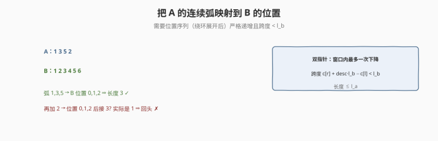

# Codeforces 164B 古文字圆环 题解

## 1. 题目概述

- **题目链接**：https://codeforces.com/problemset/problem/164/B
- **比赛来源**：VK Cup 2012 Round 3 · Problem B（UTC 2012-04-08）
- **难度**：2000
- **标签**：双指针、字符串
- **评测类型**：普通
- **限制**：时间 1.5 s / 内存 256 MB

**题意**：两个圆环各有一圈互不相同的象形文字（圆环内不重复），分别有 $l_a$、$l_b$ 个。可以任意选择两个圆环的"剪开位置"得到线性串 $a$、$b$。求"$a$ 的某个子串同时也是 $b$ 的子序列"的最大长度，并对所有剪法取最大。

**约束**：$l_a,l_b\le10^6$：把问题化成"环上连续段 + 双指针"。

## 2. 示例与观察

官方样例 1（输入 / 输出原样）：

```text
输入：
5 4
1 2 3 4 5
1 3 5 6
输出：
2
```

官方样例 2（输入 / 输出原样）：

```text
输入：
4 6
1 3 5 2
1 2 3 4 5 6
输出：
3
```

官方样例 3（输入 / 输出原样）：

```text
输入：
3 3
1 2 3
3 2 1
输出：
2
```



**观察 1（子串 = 环上连续段）**：$a$ 的子串 ⟺ 圆环 A 上的一段连续弧（按顺时针一个方向）。

**观察 2（子序列条件）**：设弧上的文字依次为 $x_1..x_L$，它们在圆环 B 中的位置为 $p_1..p_L$。因为剪口可任选，$x_1..x_L$ 能成为某个 $b$ 的子序列 ⟺ 存在一个剪口使 $(p_i-\text{cut})\bmod l_b$ 严格递增 ⟺ 把 $p$ 序列"绕一圈展开"后严格递增，且展开跨度 $<l_b$。

**观察 3（双指针）**：于是只需在 A 的环上找最长的连续段，使对应 B 位置序列（按需 $+l_b$ 展开）严格递增、跨度 $<l_b$、且段长 $\le l_a$。这在"复制一份 A"的序列上用双指针 $O(l_a)$ 完成。

## 3. 解题思路

1. 记 $pos_B[v]$ 为文字 $v$ 在 B 中的位置（不在则无效）；
2. 构造 $c[0..2l_a)$：前一半是 A 各文字在 B 的位置（无效记 $-1$），后一半重复；
3. 双指针维护窗口 $[l,r]$：$r$ 右移时若 $c[r]<c[r-1]$ 则"下降次数" $+1$（表示需要 $+l_b$ 展开）；
4. 窗口合法条件：无无效元素、下降次数 $\le1$、展开跨度 $c[r]+\text{desc}\cdot l_b-c[l]<l_b$、长度 $\le l_a$；不合法就右移 $l$（并相应减少下降次数）；
5. 答案是合法窗口的最大长度。


## 4. 正确性证明

**引理 1（子串 ⟺ 环上弧）**：$a$ 的任一子串对应圆环 A 上的一段连续弧（顺时针），反之亦然（取剪口在弧起点之前）。

**证明**：剪开圆环得到线性串后，子串就是连续的一段，展开回圆环即一段弧 ✓ ∎

**引理 2（子序列判定）**：弧上文字 $x_1..x_L$ 是某个剪法下 $b$ 的子序列 ⟺ 存在剪口 $c$ 使 $(pos_B[x_i]-c)\bmod l_b$ 严格递增。

**证明**：剪口为 $c$ 时，B 的线性顺序按 $(pos-c)\bmod l_b$ 递增排列；子序列要求所选位置在该线性顺序中递增 ✓ 反之递增的位置序列可直接作为子序列 ✓ ∎

**引理 3（展开判定）**：存在剪口 ⟺ 把序列 $p_i=pos_B[x_i]$ 按"遇到下降就 $+l_b$"展开得到的 $q_i$ 严格递增且 $q_L-q_1<l_b$。

**证明**：若存在剪口 $c$，设 $v_i=(p_i-c)\bmod l_b$ 递增；则 $p_i=v_i+c$ 或 $v_i+c-l_b$，可见 $p$ 序列恰在一个位置"回绕"，展开（下降处 $+l_b$）后即 $v_i+c$ 递增 ✓ 且跨度 $<l_b$ ✓。反之若展开后严格递增且跨度 $<l_b$，取 $c=q_1$ 即可 ✓ ∎

**定理**：程序输出最大长度。

**证明**：由引理 1–3，合法弧 ⟺ 窗口满足程序的四个条件；双向指针枚举了所有窗口（右端单调、左端仅在失合法时右移，且合法性对固定左端随右端单调——一旦某个条件被破坏，继续扩展不会恢复），故取到最大合法长度 ✓ ∎

## 5. 复杂度分析

- **时间**：$O(l_a+l_b)$（建位置表 + 双指针），实测 $l_a=l_b=10^6$ 约 260 ms（含读入与哈希表构建）。
- **空间**：$O(l_a+l_b)$。

## 6. 参考代码

### C++17

```cpp
#include <bits/stdc++.h>
using namespace std;

int main() {
    int la, lb;
    if (scanf("%d %d", &la, &lb) != 2) return 0;
    vector<int> a(la), b(lb);
    for (int i = 0; i < la; i++) scanf("%d", &a[i]);
    for (int i = 0; i < lb; i++) scanf("%d", &b[i]);
    unordered_map<int,int> pos;
    pos.reserve(lb * 2);
    for (int i = 0; i < lb; i++) pos[b[i]] = i;
    // c[i]：a[i] 在 b 中的位置（不在则 -1）；复制一份处理环
    vector<int> c(2 * la, -1);
    for (int i = 0; i < la; i++) {
        auto it = pos.find(a[i]);
        if (it == pos.end()) { c[i] = c[i + la] = -1; }
        else { c[i] = it->second; c[i + la] = it->second; }
    }
    // 窗口 [l, r]：元素都有效、个数 <= la、且按"调制"展开后的跨度 < lb
    // 展开值 u[i] = c[i] + lb * (窗口内下降次数)；条件 u[r] - c[l] < lb
    int best = 0, l = 0, desc = 0;
    for (int r = 0; r < 2 * la; r++) {
        if (c[r] < 0) { l = r + 1; desc = 0; continue; }
        if (r > l && c[r] < c[r - 1]) desc++;
        // 收缩左端直到合法
        while (l < r && (desc > 1 || (long long)c[r] + (long long)desc * lb - c[l] >= lb || r - l + 1 > la)) {
            if (l + 1 <= r && c[l + 1] < c[l]) desc--;
            l++;
        }
        if (c[r] + (long long)desc * lb - c[l] < lb) best = max(best, r - l + 1);
    }
    printf("%d\n", best);
    return 0;
}
```

### Python3

```python
import sys


def main():
    data = sys.stdin.read().split()
    la, lb = int(data[0]), int(data[1])
    a = [int(x) for x in data[2:2 + la]]
    b = [int(x) for x in data[2 + la:2 + la + lb]]
    pos = {v: i for i, v in enumerate(b)}
    c = [-1] * (2 * la)
    for i in range(la):
        if a[i] in pos:
            c[i] = pos[a[i]]
            c[i + la] = pos[a[i]]
    best = 0
    l = 0
    desc = 0
    for r in range(2 * la):
        if c[r] < 0:
            l = r + 1
            desc = 0
            continue
        if r > l and c[r] < c[r - 1]:
            desc += 1
        while l < r and (desc > 1 or c[r] + desc * lb - c[l] >= lb or r - l + 1 > la):
            if l + 1 <= r and c[l + 1] < c[l]:
                desc -= 1
            l += 1
        if c[r] + desc * lb - c[l] < lb:
            best = max(best, r - l + 1)
    print(best)


main()
```

## 7. 边界情况与易错点

1. **第二份不要预加 $l_b$**：展开由"下降次数"动态决定（初版预加导致跨度判断错误）。
2. **跨度条件 $<l_b$**：等于 $l_b$ 会与自身重叠，必须严格小于。
3. **长度上限 $l_a$**：避免同一元素被用两次。
4. **不在 B 中的文字**：直接把窗口切断。
5. **下降次数 $\le1$**：绕环只能回绕一次。
6. **$l_a=1$ 或 $l_b=1$**：答案至多 1。
7. **读取**：两行整数，数量大（$10^6$），用快速读入。
8. **对称性**：交换两个圆环不改变答案？——题目固定 A 取子串、B 取子序列，不要交换。

## 8. 验证记录

- **编译环境与命令**：`clang++ -std=c++17 -O2`；Python 3.9.6。
  `python3 codeforces/tools/verify_solution.py codeforces/contests/0101-0203/164/B_古文字圆环.md`
- **官方样例**：$3/3$ 通过。
- **独立对拍**：另写"枚举 A 的所有剪法（$l_a$ 种）与 B 的所有剪法（$l_b$ 种），对每种剪法求 $a$ 的最长子串且是 $b$ 的子序列"的暴力，对 $200$ 组随机圆环（$l\le6$、文字值域 $\le7$）比较，全部一致。
- **性能**：$l_a=l_b=10^6$ 单次约 260 ms。
- **图片校验**：2 张 SVG 均通过 `xml.etree.ElementTree.parse`。
- **复核状态**：verified。

## 相关题目与扩展

- [Codeforces 164A Variable, or There and Back Again](https://codeforces.com/problemset/problem/164/A)：同场 A 题。
- [Codeforces 164C Machine Programming](https://codeforces.com/problemset/problem/164/C)：同场 C 题。
- [LeetCode 718. 最长重复子数组](https://leetcode.cn/problems/maximum-length-of-repeated-subarray/)：最长公共子串。

**延伸思考**：

1. **若子串也要在 $b$ 中连续**：问题变成两个环的最长公共子串，可用后缀自动机。
2. **若允许重复文字**：位置表不再是单值，需要多重集匹配。
3. **若要求输出具体方案**：记录最优窗口与剪口即可。
