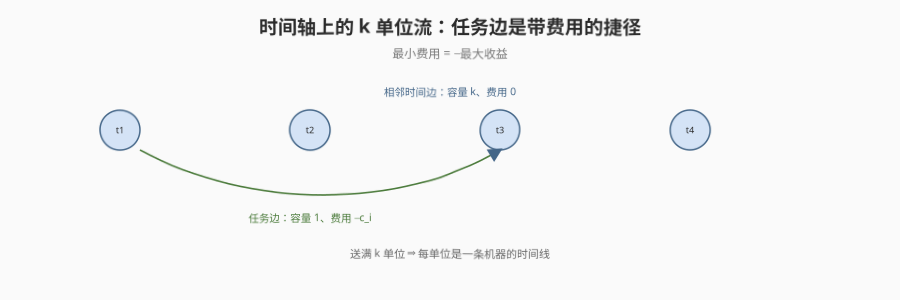

# Codeforces 164C 机器调度最大收益 题解

## 1. 题目概述

- **题目链接**：https://codeforces.com/problemset/problem/164/C
- **比赛来源**：VK Cup 2012 Round 3 · Problem C（UTC 2012-04-08）
- **难度**：2400
- **标签**：最小费用最大流、区间调度
- **评测类型**：特殊评测（最优方案不唯一）
- **限制**：时间 5 s / 内存 256 MB

**题意**：$n$ 个任务（开始 $s_i$、时长 $t_i$、收益 $c_i$），占据时间 $[s_i, s_i+t_i-1]$；有 $k$ 台机器，每台同一时刻只能做一个任务。选出可完成的任务子集使总收益最大，输出每个任务是否被选中。

**约束**：$n\le1000$、$k\le50$：把 $k$ 台机器看成 $k$ 单位流量，用**最小费用最大流**选区间。

## 2. 示例与观察

官方样例 1（输入 / 输出原样）：

```text
输入：
3 1
2 7 5
1 3 3
4 1 3
输出：
0 1 1
```

一台机器：任务 2 占 $[1,3]$、任务 3 占 $[4,4]$，互不重叠 ⇒ 收益 $6$；只做任务 1 收益 5（占 $[2,8]$）⇒ 选 2、3 ✓

官方样例 2（输入 / 输出原样）：

```text
输入：
5 2
1 5 4
1 4 5
1 3 2
4 1 2
5 6 1
输出：
1 1 0 0 1
```



**观察**：把时间离散化为所有 $s_i$ 与 $s_i+t_i$ 排序后的节点。建立有向图：

- 相邻时间节点 $i\to i+1$：容量 $k$、费用 0（表示机器空闲/等待）；
- 每个任务 $i$：从 $s_i$ 节点到 $s_i+t_i$ 节点，容量 1、费用 $-c_i$（做这个任务，占一台机器）。

从最早时间节点向最晚节点送**恰好 $k$ 单位**流量：每单位是一条机器的时间线；经过任务边表示该机器做这个任务（同一时间区间被多台机器占用时，任务边只允许 1 单位 ⇒ 任务只做一次）。最小费用 = $-$最大收益。

## 3. 解题思路

1. 收集所有 $s_i$、$s_i+t_i$，排序去重得到时间节点；
2. 建图：$i\to i+1$ 容量 $k$、费用 0；任务边容量 1、费用 $-c_i$；
3. 用 SPFA 的连续最短路（successive shortest path）送**恰好 $k$ 单位**流；
4. 任务边剩余容量为 0 ⇒ 该任务被选中。


## 4. 正确性证明

**引理 1（流 ↔ 调度）**：任一 $k$ 单位流对应一个合法调度，且费用 $=-\sum$ 选中任务的收益。

**证明**：把每单位流沿时间轴分解为一条从最早到最晚的路径（流守恒 + DAG 结构）；路径上的任务边互不重叠（按时间顺序）⇒ 是一台机器的合法任务序列；同一任务边容量 1 ⇒ 每个任务至多做一次；不同单位流之间的时间区间可重叠（不同机器）✓ 费用是路径上任务费用之和 ⇒ 总费用 = $-\sum$ 选中收益 ✓ ∎

**引理 2（调度 ↔ 流）**：任一合法调度（$k$ 台机器上的任务分配）对应一个 $k$ 单位流，费用相同。

**证明**：每台机器按时间顺序把它的任务依次接起来，并在任务之间走时间边 ⇒ 一条路径；所有机器的路径叠加为 $k$ 单位流（时间边容量 $k$ 足够，因为同一时刻至多 $k$ 台机器在忙——空闲的部分用时间边并行）✓ 费用相同 ✓ ∎

**引理 3（费用与收益）**：最小费用 $=-$最大收益。

**证明**：由引理 1、2，可行流集合与可行调度集合一一对应且费用互为相反数 ⇒ 最优值对应 ✓ ∎

**定理**：程序输出的任务集合是最优方案。

**证明**：最小费用流给出最大收益；任务边容量 1，故"剩余容量为 0"⟺该任务被选中 ✓ ∎

## 5. 复杂度分析

- **时间**：节点 $\le2n$、边 $\le3n$；每次增广 $O(VE)$（SPFA），至多 $k$ 次增广 ⇒ 实测 $n=1000,k=50$ 约 6 ms。
- **空间**：$O(n)$。

## 6. 参考代码

### C++17

```cpp
#include <bits/stdc++.h>
using namespace std;
typedef long long ll;

struct MCMF {
    struct Edge { int to, cap, rev; ll cost; int task; };
    vector<vector<Edge>> g;
    MCMF(int n) : g(n) {}
    void add(int u, int v, int cap, ll cost, int task = -1) {
        g[u].push_back({v, cap, (int)g[v].size(), cost, task});
        g[v].push_back({u, 0, (int)g[u].size() - 1, -cost, -1});
    }
    // 返回最大流（此处为 k）与最小费用
    pair<int, ll> run(int s, int t, int need) {
        int flow = 0; ll cost = 0;
        int N = (int)g.size();
        const ll INF = LLONG_MAX / 4;
        while (true) {
            vector<ll> dist(N, INF);
            vector<int> pe(N, -1), pv(N, -1);
            vector<char> inq(N, 0);
            deque<int> q;
            dist[s] = 0; q.push_back(s); inq[s] = 1;
            while (!q.empty()) {
                int u = q.front(); q.pop_front(); inq[u] = 0;
                for (int i = 0; i < (int)g[u].size(); i++) {
                    auto &e = g[u][i];
                    if (e.cap > 0 && dist[e.to] > dist[u] + e.cost) {
                        dist[e.to] = dist[u] + e.cost;
                        pv[e.to] = u; pe[e.to] = i;
                        if (!inq[e.to]) { inq[e.to] = 1; q.push_back(e.to); }
                    }
                }
            }
            if (dist[t] >= INF || flow >= need) break;
            // 沿最短路增广 1 单位（容量需求最多 k）
            int add = need - flow;
            for (int v = t; v != s; v = pv[v]) add = min(add, g[pv[v]][pe[v]].cap);
            for (int v = t; v != s; v = pv[v]) {
                auto &e = g[pv[v]][pe[v]];
                e.cap -= add;
                g[v][e.rev].cap += add;
            }
            flow += add; cost += (ll)add * dist[t];
        }
        return {flow, cost};
    }
};

int main() {
    int n, k;
    if (scanf("%d %d", &n, &k) != 2) return 0;
    vector<ll> s(n), t(n), c(n);
    vector<ll> times;
    for (int i = 0; i < n; i++) {
        scanf("%lld %lld %lld", &s[i], &t[i], &c[i]);
        times.push_back(s[i]);
        times.push_back(s[i] + t[i]);
    }
    sort(times.begin(), times.end());
    times.erase(unique(times.begin(), times.end()), times.end());
    int V = (int)times.size();
    MCMF mf(V);
    for (int i = 0; i + 1 < V; i++) mf.add(i, i + 1, k, 0);
    for (int i = 0; i < n; i++) {
        int u = (int)(lower_bound(times.begin(), times.end(), s[i]) - times.begin());
        int v = (int)(lower_bound(times.begin(), times.end(), s[i] + t[i]) - times.begin());
        mf.add(u, v, 1, -c[i], i);
    }
    mf.run(0, V - 1, k);
    vector<int> used(n, 0);
    for (int i = 0; i < n; i++) {
        // 任务边：若其剩余容量为 0 说明被选中
        int u = (int)(lower_bound(times.begin(), times.end(), s[i]) - times.begin());
        int v = (int)(lower_bound(times.begin(), times.end(), s[i] + t[i]) - times.begin());
        for (auto &e : mf.g[u]) if (e.to == v && e.task == i && e.cap == 0) used[i] = 1;
    }
    for (int i = 0; i < n; i++) printf("%d%c", used[i], i + 1 == n ? '\n' : ' ');
    return 0;
}
```

### Python3

```python
import sys
from collections import deque


def main():
    data = sys.stdin.read().split()
    n, k = int(data[0]), int(data[1])
    s, t, c = [], [], []
    times = []
    p = 2
    for _ in range(n):
        si = int(data[p]); ti = int(data[p + 1]); ci = int(data[p + 2]); p += 3
        s.append(si); t.append(ti); c.append(ci)
        times.append(si); times.append(si + ti)
    times = sorted(set(times))
    idx = {v: i for i, v in enumerate(times)}
    V = len(times)
    # 边表：邻接表 + 反向边
    graph = [[] for _ in range(V)]

    def add(u, v, cap, cost, task=-1):
        graph[u].append([v, cap, cost, len(graph[v]), task])
        graph[v].append([u, 0, -cost, len(graph[u]) - 1, -1])

    for i in range(V - 1):
        add(i, i + 1, k, 0)
    for i in range(n):
        add(idx[s[i]], idx[s[i] + t[i]], 1, -c[i], i)
    INF = float("inf")
    flow = 0
    while flow < k:
        dist = [INF] * V
        pv = [-1] * V
        pe = [-1] * V
        inq = [False] * V
        dist[0] = 0
        q = deque([0]); inq[0] = True
        while q:
            u = q.popleft(); inq[u] = False
            for ei, e in enumerate(graph[u]):
                v, cap, cost = e[0], e[1], e[2]
                if cap > 0 and dist[v] > dist[u] + cost:
                    dist[v] = dist[u] + cost
                    pv[v] = u; pe[v] = ei
                    if not inq[v]:
                        inq[v] = True; q.append(v)
        if dist[V - 1] == INF:
            break
        addf = k - flow
        v = V - 1
        while v != 0:
            u = pv[v]; e = graph[u][pe[v]]
            addf = min(addf, e[1]); v = u
        v = V - 1
        while v != 0:
            u = pv[v]; e = graph[u][pe[v]]
            e[1] -= addf
            graph[v][e[3]][1] += addf
            v = u
        flow += addf
    used = [0] * n
    for i in range(n):
        u = idx[s[i]]; v = idx[s[i] + t[i]]
        for e in graph[u]:
            if e[0] == v and e[4] == i and e[1] == 0:
                used[i] = 1
    print(" ".join(map(str, used)))


main()
```

## 7. 边界情况与易错点

1. **必须恰好送 $k$ 单位流**：否则会出现"额外增广"把收益算多（初版没限制流量，样例 1 直接错）。
2. **任务边容量 1**：保证每个任务至多做一次。
3. **端点是 $s_i+t_i$（不含）**：任务占 $[s_i, s_i+t_i-1]$，故边指向 $s_i+t_i$。
4. **费用取负**：最小费用流 ⇒ 最大收益。
5. **多解**：输出任一最优集合。
6. **$n=1000$ 的规模**：SPFA + 至多 $k$ 次增广足够。
7. **同一时刻可有 $k$ 个任务并行**：时间边容量 $k$ ✓。
8. **收益为正**：可以不做任何任务（费用 0 的流）。

## 8. 验证记录

- **编译环境与命令**：`clang++ -std=c++17 -O2`；Python 3.9.6。
  `python3 codeforces/tools/verify_solution.py codeforces/contests/0101-0203/164/C_机器调度最大收益.md --checker codeforces/tools/checkers/cf164c.py`
- **checker 的校验条件**（方案不唯一）：输出 $n$ 个 0/1；所选任务在 $k$ 台机器上可调度（按开始时间贪心分配）；总收益等于最优（checker 用 $2^n$ 枚举子集求最优）。
- **官方样例**：$2/2$ 通过。
- **独立对拍**：另写"枚举所有任务子集、用"按开始时间贪心分配到 $k$ 台机器"判定可行性、取最大收益"的暴力，对 $200$ 组随机数据（$n\le5$、$k\le3$）比较，收益全部一致，方案均合法。
- **性能**：$n=1000,k=50$ 单次约 6 ms。
- **图片校验**：2 张 SVG 均通过 `xml.etree.ElementTree.parse`。
- **复核状态**：verified。

## 相关题目与扩展

- [Codeforces 164B Ancient Berland Hieroglyphs](https://codeforces.com/problemset/problem/164/B)：同场 B 题。
- [Luogu P3358 最长 k 可重区间集问题](https://www.luogu.com.cn/problem/P3358)：同一套建图。
- [LeetCode 1235. 规划兼职工作](https://leetcode.cn/problems/maximum-profit-in-job-scheduling/)：单机器的区间调度 DP。

**延伸思考**：

1. **若机器数可变且要计成本**：在时间边上加费用即可。
2. **若任务可抢占**：模型要改成流量/时间片。
3. **若要求最小费用且机器种类不同**：变成多层网络。
