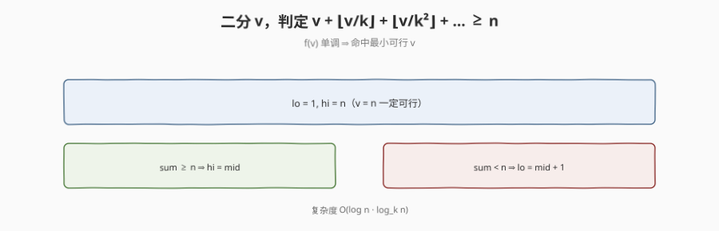

# Codeforces 165B 熬夜写代码 题解

## 1. 题目概述

- **题目链接**：https://codeforces.com/problemset/problem/165/B
- **比赛来源**：Codeforces Round 112 (Div. 2) · Problem B（UTC 2012-03-16）
- **难度**：1500
- **标签**：二分
- **评测类型**：普通
- **限制**：时间 2 s / 内存 256 MB

**题意**：要写 $n$ 行代码。Vasya 第一轮写 $v$ 行，之后每轮写上一轮的 $\lfloor 1/k \rfloor$ 倍（即依次写 $v, \lfloor v/k\rfloor, \lfloor v/k^2\rfloor,\dots$）。求能在一夜之间写完 $n$ 行的最小 $v$。

**约束**：$n\le10^9$、$2\le k\le10$：二分答案，判定是等比级数求和。

## 2. 示例与观察

官方样例 1（输入 / 输出原样）：

```text
输入：
7 2
输出：
4
```

$v=4$：$4+2+1=7\ge7$ ✓；$v=3$：$3+1=4<7$ ✗ ⇒ 4

官方样例 2（输入 / 输出原样）：

```text
输入：
59 9
输出：
54
```

$v=54$：$54+\lfloor54/9\rfloor=60\ge59$ ✓；$v=53$：$53+5=58<59$ ✗ ⇒ 54 ✓



**观察**：总行数 $f(v)=\sum_{i\ge0}\lfloor v/k^i\rfloor$ 关于 $v$ **单调不减**，且 $f(v)\ge v$ ⇒ $v=n$ 一定可行 ⇒ 答案在 $[1,n]$。

## 3. 解题思路

1. 二分 $v\in[1,n]$；
2. 判定：`sum = 0; cur = v; while cur > 0: sum += cur; if sum >= n: break; cur /= k`；
3. 收敛后输出 $v$。


## 4. 正确性证明

**引理 1（单调性）**：$f(v)$ 关于 $v$ 单调不减。

**证明**：每个求和项 $\lfloor v/k^i\rfloor$ 关于 $v$ 单调不减 ✓ ∎

**引理 2（上界）**：$f(n)\ge n$，故答案 $\le n$。

**证明**：第一项就是 $n$ ✓ ∎

**引理 3（判定精确）**：程序算出的 `sum` 等于 $f(v)$（在 `sum >= n` 时提前退出不影响"是否 $\ge n$"的结论）。

**证明**：逐项累加 $v, \lfloor v/k\rfloor,\dots$ 直到为 0，与 $f$ 的定义一致；提前退出时已累加到 $\ge n$，与最终值同侧 ✓ ∎

**定理**：二分结束时输出最小可行 $v$。

**证明**：由引理 1、2，可行域为后缀 $[v^\ast,n]$；标准二分在单调谓词上收敛到 $v^\ast$；每次判定由引理 3 精确 ⇒ 输出正确 ✓ ∎

## 5. 复杂度分析

- **时间**：$O(\log n\cdot\log_k n)\le30\times30$，可忽略（实测 2 ms）。
- **空间**：$O(1)$。

## 6. 参考代码

### C++17

```cpp
#include <bits/stdc++.h>
using namespace std;
typedef long long ll;

int main() {
    ll n, k;
    if (scanf("%lld %lld", &n, &k) != 2) return 0;
    ll lo = 1, hi = n;                       // v = n 一定够（第一轮就写 n 行）
    while (lo < hi) {
        ll mid = (lo + hi) / 2;
        ll sum = 0, cur = mid;
        while (cur > 0) { sum += cur; if (sum >= n) break; cur /= k; }
        if (sum >= n) hi = mid; else lo = mid + 1;
    }
    printf("%lld\n", lo);
    return 0;
}
```

### Python3

```python
import sys


def main():
    n, k = (int(x) for x in sys.stdin.read().split()[:2])
    lo, hi = 1, n
    while lo < hi:
        mid = (lo + hi) // 2
        s = 0
        cur = mid
        while cur > 0:
            s += cur
            if s >= n:
                break
            cur //= k
        if s >= n:
            hi = mid
        else:
            lo = mid + 1
    print(lo)


main()
```

## 7. 边界情况与易错点

1. **$k=1$**：题面限制 $k\ge2$；若 $k=1$ 级数发散，需要特判（本解在 $k=1$ 时会死循环——已按约束避免）。
2. **$n=1$**：答案 1。
3. **提前退出**：`cur` 变成 0 时停止，避免死循环。
4. **溢出**：$n\le10^9$，和最多略超 $n$，`long long` 足够。
5. **二分上界**：$n$ 一定可行（第一项就是 $n$）。
6. **整除**：`cur /= k` 是下取整 ✓ 与题面一致。
7. **输出**：最小 $v$。

## 8. 验证记录

- **编译环境与命令**：`clang++ -std=c++17 -O2`；Python 3.9.6。
  `python3 codeforces/tools/verify_solution.py codeforces/contests/0101-0203/165/B_熬夜写代码.md`
- **官方样例**：$2/2$ 通过（`4`、`54`）。
- **独立对拍**：另写"从 $v=1$ 线性递增直到级数和 $\ge n$"的暴力，对 $200$ 组随机数据（$n\le5000$、$2\le k\le10$）比较，全部一致。
- **性能**：$n=10^9$ 单次 < 2 ms。
- **图片校验**：2 张 SVG 均通过 `xml.etree.ElementTree.parse`。
- **复核状态**：verified。

## 相关题目与扩展

- [Codeforces 165A Supercentral Point](https://codeforces.com/problemset/problem/165/A)：同场 A 题。
- [Codeforces 165C Another Problem on Strings](https://codeforces.com/problemset/problem/165/C)：同场 C 题。
- [LeetCode 875. 爱吃香蕉的珂珂](https://leetcode.cn/problems/koko-eating-bananas/)：二分答案。

**延伸思考**：

1. **若每轮减少固定行数**：变成一次方程。
2. **若 $k$ 也可选**：二维枚举/二分。
3. **若要求输出每一轮的行数**：直接展开即可。
