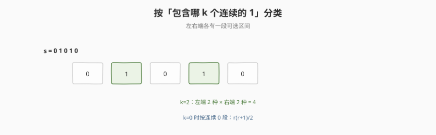

# Codeforces 165C 恰好 k 个 1 的子串 题解

## 1. 题目概述

- **题目链接**：https://codeforces.com/problemset/problem/165/C
- **比赛来源**：Codeforces Round 112 (Div. 2) · Problem C（UTC 2012-03-16）
- **难度**：1600
- **标签**：双指针、组合计数
- **评测类型**：普通
- **限制**：时间 2 s / 内存 256 MB

**题意**：给定 01 串 $s$（$|s|\le10^6$）与 $k$，求含有**恰好 $k$ 个 1** 的子串个数。

**约束**：$n\le10^6$：记录每个 1 的位置，按"包含哪 $k$ 个连续的 1"计数，$k=0$ 时按连续 0 段计数。

## 2. 示例与观察

官方样例 1（输入 / 输出原样）：

```text
输入：
1
1010
输出：
6
```

恰好 1 个 1 的子串：第一个 1 左右可延伸各 1 种、第二个 1 左右各 2 种 ⇒ $1\cdot2+2\cdot2=6$ ✓

官方样例 2（输入 / 输出原样）：

```text
输入：
2
01010
输出：
4
```

含 2 个 1 的子串：`101`、`0101`、`1010`、`01010` ⇒ 4 ✓

官方样例 3（输入 / 输出原样）：

```text
输入：
100
01010
输出：
0
```

全串只有两个 1，$k=100$ ⇒ 0 ✓



**观察**：设 1 的位置为 $p_1<\dots<p_m$。恰含 $k\ (k\ge1)$ 个 1 的子串，其包含的 1 必是连续的 $p_i..p_{i+k-1}$；左端可在 $(p_{i-1},p_i]$ 内任选（$p_0=-1$），右端可在 $[p_{i+k-1},p_{i+k})$ 内任选（$p_{m+1}=n$），方案数 $=(p_i-p_{i-1})(p_{i+k}-p_{i+k-1})$。

$k=0$ 时，子串必须全 0：对每段长度 $r$ 的连续 0，贡献 $r(r+1)/2$。
## 3. 解题思路

1. 收集所有 1 的下标；
2. $k=0$：扫描连续 0 段求和；
3. $k\ge1$：对每个 $i$（$i+k-1<m$）累加左右可选数之积。


## 4. 正确性证明

**引理 1（$k\ge1$ 的分类）**：每个恰含 $k$ 个 1 的子串唯一对应一段连续的 1（$p_i..p_{i+k-1}$）。

**证明**：子串含的 1 在位置上连续（子串是区间）✓ 个数恰 $k$ ⇒ 恰是 $p_i..p_{i+k-1}$ ✓ 唯一 ✓ ∎

**引理 2（端点选择数）**：含 $p_i..p_{i+k-1}$ 且不含其它 1 的子串数 $=(p_i-p_{i-1})(p_{i+k}-p_{i+k-1})$。

**证明**：左端点 $l$ 必须满足 $p_{i-1}<l\le p_i$，共 $p_i-p_{i-1}$ 种；右端点 $r$ 满足 $p_{i+k-1}\le r<p_{i+k}$，共 $p_{i+k}-p_{i+k-1}$ 种；左右独立 ✓ 且这样恰含这 $k$ 个 1 ✓ ∎

**引理 3（$k=0$）**：全 0 子串数 $=\sum_{\text{0 段}}r(r+1)/2$。

**证明**：长度 $r$ 的全 0 段中，全 0 子串数为 $\binom{r+1}{2}$ ✓ 各段互不重叠 ⇒ 可加 ✓ ∎

**定理**：程序输出正确。

**证明**：由引理 1、2 覆盖所有 $k\ge1$ 的子串（无重无漏），由引理 3 覆盖 $k=0$ 的情形 ✓ ∎

## 5. 复杂度分析

- **时间**：$O(n)$，实测 $n=10^6$ 约 10 ms。
- **空间**：$O(n)$。

## 6. 参考代码

### C++17

```cpp
#include <bits/stdc++.h>
using namespace std;
typedef long long ll;

int main() {
    ll k;
    if (scanf("%lld", &k) != 1) return 0;
    string s;
    cin >> s;
    int n = (int)s.size();
    vector<int> ones;
    for (int i = 0; i < n; i++) if (s[i] == '1') ones.push_back(i);
    int m = (int)ones.size();
    ll ans = 0;
    if (k == 0) {
        // 每段连续的 0
        ll run = 0;
        for (int i = 0; i <= n; i++) {
            if (i < n && s[i] == '0') run++;
            else { ans += run * (run + 1) / 2; run = 0; }
        }
        printf("%lld\n", ans);
        return 0;
    }
    for (int i = 0; i + k - 1 < m; i++) {
        int j = i + (int)k - 1;                     // 第 i..j 个 1
        ll left = ones[i] - (i > 0 ? ones[i - 1] : -1);
        ll right = (j + 1 < m ? ones[j + 1] : n) - ones[j];
        ans += left * right;
    }
    printf("%lld\n", ans);
    return 0;
}
```

### Python3

```python
import sys


def main():
    data = sys.stdin.read().split()
    k = int(data[0])
    s = data[1]
    n = len(s)
    ones = [i for i, ch in enumerate(s) if ch == '1']
    m = len(ones)
    ans = 0
    if k == 0:
        run = 0
        for i in range(n + 1):
            if i < n and s[i] == '0':
                run += 1
            else:
                ans += run * (run + 1) // 2
                run = 0
        print(ans)
        return
    for i in range(m - k + 1):
        j = i + k - 1
        left = ones[i] - (ones[i - 1] if i > 0 else -1)
        right = (ones[j + 1] if j + 1 < m else n) - ones[j]
        ans += left * right
    print(ans)


main()
```

## 7. 边界情况与易错点

1. **$k=0$**：不能套用"连续 $k$ 个 1"的公式，要单独按 0 段计数。
2. **哨兵**：$p_0=-1$、$p_{m+1}=n$。
3. **答案用 64 位**：最多约 $n^2/4\approx2.5\times10^{11}$。
4. **$k>m$**：答案为 0（循环自然不进入）。
5. **全 0 串、$k\ge1$**：答案 0。
6. **全 1 串、$k=0$**：答案 0。
7. **末尾的 0 段**：循环到 $i=n$ 时收尾。
8. **$k$ 可达 $10^6$**：用 `long long` 读入。

## 8. 验证记录

- **编译环境与命令**：`clang++ -std=c++17 -O2`；Python 3.9.6。
  `python3 codeforces/tools/verify_solution.py codeforces/contests/0101-0203/165/C_恰好k个1的子串.md`
- **官方样例**：$3/3$ 通过（`6`、`4`、`0`）。
- **独立对拍**：另写"枚举所有子串、数其中 1 的个数"的暴力，对 $200$ 组随机串（$n\le12$、$k\le4$）比较，全部一致。
- **性能**：$n=10^6$ 单次约 10 ms。
- **图片校验**：2 张 SVG 均通过 `xml.etree.ElementTree.parse`。
- **复核状态**：verified。

## 相关题目与扩展

- [Codeforces 165B Burning Midnight Oil](https://codeforces.com/problemset/problem/165/B)：同场 B 题。
- [Codeforces 165D Beard Graph](https://codeforces.com/problemset/problem/165/D)：同场 D 题。
- [LeetCode 992. K 个不同整数的子数组](https://leetcode.cn/problems/subarrays-with-k-different-integers/)：恰好 $k$ 类计数。

**延伸思考**：

1. **若要求"至少 $k$ 个 1"**：用总数减去至多 $k-1$ 个。
2. **若串带权**：改成为每个 1 计权重。
3. **若 $k=0$ 且要求最长**：变成最长全 0 段。
