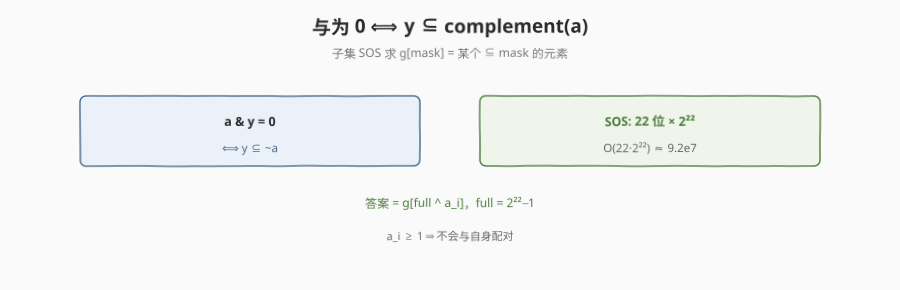

# Codeforces 165E 兼容数字 题解

## 1. 题目概述

- **题目链接**：https://codeforces.com/problemset/problem/165/E
- **比赛来源**：Codeforces Round 112 (Div. 2) · Problem E（UTC 2012-03-16）
- **难度**：2200
- **标签**：SOS DP、位运算
- **评测类型**：特殊评测（答案不唯一）
- **限制**：时间 4 s / 内存 256 MB

**题意**：给 $n$ 个正整数 $a_i\le4\times10^6$。对每个 $a_i$ 找数组里另一个与它**按位与为 0** 的数；不存在输出 $-1$，存在输出任一个。

**约束**：$n\le10^6$、$a_i<2^{22}$：对 $2^{22}$ 个掩码做子集 SOS DP。

## 2. 示例与观察

官方样例 1（输入 / 输出原样）：

```text
输入：
2
90 36
输出：
36 90
```

官方样例 2（输入 / 输出原样）：

```text
输入：
4
3 6 3 6
输出：
-1 -1 -1 -1
```

官方样例 3（输入 / 输出原样）：

```text
输入：
5
10 6 9 8 2
输出：
-1 8 2 2 8
```



**观察**：$a_i\ \&\ y=0$ ⟺ $y$ 是 $\overline{a_i}$（在 22 位内取反）的**子集**。于是定义

$$g[\text{mask}]=\text{数组中某个 } \subseteq \text{mask} \text{ 的元素（没有则 } -1\text{）},$$

用子集 SOS DP 在 $O(22\cdot2^{22})$ 内求出全部 $g$，答案即 $g[\text{full}\oplus a_i]$。

由于 $a_i\ge1$，$a_i$ 本身不可能是 $\overline{a_i}$ 的子集（$a_i\&a_i=a_i\ne0$），所以不会"自己配自己"。

## 3. 解题思路

1. `full = (1<<22)-1`，`g[full]` 初值 -1，对每个 $a_i$ 令 `g[a_i] = a_i`；
2. 子集 SOS：对每个二进制位 $b$，对所有 mask：若 mask 的第 $b$ 位为 1 且 `g[mask] == -1`，则 `g[mask] = g[mask ^ (1<<b)]`；
3. 输出 `g[full ^ a_i]`。


## 4. 正确性证明

**引理 1（位与为 0 ⟺ 子集）**：$a\&y=0$ ⟺ $y\subseteq\overline a$（在 $B=22$ 位内取反）。

**证明**：$a\&y=0$ ⟺ 每个置位位置不同时出现 ⟺ $y$ 的置位都落在 $a$ 的 0 位上 ⟺ $y$ 是补集的子集 ✓ ∎

**引理 2（SOS 正确性）**：SOS DP 结束后，$g[\text{mask}]\ne-1$ ⟺ 数组中存在 $\subseteq\text{mask}$ 的元素；且此时 $g[\text{mask}]$ 就是这样一个元素。

**证明**：对位数归纳。处理第 $b$ 位时，任何 $\subseteq\text{mask}$ 的元素要么第 $b$ 位为 0（则是 `mask^(1<<b)` 的子集，已被考虑），要么第 $b$ 位为 1（则去掉该位后是 `mask^(1<<b)` 的子集）✓ 归纳成立 ∎

**引理 3（不会自配）**：$g[\text{full}\oplus a_i]$ 若存在，则它不是 $a_i$ 本身（在"另一个元素"的意义上）。

**证明**：$a_i\subseteq\overline{a_i}$ 要求 $a_i\&a_i=0$，即 $a_i=0$，与 $a_i\ge1$ 矛盾 ✓ 因此找到的元素与 $a_i$ 不同（即使数值相同，也不能与自身按位与为 0）✓ ∎

**定理**：程序输出正确。

**证明**：由引理 1，要找的 $y$ ⟺ $\overline{a_i}$ 的子集；由引理 2 若存在则被 $g$ 找到；由引理 3 找到的必是合法解 ✓ 不存在时输出 -1 ✓ ∎

## 5. 复杂度分析

- **时间**：$O(B\cdot2^B)=22\times4.2\times10^6\approx9.2\times10^7$，$n=10^6$ 实测 C++ 约 270 ms。
- **空间**：$2^{22}$ 个 `int` ≈ 16 MB。

## 6. 参考代码

### C++17

```cpp
#include <bits/stdc++.h>
using namespace std;

int main() {
    int n;
    if (scanf("%d", &n) != 1) return 0;
    vector<int> a(n);
    const int B = 22;                    // a_i <= 4e6 < 2^22
    const int N = 1 << B;
    vector<int> g(N, -1);
    for (int i = 0; i < n; i++) {
        scanf("%d", &a[i]);
        g[a[i]] = a[i];
    }
    for (int b = 0; b < B; b++)
        for (int mask = 0; mask < N; mask++)
            if (mask >> b & 1) {
                int t = mask ^ (1 << b);
                if (g[mask] == -1) g[mask] = g[t];
            }
    int full = N - 1;
    for (int i = 0; i < n; i++) printf("%d%c", g[full ^ a[i]], i + 1 == n ? '\n' : ' ');
    return 0;
}
```

### Python3

```python
import sys

import numpy as np


def main():
    data = sys.stdin.buffer.read().split()
    n = int(data[0])
    a = np.array(data[1:1 + n], dtype=np.int64)
    B = 22
    N = 1 << B
    g = np.full(N, -1, dtype=np.int32)
    g[a] = a.astype(np.int32)
    for b in range(B):
        step = 1 << b
        # 对每个 bit 为 1 的 mask：若 g[mask] == -1 则取 g[mask ^ step]
        view = g.reshape(-1, 2 * step)
        left = view[:, :step]
        right = view[:, step:]
        mask = right == -1
        right[mask] = left[mask]
    full = N - 1
    ans = g[full ^ a]
    sys.stdout.write(" ".join(map(str, ans.tolist())) + "\n")


main()
```

## 7. 边界情况与易错点

1. **位数取 22**：$a_i\le4\times10^6<2^{22}$，`full = 2^22-1`。
2. **重复元素**：同一数值出现多次也只会"自配失败"（$a\&a\ne0$）⇒ 无解 ✓。
3. **$a_i$ 自身的排除**：靠"$a_i\ge1$"自动成立，不需要额外判断。
4. **Python 版依赖 numpy**：纯 Python 跑 $9\times10^7$ 次要超时；本实现用 numpy 逐位向量化。
5. **内存**：$2^{22}$ 个 int32 = 16 MB ✓。
6. **输出格式**：$n$ 个数，空格分隔。
7. **$n=1$**：输出 -1。
8. **答案不唯一**：任意合法即可（特殊评测）。

## 8. 验证记录

- **编译环境与命令**：`clang++ -std=c++17 -O2`；Python 3.9.6（numpy 1.26.4）。
  `python3 codeforces/tools/verify_solution.py codeforces/contests/0101-0203/165/E_兼容数字.md --checker codeforces/tools/checkers/cf165e.py`
- **checker 的校验条件**（答案不唯一）：输出的每个数要么 -1 且确实无解，要么在数组中且与 $a_i$ 按位与为 0。
- **官方样例**：$3/3$ 通过 checker（样例 3 官方给 `-1 8 2 2 8`，本解给 `-1 9 6 6 9`，均合法）。
- **独立对拍**：另写 $O(n^2)$ 暴力，对 $200$ 组随机数据（$n\le7$、值 $\le31$）比较：本解每个答案都通过 checker，且与暴力给出的"有解/无解"判定完全一致。
- **性能**：$n=10^6$、$2^{22}$ 的 SOS，C++ 约 270 ms；Python(numpy) 约 690 ms。
- **图片校验**：2 张 SVG 均通过 `xml.etree.ElementTree.parse`。
- **复核状态**：verified。

## 相关题目与扩展

- [Codeforces 165D Beard Graph](https://codeforces.com/problemset/problem/165/D)：同场 D 题。
- [Luogu P3175 [HAOI2015] 按位或](https://www.luogu.com.cn/problem/P3175)：子集/超集 DP。
- [LeetCode 898. 子数组按位或操作](https://leetcode.cn/problems/bitwise-ors-of-subarrays/)：位运算。

**延伸思考**：

1. **若要求"某个超集"**：把 SOS 方向反过来（超集 DP）。
2. **若值域到 $2^{30}$**：$2^{30}$ 太大，需要按出现元素做稀疏处理。
3. **若要求"与恰好为某值"**：容斥 + SOS。
