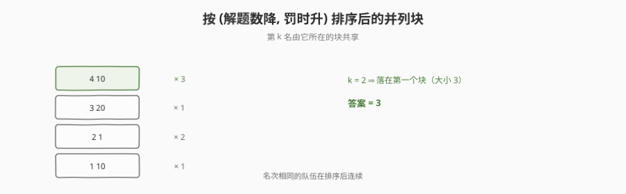

# Codeforces 166A 排名并列队伍数 题解

## 1. 题目概述

- **题目链接**：https://codeforces.com/problemset/problem/166/A
- **比赛来源**：Codeforces Round 113 (Div. 2) · Problem A（UTC 2012-03-23）
- **难度**：1100
- **标签**：排序
- **评测类型**：普通
- **限制**：时间 2 s / 内存 256 MB

**题意**：$n$ 支队伍，每支有解题数 $p_i$ 与罚时 $t_i$。比较规则：解题多者靠前；解题数相同则罚时少者靠前；两项都相同则并列同一名次（共享所有对应名次）。问有多少支队伍拿到**第 $k$ 名**。

**约束**：$n\le50$：排序后数一数与第 $k$ 名完全相同的队伍数。

## 2. 示例与观察

官方样例 1（输入 / 输出原样）：

```text
输入：
7 2
4 10
4 10
4 10
3 20
2 1
2 1
1 10
输出：
3
```

排序后前三名都是 $(4,10)$，它们共享第 1、2、3 名 ⇒ 第 2 名被这 3 支队伍共享 ⇒ 3 ✓

官方样例 2（输入 / 输出原样）：

```text
输入：
5 4
3 1
3 1
5 3
3 1
3 1
输出：
4
```

排序：$(5,3)$ 第 1；后面 4 支都是 $(3,1)$，共享第 2–5 名 ⇒ 第 4 名由这 4 支共享 ⇒ 4 ✓



**观察**：名次由"严格优于自己的队伍数 + 1"决定；所有 $p,t$ 完全相同的队伍名次相同 ⇒ 第 $k$ 名对应的就是排好序后第 $k$ 个位置的那支队伍的"并列块"大小。

## 3. 解题思路

1. 按 $(p$ 降序$, t$ 升序$)$ 排序；
2. 取第 $k$ 个元素的 $(p,t)$；
3. 统计与之完全相同的队伍数并输出。


## 4. 正确性证明

**引理 1（排序即名次）**：排序后第 $i$ 个位置的队伍，其名次 = $1+$（严格优于它的队伍数），且名次相同的队伍在排序后连续。

**证明**：比较规则是严格全序（同 $p$、同 $t$ 视为相等）⇒ 排序后名次单调不减；相同 $(p,t)$ 的队伍名次相同且相邻 ✓ ∎

**引理 2（第 $k$ 名共享块）**：第 $k$ 名被"排序后第 $k$ 个位置所属的相等块"中的队伍共享，且仅被它们共享。

**证明**：由引理 1，名次相同的队伍恰是一个连续块；第 $k$ 名对应的块包含位置 $k$（名次 $k$ 的若干队伍占据位置 $\ldots,k,\ldots$）✓ 块外队伍名次不同 ✓ ∎

**定理**：程序输出正确。

**证明**：程序排序后取第 $k$ 个元素的键，统计全数组中该键的出现次数 = 该块大小 = 第 $k$ 名的队伍数（引理 2）✓ ∎

## 5. 复杂度分析

- **时间**：$O(n\log n)\le$ 极小，实测 2 ms。
- **空间**：$O(n)$。

## 6. 参考代码

### C++17

```cpp
#include <bits/stdc++.h>
using namespace std;
int main() {
    int n, k;
    if (scanf("%d %d", &n, &k) != 2) return 0;
    vector<pair<int,int>> t(n);
    for (int i = 0; i < n; i++) scanf("%d %d", &t[i].first, &t[i].second);
    sort(t.begin(), t.end(), [](const pair<int,int> &a, const pair<int,int> &b) {
        if (a.first != b.first) return a.first > b.first;
        return a.second < b.second;
    });
    int cnt = 0;
    for (int i = 0; i < n; i++) if (t[i] == t[k - 1]) cnt++;
    printf("%d\n", cnt);
    return 0;
}
```

### Python3

```python
import sys
from collections import Counter


def main():
    data = sys.stdin.read().split()
    n, k = int(data[0]), int(data[1])
    teams = [(int(data[2 + 2 * i]), int(data[3 + 2 * i])) for i in range(n)]
    teams.sort(key=lambda t: (-t[0], t[1]))
    print(Counter(teams)[teams[k - 1]])


main()
```

## 7. 边界情况与易错点

1. **排序键**：解题数降序、罚时升序（方向相反，别写错）。
2. **并列计数**：按 $(p,t)$ 完全相同计数，而不是按名次。
3. **$k=1$**：第 1 名同样可能并列。
4. **全部相同**：答案是 $n$。
5. **$n=1$**：答案 1。
6. **键的比较**：用二元组整体相等。
7. **输出**：单个整数。

## 8. 验证记录

- **编译环境与命令**：`clang++ -std=c++17 -O2`；Python 3.9.6。
  `python3 codeforces/tools/verify_solution.py codeforces/contests/0101-0203/166/A_排名并列队伍数.md`
- **官方样例**：$2/2$ 通过（`3`、`4`）。
- **独立对拍**：另写"对每支队伍统计严格优于它的队伍数、取第 $k$ 名队伍计数"的独立实现，对 $200$ 组随机数据（$n\le8$）比较，全部一致。
- **性能**：$n=50$ 单次约 2 ms。
- **图片校验**：2 张 SVG 均通过 `xml.etree.ElementTree.parse`。
- **复核状态**：verified。

## 相关题目与扩展

- [Codeforces 166B Polygons](https://codeforces.com/problemset/problem/166/B)：同场 B 题。
- [Codeforces 166C Median](https://codeforces.com/problemset/problem/166/C)：同场 C 题。
- [LeetCode 506. 相对名次](https://leetcode.cn/problems/relative-ranks/)：名次计算。

**延伸思考**：

1. **若名次按"标准比赛排名"（并列后跳号）**：需要另一套计数。
2. **若比较维度更多**：仍是排序 + 相同键计数。
3. **若要求输出第 $k$ 名的队伍编号**：按块输出即可。
