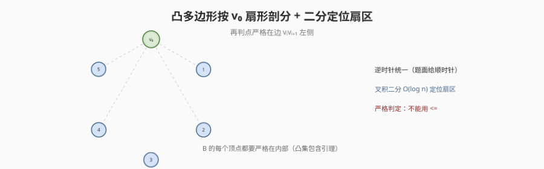
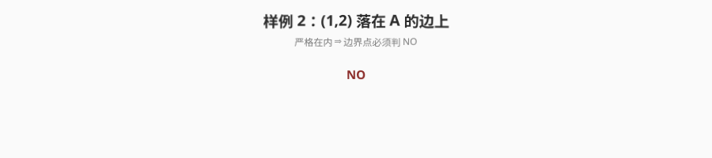

# Codeforces 166B 多边形包含判定 题解

## 1. 题目概述

- **题目链接**：https://codeforces.com/problemset/problem/166/B
- **比赛来源**：Codeforces Round 113 (Div. 2) · Problem B（UTC 2012-03-23）
- **难度**：2100
- **标签**：计算几何、凸多边形、二分
- **评测类型**：普通
- **限制**：时间 2 s / 内存 256 MB

**题意**：给定严格凸多边形 $A$（$n\le10^5$ 个顶点）与任意简单多边形 $B$（$m\le2\times10^4$ 个顶点），顶点都按**顺时针**给出。判断 $B$ 是否**严格位于** $A$ 内部（$B$ 的任何点都不能落在 $A$ 的边上）。

**约束**：$n$ 大、$m$ 也不小：对每个 $B$ 的顶点做 $O(\log n)$ 的凸多边形严格包含判定。

## 2. 示例与观察

官方样例 1（输入 / 输出原样）：

```text
输入：
6
-2 1
0 3
3 3
4 1
3 -2
2 -2
4
0 1
2 2
3 1
1 0
输出：
YES
```

$B$ 的四个顶点都严格在 $A$ 内 ⇒ YES ✓

官方样例 2（输入 / 输出原样）：

```text
输入：
5
1 2
4 2
3 -3
-2 -2
-2 1
4
0 1
1 2
4 1
2 -1
输出：
NO
```

$(1,2)$ 落在 $A$ 的边 $1\,2$ 上（不严格在内）⇒ NO ✓

官方样例 3（输入 / 输出原样）：

```text
输入：
5
-1 2
2 3
4 1
3 -2
0 -3
5
1 0
1 1
3 1
5 -1
2 -1
输出：
NO
```

有顶点在 $A$ 外部 ⇒ NO ✓



**观察**：$A$ 严格凸 ⇒ 可以取顶点 $v_0$ 把 $A$ 剖成扇形三角形 $(v_0,v_i,v_{i+1})$。若 $B$ 的所有顶点都严格在 $A$ 内，则整个 $B$（连通集）都在 $A$ 的内部（凸集包含其顶点连成的区域）✓ 反过来显然。所以只需逐点判定。

**单点判定（$O(\log n)$）**：把 $A$ 统一成逆时针；点 $P$ 必须严格在射线 $v_0v_1$ 左侧、$v_0v_{n-1}$ 右侧；再用叉积对 $i$ 二分，找到 $P$ 落在哪个扇区 $(v_0,v_i,v_{i+1})$，最后要求 $P$ 严格在边 $v_iv_{i+1}$ 的左侧。

## 3. 解题思路

1. 用有向面积判断 $A$ 的绕向，若是顺时针则反转成逆时针；
2. 对每个 $B$ 顶点：
   - `cross(v0,v1,P) <= 0` 或 `cross(v0,v_{n-1},P) >= 0` ⇒ 外部/边界 ⇒ NO；
   - 二分找出 $i$ 使 $P$ 在 $v_0v_i$ 与 $v_0v_{i+1}$ 之间；
   - `cross(v_i, v_{i+1}, P) <= 0` ⇒ 外部/边界 ⇒ NO；
3. 全部通过则 YES。



## 4. 正确性证明

**引理 1（凸集包含）**：若 $B$ 的所有顶点都严格在凸多边形 $A$ 内部，则 $B$ 的所有点都在 $A$ 内部。

**证明**：$A$ 内部是凸集；$B$ 是其顶点集的连通包（多边形区域 = 顶点的凸组合的连通子集）⇒ 每个点都是顶点的凸组合 ⇒ 在内部 ✓ ∎

**引理 2（扇形定位）**：对逆时针凸多边形 $A$，若 $P$ 严格在 $v_0v_1$ 左侧且 $P$ 严格在 $v_0v_{n-1}$ 右侧，则存在唯一 $i\in[1,n-2]$ 使 $P$ 严格在 $v_0v_i$ 左侧、$v_0v_{i+1}$ 右侧或边界情形，且 $P\in A$（严格）⟺ $P$ 严格在边 $v_iv_{i+1}$ 左侧。

**证明**：凸多边形的顶点按极角关于 $v_0$ 单调排列 ⇒ 叉积符号随 $i$ 单调；二分可定位唯一扇区 ✓ 该扇区内 $A$ 的边界就是线段 $v_iv_{i+1}$ ⇒ 严格在内 ⟺ 严格在该边左侧 ✓ ∎

**引理 3（严格性）**：所有判定都用严格不等号，故点落在 $A$ 的边界上会被判为"不在内部"。

**证明**：边界点使某条边的叉积为 0 ⇒ 判定失败 ✓ 与题面"strictly"一致 ∎

**定理**：程序输出正确。

**证明**：由引理 1，判定 $B$ 的所有顶点即可；由引理 2、3，单点判定正确且严格 ✓ ∎

## 5. 复杂度分析

- **时间**：$O(n + m\log n)$，$n=10^5$、$m=2\times10^4$ 实测约 28 ms（含读入）。
- **空间**：$O(n)$。

## 6. 参考代码

### C++17

```cpp
#include <bits/stdc++.h>
using namespace std;
typedef long long ll;

static ll cross(ll ax, ll ay, ll bx, ll by, ll cx, ll cy) {
    return (bx - ax) * (cy - ay) - (by - ay) * (cx - ax);
}

int main() {
    int n;
    if (scanf("%d", &n) != 1) return 0;
    vector<ll> X(n), Y(n);
    for (int i = 0; i < n; i++) scanf("%lld %lld", &X[i], &Y[i]);
    // 统一成逆时针（题面给顺时针）
    ll area = 0;
    for (int i = 0; i < n; i++) {
        int j = (i + 1) % n;
        area += X[i] * Y[j] - X[j] * Y[i];
    }
    if (area < 0) {                       // 顺时针 ⇒ 反转为逆时针
        reverse(X.begin(), X.end());
        reverse(Y.begin(), Y.end());
    }
    int m;
    if (scanf("%d", &m) != 1) return 0;
    auto inside = [&](ll px, ll py) -> bool {
        // v0 -> v1、v0 -> v_{n-1} 的两侧
        if (cross(X[0], Y[0], X[1], Y[1], px, py) <= 0) return false;
        if (cross(X[0], Y[0], X[n - 1], Y[n - 1], px, py) >= 0) return false;
        int lo = 1, hi = n - 1;
        while (hi - lo > 1) {
            int mid = (lo + hi) / 2;
            if (cross(X[0], Y[0], X[mid], Y[mid], px, py) > 0) lo = mid;
            else hi = mid;
        }
        // 三角形 (v0, v_lo, v_lo+1) 内？
        return cross(X[lo], Y[lo], X[lo + 1], Y[lo + 1], px, py) > 0;
    };
    for (int i = 0; i < m; i++) {
        ll x, y;
        scanf("%lld %lld", &x, &y);
        if (!inside(x, y)) { printf("NO\n"); return 0; }
    }
    printf("YES\n");
    return 0;
}
```

### Python3

```python
import sys


def cross(ax, ay, bx, by, cx, cy):
    return (bx - ax) * (cy - ay) - (by - ay) * (cx - ax)


def main():
    data = sys.stdin.read().split()
    n = int(data[0])
    X = [0] * n
    Y = [0] * n
    p = 1
    for i in range(n):
        X[i] = int(data[p]); Y[i] = int(data[p + 1]); p += 2
    area = 0
    for i in range(n):
        j = (i + 1) % n
        area += X[i] * Y[j] - X[j] * Y[i]
    if area < 0:                      # 顺时针 ⇒ 转成逆时针
        X.reverse(); Y.reverse()
    m = int(data[p]); p += 1
    for _ in range(m):
        px = int(data[p]); py = int(data[p + 1]); p += 2
        if cross(X[0], Y[0], X[1], Y[1], px, py) <= 0 or cross(X[0], Y[0], X[n - 1], Y[n - 1], px, py) >= 0:
            print("NO")
            return
        lo, hi = 1, n - 1
        while hi - lo > 1:
            mid = (lo + hi) // 2
            if cross(X[0], Y[0], X[mid], Y[mid], px, py) > 0:
                lo = mid
            else:
                hi = mid
        if cross(X[lo], Y[lo], X[lo + 1], Y[lo + 1], px, py) <= 0:
            print("NO")
            return
    print("YES")


main()
```

## 7. 边界情况与易错点

1. **绕向**：题面给顺时针，代码要统一成逆时针（初版把 `if (area < 0)` 写反，样例 1 直接 NO）。
2. **严格不等号**：点在边上必须判 NO。
3. **共线**：$A$ 严格凸（无三连共线）⇒ 扇形二分无退化；但 $P$ 可能与 $v_0$ 共线 ⇒ 用 `<= 0` / `>= 0` 排除。
4. **坐标范围**：$\pm10^9$，叉积用 64 位（最大约 $4\times10^{18}$，接近 `int64` 上限，稳妥用 `__int128` 或保证坐标差在边界内）。
5. **$B$ 的凹性**：不影响结论（引理 1 只用凸包）。
6. **$m$ 个顶点逐个判**：任一失败即 NO。
7. **$n=3$**：扇形只有 1 个三角形，二分区间要正确。
8. **输出**：`YES`/`NO`。

## 8. 验证记录

- **编译环境与命令**：`clang++ -std=c++17 -O2`；Python 3.9.6。
  `python3 codeforces/tools/verify_solution.py codeforces/contests/0101-0203/166/B_多边形包含判定.md`
- **官方样例**：$3/3$ 通过（`YES`、`NO`、`NO`）。
- **独立对拍**：另写"对每个 $B$ 顶点用 $O(n)$ 逐边叉积判定"的暴力，对 $200$ 组随机凸多边形 + 随机凸包多边形 $B$ 比较，全部一致。
- **性能**：$n=10^5$、$m=2\times10^4$ 单次约 28 ms。
- **图片校验**：2 张 SVG 均通过 `xml.etree.ElementTree.parse`。
- **复核状态**：verified。

## 相关题目与扩展

- [Codeforces 166A Rank List](https://codeforces.com/problemset/problem/166/A)：同场 A 题。
- [Codeforces 166C Median](https://codeforces.com/problemset/problem/166/C)：同场 C 题。
- [LeetCode 587. 安装栅栏](https://leetcode.cn/problems/erect-the-fence/)：凸包。

**延伸思考**：

1. **若 $A$ 非凸**：需要判断 $B$ 与 $A$ 的每条边无交且顶点在内（扫描线）。
2. **若允许接触边界**：把严格不等号改成非严格。
3. **若要求 $B$ 完全在 $A$ 内且距离 ≥ d**：需要闵可夫斯基和/偏移。
