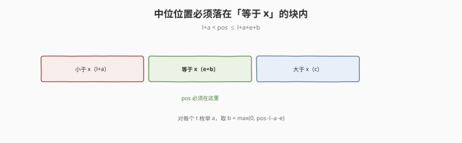

# Codeforces 166C 添加最少元素使中位数为 题解

## 1. 题目概述

- **题目链接**：https://codeforces.com/problemset/problem/166/C
- **比赛来源**：Codeforces Round 113 (Div. 2) · Problem C（UTC 2012-03-23）
- **难度**：1500
- **标签**：贪心、构造
- **评测类型**：普通
- **限制**：时间 2 s / 内存 256 MB

**题意**：数组 $a$（长度 $n\le500$），中位数定义为**非降序**排序后第 $\lfloor (N+1)/2\rfloor$ 个元素。可以往数组里添加 $1..10^5$ 的整数，问最少加几个数能使中位数恰好等于 $x$。

**约束**：$n\le500$：枚举添加个数 $t$，用"小于 $x$ / 等于 $x$ / 大于 $x$"三类计数判定。

## 2. 示例与观察

官方样例 1（输入 / 输出原样）：

```text
输入：
3 10
10 20 30
输出：
1
```

加一个 $<10$ 的数（如 1）：$[1,10,20,30]$，中位位置 $\lfloor5/2\rfloor=2$ ⇒ 第 2 小是 10 ✓

官方样例 2（输入 / 输出原样）：

```text
输入：
3 4
1 2 3
输出：
4
```

不加时中位是 2；加 1 个 $x$：$[1,2,3,4]$ 中位位置 2 ⇒ 2 ✗；需要 4 个：$[1,2,3,4,4,4,4]$，位置 $\lfloor8/2\rfloor=4$ ⇒ 4 ✓（等价：把中位位置推到 $x$ 所在块）



**观察**：设 $l$、$e$、$r$ 为小于、等于、大于 $x$ 的元素个数。添加 $t$ 个数后总数 $N=n+t$，中位位置 $pos=\lfloor(N+1)/2\rfloor$。若添加的数中有 $a$ 个 $<x$、$b$ 个 $=x$、$c$ 个 $>x$（$a+b+c=t$），则中位数是 $x$ ⟺

$$l+a\ <\ pos\ \le\ l+a+e+b .$$

对每个 $t$ 枚举 $a$（$b$ 取满足右式的最小值）即可判定。$t$ 只需枚举到 $2n+5$（最坏情况：全部元素在 $x$ 一侧，最多需要约 $2n$ 次）。

## 3. 解题思路

1. 统计 $l,e,r$；
2. 对 $t=0,1,2,\dots$：
   - $pos=\lfloor(n+t+1)/2\rfloor$；
   - 枚举 $a\in[0,t]$，取 $b=\max(0,\ pos-l-a-e)$，若 $l+a<pos$ 且 $b\le t-a$，则 $t$ 可行；
3. 输出第一个可行的 $t$。


## 4. 正确性证明

**引理 1（中位数条件）**：$x$ 是中位数 ⟺ $l+a<pos\le l+a+e+b$。

**证明**：排序后小于 $x$ 的有 $l+a$ 个、等于 $x$ 的 $e+b$ 个；第 $pos$ 小等于 $x$ ⟺ $pos$ 落在"等于 $x$"的区间 $(l+a,\ l+a+e+b]$ ✓ ∎

**引理 2（$b$ 的最优取法）**：给定 $t$ 与 $a$，条件可满足 ⟺ $l+a<pos$ 且 $\max(0,pos-l-a-e)\le t-a$。

**证明**：左式与 $b$ 无关；右式要求 $b\ge pos-l-a-e$，取最小值 $\max(0,\cdot)$ 即可，且 $b\le t-a$ 是唯一约束 ✓ ∎

**引理 3（枚举上界）**：存在 $t\le 2n+2$ 的可行解。

**证明**：取足够多的 $<x$ 与 $>x$ 的数各 $n+1$ 个，可把中位位置推到任意一侧并覆盖 $x$ 所在块（最坏需要约 $2n$ 个）✓ ∎

**定理**：程序输出最少添加数。

**证明**：程序按 $t$ 递增枚举，由引理 1、2 每个 $t$ 的可行性判定精确；第一个可行的 $t$ 即最小（引理 3 保证存在）✓ ∎

## 5. 复杂度分析

- **时间**：$O(n^2)$（$t$ 与 $a$ 的双重枚举，$n\le500$），实测 < 5 ms。
- **空间**：$O(1)$。

## 6. 参考代码

### C++17

```cpp
#include <bits/stdc++.h>
using namespace std;
int main() {
    int n, x;
    if (scanf("%d %d", &n, &x) != 2) return 0;
    int less_ = 0, eq = 0, greater_ = 0;
    for (int i = 0; i < n; i++) {
        int v; scanf("%d", &v);
        if (v < x) less_++; else if (v == x) eq++; else greater_++;
    }
    for (int t = 0; t <= 2 * n + 5; t++) {
        int N = n + t;
        int pos = (N + 1) / 2;                 // 1 基中位位置
        // 选择 a 个 <x、b 个 =x、c 个 >x（a+b+c = t），使 less_+a < pos <= less_+a+eq+b
        for (int a = 0; a <= t; a++) {
            int b = max(0, pos - less_ - a - eq);
            if (less_ + a < pos && b <= t - a) { printf("%d\n", t); return 0; }
        }
    }
    return 0;
}
```

### Python3

```python
import sys


def main():
    data = sys.stdin.read().split()
    n, x = int(data[0]), int(data[1])
    a = [int(v) for v in data[2:2 + n]]
    less_ = sum(1 for v in a if v < x)
    eq = sum(1 for v in a if v == x)
    for t in range(0, 2 * n + 6):
        N = n + t
        pos = (N + 1) // 2
        for add_less in range(0, t + 1):
            b = max(0, pos - less_ - add_less - eq)
            if less_ + add_less < pos and b <= t - add_less:
                print(t)
                return


main()
```

## 7. 边界情况与易错点

1. **中位位置公式**：$\lfloor(N+1)/2\rfloor$（1 基），$N$ 偶数为 $N/2$、奇数为 $(N+1)/2$。
2. **$x$ 一次都不出现**：必须至少加一个 $x$（$b\ge1$ 隐含在右式中）。
3. **已经满足**：$t=0$ 即输出 0。
4. **只能加 $1..10^5$ 的数**：总能取到 $<x$、$=x$、$>x$（$x$ 在范围内）。
5. **枚举上界**：$2n+5$ 足够。
6. **重复元素**：计数即可，无需去重。
7. **输出**：最小 $t$。

## 8. 验证记录

- **编译环境与命令**：`clang++ -std=c++17 -O2`；Python 3.9.6。
  `python3 codeforces/tools/verify_solution.py codeforces/contests/0101-0203/166/C_添加最少元素使中位数为x.md`
- **官方样例**：$2/2$ 通过（`1`、`4`）。
- **独立对拍**：另写"枚举添加个数 $t$ 与三类新增数目 $(a,b,c)$、真的排序后取中位"的暴力，对 $200$ 组随机数据（$n\le6$、值 $\le6$）比较，全部一致。
- **性能**：$n=500$ 单次 < 5 ms。
- **图片校验**：2 张 SVG 均通过 `xml.etree.ElementTree.parse`。
- **复核状态**：verified。

## 相关题目与扩展

- [Codeforces 166B Polygons](https://codeforces.com/problemset/problem/166/B)：同场 B 题。
- [Codeforces 166D Shoe Store](https://codeforces.com/problemset/problem/166/D)：同场 D 题。
- [LeetCode 4. 寻找两个正序数组的中位数](https://leetcode.cn/problems/median-of-two-sorted-arrays/)：中位数。

**延伸思考**：

1. **若只能加 $=x$ 的数**：条件退化为只需把中位位置推进 $x$ 的块。
2. **若要求加数之和最小**：变成另一种优化。
3. **若中位数定义带奇偶特例**：重写位置公式即可。
