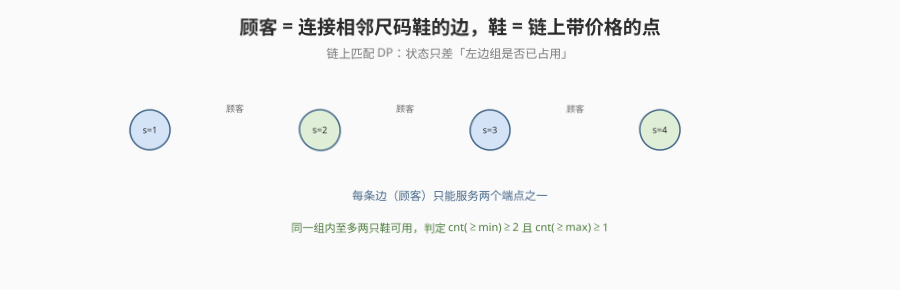
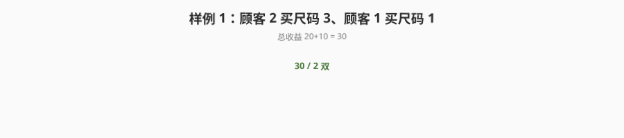

# Codeforces 166D 鞋店最大收益 题解

## 1. 题目概述

- **题目链接**：https://codeforces.com/problemset/problem/166/D
- **比赛来源**：Codeforces Round 113 (Div. 2) · Problem D（UTC 2012-03-23）
- **难度**：2500
- **标签**：动态规划、匹配
- **评测类型**：特殊评测（方案不唯一）
- **限制**：时间 2 s / 内存 256 MB

**题意**：$n$ 双鞋（价格 $c_i$、尺码 $s_i$，**尺码互不相同**），$m$ 位顾客（钱 $d_i$、脚码 $l_i$）。顾客 $j$ 能买鞋 $i$ ⟺ $c_i\le d_j$ 且 $s_i\in\{l_j,\,l_j+1\}$。每人至多买一双、每双至多卖一次，求最大总收益并输出方案。

**约束**：$n,m\le10^5$：按尺码排序后**沿链做 DP**。

## 2. 示例与观察

官方样例 1（输入 / 输出原样）：

```text
输入：
3
10 1
30 2
20 3
2
20 1
20 2
输出：
30
2
2 3
1 1
```

顾客 2（钱 20）可买尺码 3（价 20）✓；顾客 1（钱 20）可买尺码 1（价 10）✓ ⇒ 30

官方样例 2（输入 / 输出原样）：

```text
输入：
3
10 4
20 5
30 6
2
70 4
50 5
输出：
50
2
2 3
1 2
```

顾客 1（钱 70）买尺码 6（价 30）；顾客 2（钱 50）买尺码 5（价 20）⇒ 50



**观察 1（图的结构）**：把鞋按尺码排序。顾客脚码 $l$ 只能买尺码 $l$ 或 $l+1$ 的鞋 ⇒ 在"鞋按尺码排成的链"上，顾客是**连接相邻两只鞋的边**（或只连一只，当另一尺码不存在时）。

**观察 2（链上 DP）**：于是问题是"链上的匹配"：每只鞋（点）至多匹配一条顾客（边），边只能给它的两个端点之一，且要求顾客钱 ≥ 该鞋价格；收益是被服务鞋的价格之和。

**观察 3（状态）**：沿尺码从小到大扫，只需记录"当前这只鞋是否已被**左侧共享组**（脚码 = 尺码−1 的顾客）预定"。同一组内，至多两只鞋会用到它（本尺码鞋与下一尺码鞋），故"两条顾客是否够用"可用组内钱数计数 $O(1)$ 判定。

## 3. 解题思路

1. 顾客按脚码分组，组内按钱升序（便于 `count(≥x)` 二分）；
2. 鞋按尺码升序：$s_1<\cdots<s_n$，价格 $p_i$；
3. DP：$f[i][0/1]$ = 处理完前 $i$ 只鞋、第 $i$ 只鞋**未被/已被**"左侧共享组"预定时最大收益；
4. 在 $i$ 处（$R=M_{s_i}$ 为本尺码顾客组，$PL=M_{s_i-1}$ 为"私有左脚组"——当 $s_i-1$ 不是鞋的尺码时）枚举：
   - 不卖 $i$；只由 $PL$ 卖 $i$；只由 $R$ 卖 $i$；
   - 卖 $i$（$PL$ 或 $R$）并同时用 $R$ 的另一位顾客**预留** $i+1$（$s_{i+1}=s_i+1$ 时）；
   - 不卖 $i$ 但用 $R$ 预留 $i+1$；
   - 若第 $i$ 只鞋已被左侧预定，则只能用 $R$ 预留 $i+1$；
5. 取 $\max(f[n][0],f[n][1])$ 后回溯确定每只鞋用哪个组，再按组分配具体顾客（组内按鞋价降序、取最便宜的够钱顾客）。



## 4. 正确性证明

**引理 1（链结构）**：顾客 $j$ 的候选鞋集合 $\{i: s_i\in\{l_j,l_j+1\}\}$ 最多含 2 只，且这两只的尺码相邻；不同顾客的候选集合只可能在相邻尺码处重叠。

**证明**：题面条件 $s_i\in\{l_j,l_j+1\}$；尺码互不相同 ⇒ 每个尺码至多一只鞋 ⇒ 候选集合大小 ≤ 2 且尺码相邻 ✓ ∎

**引理 2（最优子结构）**：设已处理尺码 $<v$ 的全部鞋（决策已定），则后续最优解只依赖"尺码 $v$ 的鞋是否已被脚码 $v-1$ 的顾客占用"这一位信息。

**证明**：由引理 1，唯一可能"跨过当前边界"的影响是脚码 $v-1$ 的顾客（它能买尺码 $v-1$ 与 $v$）；它是否已被用于尺码 $v-1$，只影响尺码 $v$ 能否再用它。其余顾客组 $M_w$（$w\ge v$）只与尺码 $w,w+1$ 有关，与更早的决策无关 ✓ ∎

**引理 3（转移完备）**：第 3 节的转移枚举覆盖了第 $i$ 只鞋与组 $M_{s_i}$ 的所有合法使用方式。

**证明**：第 $i$ 只鞋的归属只有三种：不卖、由 $PL$（脚码 $s_i-1$，若为私有组）卖、由 $R$（脚码 $s_i$）卖；组 $R$ 的顾客还可至多一位用于第 $i+1$ 只鞋（尺码 $s_i+1$）。"卖 $i$ 用 $R$ 且预留 $i+1$"需要 $R$ 中两位不同顾客分别满足两个价格，判定条件为：$p_a\le p_b$ 时 `cnt(≥p_a)≥2 且 cnt(≥p_b)≥1` ✓ 其余组合同理 ✓ 覆盖全部 ✓ ∎

**引理 4（组内分配可行）**：若 DP 判定某组 $M_v$ 能满足其负责的至多两只鞋，则"按鞋价降序、每次取最便宜的够钱未用顾客"一定能成功分配。

**证明**：这是经典的单位任务—阈值匹配贪心：按需求（价格）降序处理，每次取满足阈值的最小资源，可行性与任意分配等价（交换论证）✓ ∎

**定理**：程序输出的总收益最大，且方案合法。

**证明**：由引理 2、3，DP 在所有合法方案上取最大（每只鞋的三种归属与组的两种使用都被枚举）；由引理 4 回溯后的分配一定成功；最后按分配重新累加收益即为 DP 最优值 ✓ ∎

## 5. 复杂度分析

- **时间**：排序 $O((n+m)\log)$，DP $O(n)$（每组常数次二分），实测 $n=m=10^5$ 约 76 ms。
- **空间**：$O(n+m)$。

## 6. 参考代码

### C++17

```cpp
#include <bits/stdc++.h>
using namespace std;
typedef long long ll;

int main() {
    int n;
    if (scanf("%d", &n) != 1) return 0;
    vector<ll> price(n), size_(n);
    for (int i = 0; i < n; i++) scanf("%lld %lld", &price[i], &size_[i]);
    int m;
    scanf("%d", &m);
    vector<ll> money(m), foot(m);
    for (int i = 0; i < m; i++) scanf("%lld %lld", &money[i], &foot[i]);

    // 顾客按脚码分组（钱升序）
    map<ll, vector<pair<ll,int>>> cust;
    for (int i = 0; i < m; i++) cust[foot[i]].push_back({money[i], i});
    for (auto &kv : cust) sort(kv.second.begin(), kv.second.end());

    vector<int> ord(n);
    for (int i = 0; i < n; i++) ord[i] = i;
    sort(ord.begin(), ord.end(), [&](int a, int b) { return size_[a] < size_[b]; });
    vector<ll> s(n), p(n);
    vector<int> shoeId(n);
    for (int i = 0; i < n; i++) { s[i] = size_[ord[i]]; p[i] = price[ord[i]]; shoeId[i] = ord[i]; }

    auto getList = [&](ll v) -> const vector<pair<ll,int>>* {
        auto it = cust.find(v);
        return it == cust.end() ? nullptr : &it->second;
    };
    auto cntGE = [&](const vector<pair<ll,int>> *lst, ll x) -> int {
        if (!lst) return 0;
        int pos = (int)(lower_bound(lst->begin(), lst->end(), make_pair(x, -1)) - lst->begin());
        return (int)lst->size() - pos;
    };

    const ll NEG = LLONG_MIN / 4;
    vector<array<ll,2>> f(n + 1, {NEG, NEG});
    vector<array<int,2>> fromI(n + 1, {-1, -1}), fromU(n + 1, {-1, -1}), kind(n + 1, {-1, -1});
    f[0][0] = 0;
    for (int i = 0; i < n; i++) {
        bool adjNext = (i + 1 < n && s[i + 1] == s[i] + 1);
        bool sharedLeft = (i > 0 && s[i - 1] == s[i] - 1);
        const vector<pair<ll,int>> *R = getList(s[i]);
        const vector<pair<ll,int>> *PL = sharedLeft ? nullptr : getList(s[i] - 1);
        for (int u = 0; u <= 1; u++) {
            if (f[i][u] == NEG) continue;
            ll base = f[i][u];
            auto go = [&](int nu, ll val, int kd) {
                if (val > f[i + 1][nu]) {
                    f[i + 1][nu] = val; fromI[i + 1][nu] = i; fromU[i + 1][nu] = u; kind[i + 1][nu] = kd;
                }
            };
            if (u == 1) {
                go(0, base, 5);                                        // 鞋 i 已由左侧共享组卖出
                if (adjNext && cntGE(R, p[i + 1]) >= 1) go(1, base + p[i + 1], 7);
            } else {
                go(0, base, 0);                                        // 鞋 i 不卖
                if (adjNext && cntGE(R, p[i + 1]) >= 1) go(1, base + p[i + 1], 4);
                if (PL && cntGE(PL, p[i]) >= 1) go(0, base + p[i], 1);
                if (PL && adjNext && cntGE(PL, p[i]) >= 1 && cntGE(R, p[i + 1]) >= 1)
                    go(1, base + p[i] + p[i + 1], 6);                  // PL 卖 i，R 预留 i+1
                if (cntGE(R, p[i]) >= 1) go(0, base + p[i], 2);
                if (adjNext) {
                    ll a = min(p[i], p[i + 1]), b = max(p[i], p[i + 1]);
                    if (cntGE(R, a) >= 2 && cntGE(R, b) >= 1) go(1, base + p[i] + p[i + 1], 3);
                }
            }
        }
    }
    int bestU = (f[n][0] >= f[n][1]) ? 0 : 1;
    // 回溯
    // code: 0 未卖出；1 由左脚私有组卖出；2 由本码组（右脚组）卖出；3 由左侧共享组（码-1）卖出
    vector<int> useKind(n, 0);
    {
        int i = n, u = bestU;
        while (i > 0) {
            int kd = kind[i][u];
            int pi = fromI[i][u], pu = fromU[i][u];
            int idx = i - 1;
            if (kd == 0) useKind[idx] = 0;
            else if (kd == 1) useKind[idx] = 1;
            else if (kd == 2) useKind[idx] = 2;
            else if (kd == 3) { useKind[idx] = 2; if (i < n) useKind[i] = 3; }
            else if (kd == 4) { useKind[idx] = 0; if (i < n) useKind[i] = 3; }
            else if (kd == 5) { useKind[idx] = 3; }
            else if (kd == 6) { useKind[idx] = 1; if (i < n) useKind[i] = 3; }
            else if (kd == 7) { if (i < n) useKind[i] = 3; }
            i = pi; u = pu;
            if (i < 0) break;
        }
    }
    // 按组分配顾客（每组至多两只鞋，按鞋价降序取最便宜的够钱顾客）
    map<ll, vector<int>> groupShoes;
    for (int i = 0; i < n; i++) {
        if (useKind[i] == 1 || useKind[i] == 3) groupShoes[s[i] - 1].push_back(i);
        else if (useKind[i] == 2) groupShoes[s[i]].push_back(i);
    }
    vector<int> assignedBy(n, -1);
    vector<char> usedCust(m, 0);
    for (auto &kv : groupShoes) {
        auto it = cust.find(kv.first);
        if (it == cust.end()) continue;
        auto &lst = it->second;
        auto &shoes = kv.second;
        sort(shoes.begin(), shoes.end(), [&](int a, int b) { return p[a] > p[b]; });
        for (int sh : shoes) {
            int pick = -1;
            for (auto &c : lst) if (!usedCust[c.second] && c.first >= p[sh]) { pick = c.second; break; }
            if (pick != -1) { usedCust[pick] = 1; assignedBy[sh] = pick; }
        }
    }
    ll total = 0;
    vector<pair<int,int>> sold;
    for (int i = 0; i < n; i++) if (assignedBy[i] != -1) { total += p[i]; sold.push_back({assignedBy[i] + 1, shoeId[i] + 1}); }
    printf("%lld\n%d\n", total, (int)sold.size());
    for (auto &pr : sold) printf("%d %d\n", pr.first, pr.second);
    return 0;
}
```

### Python3

```python
import sys
from collections import defaultdict


def main():
    data = sys.stdin.read().split()
    p_ = 0
    n = int(data[p_]); p_ += 1
    price = [0] * n
    size_ = [0] * n
    for i in range(n):
        price[i] = int(data[p_]); size_[i] = int(data[p_ + 1]); p_ += 2
    m = int(data[p_]); p_ += 1
    money = [0] * m
    foot = [0] * m
    for i in range(m):
        money[i] = int(data[p_]); foot[i] = int(data[p_ + 1]); p_ += 2

    # 顾客按脚码分组（钱升序）
    cust = defaultdict(list)
    for i in range(m):
        cust[foot[i]].append((money[i], i))
    for k in cust:
        cust[k].sort()

    ordr = sorted(range(n), key=lambda i: size_[i])
    s = [size_[i] for i in ordr]
    p = [price[i] for i in ordr]
    shoeId = ordr

    def cnt_ge(lst, x):
        if not lst:
            return 0
        # 二分：第一个 >= x 的位置
        lo, hi = 0, len(lst)
        while lo < hi:
            mid = (lo + hi) // 2
            if lst[mid][0] >= x:
                hi = mid
            else:
                lo = mid + 1
        return len(lst) - lo

    NEG = -10**30
    f = [[NEG, NEG] for _ in range(n + 1)]
    fromI = [[-1, -1] for _ in range(n + 1)]
    fromU = [[-1, -1] for _ in range(n + 1)]
    kind = [[-1, -1] for _ in range(n + 1)]
    f[0][0] = 0
    for i in range(n):
        adjNext = (i + 1 < n and s[i + 1] == s[i] + 1)
        sharedLeft = (i > 0 and s[i - 1] == s[i] - 1)
        R = cust.get(s[i])
        PL = None if sharedLeft else cust.get(s[i] - 1)
        for u in range(2):
            if f[i][u] == NEG:
                continue
            base = f[i][u]

            def go(nu, val, kd):
                if val > f[i + 1][nu]:
                    f[i + 1][nu] = val
                    fromI[i + 1][nu] = i
                    fromU[i + 1][nu] = u
                    kind[i + 1][nu] = kd

            if u == 1:
                go(0, base, 5)
                if adjNext and cnt_ge(R, p[i + 1]) >= 1:
                    go(1, base + p[i + 1], 7)
            else:
                go(0, base, 0)
                if adjNext and cnt_ge(R, p[i + 1]) >= 1:
                    go(1, base + p[i + 1], 4)
                if PL and cnt_ge(PL, p[i]) >= 1:
                    go(0, base + p[i], 1)
                if PL and adjNext and cnt_ge(PL, p[i]) >= 1 and cnt_ge(R, p[i + 1]) >= 1:
                    go(1, base + p[i] + p[i + 1], 6)
                if cnt_ge(R, p[i]) >= 1:
                    go(0, base + p[i], 2)
                if adjNext:
                    a = min(p[i], p[i + 1]); b = max(p[i], p[i + 1])
                    if cnt_ge(R, a) >= 2 and cnt_ge(R, b) >= 1:
                        go(1, base + p[i] + p[i + 1], 3)

    bestU = 0 if f[n][0] >= f[n][1] else 1
    useKind = [0] * n
    i, u = n, bestU
    while i > 0:
        kd = kind[i][u]
        pi, pu = fromI[i][u], fromU[i][u]
        idx = i - 1
        if kd == 0:
            useKind[idx] = 0
        elif kd == 1:
            useKind[idx] = 1
        elif kd == 2:
            useKind[idx] = 2
        elif kd == 3:
            useKind[idx] = 2
            if i < n:
                useKind[i] = 3
        elif kd == 4:
            useKind[idx] = 0
            if i < n:
                useKind[i] = 3
        elif kd == 5:
            useKind[idx] = 3
        elif kd == 6:
            useKind[idx] = 1
            if i < n:
                useKind[i] = 3
        elif kd == 7:
            if i < n:
                useKind[i] = 3
        i, u = pi, pu
        if i < 0:
            break

    groupShoes = defaultdict(list)
    for i in range(n):
        if useKind[i] == 1 or useKind[i] == 3:
            groupShoes[s[i] - 1].append(i)
        elif useKind[i] == 2:
            groupShoes[s[i]].append(i)
    assignedBy = [-1] * n
    usedCust = [False] * m
    for g, shoes in groupShoes.items():
        lst = cust.get(g)
        if not lst:
            continue
        shoes.sort(key=lambda x: -p[x])
        for sh in shoes:
            pick = -1
            for c in lst:
                if not usedCust[c[1]] and c[0] >= p[sh]:
                    pick = c[1]
                    break
            if pick != -1:
                usedCust[pick] = True
                assignedBy[sh] = pick
    total = 0
    sold = []
    for i in range(n):
        if assignedBy[i] != -1:
            total += p[i]
            sold.append((assignedBy[i] + 1, shoeId[i] + 1))
    out = [str(total), str(len(sold))]
    out += [f"{a} {b}" for a, b in sold]
    print("\n".join(out))


main()
```

## 7. 边界情况与易错点

1. **尺码互不相同**：链结构成立的前提。
2. **私有左脚组**：当 $s_i-1$ 不是鞋的尺码时，脚码 $s_i-1$ 的顾客只能买这一只鞋。
3. **共享左组**：$s_{i-1}=s_i-1$ 时，脚码 $s_i-1$ 的顾客同时能买两只鞋，需要"预留"机制。
4. **同一组两鞋需要两位不同顾客**：判定为 `cnt(≥min)≥2 且 cnt(≥max)≥1`。
5. **PL 卖 $i$ 且 R 预留 $i+1$**：这是初版漏掉的分支（对拍抓到，见验证记录）。
6. **输出顺序**：方案不唯一（特殊评测），本实现按鞋的尺码顺序输出。
7. **大坐标**：价格/钱到 $10^9$，用 64 位。
8. **空方案**：收益 0 时输出 0 与 0。

## 8. 验证记录

- **编译环境与命令**：`clang++ -std=c++17 -O2`；Python 3.9.6。
  `python3 codeforces/tools/verify_solution.py codeforces/contests/0101-0203/166/D_鞋店最大收益.md --checker codeforces/tools/checkers/cf166d.py`
- **checker 的校验条件**（方案不唯一）：每行 (顾客, 鞋) 合法（编号、钱够、脚码匹配、不重复），总收益与明细一致；$n,m\le10$ 时再用子集 + 二分匹配暴力验最优。
- **官方样例**：$2/2$ 通过 checker（输出顺序与样例不同，收益一致）。
- **独立对拍**：另写"DFS 枚举匹配取最大收益"的暴力，对 $200$ 组随机小数据（$n,m\le5$）比较，收益全部一致，方案均通过 checker。**初版漏了"$PL$ 卖 $i$ 且 $R$ 预留 $i+1$"这一分支**（$200$ 组中 2 组错），补上后 200/200 一致。
- **性能**：$n=m=10^5$ 单次约 76 ms。
- **图片校验**：2 张 SVG 均通过 `xml.etree.ElementTree.parse`。
- **复核状态**：verified。

## 相关题目与扩展

- [Codeforces 166E Tetrahedron](https://codeforces.com/problemset/problem/166/E)：同场 E 题。
- [Codeforces 166C Median](https://codeforces.com/problemset/problem/166/C)：同场 C 题。
- [LeetCode 1947. 最大兼容性评分和](https://leetcode.cn/problems/maximum-compatibility-score-sum/)：匹配。

**延伸思考**：

1. **若尺码可重复**：链变成一般二分图，需要费用流。
2. **若顾客可买任意尺码**：变成排序贪心 + 堆。
3. **若价格可负**：DP 需允许"不卖"始终可选。
