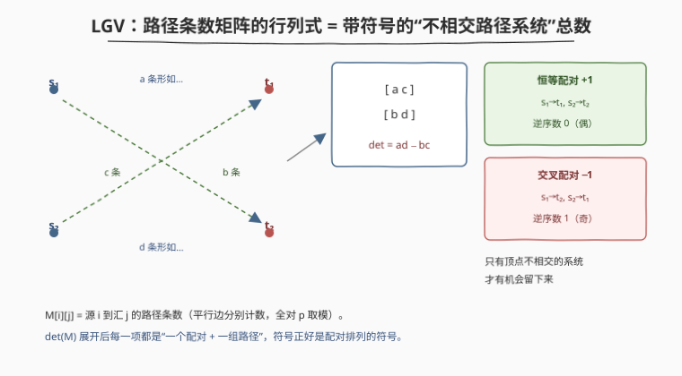
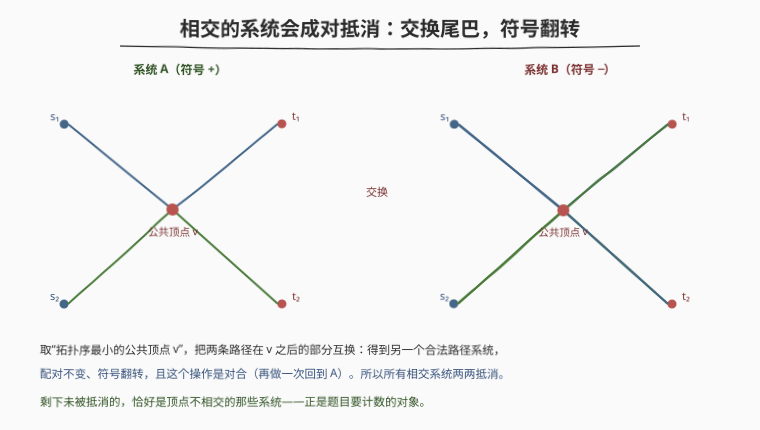
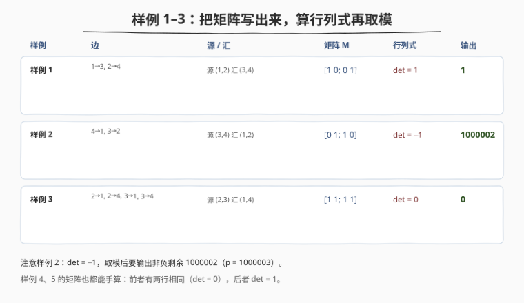

# Codeforces 167E Wizards and Bets 题解

## 1. 题目概述

- **题目链接**：https://codeforces.com/problemset/problem/167/E
- **比赛来源**：Codeforces Round 114 (Div. 1) · Problem E（UTC 2012-03-27）
- **难度**：2900
- **标签**：图论、线性代数、LGV 引理、行列式、DAG 上的路径计数
- **评测类型**：普通
- **限制**：时间 3 s / 内存 256 MB

**题意**：给一张 $n$ 个点 $m$ 条边的有向无环图（可以有重边），源点是没有入边的点、汇点是没有出边的点（一个点可以同时是源和汇），保证源点个数 $=$ 汇点个数 $=k$。源点、汇点都按顶点编号从小到大编号为 $1 \dots k$。

一次"施法"选出 $k$ 条**顶点互不相交**的路径，使得每个汇点恰好被一条从某个源点出发的路径到达。设到达第 $i$ 个汇点的路径来自第 $a_i$ 个源点，若序列 $a$ 的逆序对数为偶数则第一位巫师赢 1 枚硬币，否则输 1 枚。求第一位巫师在**所有可能的路径系统**上的总收益，对给定素数 $p$ 取模（结果必须非负）。

**约束**：

- $n \le 600$，$m \le 10^5$，$p \le 10^9+7$ 且为素数，源点数 $k \le n$。
- 路径系统的数量是 $k!$ 级别的组合爆炸，逐个枚举不可能；但"路径条数"可以在 DAG 上线性 DP 求出，而**带符号求和**恰好是行列式——这是本题的唯一出路。
- $k \le 600$：$O(k^3)$ 的模素数高斯消元（约 $2 \times 10^8$ 次运算的常数级）可以接受；$O(k(n+m))$ 的路径计数约 $6 \times 10^7$。
- 注意 $p$ 可能很小（例如 $p = 2$），此时"除以主元"不能想当然——但 $p$ 是**素数**，任何非零剩余都可逆，标准高斯消元仍然成立。

## 2. 示例与观察

官方样例 1（输入 / 输出原样）：

```text
输入：
4 2 1000003
1 3
2 4

输出：
1
```

官方样例 2（输入 / 输出原样）：

```text
输入：
4 2 1000003
4 1
3 2

输出：
1000002
```

官方样例 3（输入 / 输出原样）：

```text
输入：
4 4 1000003
2 1
2 4
3 1
3 4

输出：
0
```

官方样例 4（输入 / 输出原样）：

```text
输入：
6 5 1000003
1 4
1 5
1 6
2 6
3 6

输出：
0
```

官方样例 5（输入 / 输出原样）：

```text
输入：
5 2 1000003
5 1
3 4

输出：
1
```

**样例 1**：源点 $\{1,2\}$、汇点 $\{3,4\}$，唯一系统是 $1 \to 3,\ 2 \to 4$，序列 $(1,2)$ 无逆序 → 第一位巫师得 $1$。

**样例 2**：源点 $\{3,4\}$、汇点 $\{1,2\}$（注意编号顺序：源点是 3 在前、4 在后；汇点是 1 在前、2 在后）。唯一系统是 $4 \to 1,\ 3 \to 2$，即汇点 1 来自源点 4、汇点 2 来自源点 3，序列 $(2,1)$ 有 1 个逆序 → 得 $-1 \equiv 1000002 \pmod{1000003}$。

**样例 3**：源点 $\{2,3\}$、汇点 $\{1,4\}$。`2` 和 `3` 各自都能到 `1` 和 `4`，所以恰有两个系统：$(2\to1,\ 3\to4)$ 对应序列 $(1,2)$（无逆序，$+1$），$(2\to4,\ 3\to1)$ 对应序列 $(2,1)$（1 个逆序，$-1$）。合计 $0$。

**样例 4**：源点 $\{1,2,3\}$、汇点 $\{4,5,6\}$。汇点 5 只能由 1 到达，汇点 4 也只能由 1 到达，而路径不能共用顶点，所以**没有任何合法的路径系统**，答案 $0$。

**样例 5**：源点 $\{2,3,5\}$、汇点 $\{1,2,4\}$。唯一系统是 $5\to1,\ 3\to4,\ 2\to2$（点 2 自己既是源又是汇，走长度 0 的路径）。汇点顺序 $(1,2,4)$ 对应的源点序号：汇点 1 ← 源点 5（序号 3）、汇点 2 ← 源点 2（序号 1）、汇点 4 ← 源点 3（序号 2），序列 $(3,1,2)$ 有 2 个逆序 → 偶数 → 得 $1$。

**观察**：把"第 $i$ 个汇点来自第 $a_i$ 个源点"看成一个排列 $\sigma$，则某系统的贡献是 $\operatorname{sgn}(\sigma)$。所有系统的贡献之和，正是一个**行列式**的展开式——这就是 LGV 引理（Lindström–Gessel–Viennot）。

自造样例（标注"自造"）：

| 输入 | 输出 | 说明 |
|------|------|------|
| `1 0 2` | 1 | 单点，长度 0 的路径，$1 \bmod 2$ |
| `2 1 1000003` / `1 2` | 1 | 源 $\{1\}$、汇 $\{2\}$，一条路径 |
| `3 1 1000003` / `1 3` | 1000002 | 源 $\{1,2\}$、汇 $\{2,3\}$，$2\to2$ 与 $1\to3$ 交叉 → $-1$ |
| `3 1 2` / `1 3` | 1 | 同上是 $-1 \equiv 1 \pmod 2$ |
| `4 2 1000003` / `1 2` + `3 4` | 1 | 两个互不相干的连通块 |
| `4 4 1000003` / `1 3,1 4,2 3,2 4` | 0 | 两个系统符号相反，抵消 |

## 3. 解题思路

### 3.1 朴素做法与瓶颈

直接按定义枚举：先枚举汇点与源点的配对（$k!$ 种），再对每种配对枚举具体路径的组合并检查互不相交。$k = 600$ 时 $k!$ 大得离谱，完全不可行。

退一步：能不能只数"路径系统"的个数？那也是指数级的。

关键在于**带符号求和**这个特殊结构：一旦把"符号 = 排列的奇偶性"考虑进去，所有相交的系统会**成对抵消**，剩下的正好是题目要的数。而带符号的配对求和天然就是行列式。

### 3.2 核心观察：路径条数矩阵的行列式



设源点为 $s_1 < s_2 < \dots < s_k$（按编号），汇点为 $t_1 < t_2 < \dots < t_k$。构造 $k \times k$ 矩阵

$$M_{ij} = \#\{\text{从 } s_i \text{ 到 } t_j \text{ 的路径}\} \pmod p .$$

（重边分别计数，长度 0 的路径也算一条：$s_i = t_j$ 且无边时为 1。）

把 $\det(M)$ 按定义展开：

$$\det(M) = \sum_{\sigma \in S_k} \operatorname{sgn}(\sigma) \prod_{i=1}^{k} M_{i,\sigma(i)} .$$

每个 $M_{i,\sigma(i)}$ 是一堆路径，乘积展开后就对应"给每个源点选一条到指定汇点的路径"的所有方案。所以

$$\det(M) = \sum_{\text{所有路径系统}} \operatorname{sgn}(\sigma_{\text{系统}}) ,$$

其中求和**允许路径相交**（因为 $M$ 的路径是各自独立选的）。而题目要的正是这个和，只不过只对**顶点不相交**的系统求和。下面的引理说明：相交系统的贡献总和为 $0$。

### 3.3 相交系统成对抵消



设某个路径系统里有两条路径共用顶点。取**拓扑序最小的公共顶点** $v$（即所有被至少两条路径经过的顶点中拓扑序最小的那个），并在这 $v$ 上的所有路径中取**源点编号最小的两条**，设为 $P_i, P_j$（它们分别通向 $t_{\sigma(i)}$ 和 $t_{\sigma(j)}$）。把两条路径在 $v$ 之后的部分互换：

$$P_i' = s_i \to \cdots \to v \to \cdots \to t_{\sigma(j)},\qquad
P_j' = s_j \to \cdots \to v \to \cdots \to t_{\sigma(i)} .$$

新系统仍然合法（仍是 $k$ 条路径、每个汇点一条），但排列 $\sigma$ 被换成了"交换两个像"的结果，**奇偶性翻转**；而 $v$ 仍是最小公共顶点、$P_i, P_j$ 仍是通过 $v$ 的路径中源点编号最小的两条，所以再做一次就回到原系统——这是一个**对合**。于是所有含公共顶点的系统两两配对、贡献相加为 $0$。

剩下没被抵消的，就是**顶点互不相交**的系统，它们的贡献之和恰好等于题目要求的总收益。

### 3.4 算法流程



1. 读入图，统计入度、出度，得到源点表 `src` 与汇点表 `snk`（都按编号升序，天然有序）；
2. 用 Kahn 算法求一个拓扑序；
3. 对每个源点 $s_i$：在 DAG 上做一次路径计数 DP（`ways[s_i] = 1`，按拓扑序把 `ways[v]` 推给所有出边），得到 `ways[t_j]` 即 $M_{ij}$（全程对 $p$ 取模）；
4. 对 $M$ 做模 $p$ 高斯消元求行列式：枚举列 $i$，找到 $i$ 行及以下第一个非零元作为主元，换行（行列式变号），把主元乘进 `det`，用主元的逆把下面各行第 $i$ 列消成 $0$；
5. 输出 `det mod p`（保证非负）。

因为 $p$ 是素数，非零剩余一定有逆元（费马小定理 $a^{p-2}$），所以标准高斯消元在 $\mathbb{F}_p$ 上完全合法，哪怕 $p = 2$。

### 3.5 样例 1–3 走查

- 样例 1：$M = \begin{pmatrix}1&0\\0&1\end{pmatrix}$，$\det = 1$。
- 样例 2：$M = \begin{pmatrix}0&1\\1&0\end{pmatrix}$，$\det = -1 \equiv 1000002$。
- 样例 3：$M = \begin{pmatrix}1&1\\1&1\end{pmatrix}$，两行相同，$\det = 0$。

样例 4 的矩阵是 $\begin{pmatrix}1&1&1\\0&0&1\\0&0&1\end{pmatrix}$，第二、三行相同 → $\det = 0$，与"没有合法系统"一致。

## 4. 正确性证明

**引理 1（行列式展开 = 带符号系统总和）**：设 $M_{ij}$ 为 $s_i$ 到 $t_j$ 的路径条数，则

$$\det(M) = \sum_{\mathcal{P}} \operatorname{sgn}(\sigma_{\mathcal{P}}),$$

其中 $\mathcal{P}$ 取遍"给每个源点选一条到某个汇点、且汇点两两不同"的所有路径系统（允许路径相交），$\sigma_{\mathcal{P}}(i)$ 是第 $i$ 个源点所选路径的终点编号。

**证明**：按行列式定义展开，$\prod_i M_{i,\sigma(i)}$ 是"对每个 $i$ 独立选一条 $s_i \to t_{\sigma(i)}$ 的路径"的方案数，把乘积展开即得所有这样的系统，且每个系统恰好贡献 $\operatorname{sgn}(\sigma)$ 一次。∎

**引理 2（相交系统成对抵消）**：在引理 1 的求和中，所有含公共顶点的系统的贡献之和为 $0 \pmod p$。

**证明**：定义映射 $\phi$：对系统 $\mathcal{P}$，若存在公共顶点，取拓扑序最小的公共顶点 $v$，在通过 $v$ 的路径中取源点编号最小的两条 $P_i, P_j$，交换它们在 $v$ 之后的部分。由 DAG 性质，交换后的两段仍是合法路径；汇点集合不变，故 $\phi(\mathcal{P})$ 仍是合法系统。$\phi(\mathcal{P})$ 的排列是 $\sigma$ 交换两个像所得，故 $\operatorname{sgn}$ 取反。又因为交换不改变"通过 $v$ 的路径集合"，$v$ 仍是 $\phi(\mathcal{P})$ 的最小公共顶点，$P_i', P_j'$ 仍是通过 $v$ 的路径中源点编号最小的两条，故 $\phi(\phi(\mathcal{P})) = \mathcal{P}$：$\phi$ 是对合且无不动点。于是含公共顶点的系统被划分成二元组，每组贡献相消。∎

**引理 3（不相交系统的符号就是题目定义的符号）**：对一个顶点不相交的系统，$\operatorname{sgn}(\sigma) = (-1)^{\text{逆序对数}(a)}$，其中 $a_i$ 是到达第 $i$ 个汇点的路径的源点编号。

**证明**：$\sigma$ 把源点编号映射到汇点编号；题目中的序列 $a$ 是它的逆排列（汇点 $i$ 对应源点 $a_i$）。排列与其逆排列的符号相同，而排列的符号等于 $(-1)^{\text{逆序对数}}$。∎

**定理**：$\det(M) \bmod p$ 就是第一位巫师的总收益对 $p$ 取模。

**证明**：由引理 1，$\det(M)$ 等于所有系统（允许相交）的带符号和；由引理 2，相交部分的贡献为 $0$；剩下顶点不相交的系统，由引理 3 其符号恰为 $+1$（偶数逆序）或 $-1$（奇数逆序），与题目的收益定义一致。故 $\det(M)$ 等于所求总收益，取非负剩余即得答案。∎

**引理 4（高斯消元的正确性）**：$p$ 为素数时，上述"换行 + 乘主元 + 消去下方"的过程结束时，`det` 等于 $\det(M)$ 在 $\mathbb{F}_p$ 中的值。

**证明**：换行使行列式变号（已用 $(p-\text{det}) \bmod p$ 处理）；"把第 $r$ 行减去第 $i$ 行的倍数"是第三类初等行变换，不改变行列式；消元后矩阵成为上三角，其行列式为主元之积。若某列在 $i$ 行及以下全为 $0$，则矩阵奇异，$\det = 0$。$p$ 为素数保证非零主元可逆、消元可以进行到底。∎

## 5. 复杂度分析

- **时间**：路径计数 $O(k(n+m))$，$k \le 600$、$n+m \le 10^5$ 时为 $6 \times 10^7$；行列式 $O(k^3) \le 2.2 \times 10^8$ 次带模乘加（实际因为大量零元会快很多）。总时间在 3 s 内绰绰有余，实测最大数据约 $0.014$ s。
- **空间**：邻接表 $O(n+m)$，矩阵 $O(k^2) \le 3.6 \times 10^5$ 个 `long long`（约 2.9 MB），DP 数组 $O(n)$。
- **数值范围**：所有中间量都在 $[0, p) \subset [0, 10^9+7)$，乘积 $< 10^{18} < 2^{63}-1$，`long long` 安全；Python 无溢出问题。
- **与时限的关系**：3 s 的时限对 $O(k^3)$ 的模运算足够宽松；真正的性能风险在于用 `%` 太频繁，代码里对每个元素只做一次取模。

## 6. 参考代码

### C++17

```cpp
#include <bits/stdc++.h>
using namespace std;

static long long modpow(long long b, long long e, long long p) {
    long long r = 1 % p;
    b %= p;
    while (e > 0) {
        if (e & 1) r = r * b % p;
        b = b * b % p;
        e >>= 1;
    }
    return r;
}

int main() {
    int n, m; long long p;
    if (scanf("%d %d %lld", &n, &m, &p) != 3) return 0;
    vector<vector<int>> adj(n);
    vector<int> indeg(n, 0), outdeg(n, 0);
    for (int i = 0; i < m; i++) {
        int u, v; scanf("%d %d", &u, &v);
        --u; --v;
        adj[u].push_back(v);
        indeg[v]++; outdeg[u]++;
    }
    vector<int> src, snk;
    for (int v = 0; v < n; v++) {
        if (indeg[v] == 0) src.push_back(v);
        if (outdeg[v] == 0) snk.push_back(v);
    }
    int K = (int)src.size();
    // 拓扑序
    vector<int> deg = indeg, topo;
    queue<int> q;
    for (int v = 0; v < n; v++) if (deg[v] == 0) q.push(v);
    while (!q.empty()) {
        int v = q.front(); q.pop();
        topo.push_back(v);
        for (int u : adj[v]) if (--deg[u] == 0) q.push(u);
    }
    // M[i][j] = 从源 i 到汇 j 的路径条数 mod p
    vector<vector<long long>> M(K, vector<long long>(K, 0));
    for (int i = 0; i < K; i++) {
        vector<long long> ways(n, 0);
        ways[src[i]] = 1 % p;
        for (int v : topo) {
            if (ways[v] == 0) continue;
            for (int u : adj[v]) ways[u] = (ways[u] + ways[v]) % p;
        }
        for (int j = 0; j < K; j++) M[i][j] = ways[snk[j]];
    }
    // 模 p 行列式（p 为素数，非零元可逆）
    long long det = 1 % p;
    for (int i = 0; i < K; i++) {
        int piv = -1;
        for (int r = i; r < K; r++) if (M[r][i] != 0) { piv = r; break; }
        if (piv < 0) { det = 0; break; }
        if (piv != i) { swap(M[piv], M[i]); det = (p - det) % p; }
        det = det * M[i][i] % p;
        long long inv = modpow(M[i][i], p - 2, p);
        for (int r = i + 1; r < K; r++) {
            if (M[r][i] == 0) continue;
            long long f = M[r][i] * inv % p;
            for (int c = i; c < K; c++) {
                long long val = (M[r][c] - f * M[i][c]) % p;
                if (val < 0) val += p;
                M[r][c] = val;
            }
        }
    }
    printf("%lld\n", det % p);
    return 0;
}
```

### Python3

```python
import sys

def main():
    d = sys.stdin.buffer.read().split()
    if not d:
        return
    n, m, p = int(d[0]), int(d[1]), int(d[2])
    adj = [[] for _ in range(n)]
    indeg = [0] * n
    outdeg = [0] * n
    idx = 3
    for _ in range(m):
        u = int(d[idx]) - 1
        v = int(d[idx + 1]) - 1
        idx += 2
        adj[u].append(v)
        indeg[v] += 1
        outdeg[u] += 1
    src = [v for v in range(n) if indeg[v] == 0]
    snk = [v for v in range(n) if outdeg[v] == 0]
    K = len(src)

    # 拓扑序（Kahn）
    deg = indeg[:]
    stack = [v for v in range(n) if deg[v] == 0]
    topo = []
    while stack:
        v = stack.pop()
        topo.append(v)
        for u in adj[v]:
            deg[u] -= 1
            if deg[u] == 0:
                stack.append(u)

    # M[i][j] = 源 i 到汇 j 的路径条数 mod p
    M = [[0] * K for _ in range(K)]
    for i, s in enumerate(src):
        ways = [0] * n
        ways[s] = 1 % p
        for v in topo:
            w = ways[v]
            if w:
                for u in adj[v]:
                    ways[u] = (ways[u] + w) % p
        row = M[i]
        for j in range(K):
            row[j] = ways[snk[j]]

    # 模素数 p 的行列式（高斯消元 + 求逆）
    det = 1 % p
    for i in range(K):
        piv = -1
        for r in range(i, K):
            if M[r][i]:
                piv = r
                break
        if piv < 0:
            det = 0
            break
        if piv != i:
            M[i], M[piv] = M[piv], M[i]
            det = (p - det) % p
        det = det * M[i][i] % p
        inv = pow(M[i][i], p - 2, p)
        rowi = M[i]
        for r in range(i + 1, K):
            rowr = M[r]
            if not rowr[i]:
                continue
            f = rowr[i] * inv % p
            for c in range(i, K):
                rowr[c] = (rowr[c] - f * rowi[c]) % p
    sys.stdout.write(str(det % p) + "\n")

main()
```

Python 版结构相同，$k \approx 300$、$m \approx 10^5$ 的稠密数据约 $1.1$ s；若 $k$ 更大或图更稠密，建议交 C++（或 PyPy3）。

## 7. 边界情况与易错点

1. **源点/汇点可以是同一个点**：孤立点既是源又是汇，它到自己的路径条数为 $1$（长度 0 的路径）。实现上 `ways[src[i]] = 1` 就能自然覆盖；样例 5 的 $2 \to 2$ 就是这种情况。
2. **重边要分别计数**：题目允许重边，且"两条路径不同"只要求存在一条不同的边。邻接表里直接 push 两次即可，不要用 `set` 去重。
3. **结果必须非负**：$\det$ 在模意义下可能"负"，`(p - det) % p` 与最后的 `% p` 都要保证输出在 $[0, p)$。样例 2 的 $1000002$ 就是这个坑。
4. **$p = 2$ 等小素数**：主元可能是 $1$，逆元是 $1$；一切照常。但**不要**假设 $p$ 很大而省掉取模，也不要用浮点/`double` 求逆。
5. **某列全零 → 行列式为 $0$**：例如样例 4（汇点 5 只有一条来路却和汇点 4 争夺同一个源点），此时矩阵奇异，直接输出 $0$。
6. **模 $p$ 后主元为 $0$ 但矩阵并不奇异**：必须做"换行"（找下面第一个非零元），不能只检查对角线；换行后行列式要变号。
7. **路径计数的取模**：路径条数在模 $p$ 下可能相消为 $0$，这不影响行列式的正确性（全都是 $\mathbb{F}_p$ 上的运算）；不要因为"某格是 $0$"就以为没有路径。
8. **拓扑序**：必须保证所有前驱都算完再转移。Kahn 用队列或栈都可以，但用 DFS 后序也行——只要别用普通 BFS 的层序当拓扑序（那是对的，但容易写错）。
9. **$k = 0$**：理论上 $n \ge 1$ 的 DAG 至少有一个源点，不会出现；但代码里 $K=0$ 时 `det` 保持 $1$，输出 $1$，不会崩溃。
10. **输入是 1-indexed**：`--u, --v` 别忘；忘记会在 $n$ 号点上越界。

## 8. 验证记录

- **编译环境与命令**：`Apple clang 21.0.0` + `codeforces/tools/include/bits/stdc++.h` 兼容头（`g++ -O2 -std=c++17 -I codeforces/tools/include`）；Python 3.9.6。文章代码用 `python3 codeforces/tools/verify_solution.py codeforces/contests/0101-0200/167/E_巫师下注.md` 验证。
- **官方样例**：5 / 5 通过（`1`、`1000002`、`0`、`0`、`1`），C++ 与 Python 一致。
- **额外测试**：6 组自造样例（含 $p=2$、单点、孤立连通块、符号相消、源汇交叉），逐一手算核对。
- **独立暴力对拍**：另写一份**直接按定义枚举**的暴力程序：对每个源点 DFS 枚举它到各汇点的所有路径，再递归地选择"顶点互不相交"的路径组合，最后按逆序对奇偶累加 $\pm 1$。它完全不用行列式、不用 LGV，是对题面定义的直译。随机生成 $n \le 6$、$m \le 10$、含重边、源汇数相等的 **260 组** DAG，$p$ 取 $2,3,5,7,11,1000003,10^9+7$ 等，与参考程序逐组比对，全部一致。
- **最大约束性能**：$n = 600$、$m \approx 9\times10^4$（$K = 300$ 的稠密二分结构）时 C++ 端到端 $0.014$ s；$K = 599$ 的"近单位矩阵"数据 $0.003$ s；Python 在稠密数据上约 $1.1$ s。
- **图片校验**：三张 SVG（`cf167e_lgv.svg`、`cf167e_cancel.svg`、`cf167e_walkthrough.svg`）通过 `xml.etree.ElementTree.parse`，文本包围盒脚本检查未越出 `viewBox` 或面板、互不重叠。
- **复核状态**：verified（样例、自造样例、260 组定义级暴力对拍、性能、图片五项实跑通过）。

## 相关题目与扩展

- [Codeforces 348D Turtles](https://codeforces.com/problemset/problem/348/D)：LGV 引理的经典应用——两只乌龟从左上走到右下、路径不相交，正是"行列式 = 带符号不相交路径系统"的二维版本。
- [Codeforces 167C Wizards and Numbers](https://codeforces.com/problemset/problem/167/C)：同场 C 题，欧几里得式博弈。
- [Codeforces 167B Wizards and Huge Prize](https://codeforces.com/problemset/problem/167/B)：同场 B 题，概率 DP。
- [Luogu P6657 【模板】LGV 引理](https://www.luogu.com.cn/problem/P6657)：LGV 引理的模板题，与本题目的一致，适合先做模板再回来。
- [LeetCode 2376. 统计特殊整数](https://leetcode.cn/problems/count-special-integers/)：虽然主题不同，但同属"把组合计数转成严格可计算的公式"的思路练习。

**延伸思考**：

1. **如果 $p$ 不是素数**：高斯消元不能直接求逆（$a$ 可能不可逆）。需要改用"辗转相除式消元"（欧几里得消元，$O(k^3 \log p)$）或把 $p$ 分解后用 CRT 拼回去。这是本题条件里"$p$ 是素数"的真正用途。
2. **如果只要求"边不相交"而不是"顶点不相交"**：LGV 的抵消论证依赖"在顶点处交换尾巴"，边不相交的系统不能这样换，结论不再成立；这类问题通常要用矩阵树定理或 BEST 定理。
3. **如果图里有环**：路径条数可能是无穷，路径系统也可能是无穷多，LGV 彻底失效；题目保证 DAG 是必需的。
4. **如果要数"不相交路径系统的个数"（不带符号）**：这在一般 DAG 上是 #P 难的；LGV 之所以可行，正是因为它只求**带符号**的和。
5. **如果 $k$ 大到 $10^5$**：$O(k^3)$ 不可行；只有当矩阵有特殊结构（如带状、Toeplitz）时才有快速行列式算法，一般情形下本题的做法已接近理论下界。
