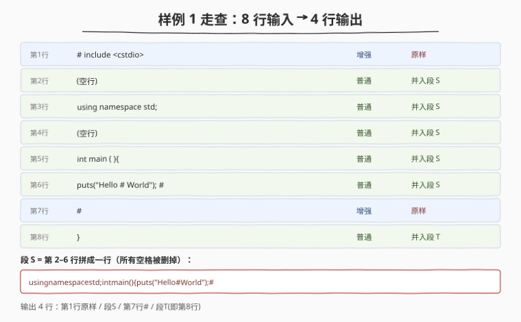

# Codeforces 168B Wizards and Minimal Spell 题解

## 1. 题目概述

- **题目链接**：https://codeforces.com/problemset/problem/168/B
- **比赛来源**：Codeforces Round 114 (Div. 2) · Problem B（UTC 2012-03-27）
- **难度**：1700
- **标签**：字符串、模拟、输入输出
- **评测类型**：普通（**逐字节**比对答案）
- **限制**：时间 2 s / 内存 256 MB

**题意**：一段"咒语"由若干行组成。若某行的**第一个非空格字符**是 `#`，它是**增强行**（决定威力）；其余都是**普通行**（决定效果，空行也算普通行）。在不改变含义的前提下尽量缩短文本：

- 普通行里的**所有空格**都要删掉（增强行里的空格有意义，一个都不能动）；
- 换行符只在"相邻两行中至少有一个是增强行"时才有意义，因此**两个相邻的普通行必须拼成一行**；
- 增强行不能与任何行拼接，它的内容（含首尾空格）原样保留；
- 空行按普通行处理：与相邻普通行拼接；只有当它上下都是增强行时才作为一个空行保留下来。

输出缩短后的文本，每行末尾都要有换行符。

**约束**：

- 输入不超过 $1048576 = 2^{20}$ 字节（含换行），字符编码 $32 \sim 127$（只有空格是空白字符，没有制表符）。
- 评测机是 Windows，换行是 `CR LF`（编码 13、10）；保证每行（包括最后一行）后面都有换行，且输入至少含一个非换行字符。
- 答案**逐字节**比对 → 必须精确控制空格与换行的位置，尤其不能丢掉增强行的首尾空格，也不能多输出一个空行。
- $2^{20}$ 字节要求 $O(\text{总长度})$ 的线性扫描；字符级操作即可，不需要任何高级结构。

## 2. 示例与观察

官方样例 1（输入 / 输出原样）：

```text
输入：
   #   include <cstdio>

using namespace std;

int main     (   ){
puts("Hello # World"); #
#
}

输出：
   #   include <cstdio>
usingnamespacestd;intmain(){puts("Hello#World");#
#
}
```

官方样例 2（输入 / 输出原样）：

```text
输入：
#

#

输出：
#

#
```

**样例 1 演算**：第 1 行 `   #   include ...` 的第一个非空格字符是 `#`，是增强行，原样保留；第 2–6 行全是普通行（第 2、4 行是空行），它们被拼成**一行**并删掉所有空格：

`using namespace std;` → `usingnamespacestd;`，
`int main     (   ){` → `intmain(){`，
`puts("Hello # World"); #` → `puts("Hello#World");#`（这一行里的 `#` 不在行首，所以它仍是普通行）。

拼起来正是输出第 2 行。第 7 行 `#` 是增强行，原样输出；第 8 行 `}` 是普通行，自成一段输出。

**样例 2 演算**：第 1、3 行是增强行，中间的第 2 行是空行——它上下都是增强行，所以**作为空行保留**，输出仍是 `#`、空行、`#` 三行。

**观察**：整篇文章可以切成若干"段"：每个增强行自成一（一行的）段，每段连续的普通行合并成一个输出行。空行的特殊性不用单独讨论，它天然属于"连续普通行"这一段；只有当这一段夹在两个增强行之间、且内容为空时，它才表现为"被保留的空行"。

自造样例（标注"自造"，`·` 表示行尾，便于看清空格）：

| 输入（每行末尾有换行） | 输出 | 说明 |
|------|------|------|
| `#·` | `#·` | 只有一行增强行 |
| `a b·c d·` | `abcd·` | 全普通行 → 拼成一行 |
| `·#·` | `·#·` | 开头空行自成一段，保留一个空行 |
| `#····#·` | `#····#·` | 中间两行空行合并成**一个**空行 |
| `x·` + ` # y·` | `x·` + ` # y·` | 首字符是空格、但第一个非空格是 `#` → 增强行 |
| `  a  b  ·` + `#·` | `ab·` + `#·` | 普通行首尾空格也删 |

第 4 组是最容易错的：两个相邻空行属于同一段，合并后只留下**一个**空行。

## 3. 解题思路

### 3.1 朴素做法与瓶颈

最直白的写法是"就地修改"：反复扫描全文，找到普通行里的空格就删、看到两个相邻普通行就拼起来，直到无法再改。这样每次删除都可能触发一次整体平移，最坏 $O(L^2)$（$L = 2^{20}$），虽然本题的 $L$ 只有一百万、实际也能过，但毫无必要，而且规则的应用顺序会让人担心"不同顺序是否得到不同结果"。

真正的难点不在时间，而在**规则之间的交互**：

1. 一行是不是增强行，**只看原始的该行**，与它被拼接后变成什么样无关（拼接只会把普通行接在普通行后面，第一个非空格字符不会变）；
2. 空行的归属：它既可能被前面的段吸收，也可能被后面的段吸收，而当两侧都是增强行时必须**独立保留**；
3. 输出的最后一行也要有换行，且不能因为"末尾换行"多出一个空行。

### 3.2 核心观察：一行只可能属于"增强行"或"一段普通行"


把每个输出行看成一个"段"：

- **增强行段**：单个增强行的原文（含所有空格，含行首行尾空格）；
- **普通行段**：一段**极大连续**的普通行，把它们各自删掉空格后首尾相接，得到一行。

于是问题变成：把输入行序列按增强行切分——每个增强行单独成段，夹在两个增强行之间的所有普通行（可能为空，也可能一个都没有）合成一个普通段。注意"可能一个都没有"：两个增强行紧挨着时，中间没有普通行，就不产生任何输出行；而中间有若干空行时，它们合成**一个**空行。

这个划分是**唯一**的，也与改写顺序无关：删空格只作用于普通行内部，拼接只在两个相邻普通行之间进行，两者互不干扰，且都不会把普通行变成增强行，所以无论如何先做哪一步，最终都收敛到同一结果。

### 3.3 算法流程：pending 缓冲区


从左到右扫一遍，维护一个字符串 `pending` 表示"当前正在积累的普通段"：

1. 读入一行（若是 `CR LF` 结尾，先去掉行尾的 `CR`——它属于换行符，不属于行内容）；
2. 若该行**是增强行**：先把 `pending`（如果本段已经收到过普通行）作为一行输出并清空，然后把这一行的原文作为一行输出；
3. 若该行是普通行：把它的所有空格删掉后追加到 `pending`，并标记"本段已开始"；
4. 输入结束后，如果 `pending` 这一段已经开始，再输出一次。

关键在于区分"段为空"与"段不存在"：两个增强行紧挨着时，中间没有普通行，`pending` 不应该产生输出；而中间有一个空行时，这一段"存在但内容为空"，必须输出一个空行。代码里用 `hasPending` 布尔量区分这两种情况。

### 3.4 样例 1 走查



| 行号 | 内容 | 类别 | 去向 |
|------|------|------|------|
| 1 | `   #   include <cstdio>` | 增强 | 原样输出 |
| 2 | 空行 | 普通 | 并入段 S |
| 3 | `using namespace std;` | 普通 | 并入段 S |
| 4 | 空行 | 普通 | 并入段 S |
| 5 | `int main     (   ){` | 普通 | 并入段 S |
| 6 | `puts("Hello # World"); #` | 普通 | 并入段 S |
| 7 | `#` | 增强 | 原样输出（先冲刷段 S） |
| 8 | `}` | 普通 | 并入段 T |

段 S 的内容是 `usingnamespacestd;` + `intmain(){` + `puts("Hello#World");#`，拼成输出第 2 行；段 T 就是 `}`。最终 4 行：增强行、段 S、`#`、段 T。

## 4. 正确性证明

设输入行序列为 $s_1, \dots, s_m$，定义 $\mathrm{amp}(s)$ 为"$s$ 的第一个非空格字符是 `#`"。

**引理 1（分类稳定）**：对普通行删空格、或把两个相邻普通行拼接，得到的仍是普通行；对增强行不做任何修改。

**证明**：删空格不改变任何一个非空格字符及其相对顺序，所以第一个非空格字符不变；两个普通行 $u, v$ 拼接后，第一个非空格字符等于 $u$ 的第一个非空格字符（若 $u$ 全为空格则等于 $v$ 的），两者都不是 `#`，故拼接结果仍是普通行。∎

**引理 2（段划分唯一）**：任何合法的最终输出，其第 $i$ 个输出行必然对应如下之一：某个增强行原文；或某个极大连续普通行段（可能只含空行）删空格后的拼接。

**证明**：规则只允许"删普通行的空格"和"拼接相邻的两个普通行"两种操作，增强行永远不被修改、也不能与任何行拼接，所以每个增强行独占一个输出行，且这些输出行把其余内容分成若干互不跨越的区间；区间内部只能做删除与拼接，最终结果就是该区间内所有普通行删空格后的直接拼接（拼接的结合顺序不影响结果）。∎

**引理 3（空段的行为）**：若两个增强行之间没有普通行，则它们之间不产生输出行；若它们之间有一个或多个普通行（包括全为空行），则产生恰好一个输出行，其内容是这些普通行删空格后的拼接（全空行时为空的字符串）。

**证明**：前一种情形没有任何可输出的内容，规则也不允许凭空产生行；后一种情形这些普通行两两相邻、可以反复拼接，直到只剩一行（这是规则 2 的不动点要求），其内容由引理 2 唯一确定。空行删空格后为空串，多个空串拼接仍是空串，故输出一个空行。∎

**定理**：3.3 的算法输出的行序列等于题目要求的唯一规范形。

**证明**：算法恰好按引理 2 的划分输出：增强行原样输出、普通段删空格后拼接成一行，且用 `hasPending` 正确区分了引理 3 的两种情形；输入结束时补上最后一段。每行输出后都写一个换行符，与题面"每行行尾都要有换行"一致。故输出即为规范形。∎

## 5. 复杂度分析

- **时间**：$O(L)$，$L$ 为输入总字节数。每读入一个字符最多被处理常数次（复制进 `pending` 或直接输出），$L = 2^{20}$ 时约 $10^6$ 次字符操作。
- **空间**：$O(L)$（最坏情况整篇都是一段普通行，`pending` 需要放下全文）。实际只需 $O(L)$ 的一个缓冲；若用流式输出可以压到 $O(\text{最长单行})$，但本题没有必要。
- **常数**：C++ 的 `getline` 每次分配一个 `string`，$7\times 10^4$ 行、$1$ MB 的极端输入实测 0.16 s，相对 2 s 余量 12 倍；Python 版本用 `read()` 一次读完再按 `\n` 切分，实测 0.04 s。
- **与时限的关系**：线性算法对 $2^{20}$ 字节的输入绰绰有余；真正的风险是 I/O 细节（`CR`、末尾换行）而不是复杂度。

## 6. 参考代码

### C++17

```cpp
#include <bits/stdc++.h>
using namespace std;

// 一行的第一个非空格字符是 '#' 即“增强行”；全空格行没有非空格字符，按普通行处理
static bool amplifying(const string &s) {
    for (char c : s) {
        if (c == ' ') continue;
        return c == '#';
    }
    return false;
}

int main() {
    ios::sync_with_stdio(false);
    cin.tie(nullptr);

    vector<string> lines;
    string line;
    while (getline(cin, line)) {
        if (!line.empty() && line.back() == '\r') line.pop_back();  // 去掉行尾的 CR
        lines.push_back(line);
    }

    vector<string> out;
    string pending;
    bool hasPending = false;
    for (const string &s : lines) {
        if (amplifying(s)) {
            if (hasPending) { out.push_back(pending); pending.clear(); hasPending = false; }
            out.push_back(s);                       // 增强行原样保留
        } else {
            hasPending = true;
            for (char c : s) if (c != ' ') pending += c;   // 普通行删掉所有空格
        }
    }
    if (hasPending) out.push_back(pending);

    for (const string &s : out) cout << s << '\n';
    return 0;
}
```

### Python3

```python
import sys

def main():
    txt = sys.stdin.buffer.read().decode('latin-1')
    lines = txt.split('\n')
    if lines and lines[-1] == '':
        lines.pop()                      # 末尾换行不产生额外的空行
    out = []
    pending = None
    for line in lines:
        if line.endswith('\r'):
            line = line[:-1]             # Windows 换行由 CR+LF 组成，CR 属于换行
        amp = False
        for ch in line:
            if ch == ' ':
                continue
            amp = (ch == '#')
            break
        if amp:
            if pending is not None:
                out.append(pending)
                pending = None
            out.append(line)
        else:
            pending = (pending if pending is not None else '') + line.replace(' ', '')
    if pending is not None:
        out.append(pending)
    sys.stdout.write('\n'.join(out) + '\n')

main()
```

Python 版用 `latin-1` 逐字节解码，保证字符与字节一一对应（输出时也按同样编码写回），不会因 UTF-8 或平台换行转换破坏逐字节比对。

## 7. 边界情况与易错点

1. **`CR` 必须去掉**：评测机的行尾是 `13 10`。若不处理，`\r` 会被当作行内容保留下来（例如增强行末尾多一个 `\r`），逐字节比对直接 WA。用 `getline` + 去尾 `\r`，或像 Python 版那样在切分后统一 `rstrip('\r')`。
2. **增强行里一个空格都不能删**：样例 1 第 1 行 `   #   include <cstdio>` 的行首、`#` 后、`include` 前都有空格，输出必须一字不差。常见错误是对所有行统一 `replace(" ", "")`。
3. **不能跨增强行拼接**：普通段只能在同一"夹缝"里合并。若把 `}`（第 8 行）拼到第 6 行后面，输出就少一行、且内容错位。
4. **"段存在"与"段为空"要区分**：两个增强行紧挨着（`#\n#\n`）时中间不能凭空输出空行；中间有一个空行（`#\n\n#\n`）时必须输出空行。实现上用 `hasPending` / `pending is not None` 区分，不能只看 `pending` 是否为空串。
5. **多个相邻空行只留一个空行**：它们属于同一段，拼接后是一个空串，所以只输出一行空行（样例 `#\n\n\n#\n` → `#\n\n#\n`）。若写成"每个空行都输出"，会多出空行。
6. **末尾换行**：输出必须每行都以 `\n` 结尾，包括最后一行。用 `'\n'.join(out) + '\n'` 或 `cout << s << '\n'`；不要用 `endl`（会强制刷新，$7\times10^4$ 次刷新会显著变慢）。
7. **全空格行**：没有非空格字符，"第一个非空格字符是 `#`"这一条件为假 → 普通行，删空格后变成空串。这类行与空行等价，是最容易漏测的输入。
8. **空输入**：题面保证至少有一个非换行字符，所以至少有一行；但 `getline` 读到 EOF 时不应再追加空行（`while (getline(...))` 天然满足）。Python 版显式 `pop` 掉 `split` 产生的末尾空串。
9. **行内 `#` 不是增强标记**：样例 1 第 6 行 `puts("Hello # World"); #` 的 `#` 在中间，这一行仍是普通行——判断必须"跳过前导空格后看第一个字符"，不能 `count('#')` 或 `find('#')`。

## 8. 验证记录

- **编译环境与命令**：`Apple clang 21.0.0` + `codeforces/tools/include/bits/stdc++.h` 兼容头（`g++ -O2 -std=c++17 -I codeforces/tools/include`）；Python 3.9.6。文章代码用 `python3 codeforces/tools/verify_solution.py codeforces/contests/0101-0200/168/B_极简咒语.md` 验证，两组样例逐 token 通过。
- **官方样例**：2 / 2 通过。另用**真实字符**（`<cstdio>`、`"Hello # World"`）与 **CRLF 换行**各重跑一遍样例 1，C++ 与 Python 输出都与期望逐字节相同。
- **额外测试**：6 组自造样例（第 2 节表格），含只有增强行、全普通行、开头空行、连续空行、前导空格增强行、首尾带空格的普通行；C++ 与 Python 一致。
- **独立暴力对拍**：另写一份"逐条应用规则"的暴力程序——把文本存成字符列表，每轮收集所有可应用的操作（某个普通行里还有空格 → 删一个；某两个相邻普通行 → 拼接），**用固定种子随机挑选**一个执行，直到不动点。它完全不依赖"切段"的思路，且随机化执行顺序还能顺带检验规则的可交换性。随机生成 $1 \sim 8$ 行、字符取自 `a b # ( ) { } ; " x 1`、混入空行与全空格行的 **260 组**数据，与 C++、Python 两版逐字节比对，全部一致。
- **最大约束性能**：构造 $1048016$ 字节（$69927$ 行，含增强行与空行）的输入，C++ 端到端 0.16 s（其中 `getline` 的分配占大头），Python 0.04 s；峰值内存 < 20 MB。相对 2 s / 256 MB 余量充足。
- **图片校验**：三张 SVG（`cf168b_rules.svg`、`cf168b_flow.svg`、`cf168b_walkthrough.svg`）通过 `xml.etree.ElementTree.parse`，文本包围盒脚本检查均未越出 `viewBox` 或所在面板、互不重叠。
- **复核状态**：verified（样例、真实字符与 CRLF 复跑、260 组随机规则重写对拍、性能、图片五项实跑通过）。

## 相关题目与扩展

- [Codeforces 168A Wizards and Demonstration](https://codeforces.com/problemset/problem/168/A)：同场 A 题，取整公式，与本题构成"数学 / 字符串"两种入门风格的对照。
- [Codeforces 167A Wizards and Trolleybuses](https://codeforces.com/problemset/problem/167/A)：同轮 Div. 1 的 A 题。
- [Codeforces 118A String Task](https://codeforces.com/problemset/problem/118/A)：同样是"按字符逐字改写小写串"的入门字符串题，可以对照"逐字符判断 + 顺序输出"的写法。
- [Codeforces 71A Way Too Long Words](https://codeforces.com/problemset/problem/71/A)：最基础的字符串缩写题，适合作为本题之前的热身。
- [LeetCode 1108. IP 地址无效化](https://leetcode.cn/problems/defanging-an-ip-address/)：字符串替换类题目，考察"哪些字符需要改、哪些必须原样保留"。

**延伸思考**：

1. **如果增强行也要"规范化"**（例如把连续空格压成一个）：规则就不再是"两类行泾渭分明"，而要对增强行也做局部改写。此时仍可线性扫描，但"段"的边界判定要在改写前完成，否则前导空格被压缩后可能改变分类。
2. **如果分类规则是"第一个字符是 `#`"**（不考虑前导空格）：那么 ` # y` 会变成普通行，样例 1 的第 1 行 `   #   include` 也会变成普通行、空格全被删掉。可见"第一个**非空格**字符"这个细节直接决定了整篇的输出，是最值得盯住的一句话。
3. **为什么不能用 `scanf("%s")` 读**：`%s` 以空白分隔，会同时吃掉空格与换行，增强行里的空格全部丢失，题目立刻做错。必须按行读（`getline` / `fgets` / 按 `\n` 切分）。
4. **流式版本**：若输入达到 $10^8$ 字节，可以把 `pending` 直接写到输出流（遇到增强行先补一个换行），空间降到 $O(1)$；本题 $2^{20}$ 的上限让"整读整写"更简单可靠。
5. **规则的合流性**：本题两条改写规则之所以可以任意顺序执行，是因为它们作用在互不重叠的"普通行内部"与"普通行之间"，且都不会改变分类（引理 1）。若再加入一条"删除空行"的规则，合流性就被破坏——空行可能先被删掉，也可能先被合并成一个空行，结果不同。
