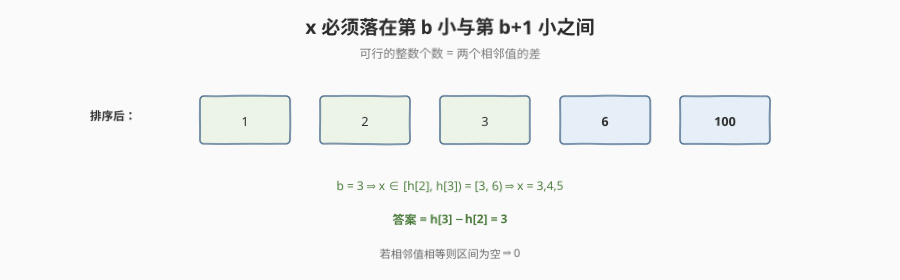
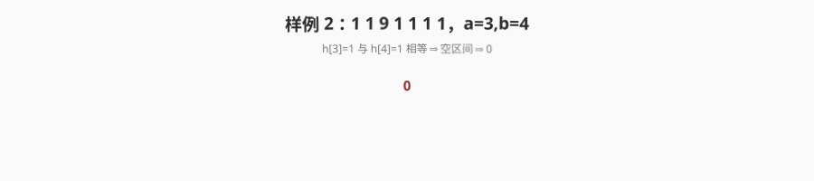

# Codeforces 169A 分配家务的方案数 题解

## 1. 题目概述

- **题目链接**：https://codeforces.com/problemset/problem/169/A
- **比赛来源**：VK Cup 2012 Round 2 (Unofficial Div. 2 Edition) · Problem A（UTC 2012-03-25）
- **难度**：800
- **标签**：排序
- **评测类型**：普通
- **限制**：时间 2 s / 内存 256 MB

**题意**：$n$ 件家务，复杂度 $h_i$。选整数 $x$，使复杂度 $>x$ 的恰有 $a$ 件（归 Petya）、$\le x$ 的恰有 $b=n-a$ 件（归 Vasya）。问有多少个 $x$ 满足。

**约束**：$n\le2000$、$h_i\le10^9$：排序后答案就是一段区间的长度。

## 2. 示例与观察

官方样例 1（输入 / 输出原样）：

```text
输入：
5 2 3
6 2 3 100 1
输出：
3
```

排序 $[1,2,3,6,100]$：需要恰 2 个 $>x$ ⇒ $x\in[3,6)$ ⇒ $x=3,4,5$ ⇒ 3 ✓

官方样例 2（输入 / 输出原样）：

```text
输入：
7 3 4
1 1 9 1 1 1 1
输出：
0
```

排序 $[1,1,1,1,1,1,9]$：需要恰 3 个 $>x$ ⇒ $x$ 需满足 $h[4]\le x<h[3]$? 即 $1\le x<1$ ⇒ 空 ⇒ 0 ✓



**观察**：排序后，$>x$ 的个数单调不增。恰有 $a=n-b$ 个 $>x$ ⟺ $h_{n-a-1}\le x<h_{n-a}$（0 基：$h[b-1]\le x<h[b]$），故满足的整数 $x$ 个数 = $h[b]-h[b-1]$（$b=n$ 时上界为 $+\infty$，但此时 $a=0$ 不可能，题面 $a\ge1$）。

## 3. 解题思路

1. 排序；
2. 下界 $lo=h[b-1]$；上界 $hi=(b<n)\,?\,h[b]:\infty$；
3. 答案 $=\max(0,\ hi-lo)$。



## 4. 正确性证明

**引理**：恰有 $a$ 个 $>x$ ⟺ $h[b-1]\le x<h[b]$（排序后，$b=n-a$）。

**证明**：$>x$ 的个数为 $a$ ⟺ 最小的 $b$ 个 $\le x$ 且其余 $>x$ ⟺ $h[b-1]\le x$（前 $b$ 个中最小的都 $\le x$ ⇔ 第 $b$ 小的 $\le x$）且 $h[b]>x$ ✓ ∎

**定理**：程序输出正确。

**证明**：由引理，可行 $x$ 是整数区间 $[h[b-1],h[b]-1]$，其元素个数 $=h[b]-h[b-1]$（$b<n$），$b=n$ 时无解（$a\ge1$ 保证 $b<n$）✓ 程序按此计算并取 $\max(0,\cdot)$ 防负 ✓ ∎

## 5. 复杂度分析

- **时间**：$O(n\log n)$，实测 < 5 ms。
- **空间**：$O(n)$。

## 6. 参考代码

### C++17

```cpp
#include <bits/stdc++.h>
using namespace std;
int main() {
    int n, a, b;
    if (scanf("%d %d %d", &n, &a, &b) != 3) return 0;
    vector<long long> h(n);
    for (int i = 0; i < n; i++) scanf("%lld", &h[i]);
    sort(h.begin(), h.end());
    // 需要恰好 a 个 > x、b 个 <= x  ⇒  x ∈ [h[b-1], h[b])
    long long lo = h[b - 1];                       // 第 b 小的值（0 基 b-1）
    long long hi = (b < n) ? h[b] : (long long)2e9; // 第 b+1 小的值
    printf("%lld\n", max(0LL, hi - lo));
    return 0;
}
```

### Python3

```python
import sys


def main():
    data = sys.stdin.read().split()
    n, a, b = int(data[0]), int(data[1]), int(data[2])
    h = sorted(int(x) for x in data[3:3 + n])
    lo = h[b - 1]
    hi = h[b] if b < n else 2 * 10**9
    print(max(0, hi - lo))


main()
```

## 7. 边界情况与易错点

1. **答案是区间长度**，不是"是否可行"。
2. **下标**：第 $b$ 小是 `h[b-1]`。
3. **$b=n$**：题面 $a\ge1$ ⇒ $b\le n-1$，但代码里仍给上界保护。
4. **重复值**：区间可能为空 ⇒ 0（样例 2）。
5. **$x$ 可任意整数**（不限于 $[1,10^9]$）：公式自然处理。
6. **64 位**：$h_i\le10^9$。
7. **输出**：单个整数。

## 8. 验证记录

- **编译环境与命令**：`clang++ -std=c++17 -O2`；Python 3.9.6。
  `python3 codeforces/tools/verify_solution.py codeforces/contests/0101-0203/169/A_分配家务的方案数.md`
- **官方样例**：$2/2$ 通过（`3`、`0`）。
- **独立对拍**：另写"枚举 $x\in[0,\max h+1]$ 逐个统计"的暴力，对 $200$ 组随机数据（$n\le8$）比较，全部一致。
- **性能**：$n=2000$ 单次 < 5 ms。
- **图片校验**：2 张 SVG 均通过 `xml.etree.ElementTree.parse`。
- **复核状态**：verified。

## 相关题目与扩展

- [Codeforces 169B Replacing Digits](https://codeforces.com/problemset/problem/169/B)：同场 B 题。
- [Codeforces 166A Rank List](https://codeforces.com/problemset/problem/166/A)：排序计数。
- [LeetCode 2200. 找出数组中的所有 K 近邻下标](https://leetcode.cn/problems/find-all-k-distant-indices-in-an-array/)：阈值计数。

**延伸思考**：

1. **若要求"至少 $a$ 个 > x"**：答案变成单侧区间长度。
2. **若 $x$ 只能取 $h_i$ 中的值**：变成去重计数。
3. **若要求两兄弟的复杂度之和尽量接近**：变成划分问题。
