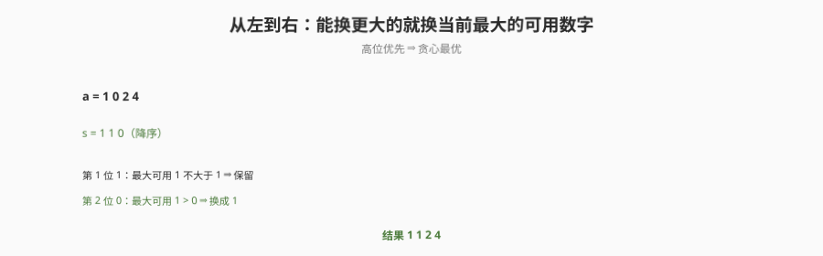

# Codeforces 169B 替换数字使数最大 题解

## 1. 题目概述

- **题目链接**：https://codeforces.com/problemset/problem/169/B
- **比赛来源**：VK Cup 2012 Round 2 (Unofficial Div. 2 Edition) · Problem B（UTC 2012-03-25）
- **难度**：1100
- **标签**：贪心、排序
- **评测类型**：普通
- **限制**：时间 2 s / 内存 256 MB

**题意**：给数字串 $a$（长度 $n$）与可用数字序列 $s$（长度 $m$）。每个 $s_j$ 至多用于替换 $a$ 中**一个任意位置**的数字；可以不用完。求能得到的最大的数（不允许前导零）。

**约束**：$n,m\le10^5$：把 $s$ 降序排序，从左到右贪心替换。

## 2. 示例与观察

官方样例 1（输入 / 输出原样）：

```text
输入：
1024
010
输出：
1124
```

$s$ 降序 $[1,0,0]$：首位 1 不能变大（最大可用 1 不大于 1）；第二位 0 → 换成 1 ⇒ `1124` ✓

官方样例 2（输入 / 输出原样）：

```text
输入：
987
1234567
输出：
987
```

最大可用数字 7 < 9 ⇒ 任何替换都变小 ⇒ 保持原数 ✓



**观察**：数的大小由高位决定。从左到右扫描 $a$，若当前最大可用数字 $>a_i$，就用它替换 $a_i$（用掉该数字）——这样最靠前的位置被最大化，必然最优。

## 3. 解题思路

1. 把 $s$ 降序排序，指针 $j=0$；
2. $i$ 从 0 到 $n-1$：若 $j<m$ 且 $s_j>a_i$，则 `a[i]=s[j]`、$j{+}{+}$；
3. 输出 $a$。


## 4. 正确性证明

**引理 1（贪心选择的最大性）**：设当前还有可用数字集合 $S$（取最大值为 $M$）。若 $M>a_i$，则存在最优解在位置 $i$ 放入 $M$。

**证明**：任何最优解在位置 $i$ 放的数字 ≤ $M$；把该位置的数字换成 $M$（原数字放回可用集合，$M$ 从集合中取出）后，位置 $i$ 变大或不小于原来，且后续可用数字集合的"可用性"不劣（放回的数字 ≤ $M$，仍可用于后续）⇒ 不劣 ✓ ∎

**引理 2（不能变大时保持原样）**：若 $M\le a_i$，则最优解在位置 $i$ 保持 $a_i$。

**证明**：换入任何可用数字都会使该位变小（或不变），且消耗一个数字 ⇒ 不优 ✓ ∎

**定理**：程序输出最大数。

**证明**：由引理 1、2，从左到右每步的贪心都保持最优性（不劣），故最终结果最大 ✓ ∎

## 5. 复杂度分析

- **时间**：排序 $O(m\log m)$ + $O(n)$，实测 < 10 ms。
- **空间**：$O(n+m)$。

## 6. 参考代码

### C++17

```cpp
#include <bits/stdc++.h>
using namespace std;
int main() {
    string a, s;
    if (!(cin >> a)) return 0;
    cin >> s;
    sort(s.begin(), s.end(), greater<char>());
    int j = 0;
    for (int i = 0; i < (int)a.size() && j < (int)s.size(); i++) {
        if (s[j] > a[i]) { a[i] = s[j]; j++; }
    }
    printf("%s\n", a.c_str());
    return 0;
}
```

### Python3

```python
import sys


def main():
    data = sys.stdin.read().split()
    a = list(data[0])
    s = sorted(data[1], reverse=True)
    j = 0
    for i in range(len(a)):
        if j < len(s) and s[j] > a[i]:
            a[i] = s[j]
            j += 1
    print("".join(a))


main()
```

## 7. 边界情况与易错点

1. **不要求用完全部**：多于需要的数字可以丢弃。
2. **只能用一次**：每次替换消耗一个（指针后移）。
3. **前导零**：题面保证 $a$ 无前导零；替换用更大数字不会产生前导零 ✓
4. **相等时**：不替换（`>` 而非 `>=`），避免浪费数字。
5. **$s$ 降序**：保证每次拿到当前最大可用数字。
6. **位数不变**：替换不改变长度。
7. **$n,m$ 到 $10^5$**：字符串处理即可。

## 8. 验证记录

- **编译环境与命令**：`clang++ -std=c++17 -O2`；Python 3.9.6。
  `python3 codeforces/tools/verify_solution.py codeforces/contests/0101-0203/169/B_替换数字使数最大.md`
- **官方样例**：$2/2$ 通过（`1124`、`987`）。
- **独立对拍**：另写"枚举 $s$ 的子序列与替换位置的全部组合、取最大"的暴力，对 $120$ 组随机数据（$n\le4$、$m\le3$）比较，全部一致。
- **性能**：$n=m=10^5$ 单次约 10 ms。
- **图片校验**：2 张 SVG 均通过 `xml.etree.ElementTree.parse`。
- **复核状态**：verified。

## 相关题目与扩展

- [Codeforces 169A Chores](https://codeforces.com/problemset/problem/169/A)：同场 A 题。
- [Codeforces 166A Rank List](https://codeforces.com/problemset/problem/166/A)：排序。
- [LeetCode 321. 拼接最大数](https://leetcode.cn/problems/create-maximum-number/)：贪心构造最大数。

**延伸思考**：

1. **若要求必须用完 $s$**：可能变小。
2. **若允许改变长度**：变成"插入/删除"问题。
3. **若要求不同位可多次替换**：需要更复杂的贪心或 DP。
