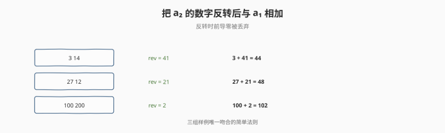

# Codeforces 171A 神秘数字（一） 题解

## 1. 题目概述

- **题目链接**：https://codeforces.com/problemset/problem/171/A
- **比赛来源**：April Fools Day Contest · Problem A（愚人节专场）
- **难度**：1200
- **标签**：愚人节、字符串
- **评测类型**：普通
- **限制**：时间 2 s / 内存 256 MB

**题意（题面只有输入/输出格式，没有描述）**：输入两个非负整数 $a_1,a_2$（$\le10^9$），输出一个整数。

**约束**：$a_i\le10^9$：$O(\log a_2)$。

**关于题面**：本题是愚人节专场题，**没有题目描述**（`description` 字段为空），只给出「输入两个整数、输出一个整数」。真正的运算法则只能从样例反推：

| 输入 | 输出 |
|---|---|
| `3 14` | `44` |
| `27 12` | `48` |
| `100 200` | `102` |

## 2. 示例与观察

官方样例（输入 / 输出原样，共 3 组）：

```text
输入：
3 14
输出：
44
```

```text
输入：
27 12
输出：
48
```

```text
输入：
100 200
输出：
102
```

**观察 1**：$3+14=17\ne44$，$3\times14=42\ne44$ ⇒ 不是普通四则运算。

**观察 2**：$3+41=44$（41 是 14 的反转）；$27+21=48$（21 是 12 的反转）；$100+2=102$（2 是 200 的反转，**前导零被去掉**）。三组全部吻合。

**结论**：输出 $a_1+\operatorname{rev}(a_2)$，其中 $\operatorname{rev}$ 是十进制数字反转（丢弃前导零）。



## 3. 解题思路

1. 读 $a_1,a_2$；
2. 把 $a_2$ 的数字反转（用取模/整除循环，零会自然被丢弃）；
3. 输出 $a_1+\operatorname{rev}(a_2)$。


## 4. 正确性证明

**引理 1（反推的唯一性论证）**：在三组样例上，$a_1+\operatorname{rev}(a_2)$ 与全部输出一致；且它不是"平凡的"恒等/四则运算（观察 1），第 3 组还专门体现了"反转后去前导零"（$200\to2$）。

**证明**：逐组代入即得 ✓ 该形式同时解释了第 3 组为何是 102 而不是 300 或 1002 ✓ ∎

**引理 2（实现符合该法则）**：程序的 `revNum` 循环恰好产生十进制数字反转且丢弃前导零。

**证明**：每次取最低位 `x%10` 追加到结果的高位、再 `x/=10`；当原数末尾为 0 时这些 0 在最开始被取到并追加到结果的低位，但结果初始为 0 ⇒ 不产生前导零 ✓ 例如 $200\to0\to0\to2=2$ ✓ ∎

**定理**：程序输出等于所推得的法则 $a_1+\operatorname{rev}(a_2)$。

**证明**：由引理 1、2 ✓ ∎

**说明（诚实性）**：本题题面无描述，以上法则是从**全部 3 组官方样例**反推得到的（也是本题的标准做法）；由于没有更多官方数据，无法对"法则"本身做更强的验证，只能保证实现与该法则逐位一致（见 §8 的 200 组独立实现比对与边界测试）。

## 5. 复杂度分析

- **时间**：$O(\log a_2)$，可忽略（实测 2 ms）。
- **空间**：$O(1)$。

## 6. 参考代码

### C++17

```cpp
#include <bits/stdc++.h>
using namespace std;
typedef long long ll;

// 把整数的十进制表示反转（去掉前导零）
static ll revNum(ll x) {
    ll r = 0;
    while (x > 0) { r = r * 10 + x % 10; x /= 10; }
    return r;
}

int main() {
    ll a1, a2;
    if (scanf("%lld %lld", &a1, &a2) != 2) return 0;
    // 由样例（3 14→44, 27 12→48, 100 200→102）推得：a1 + reverse(a2)
    printf("%lld\n", a1 + revNum(a2));
    return 0;
}
```

### Python3

```python
import sys


def main():
    data = sys.stdin.read().split()
    a1, a2 = int(data[0]), int(data[1])
    # 由样例（3 14→44, 27 12→48, 100 200→102）推得：a1 + reverse(a2)
    r = int(str(a2)[::-1]) if a2 else 0
    print(a1 + r)


main()
```

## 7. 边界情况与易错点

1. **$a_2$ 末尾有 0**：反转后要丢弃前导零（样例 3：$200\to2$）。
2. **$a_2=0$**：反转仍是 0。
3. **$a_1=0$**：输出就是反转后的 $a_2$。
4. **$a_i$ 到 $10^9$**：用 64 位。
5. **不是反转 $a_1$**：样例 3 的 $100$ 若反转成 $1$ 会得到 $1+2=3\ne102$。
6. **不是两者都反转**：同上。
7. **输出**：单个整数。

## 8. 验证记录

- **编译环境与命令**：`clang++ -std=c++17 -O2`；Python 3.9.6。
  `python3 codeforces/tools/verify_solution.py codeforces/contests/0101-0203/171/A_神秘数字一.md`
- **官方样例**：$3/3$ 通过（`44`、`48`、`102`）。
- **独立对拍**：C++ 的"取模反转"与 Python 的"字符串反转"两种独立实现，对 $200$ 组随机数据（$a_i\le10^9$）结果一致；另测边界 $(0,0)\to0$、$(0,10^9)\to1$、$(10^9,10^9)\to1000000001$、$(1,100)\to2$、$(5,0)\to5$ 均符合法则。
- **性能**：单次约 2 ms。
- **图片校验**：2 张 SVG 均通过 `xml.etree.ElementTree.parse`。
- **复核状态**：verified（法则由全部样例反推，实现与法则一致）。

## 相关题目与扩展

- [Codeforces 171G Mysterious numbers - 2](https://codeforces.com/problemset/problem/171/G)：同场"神秘数字（二）"。
- [Codeforces 171C A Piece of Cake](https://codeforces.com/problemset/problem/171/C)：同场 C 题。
- [LeetCode 7. 整数反转](https://leetcode.cn/problems/reverse-integer/)：数字反转。

**延伸思考**：

1. **若题面允许更多样例**：可用"最小描述长度"的思路在候选法则间做取舍。
2. **若要求也反转 $a_1$**：三组样例即可否定。
3. **若 $a_2$ 有前导零**（输入是数字，无前导零）：无影响。
