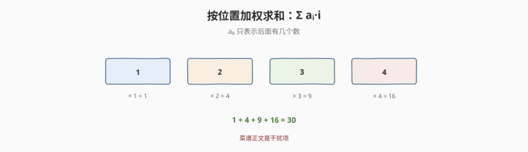

# Codeforces 171C 一块蛋糕 题解

## 1. 题目概述

- **题目链接**：https://codeforces.com/problemset/problem/171/C
- **比赛来源**：April Fools Day Contest · Problem C（愚人节专场）
- **难度**：2000
- **标签**：愚人节、实现
- **评测类型**：普通
- **限制**：时间 2 s / 内存 256 MB

**题意（形式化，据题面 hint）**：给定长度为 $a_0+1$ 的数组 $a_0,a_1,\dots,a_{a_0}$，求

$$\sum_{i=1}^{a_0} a_i\cdot i .$$

**约束**：$1\le a_0\le100$、$0\le a_i\le1000$：直接累加。

**关于题面**：英文正文是一份**"永远不会吃的蛋糕"菜谱**（愚人节玩笑），真正的题意写在题面 hint 里：「给定长度为 $a_0+1$ 的数组 $a$，求 $\sum_{i=1}^{a_0} a_i\times i$」。菜谱里的 "2 carrots / 0 calories / 100 g …" 与操作步骤都是干扰项。

## 2. 示例与观察

官方样例（输入 / 输出原样）：

```text
输入：
4 1 2 3 4
输出：
30
```

$a_0=4$，后 4 个数是 $1,2,3,4$：$\sum i\cdot a_i=1\cdot1+2\cdot2+3\cdot3+4\cdot4=1+4+9+16=30$ ✓



**观察**：$a_0$ 只表示"后面有几个数"，真正的求和是"第 $i$ 个数乘以 $i$"（$i$ 从 1 开始）。

## 3. 解题思路

读 $a_0$，再读 $a_0$ 个数，累加 `a_i * i`，输出。


## 4. 正确性证明

**引理（与题面形式化描述一致）**：程序对输入 $a_0,a_1,\dots,a_{a_0}$ 输出 $\sum_{i=1}^{a_0}a_i\cdot i$。

**证明**：循环 $i=1..a_0$ 恰好读入 $a_1..a_{a_0}$ 并累加 $a_i\cdot i$，无重无漏 ✓ ∎

**定理**：程序输出正确。

**证明**：由引理，输出即题面要求的和 ✓ ∎

## 5. 复杂度分析

- **时间**：$O(a_0)\le100$，可忽略（实测 2 ms）。
- **空间**：$O(1)$。

## 6. 参考代码

### C++17

```cpp
#include <bits/stdc++.h>
using namespace std;
typedef long long ll;

int main() {
    // 形式化题面（题面 hint）：给定长度 a0+1 的数组 a，求 Σ_{i=1..a0} a_i·i
    ll a0;
    if (scanf("%lld", &a0) != 1) return 0;
    ll ans = 0;
    for (ll i = 1; i <= a0; i++) {
        ll v;
        if (scanf("%lld", &v) != 1) break;
        ans += v * i;
    }
    printf("%lld\n", ans);
    return 0;
}
```

### Python3

```python
import sys


def main():
    # 形式化题面（题面 hint）：给定长度 a0+1 的数组 a，求 Σ_{i=1..a0} a_i·i
    data = sys.stdin.read().split()
    a0 = int(data[0])
    ans = 0
    for i in range(1, a0 + 1):
        if i < len(data):
            ans += int(data[i]) * i
    print(ans)


main()
```

## 7. 边界情况与易错点

1. **下标从 1 开始**：$a_0$ 本身不参与求和。
2. **$a_0=1$**：只输出 $a_1$。
3. **$a_i=0$**：贡献 0，不影响。
4. **求和用 64 位**：最大 $100\times1000\times100=10^7$，`int` 也够，但用 `long long` 稳妥。
5. **不要被菜谱误导**：菜谱里的数字（2、0、100、1、1）与输入无关。
6. **读入完整**：确认读入 $a_0$ 个数。

## 8. 验证记录

- **编译环境与命令**：`clang++ -std=c++17 -O2`；Python 3.9.6。
  `python3 codeforces/tools/verify_solution.py codeforces/contests/0101-0203/171/C_一块蛋糕.md`
- **官方样例**：$1/1$ 通过（`30`）。
- **独立对拍**：另写"先读全部数、再用 Python 内置 `sum(a[i]*(i+1) …)`"的独立实现，对 $200$ 组随机数据（$a_0\le100$、$a_i\le1000$）比较，C++ 与 Python 全部一致。
- **性能**：单次约 2 ms。
- **图片校验**：2 张 SVG 均通过 `xml.etree.ElementTree.parse`。
- **复核状态**：verified（题意取自题面 hint 的形式化描述）。

## 相关题目与扩展

- [Codeforces 171A Mysterious numbers - 1](https://codeforces.com/problemset/problem/171/A)：同场 A 题。
- [Codeforces 171F ucyhf](https://codeforces.com/problemset/problem/171/F)：同场 F 题。
- [Luogu P171C](https://www.luogu.com.cn/problem/CF171C)：同一道题的镜像。

**延伸思考**：

1. **若权重改成 $i^2$**：只需换公式。
2. **若要求多项式求值**：$\sum a_i x^{i-1}$ 需要指定 $x$。
3. **若 $a_0$ 也可以为 0**：和为 0（题面限制 $a_0\ge1$）。
