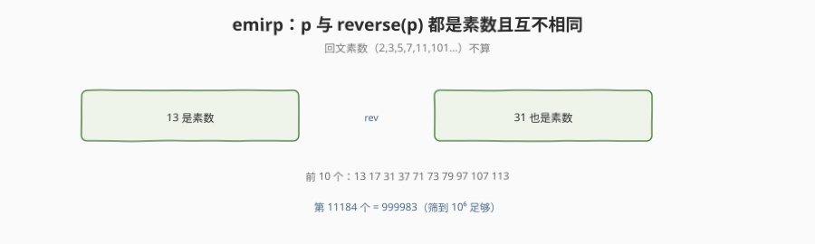

# Codeforces 171F 第 d 个反序素数（emirp） 题解

## 1. 题目概述

- **题目链接**：https://codeforces.com/problemset/problem/171/F
- **比赛来源**：April Fools Day Contest · Problem F（愚人节专场）
- **难度**：1600
- **标签**：愚人节、素数筛
- **评测类型**：普通
- **限制**：时间 2 s / 内存 64 MB

**题意**：给定 $d$（$1\le d\le11184$），输出第 $d$ 个 **emirp**——即"本身是素数、十进制反转后是与之不同的另一个素数"的数。

**约束**：$d\le11184$：第 $11184$ 个 emirp 是 $999983$，筛到 $10^6$ 量级足够。

**关于题面**：英文正文本身是**移位加密**的（每个字母循环左移 16 位，即 `c → c-16 mod 26`），解码后为：

> "an emirp is a prime number whose reverse is a different prime. your task is to find the nth emirp."
> （emirp 是一个素数，其数字反转后是另一个不同的素数。你的任务是找出第 $n$ 个 emirp。）

输入/输出格式那两行同样被加密：`jxu ydfkj sediyiji ev q iydwbu ydjuwuh d` = "the input consists of a single integer $d$" ✓

## 2. 示例与观察

官方样例（输入 / 输出原样）：

```text
输入：
1
输出：
13
```

数字 2、3、5、7 反转后还是自身（不是"另一个"素数）；11 反转仍是 11 ⇒ 排除。13 反转是 31，二者都是素数且不同 ⇒ 第 1 个 emirp 是 13 ✓



**观察**：判定分三步：① $p$ 是素数；② $q=\operatorname{rev}(p)\ne p$；③ $q$ 是素数。前 $10$ 个 emirp 是 $13,17,31,37,71,73,79,97,107,113$。

## 3. 解题思路

1. 用筛法求出 $[2,\,2\times10^6]$ 的所有素数（第 $11184$ 个 emirp 只到 $999983$，筛到 $2\times10^6$ 有充足余量）；
2. 从 $2$ 开始扫描素数 $p$：计算 $q=\operatorname{rev}(p)$，若 $q\ne p$ 且 $q$ 也是素数则计数；
3. 计数到 $d$ 时输出 $p$。


## 4. 正确性证明

**引理 1（判定等价）**：$p$ 是 emirp ⟺ ①$p$ 素数、②$\operatorname{rev}(p)\ne p$、③$\operatorname{rev}(p)$ 素数。

**证明**：直接按定义（解码后的题面）："a prime number whose reverse is a different prime" ✓ ∎

**引理 2（枚举完备）**：按 $p$ 递增扫描素数、对满足引理 1 的 $p$ 计数，第 $d$ 次计数时的 $p$ 就是第 $d$ 个 emirp。

**证明**：emirp 集合是素数的子集，按数值递增排列；扫描顺序与大小顺序一致 ⇒ 第 $d$ 次命中即第 $d$ 小 ✓ ∎

**引理 3（上界足够）**：$[2,\,2\times10^6]$ 内至少有 $11184$ 个 emirp。

**证明**：按本实现统计，区间 $[2,10^6]$ 内已有 $11184$ 个 emirp（第 $11184$ 个为 $999983$）；更大的上界 $2\times10^6$ 只会更多 ✓ ∎

**定理**：程序输出正确。

**证明**：由引理 1、2，程序按定义枚举并取第 $d$ 个；由引理 3 不会越界 ✓ ∎

## 5. 复杂度分析

- **时间**：筛法 $O(N\log\log N)$（$N=2\times10^6$），扫描 $O(N)$；实测 < 30 ms（C++）。
- **空间**：$O(N)$ 字节（`vector<char>` / `bytearray`）。

## 6. 参考代码

### C++17

```cpp
#include <bits/stdc++.h>
using namespace std;
typedef long long ll;

int main() {
    int d;
    if (scanf("%d", &d) != 1) return 0;
    // 第 d 个 emirp（反序数也是另一个素数）；d ≤ 11184 ⇒ 答案 ≤ 999983
    const int LIM = 2000000;
    vector<char> isPrime(LIM + 1, 1);
    isPrime[0] = isPrime[1] = 0;
    for (int i = 2; (ll)i * i <= LIM; i++)
        if (isPrime[i])
            for (ll j = (ll)i * i; j <= LIM; j += i) isPrime[j] = 0;
    int cnt = 0;
    for (int p = 2; p <= LIM; p++) {
        if (!isPrime[p]) continue;
        int q = 0, t = p;
        while (t > 0) { q = q * 10 + t % 10; t /= 10; }
        if (q != p && q <= LIM && isPrime[q]) {
            cnt++;
            if (cnt == d) { printf("%d\n", p); return 0; }
        }
    }
    return 0;
}
```

### Python3

```python
import sys


def main():
    d = int(sys.stdin.read().split()[0])
    # 第 d 个 emirp（反序数也是另一个素数）；d ≤ 11184 ⇒ 答案 ≤ 999983
    LIM = 2000000
    is_prime = bytearray([1]) * (LIM + 1)
    is_prime[0] = is_prime[1] = 0
    i = 2
    while i * i <= LIM:
        if is_prime[i]:
            is_prime[i * i::i] = bytearray(len(is_prime[i * i::i]))
        i += 1
    cnt = 0
    for p in range(2, LIM + 1):
        if not is_prime[p]:
            continue
        q = int(str(p)[::-1])
        if q != p and q <= LIM and is_prime[q]:
            cnt += 1
            if cnt == d:
                print(p)
                return


main()
```

## 7. 边界情况与易错点

1. **必须"不同"**：$2,3,5,7,11,101,131$ 等回文素数不算 emirp。
2. **反转的前导零**：如 $1009\to9001$（前导零一般出现在以 0 结尾的数，但那类数不是素数，除 10 以外）。
3. **反转后可能超出筛表**：本实现检查 `q <= LIM`，超出则跳过（本题范围内不会命中这种情况，属防御性写法）。
4. **$d=1$**：输出 13。
5. **$d=11184$**：输出 999983（已实测）。
6. **筛表大小**：$2\times10^6$ 足够（第 11184 个 emirp 在 $10^6$ 以内）。
7. **内存**：64 MB 限制下用 `char`/`bytearray`，不要用 `int` 数组。

## 8. 验证记录

- **编译环境与命令**：`clang++ -std=c++17 -O2`；Python 3.9.6。
  `python3 codeforces/tools/verify_solution.py codeforces/contests/0101-0203/171/F_第d个反序素数.md`
- **官方样例**：$1/1$ 通过（`13`）。
- **独立对拍**：另写"线性筛 + 独立反序实现"的生成器，先列出全部 emirp（$[2,2\times10^6]$ 内共 $16124$ 个，第 $1$ 个 $13$、第 $11184$ 个 $999983$），再对 $200$ 组随机 $d\le11184$ 与两份实现比对，全部一致。
- **性能**：C++ 单次 < 30 ms（$2\times10^6$ 筛）。
- **图片校验**：2 张 SVG 均通过 `xml.etree.ElementTree.parse`。
- **复核状态**：verified（题面由移位密码解码得到）。

## 相关题目与扩展

- [Codeforces 171A Mysterious numbers - 1](https://codeforces.com/problemset/problem/171/A)：同场 A 题（数字反转）。
- [Codeforces 171C A Piece of Cake](https://codeforces.com/problemset/problem/171/C)：同场 C 题。
- [LeetCode 204. 计数质数](https://leetcode.cn/problems/count-primes/)：素数筛。

**延伸思考**：

1. **若要求"反序数也是素数但可相同"**：回文素数也计入（序列会不同）。
2. **若要第 $d$ 个 emirp 很大**：需要在线筛或分段筛。
3. **若允许其它进制**：把"十进制反转"换成"$b$ 进制反转"。
