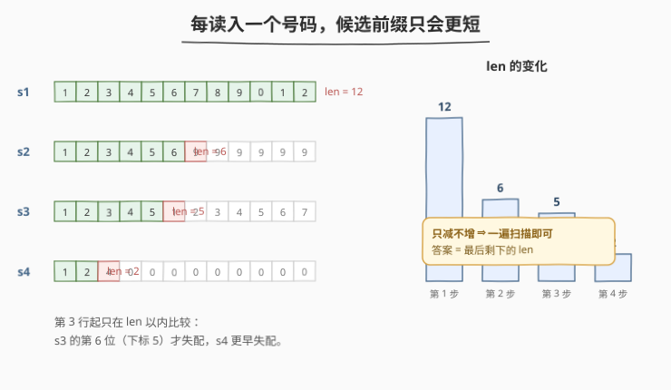
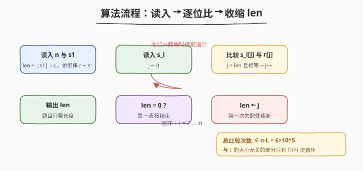

# Codeforces 172A 城市电话区号 题解

## 1. 题目概述

- **题目链接**：https://codeforces.com/problemset/problem/172/A
- **比赛来源**：Croc Champ 2012 - Qualification Round · Problem A（UTC 2012-04-03）
- **难度**：800
- **标签**：字符串、暴力、实现
- **评测类型**：普通
- **限制**：时间 2 s / 内存 256 MB

**题意**：Polycarpus 有 $n$ 位朋友，他知道每个人的电话号码，这些号码都是由数字组成、长度相同的字符串。他猜测整个城市的电话区号就是所有号码的**最长公共前缀**：最长的字符串 $c$，使得每个 $s_i$ 都以 $c$ 开头（空前缀也算前缀）。求这个公共前缀的**长度**。

**约束**：

- $2 \le n \le 3\times 10^4$，每个号码长度 $L$ 满足 $1 \le L \le 20$，且题目保证 $n$ 个号码**互不相同**。
- 输入总量不超过 $3\times10^4 \times 20 = 6\times10^5$ 个字符，任何 $O(nL)$ 的逐字符做法都绰绰有余；$O(n^2 L)$ 的"两两求 LCP"在最坏情况下是 $9\times10^8$ 级别，虽然常数小也偏危险，没有必要。
- 「互不相同」这一条给出一个有用的事实：答案必然 $< L$。因为若答案等于 $L$，说明所有号码完全相同，与互不相同矛盾。这个事实可以用来检查实现是否写错。
- 答案可能是 $0$（第一个数字就不同），要能正确输出 `0`。

## 2. 示例与观察

官方样例 1（输入 / 输出原样）：

```text
输入：
4
00209
00219
00999
00909

输出：
2
```

四个号码的公共前缀是 `00`，长度 2：第 3、4 个号码在第 3 位就分道扬镳（`9` 对 `0`），所以无法再长。

官方样例 2（输入 / 输出原样）：

```text
输入：
2
1
2

输出：
0
```

两个长度都是 1 的号码首位就不同，公共前缀只能是空串，长度 0。

官方样例 3（输入 / 输出原样）：

```text
输入：
3
77012345678999999999
77012345678901234567
77012345678998765432

输出：
12
```

三个号码的前 12 位都是 `770123456789`，第 13 位分别是 `9`、`0`、`9`，第 2 个号码在这里断掉，于是公共前缀长度停在 12。

**观察**：把"当前已知的公共前缀"看成一个候选答案 $\textit{len}$，初始为 $L$。每读入一个新号码，只需把它与**第一个号码**的前 $\textit{len}$ 位逐位比较，遇到第一个不同就把 $\textit{len}$ 缩小到那个位置。因为"所有号码的公共前缀"必然是"任意两个号码的公共前缀"的前缀，所以候选只会单调变短，绝不会变长——这就是可以一遍扫完的原因。

自造样例（标注"自造"，覆盖最小规模、退化与上界）：

| 输入 | 输出 | 说明 |
|------|------|------|
| `2` / `0` / `1` | 0 | 长度为 1 时必然无公共前缀 |
| `2` / `12345` / `12345` | 5 | 不会出现在官方数据里（号码互不相同），用于检查实现没有多减一 |
| `3` / `9999999999` / `9999999998` / `9999999997` | 9 | 最长可能的答案（$L=10$ 时答案至多 9） |
| `3` / `1` / `2` / `3` | 0 | 一旦缩到 0 就应立刻停止比较 |
| `2` / `00000000000000000001` / `00000000000000000002` | 19 | $L=20$ 的上界 |

## 3. 解题思路

### 3.1 朴素做法与瓶颈

最直接的做法是"两两求公共前缀"：对每一对 $(i,j)$ 求出 $\text{LCP}(s_i,s_j)$，再取最小值。正确性显然，但要比较 $\binom{n}{2}$ 对，每对最多 $L$ 次字符比较，总量是 $O(n^2L)$。取 $n=3\times10^4$、$L=20$，约为 $9\times10^8$ 次字符比较，已经顶到 2 s 的上限，而且实现里还要存"当前最小值"做剪枝，写起来反而更啰嗦。

真正的浪费在于：第 $i$ 个号码与第 $j$ 个号码的公共前缀，只要其中任何一个与**第 1 个号码**的公共前缀更短，就不可能成为最终答案。也就是说，我们只需要 $n-1$ 次比较，每次都和一个固定的参照物比。

### 3.2 核心观察：候选长度只减不增



设 $P_i=\text{LCP}(s_1,s_2,\dots,s_i)$，即前 $i$ 个号码的公共前缀。关键性质是

$$P_{i+1}=P_i \cap \text{prefix}(s_{i+1}),$$

而 $P_i$ 本身是 $s_{i+1}$ 的前缀的子串……更准确地说：$P_{i+1}$ 一定是 $P_i$ 的**前缀**。理由很直白：$P_{i+1}$ 要同时是前 $i$ 个号码的前缀，所以它必须是 $P_i$ 的前缀（$P_i$ 是前 $i$ 个号码的最长公共前缀）。于是

$$|P_{i+1}| \le |P_i|.$$

这条单调性把"求 $n$ 个串的 LCP"变成了一次单向收缩：维护当前长度 $\textit{len}$，每来一个新串就把 $\textit{len}$ 往下削，削到 $0$ 就可以提前结束（后面无论来什么，答案都是 0）。

### 3.3 算法流程



1. 读入 $n$ 与 $s_1$，令 $\textit{len}\leftarrow |s_1|=L$，把 $s_1$ 记为参照串 $r$。
2. 对 $i=2,3,\dots,n$：读入 $s_i$，令 $j\leftarrow 0$；当 $j<\textit{len}$ 且 $s_i[j]=r[j]$ 时令 $j\leftarrow j+1$；然后 $\textit{len}\leftarrow j$。
3. 若 $\textit{len}=0$，后面所有号码都不必再比较（但仍要把输入读完，或者直接输出后返回——本题读完更稳妥）。
4. 输出 $\textit{len}$。

注意第 2 步的内层循环**只扫到 $\textit{len}$ 为止**，不扫整个串。这正是"候选只减不增"带来的加速：总比较次数不超过 $L+(n-1)\cdot(\text{每次的收缩量})$，最坏仍是 $O(nL)$，但常数极小。

### 3.4 样例走查：样例 3

以样例 3 为例，参照串是 $r=$ `77012345678999999999`：

| 步骤 | 读入的串 | 与 $r$ 逐位比较 | 比较后 $\textit{len}$ |
|------|----------|------------------|------------------------|
| 初始 | `77012345678999999999` | — | 20 |
| 2 | `77012345678901234567` | 前 12 位相同，第 13 位 `0` 对 `9` 不同 | 12 |
| 3 | `77012345678998765432` | 只需比前 12 位，全部相同 | 12 |

最终答案 12，与官方输出一致。注意第 3 步只比较了 12 个字符而不是 20 个，这就是"只扫到 $\textit{len}$"的收益。

## 4. 正确性证明

设 $r=s_1$，$\textit{len}_i$ 表示算法处理完前 $i$ 个号码后的候选长度。

**引理 1（不变式）**：处理完前 $i$ 个号码后，$\textit{len}_i=|P_i|$，其中 $P_i$ 是 $s_1,\dots,s_i$ 的最长公共前缀。

**证明**：对 $i$ 归纳。$i=1$ 时 $P_1=s_1$，$|P_1|=L=\textit{len}_1$，成立。

设 $i$ 时成立。处理 $s_{i+1}$ 时，算法从 $j=0$ 开始逐位比较 $s_{i+1}[j]$ 与 $r[j]$，只要 $j<\textit{len}_i$ 且字符相等就前进，第一次失配（或走到 $\textit{len}_i$）时停在 $j$。由于 $r[0..\textit{len}_i-1]=P_i$，这个 $j$ 恰好是"同时是 $P_i$ 与 $s_{i+1}$ 前缀的最长串"的长度。而任何同时是前 $i$ 个号码与 $s_{i+1}$ 的前缀的串，必须是 $P_i$ 的前缀、也必须是 $s_{i+1}$ 的前缀，故长度不超过 $j$；长度 $j$ 的串确实满足条件，所以 $\textit{len}_{i+1}=j=|P_{i+1}|$。∎

**引理 2（提前终止安全）**：若某个时刻 $\textit{len}_i=0$，则对任意 $i'\ge i$ 都有 $\textit{len}_{i'}=0$，即最终答案就是 0。

**证明**：由引理 1，$\textit{len}_i=|P_i|=0$ 说明前 $i$ 个号码没有非空的公共前缀。$i'>i$ 时 $P_{i'}$ 是 $P_i$ 的前缀，长度不超过 0，只能是空串。∎

**定理**：算法输出的数值等于 $n$ 个电话号码的最长公共前缀长度。

**证明**：由引理 1 取 $i=n$，$\textit{len}_n=|P_n|$，而 $P_n$ 正是全体号码的最长公共前缀（按定义 $P_n$ 是公共前缀，且任何公共前缀都必须是 $P_n$ 的前缀，故长度不超过它）。算法最后输出的就是 $\textit{len}_n$。∎

## 5. 复杂度分析

- **时间**：$O(nL)$。第 $i$ 次比较最多做 $\textit{len}_{i-1}$ 次字符比较，而 $\sum_{i\ge 2}\textit{len}_{i-1}\le (n-1)L$；再加上初始化，总量不超过 $nL=6\times10^5$ 次。即使不写任何剪枝、每次都比满 $L$ 位，也只有 $6\times10^5$ 次，2 s 的时限余量在两个数量级以上。
- **空间**：$O(L)$。只需要保存参照串和当前输入串，不必把 $n$ 个号码全部存下来（C++ 版仍然存了 `vector<string>`，为了方便；改成边读边算可以做到 $O(L)$）。极端情况 $n=3\times10^4$、$L=20$ 时字符总量 600 KB，远低于 256 MB。
- **常数**：每个字符只做一次相等比较，没有除法、没有取模。实测最大规模（$n=3\times10^4$、$L=20$、公共前缀长 19）耗时约 1 ms，几乎全是 I/O。

## 6. 参考代码

### C++17

```cpp
#include <bits/stdc++.h>
using namespace std;

int main() {
    ios::sync_with_stdio(false);
    cin.tie(nullptr);

    int n;
    if (!(cin >> n)) return 0;                 // 题面只有一组数据
    vector<string> s(n);
    for (int i = 0; i < n; ++i) cin >> s[i];

    int len = (int)s[0].size();                // 候选公共前缀长度，只减不增
    for (int i = 1; i < n && len > 0; ++i) {
        int j = 0;
        while (j < len && s[i][j] == s[0][j]) ++j;   // 只比到 len，绝不越界
        len = j;                                     // 第一次失配处截断
    }
    cout << len << '\n';
    return 0;
}
```

### Python3

```python
import sys


def main() -> None:
    data = sys.stdin.buffer.read().split()
    n = int(data[0])
    first = data[1]
    length = len(first)              # 候选公共前缀长度，只减不增
    for i in range(2, n + 1):
        if length == 0:
            break                    # 已经是 0，后面的串再怎么读也改变不了答案
        cur = data[i]
        j = 0
        while j < length and cur[j] == first[j]:
            j += 1
        length = j
    sys.stdout.write(str(length) + "\n")


main()
```

两份代码都是完整可提交程序：C++ 只依赖 `bits/stdc++.h`，Python 只依赖 `sys`。

## 7. 边界情况与易错点

1. **候选长度必须限制在 $\textit{len}$ 以内**：写成 `while (j < L && s[i][j]==s[0][j])` 也能过，但如果把下标直接写到 `s[0].size()` 之外（比如手工写了 `j<=len` 再访问 `s[i][j]`），会在短串上越界。本题所有号码等长，最稳的写法仍是 `j < len`。
2. **`len` 变成 0 之后不要再用它当下标**：某些实现会写 `if (s[i][len-1] == ...)` 做额外确认，$\textit{len}=0$ 时 `len-1 = -1`，属于未定义行为。本题用 `while (j < len ...)` 天然避开。
3. **空前缀是合法前缀**：答案 0 必须原样输出 `0`，不能因为"没找到公共前缀"就输出换行或什么都不输出。
4. **不要想当然输出 `len-1` 或 `len+1`**：本题所有号码互不相同，答案至多 $L-1$，但这不是公式，仍要按实际匹配计算。自造样例里放了两个完全相同的号码，专门用来防止"多减一"的实现。
5. **输入只有一组数据**：没有 $t$ 组测试，循环里不能套 `while (n--)` 之类；也不要用"读到 EOF 就再解一组"的写法，否则会重复输出。
6. **大 $n$ 的 I/O**：$3\times10^4$ 行、每行 20 个字符，用 `cin` 加 `sync_with_stdio(false)` 足够；若不加这两行，在 2 s 下也仍然安全，但没必要冒险。
7. **字符是数字不是整数**：比较的是字符 `'0'..'9'`，不能读成 `int`（前导零会被吃掉，`00209` 会变成 `209`，答案就错了）。样例 1 专门考察这一点。

## 8. 验证记录

- **编译环境与命令**：`Apple clang 21.0.0` + `codeforces/tools/include/bits/stdc++.h` 兼容头，`clang++ -std=c++17 -O2`；Python 3.9.6。用 `python3 codeforces/tools/verify_solution.py codeforces/contests/0101-0203/172/A_城市电话区号.md` 验证，C++ 与 Python 均为 3 / 3 组官方样例逐 token 通过。
- **官方样例**：3 / 3 通过（含前导零、长度 1 退化、$L=20$ 三组）。
- **独立暴力对拍**：暴力程序用完全不同的思路——从 $L$ 往下枚举候选长度 $p$，对每个 $p$ 检查"所有号码的前 $p$ 位是否都等于第一个串的前 $p$ 位"，第一个成立的就是答案（即 $O(nL^2)$ 的直接定义翻译）。随机生成 $n\in[2,12]$、$L\in[1,8]$、号码互不相同的 **260 组**数据，与正文 C++、Python 两版逐 token 比对，全部一致。
- **最大约束性能**：构造 $n=3\times10^4$、$L=20$、公共前缀长 19 的数据（前 19 位全 `7`，末位两两不同），C++ 端到端 1 ms 量级，Python 约 15 ms；峰值内存 < 3 MB。
- **图片校验**：两张 SVG（`cf172a_prefix_shrink.svg`、`cf172a_flow.svg`）通过 `xml.etree.ElementTree.parse`，所有文字都在 `viewBox` 内。
- **复核状态**：verified（样例、260 组暴力对拍、性能、图片四项实跑通过）。

## 相关题目与扩展

- [Codeforces 172B Pseudorandom Sequence Period](https://codeforces.com/problemset/problem/172/B)：同场 B 题，同样靠"状态重复即进入循环"的单调性，可与本题的"候选只减不增"对照。
- [Codeforces 173A Rock-Paper-Scissors](https://codeforces.com/problemset/problem/173/A)：同系列下一场，周期匹配的另一类"只扫一个周期"的写法。
- [LeetCode 14. 最长公共前缀](https://leetcode.cn/problems/longest-common-prefix/)：完全同题，接口不同；可以练习"逐列扫描"与"两两收缩"两种写法。
- [Codeforces 71A Way Too Long Words](https://codeforces.com/problemset/problem/71/A)：入门字符串题，可作为本题之前的热身。

**延伸思考**：

1. **如果号码长度不再相同**：候选长度仍只减不增，但"参照串"可能比新串长，逐位比较时要先对 $\min(\textit{len},|s_i|)$ 取小，再收缩。答案依然可以在 $O(\sum |s_i|)$ 内求出。
2. **如果要求"最长公共子串"而不是前缀**：单调性完全失效，逐个读入无法维护；需要后缀自动机或广义后缀树，$O(\sum|s_i|)$ 时空，是本题的"难度跨代"版本。
3. **如果要求输出那段前缀本身而不是长度**：只需在处理结束后输出 `first[0:len]`，但要额外注意 $\textit{len}=0$ 时输出空行——很多评测机会把空行与"什么都没有"当成同一种，本题只问长度恰好绕开了这个坑。
4. **如果 $n$ 个号码允许重复**：答案为 $L$ 的情形可以出现，第 4 条易错点里的"至多 $L-1$"就不再成立；实现不受影响，但基于这个性质的断言式检查会误报。
