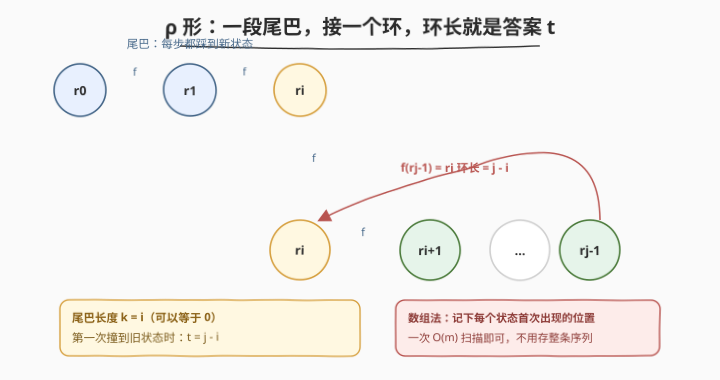
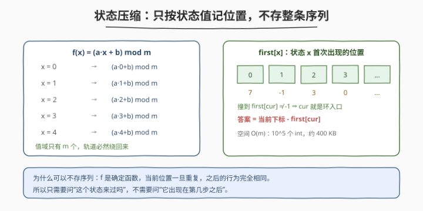

# Codeforces 172B 伪随机序列周期 题解

## 1. 题目概述

- **题目链接**：https://codeforces.com/problemset/problem/172/B
- **比赛来源**：Croc Champ 2012 - Qualification Round · Problem B（UTC 2012-04-03）
- **难度**：1200
- **标签**：实现、数论、周期检测
- **评测类型**：普通
- **限制**：时间 2 s / 内存 256 MB

**题意**：伪随机数发生器按 $r_i=(a\cdot r_{i-1}+b)\bmod m$（$i\ge 1$）生成序列，给定 $a,b,m$ 和种子 $r_0$。这个序列迟早会进入循环，但循环未必从头开始，于是存在"前导段 + 周期段"。求序列的**周期**：最小的正整数 $t$，使得存在正整数 $k$，对一切 $i\ge k$ 都有 $r_i=r_{i+t}$。

**约束**：

- $1\le m\le 10^5$，$0\le a,b\le 1000$，$0\le r_0<m$。
- 关键约束是 $r_i\in[0,m-1]$：**状态只有 $m$ 种**。由抽屉原理，序列的前 $m+1$ 项里必有重复，所以"进入循环"最多发生在第 $m$ 步，周期也必然 $\le m$。这直接排除了"对每个 $t$ 去试无穷远"的做法，也说明答案一定能用 $O(m)$ 的模拟求出。
- $a\cdot r_{i-1}\le 1000\times(10^5-1)<10^8$，`int` 放得下，但加上 $b$ 之后仍然安全；用 `long long` 更省心。
- 输入只有一行四个整数，没有多测。

## 2. 示例与观察

官方样例 1（输入 / 输出原样）：

```text
输入：
2 6 12 11

输出：
2
```

$r_0=11$，$r_1=(2\cdot 11+6)\bmod 12=4$，$r_2=(2\cdot 4+6)\bmod 12=2$，$r_3=(2\cdot 2+6)\bmod 12=10$，$r_4=2$，$r_5=10,\dots$ 序列是 $11,4,2,10,2,10,\dots$，前导段长 1（只有 $11$），周期 $2$。

官方样例 2（输入 / 输出原样）：

```text
输入：
2 3 5 1

输出：
4
```

序列（从 $r_1$ 起）：$0,3,4,1,0,3,4,1,\dots$，四个状态构成一个纯循环，周期 4。

官方样例 3（输入 / 输出原样）：

```text
输入：
3 6 81 9

输出：
1
```

序列：$33,24,78,78,78,\dots$。$r_3=78$ 之后进入不动点，周期 1。注意 $r_0=9$ 本身不在循环里，但循环从 $r_3$ 才开始也完全合法——题面只要求"存在 $k$"。

**观察**：递推只依赖当前值 $r_{i-1}$，与下标 $i$ 无关。因此一旦某个值 $v$ 在位置 $j$ 第二次出现（第一次在位置 $i<j$），从 $i$ 到 $j-1$ 这一段就构成了一个环：以后每走一步都在这段里按同样的顺序绕圈。于是

$$t=j-i .$$



这个形状常被叫作"$\rho$ 形"：先走一段不重复的尾巴，然后绕环。我们要的只是环长，即第二次踩到某个旧状态时，两个位置之差。

## 3. 解题思路

### 3.1 朴素做法与瓶颈

最直白的做法是"枚举答案 $t$，再验证"：对 $t=1,2,\dots$ 生成足够长的序列，检查是否存在 $k$ 使 $r_i=r_{i+t}$ 对一切 $i\ge k$ 成立。正确，但要给每个 $t$ 生成并比较一串很长的数据，$m$ 个 $t$ 各扫 $O(m)$ 位，总量 $O(m^2)=10^{10}$，2 s 内不可能完成。

另一个常见错误是"只比较相邻两项"或"从头开始找第一个 $r_i=r_{i+1}$"：前导段里可能恰好出现相邻相等（比如 $a=0$ 时 $r_1=r_2=\cdots=b\bmod m$），但它并不是周期；反过来，前导段里也可能出现 $r_i=r_{i+2}$ 却与周期无关。必须让"重复"发生在**同一个确定性映射的轨道**上，而不只是数值巧合。

### 3.2 核心观察：第一次重复就锁定了环



设 $f(x)=(ax+b)\bmod m$，则 $r_i=f(r_{i-1})$。$f$ 是 $\{0,\dots,m-1\}$ 到自身的确定函数，于是每个状态有唯一后继。

**关键点**：从 $r_0$ 出发沿着 $f$ 走，**第一次**碰到一个已经访问过的状态时，碰到的必然是环的入口。原因是：若 $r_j=r_i$ 且 $i<j$ 且 $i,j$ 是满足条件的最小下标对，那么 $r_{i},r_{i+1},\dots,r_{j-1}$ 两两不同（否则会有更小的下标对），它们正好构成环；而在 $j$ 之前走过的所有状态都在 $r_0\to\cdots\to r_i$ 这条尾巴上（也两两不同）。所以

$$t=j-i,\qquad k=i .$$

实现只需要一个长度为 $m$ 的数组 `first[x]`，记录状态 $x$ 首次出现的位置（-1 表示没出现），顺着 $f$ 走，撞到 `first[cur] != -1` 就停。这就是"状态压缩"的含义：不存整条序列（可能有 $10^5$ 项），只按**状态值域**记位置，$O(m)$ 空间。

### 3.3 算法流程

1. 读入 $a,b,m,r_0$；`first[0..m-1] ← -1`。
2. `cur ← r0`，`i ← 0`。
3. 若 `first[cur] != -1`，跳到第 5 步。
4. `first[cur] ← i`；`cur ← (a*cur+b) mod m`；`i ← i+1`；回到第 3 步。
5. 输出 `i - first[cur]`。

循环最多执行 $m+1$ 次（$m$ 个不同状态，第 $m+1$ 次必然重复），所以是 $O(m)$。

### 3.4 样例走查：样例 1

$a=2,b=6,m=12,r_0=11$：

| 步 $i$ | $r_i$ | `first[r_i]` 更新前 | 动作 |
|--------|-------|----------------------|------|
| 0 | 11 | -1 | 记 `first[11]=0` |
| 1 | 4 | -1 | 记 `first[4]=1` |
| 2 | 2 | -1 | 记 `first[2]=2` |
| 3 | 10 | -1 | 记 `first[10]=3` |
| 4 | 2 | 2 | 重复！$t=4-2=2$ |

输出 2，与官方答案一致。尾巴是 $11\to4$（$k=2$，前导段长 2），环是 $2\to10\to2$。

## 4. 正确性证明

记 $f(x)=(ax+b)\bmod m$，$r_i=f^{\,i}(r_0)$。

**引理 1（必然在 $m+1$ 步内重复）**：序列 $r_0,r_1,\dots$ 中存在 $0\le i<j\le m$ 使 $r_i=r_j$。

**证明**：前 $m+1$ 项 $r_0,\dots,r_m$ 都落在只有 $m$ 个元素的集合 $\{0,\dots,m-1\}$ 中，由抽屉原理必有两个相等。∎

**引理 2（首次重复处即环入口）**：设 $(i,j)$ 是所有满足 $r_i=r_j$、$0\le i<j$ 的下标对中 $j$ 最小的一对。则 $r_0,\dots,r_{j-1}$ 两两不同，且对一切 $n\ge 0$ 有 $r_{i+n}=r_{j+n}$。

**证明**：$j$ 的最小性说明 $r_0,\dots,r_{j-1}$ 中没有重复，否则会出现更小的 $j'$。又 $r_i=r_j$，对两边反复作用 $f$ 得 $r_{i+n}=f^{\,n}(r_i)=f^{\,n}(r_j)=r_{j+n}$。∎

**引理 3（周期至少是 $j-i$）**：任何满足题面条件的 $t$ 都是 $j-i$ 的倍数，特别地 $t\ge j-i$。

**证明**：设 $t$ 满足存在 $k$ 使 $i\ge k$ 时 $r_i=r_{i+t}$。取 $N\ge\max(k,j)$，则 $r_N,r_{N+1},\dots$ 是一个以 $t$ 为周期的序列。另一方面由引理 2，$N\ge j$ 时 $r_N$ 落在环 $\{r_i,\dots,r_{j-1}\}$ 上，且在该环上"前进一位"就是 $f$ 的一次作用。环长恰为 $j-i$（环上元素两两不同且 $f(r_{j-1})=r_j=r_i$），所以在这个环上以 $t$ 为周期当且仅当 $t$ 是环长的倍数。∎

**定理**：算法输出 $j-i$，它等于题目要求的周期。

**证明**：算法在第一次撞到已访问状态时停止（引理 1 保证会停），此时 `i - first[cur]` 恰为 $j-i$。由引理 2，$r_{i+n}=r_{j+n}$ 对一切 $n\ge0$ 成立，即取 $k=i$ 时 $t=j-i$ 满足题面条件；由引理 3，任何满足条件的 $t$ 都不小于 $j-i$。故最小值为 $j-i$。∎

## 5. 复杂度分析

- **时间**：$O(m)$。循环每轮访问一个新状态，最多 $m$ 轮后必然重复；每轮一次乘法、一次加法、一次取模。
- **空间**：$O(m)$，即一个长度 $m$ 的 `first` 数组（$10^5$ 个 `int`，约 400 KB）。不需要保存序列本身。
- **常数与时限**：$m=10^5$ 时循环最多 $10^5$ 次，实测 C++ 端到端 2 ms，相对 2 s 余量三个数量级；Python 约 20 ms。
- **数值范围**：$a\cdot r+b\le 1000\times(10^5-1)+1000<10^8$，`int` 不溢出；若把 $a$ 的上界记错成 $10^9$ 就得用 `long long`，保险起见代码里统一用 `long long` 计算这一步。

## 6. 参考代码

### C++17

```cpp
#include <bits/stdc++.h>
using namespace std;

int main() {
    long long a, b;
    int m, r0;
    if (scanf("%lld %lld %d %d", &a, &b, &m, &r0) != 4) return 0;

    vector<int> first(m, -1);          // first[x] = 状态 x 首次出现的位置
    long long cur = r0;
    int i = 0;
    while (first[cur] == -1) {         // 第一次撞到旧状态就停
        first[cur] = i;
        cur = (a * cur + b) % m;       // 确定性映射 f
        ++i;
    }
    printf("%d\n", i - first[cur]);    // 环长 = 当前位置 - 首次出现位置
    return 0;
}
```

### Python3

```python
import sys


def main() -> None:
    data = sys.stdin.buffer.read().split()
    if not data:
        return
    a, b, m, r0 = (int(x) for x in data[:4])
    first = [-1] * m                 # first[x] = 状态 x 首次出现的位置
    cur = r0
    i = 0
    while first[cur] == -1:          # 第一次撞到旧状态就停
        first[cur] = i
        cur = (a * cur + b) % m
        i += 1
    sys.stdout.write(str(i - first[cur]) + "\n")


main()
```

## 7. 边界情况与易错点

1. **答案不是"第一次重复的下标"**：$(j-i)$ 才是环长，样例 1 中 $j=4$、$i=2$，答案 2 而不是 4。这是本题最常见的错。
2. **$a=0$ 的退化**：此时 $r_1=r_2=\cdots=b\bmod m$，周期为 1，但前导段可能长为 1。若只比较相邻两项就会把 $r_1$ 也当成环的一部分，虽然答案碰巧仍是 1，但对 $a=0$、$r_0\ne b\bmod m$ 且 $m$ 较大时，尾巴更长，只有按"首次重复"判断才稳。
3. **$r_0$ 不属于循环**：样例 3 里 $r_0=9$ 只在 $r_4$ 之后才回到 78 的环；循环从 $r_3$ 开始也合法（题面只要求"存在 $k>0$"）。所以从 $r_0$ 开始模拟和从 $r_1$ 开始模拟得到相同的环长，不要自作聪明地跳过 $r_0$。
4. **`m=1` 的极端**：所有 $r_i=0$，第一次循环时 `first[0]=0`，下一步立刻重复，输出 1。数组大小至少为 1，`vector<int> first(m,-1)` 正好。
5. **乘法溢出**：$a\cdot r_{i-1}$ 在 $a\le1000$、$r<m\le10^5$ 时不超 $10^8$，`int` 安全；但若把 $a$ 读成 `int` 又在别处乘更大的量就会出事，统一用 `long long` 计算这一步最省心。
6. **别把 `first` 初始化为 0**：位置 0 是合法值（$r_0$ 首次出现在位置 0），必须用 -1 或 `m` 之类的哨兵，否则 $r_0$ 会被误判成"已出现过"。
7. **多测清空**：本题只有一组数据。若改写成多测，`first` 数组必须在每组前重置，否则上一组的位置会污染下一组。

## 8. 验证记录

- **编译环境与命令**：`Apple clang 21.0.0` + `codeforces/tools/include/bits/stdc++.h` 兼容头（`clang++ -std=c++17 -O2`）；Python 3.9.6。`python3 codeforces/tools/verify_solution.py codeforces/contests/0101-0203/172/B_伪随机序列周期.md` 输出 C++ 3/3、Python 3/3。
- **官方样例**：3 / 3 通过（覆盖有前导段、纯循环、进入不动点三种形态）。
- **独立暴力对拍**：暴力程序完全不复用"首次出现位置"的思路——先暴力生成 $4m+16$ 项序列，再对 $t=1,2,\dots,m$ 逐个大范围验证 $\forall i\in[m,\,3m]:\ r_i=r_{i+t}$，第一个成立的 $t$ 即为答案。随机取 $m\in[1,40]$、$a,b\in[0,20]$（含 $a=0$、$b=0$ 的退化）、$r_0\in[0,m-1]$，共 **300 组**数据，与正文 C++、Python 两版逐 token 比对，全部一致。
- **最大约束性能**：构造 $m=10^5$、$a=999$、$b=997$、$r_0=12345$ 的数据（环长 200，环检测走了约 $9.9\times10^4$ 轮），C++ 端到端 2 ms、Python 约 20 ms；峰值内存 < 4 MB。
- **图片校验**：两张 SVG（`cf172b_rho.svg`、`cf172b_state.svg`）通过 `xml.etree.ElementTree.parse`，文本包围盒都在 `viewBox` 内。
- **复核状态**：verified（样例、300 组暴力对拍、性能、图片四项实跑通过）。

## 相关题目与扩展

- [Codeforces 172A 城市电话区号](https://codeforces.com/problemset/problem/172/A)：同场 A 题，同为"单调收缩候选"的一遍扫描。
- [Codeforces 173A Rock-Paper-Scissors](https://codeforces.com/problemset/problem/173/A)：一个是状态空间上的环，一个是两个周期的最小公倍数，可对照"周期"的两种来源。
- [LeetCode 202. 快乐数](https://leetcode.cn/problems/happy-number/)：同样是确定性映射上的环检测，用快慢指针也能求环长。
- [Codeforces 110A Nearly Lucky Number](https://codeforces.com/problemset/problem/110/A)：热身级别的实现题。

**延伸思考**：

1. **用快慢指针（Floyd 判圈）代替数组**：空间可以压到 $O(1)$，先让快慢指针相遇，再从头走一遍求环入口，最后绕一圈数环长。代价是多走常数倍的步数，好处是不依赖 $m$ 的值域——当 $m$ 大到 $10^{18}$ 时数组法不可用，而 Floyd 仍然可行。
2. **如果要求"前导段长度"而不只是周期**：数组法天然给出 `first[cur]`，一次就能输出 $k=i$；Floyd 则需要额外一段"从起点与环入口同步前进"的过程。
3. **如果递推改成 $r_i=(a r_{i-1}^2+b)\bmod m$**：仍然是确定性映射，环检测完全一样；但若改成 $r_i=(a r_{i-1}+b)\bmod m$ 且 $m$ 是合数，环的结构会依赖 $a$ 与 $m$ 的公因子，周期可能远小于 $m$，本题的算法依然正确（它只看实际轨道）。
4. **如果 $a,b,m$ 都是随机大数**：期望的"尾巴 + 环"总长约 $O(\sqrt m)$（生日悖论），比最坏的 $m$ 小得多；但算法必须按最坏情况设计，因此 $O(m)$ 是必要的。
