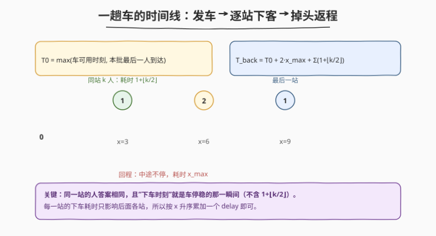
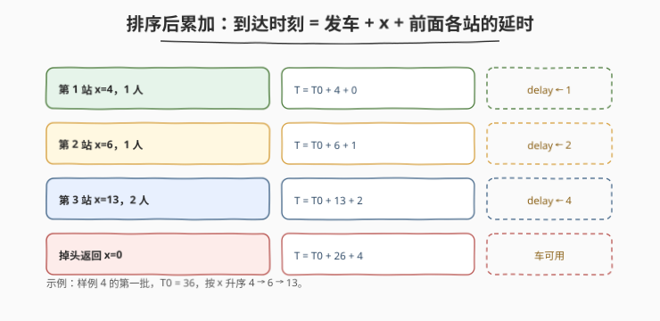

# Codeforces 172C 校园公交调度 题解

## 1. 题目概述

- **题目链接**：https://codeforces.com/problemset/problem/172/C
- **比赛来源**：Croc Champ 2012 - Qualification Round · Problem C（UTC 2012-04-03）
- **难度**：1500
- **标签**：实现、模拟、排序
- **评测类型**：普通
- **限制**：时间 1 s / 内存 256 MB

**题意**：公交站位于数轴原点 $x=0$，$n$ 名学生按到达时刻 $t_i$ 严格递增的顺序出现，第 $i$ 人要坐车到坐标 $x_i>0$。公交车初始在原点、容量 $m$。规则如下：

- 学生按到达顺序排队上车，任意多人上车都不耗时。车上坐满 $m$ 人时立即发车；若第 $n$ 名（最后一名）学生上了车，也立即发车（即使没坐满）。
- 车以速度 1 沿 $x$ 正方向行驶，途中经过"至少有一人要下车"的点就停一次，$k$ 人下这一站耗时 $1+\lfloor k/2\rfloor$。学生下车的时刻记为该站**停车的那一瞬间**（不含下车耗时本身）。
- 最后一名乘客下车、下车动作完成后，车立即掉头，中途不停，回到 $x=0$ 再装人，如此往复。
- 求每名学生下车的时刻 $w_i$。

**约束**：

- $1\le n,m\le 10^5$，$1\le t_i\le 10^5$，$1\le x_i\le 10^4$，$t_i$ 严格递增。
- $n=10^5$ 意味着总时间最多被切成 $10^5$ 趟车；每趟车内部还要按目的地分组。如果每趟车都扫一遍全体学生，就是 $O(n^2/m)$ 级别，$m=1$ 时退化成 $O(n^2)=10^{10}$，1 s 内绝无可能。因此必须做到"每名学生只被处理常数次"。
- $x_i\le 10^4$ 但时间可以累积得很大：最坏要跑 $n/m$ 趟、每趟来回 $2\times10^4$，再加上各站的 $1+\lfloor k/2\rfloor$，答案可达 $10^{10}$ 量级，**必须用 64 位整数**。
- 输入的 $t_i$ 已按严格递增给出，不需要再排序；只有每批人内部要按 $x_i$ 排序。

## 2. 示例与观察

官方样例 1（输入 / 输出原样）：

```text
输入：
1 10
3 5

输出：
8
```

只有一名学生，他在 $t=3$ 到达并上车；因为他是最后一名学生，车立刻出发，$3+5=8$ 时刻到站下车。

官方样例 2（输入 / 输出原样）：

```text
输入：
2 1
3 5
4 5

输出：
8 19
```

容量 1，所以是两趟。第一趟：$3$ 出发、$8$ 到站下车、下车耗时 $1+\lfloor1/2\rfloor=1$、返程 5，$14$ 回到原点。第二趟：$14$ 出发（人早就到了），$19$ 到站。

官方样例 3（输入 / 输出原样）：

```text
输入：
5 4
3 5
4 5
5 5
6 5
7 1

输出：
11 11 11 11 20
```

容量 4，前四名（$t=3,4,5,6$）凑满一车，$6$ 出发，$11$ 到达 $x=5$，四人同时下车；耗时 $1+\lfloor4/2\rfloor=3$，再返程 $5$，$19$ 回到原点。第五名 $t=7$ 早已在等，$19$ 出发，$20$ 到达 $x=1$。

官方样例 4（输入 / 输出原样）：

```text
输入：
20 4
28 13
31 13
35 6
36 4
52 6
53 4
83 2
84 4
87 1
93 6
108 4
113 6
116 1
125 2
130 2
136 13
162 2
166 4
184 1
192 2

输出：
51 51 43 40 93 89 86 89 114 121 118 121 137 139 139 152 195 199 193 195
```

**观察 1（分批是唯一的）**：学生按到达顺序排队，车每次装走队首的 $\min(m,\ \text{剩余})$ 人。所以"第几趟"和"每趟载谁"完全由 $m$ 与到达顺序决定，不需要任何决策。

**观察 2（发车时刻只看两件事）**：一趟车的发车时刻 $=\max(\text{车回到原点的时刻},\ \text{本批最后一人的到达时刻})$。原因：前一批人到达时刻更早，早就等在站里；车一回来就能立刻上人，而"本批最后一人上车"正是发车的触发条件。

**观察 3（同一站的人同时下车）**：目的地相同的人必然在同一站、同一瞬间下车，所以一趟车内部应该先把人按 $x_i$ 排序，再逐站累加。



## 3. 解题思路

### 3.1 朴素做法与瓶颈

最直白的做法是"按时间逐单位模拟"：每一秒让车移动一格，到站就结算下车，回到原点就上人。正确性没问题，但时间轴最长到 $10^{10}$，一秒一步的做法要跑 $10^{10}$ 次循环；即使把"空驶返程"整段跳过，只要还按"每站重新扫描车上所有人"来实现，$m=10^5$ 时单趟就是 $O(m^2)=10^{10}$。

真正的瓶颈在于：**没有必要模拟时间**。车的行为在"趟"这个粒度上是确定的：一趟车的全部时间都能用闭式公式算出来，而每名学生只会属于一趟车。所以应当以"趟"为单位，$O(\text{本趟人数}\log\text{本趟人数})$ 地一次算完。

### 3.2 核心观察：一趟车的时间可以一次算完



固定一趟车：车上成员的集合 $S$（队首的连续一段），发车时刻 $T_0$。把 $S$ 按目的地 $x$ 升序排成 $x^{(1)}<x^{(2)}<\dots<x^{(r)}$，第 $j$ 个不同目的地有 $c_j$ 人。定义到第 $j$ 站之前的累计下车耗时

$$D_j=\sum_{j'<j}\Bigl(1+\Bigl\lfloor \frac{c_{j'}}{2}\Bigr\rfloor\Bigr).$$

那么车到达第 $j$ 站的时刻是

$$T_j = T_0 + x^{(j)} + D_j,$$

这一站的 $c_j$ 人全部在 $T_j$ 时刻下车（题面明确说"下车时刻"是本车停稳的那一瞬间，不含下车耗时）。全部下完后车在 $x^{(r)}$ 处，已经花了 $D_{r+1}=\sum_{j\le r}(1+\lfloor c_j/2\rfloor)$ 的下车时间，于是空车回到原点的时刻是

$$T_{\text{back}} = T_0 + x^{(r)} + D_{r+1} + x^{(r)} = T_0 + 2x^{(r)} + D_{r+1}.$$

这个 $T_{\text{back}}$ 就是下一趟车"车可用"的时刻。于是下一趟的发车时刻为

$$T_0' = \max\bigl(T_{\text{back}},\ t_{\text{本批最后一人}}\bigr).$$

整道题就变成：把学生切成连续的批，按上式逐批推进。每名学生被排序一次、被赋值一次，总代价 $O(n\log m)$。

### 3.3 算法流程

1. 读入 $n,m$ 与所有 $(t_i,x_i)$；`cur ← 0`（车在原点可用的时刻），`i ← 0`。
2. 当 `i < n`：令 `j ← min(n, i+m)`，本批为 $[i,j)$。
3. `depart ← max(cur, t[j-1])`。
4. 把 $[i,j)$ 的**下标**按 $x$ 升序排序（相同 $x$ 保持任意顺序，结果一样）。
5. 顺序扫描排序后的下标，把相同 $x$ 的连续段合并成一组：`arrive ← depart + x + delay`，给这一段里每个人的答案赋 `arrive`；然后 `delay ← delay + 1 + cnt/2`。
6. `cur ← depart + 2*x_last + delay`，其中 `x_last` 是本批最大目的地、`delay` 是全部站点的下车耗时之和。`i ← j`，回到第 2 步。
7. 按学生原顺序输出答案。

### 3.4 样例走查：样例 3

$n=5,m=4$，学生依次是 $(3,5),(4,5),(5,5),(6,5),(7,1)$。

| 趟 | 成员 | $t_{\text{最后}}$ | 车的可用时刻 | 发车 | 分站与到达 | 下车耗时 | 回到原点 |
|----|------|-------------------|--------------|------|------------|----------|----------|
| 1 | 1–4 号 | 6 | 0 | 6 | $x=5$：4 人，到达 $6+5+0=11$ | $1+2=3$ | $6+2\cdot5+3=19$ |
| 2 | 5 号 | 7 | 19 | 19 | $x=1$：1 人，到达 $19+1+0=20$ | $1+0=1$ | $19+2\cdot1+1=22$ |

输出 `11 11 11 11 20`，与官方一致。注意第二趟的发车时刻是 19 而不是 7：车 19 才回来，人早在站里等着。

再核对样例 4 的第一批：学生 1–4 号 $(28,13),(31,13),(35,6),(36,4)$，$t_{\text{最后}}=36$，`depart=36`。按 $x$ 升序是 $4\to6\to13$：到 $x=4$ 是 $36+4=40$（4 号学生下车），耗时 $1+\lfloor1/2\rfloor=1$；到 $x=6$ 是 $36+6+1=43$（3 号），耗时 1；到 $x=13$ 是 $36+13+2=51$（1、2 号），耗时 $1+\lfloor2/2\rfloor=2$。于是前四人的答案分别是 $51,51,43,40$，与官方输出的前四个数完全吻合；`cur = 36+2\cdot13+(1+1+2)=66`，下一批在 $\max(66,53)=66$ 发车。

## 4. 正确性证明

**引理 1（分批唯一）**：对任意 $q\ge0$，第 $q$ 趟车恰好载走剩余学生中下标最小的 $\min(m,\ \text{剩余人数})$ 人。

**证明**：学生只能在车停靠原点时上车，且按到达顺序排队（题面："students consistently come to the stop and get on it ... in the order in which they came"）。车每次离开原点后直到返回都不再上人，返回时把队首能装的人全部装走（容量 $m$，装车不耗时）。因此每趟载走的是当前队首的一段，长度 $\min(m,\text{剩余})$，归纳即得。∎

**引理 2（发车时刻公式）**：设本批最后一人到达时刻为 $t^\*$、车可用时刻为 $C$，则发车时刻 $T_0=\max(C,t^\*)$。

**证明**：车在 $C$ 时刻（若 $C$ 早于本批某些人的到达，则从 $C$ 起）停在原点。车上人数 $<m$ 时，发车条件只有两个：坐满 $m$ 人，或第 $n$ 名学生上车。本批恰好是队首的一段，前一批已经全部上车，所以"本批第 $r$ 人上车"等价于"第 $i+r-1$ 名学生上车"。若 $C\ge t^\*$，所有人早已可上，车在 $C$ 时刻一次装完并立即满足条件，故 $T_0=C$；若 $C<t^\*$，则最后一个触发条件的是本批最后一人上车，故 $T_0=t^\*$。∎

**引理 3（站间时刻）**：按目的地升序访问时，第 $j$ 站的到达时刻为 $T_0+x^{(j)}+D_j$，且该站所有人都在这一瞬间下车。

**证明**：车从原点出发以速度 1 前进，第一次到达 $x^{(1)}$ 需 $x^{(1)}$ 时间；到站后停下、先结算下车（时刻取停稳瞬间），再用 $1+\lfloor c_1/2\rfloor$ 时间完成下车。此后从 $x^{(j-1)}$ 到 $x^{(j)}$ 的距离是 $x^{(j)}-x^{(j-1)}$，故到达时刻为 $T_0+x^{(j-1)}+D_{j-1}+(x^{(j)}-x^{(j-1)})+1+\lfloor c_{j-1}/2\rfloor = T_0+x^{(j)}+D_j$。归纳即得。题面规定"下车时刻"是本车停在该点的那一瞬间，故同站所有人答案相同。∎

**引理 4（返程时刻）**：本趟结束、车回到原点的时刻为 $T_0+2x^{(r)}+D_{r+1}$。

**证明**：最后一名乘客在 $T_r=T_0+x^{(r)}+D_r$ 下车，该站下车耗时 $1+\lfloor c_r/2\rfloor$，车在 $T_0+x^{(r)}+D_{r+1}$ 掉头；此后不停车，以速度 1 从 $x^{(r)}$ 返回原点需 $x^{(r)}$ 时间。∎

**定理**：算法输出的 $w_i$ 等于第 $i$ 名学生实际下车的时刻。

**证明**：由引理 1，算法划分的批次与实际一致；由引理 2，每批发车时刻一致；由引理 3，批内每人的下车时刻一致；由引理 4，批间衔接的"车可用时刻"一致。对批数归纳，算法与实际过程逐步相同，故答案正确。∎

## 5. 复杂度分析

- **时间**：每名学生恰好被放入一趟车一次，每趟车对批内下标排序一次。设第 $q$ 趟有 $s_q$ 人，则总时间为 $O\bigl(\sum_q s_q\log s_q\bigr)\le O(n\log m)$，最坏约 $10^5\times17$ 次比较，实测远小于 1 s。
- **空间**：$O(n)$ 存放 $t,x,ans$ 与排序用的下标数组，约 $10^5\times(8+4+8+4)$ 字节 $\approx 2.4$ MB，远低于 256 MB。
- **数值范围**：最坏 $m=1$ 时跑 $10^5$ 趟，每趟 $\approx 2x_{\max}+2\le 2\times10^4+2$，总时间 $\approx 2\times10^9$；再叠加每趟等待 $t$ 的差值，上界在 $10^{10}$ 量级，`int`（约 $2.1\times10^9$）**会溢出**，必须 `long long`。
- **与时限的关系**：$m=1$ 的极端情形下每趟只有 1 人，排序退化成长度 1 的数组，实测 C++ 约 25 ms，余量 40 倍；即便 $m=n=10^5$ 的"一趟装满"情形也只有 22 ms。

## 6. 参考代码

### C++17

```cpp
#include <bits/stdc++.h>
using namespace std;

int main() {
    int n, m;
    if (scanf("%d %d", &n, &m) != 2) return 0;
    vector<long long> t(n);
    vector<int> x(n);
    for (int i = 0; i < n; ++i) scanf("%lld %d", &t[i], &x[i]);

    vector<long long> ans(n);
    long long cur = 0;                        // 车在原点可用的时刻
    int i = 0;
    while (i < n) {
        int j = min(n, i + m);                // 本趟载走 [i, j)
        long long depart = max(cur, t[j - 1]); // 坐满 m 人或最后一人上车即发车
        vector<int> id(j - i);
        for (int k = i; k < j; ++k) id[k - i] = k;
        sort(id.begin(), id.end(), [&](int u, int v) {
            return x[u] != x[v] ? x[u] < x[v] : u < v;
        });

        long long delay = 0;                  // 已经发生的下车耗时之和
        int lastX = 0;
        int p = 0;
        while (p < (int)id.size()) {
            int q = p;
            while (q < (int)id.size() && x[id[q]] == x[id[p]]) ++q;   // 同一站的人
            lastX = x[id[p]];
            long long arrive = depart + lastX + delay;               // 停稳的那一刻
            for (int k = p; k < q; ++k) ans[id[k]] = arrive;
            delay += 1 + (q - p) / 2;                                // 1 + floor(k/2)
            p = q;
        }
        cur = depart + 2LL * lastX + delay;   // 下完客再空车返回
        i = j;
    }

    for (int k = 0; k < n; ++k) printf("%lld%c", ans[k], k + 1 == n ? '\n' : ' ');
    return 0;
}
```

### Python3

```python
import sys


def main() -> None:
    data = sys.stdin.buffer.read().split()
    if not data:
        return
    n = int(data[0])
    m = int(data[1])
    t = [0] * n
    x = [0] * n
    p = 2
    for i in range(n):
        t[i] = int(data[p])
        x[i] = int(data[p + 1])
        p += 2

    ans = [0] * n
    cur = 0                       # 车在原点可用的时刻
    i = 0
    while i < n:
        j = min(n, i + m)         # 本趟载走 [i, j)
        depart = cur if cur > t[j - 1] else t[j - 1]
        order = sorted(range(i, j), key=lambda k: x[k])

        delay = 0                 # 已经发生的下车耗时之和
        last_x = 0
        q = 0
        while q < len(order):
            r = q
            while r < len(order) and x[order[r]] == x[order[q]]:
                r += 1
            last_x = x[order[q]]
            arrive = depart + last_x + delay
            for s in range(q, r):
                ans[order[s]] = arrive
            delay += 1 + (r - q) // 2
            q = r
        cur = depart + 2 * last_x + delay
        i = j

    sys.stdout.write(' '.join(map(str, ans)) + '\n')


main()
```

## 7. 边界情况与易错点

1. **答案要 64 位**：最坏 $10^{10}$ 量级，`int` 在 $2.1\times10^9$ 处溢出。写 C++ 时 `depart + 2LL * lastX + delay` 里的 `2LL` 不能省；Python 无需担心。
2. **最后一趟可能没坐满**：`j = min(n, i + m)` 必须取 `min`，否则会读到不存在的学生，或把最后一趟误当满员。
3. **发车时刻不能只用 $t_{j-1}$**：如果车回来得比最后一人到达还晚（样例 3 第二趟：车 19 才回来，人 7 就到了），发车时刻必须是 `cur`。只用 $t_{j-1}$ 会让时间倒流，答案偏小。
4. **"下车时刻"不含下车耗时**：题面明确说时刻是车停稳的那一瞬间。若把 $1+\lfloor k/2\rfloor$ 算进第 $j$ 站的下车时刻（写成"到达后先延时再记录"），样例 1 就会输出 9 而不是 8。
5. **$\lfloor k/2\rfloor$ 里 $k$ 是本**站**下车人数**，不是累计人数、也不是全车人数。样例 3 前四人都去 $x=5$，$k=4$，耗时 $1+2=3$；若写成按"每人 1"算就会得到 4。
6. **同一站多人要一起结算**：必须先把相同 $x$ 的人合并成一段再累加 `delay`，否则每个人的 $D_j$ 会各不相同，同站的人答案就不相等了。
7. **输出格式**：$n$ 个整数在同一行、单空格分隔，行末换行。不要每个数一行，也不要在最后一个数后面多加空格（token 比对能容忍，但没必要冒险）。
8. **$x_i$ 相同的人很多**：如 $n=10^5$ 全部 $x_i=1$、$m=10^5$，此时只有一趟、一个站点，`delay = 1 + 50000`，答案全相同——这条路径要能在循环里正确合并，不能为每个人建一个站点。

## 8. 验证记录

- **编译环境与命令**：`Apple clang 21.0.0` + `codeforces/tools/include/bits/stdc++.h` 兼容头（`clang++ -std=c++17 -O2`）；Python 3.9.6。C++ 版用 `scanf/printf` 读入输出——本机 libc++ 的 `cin` 逐字符取数慢约 30 倍，换成 `scanf` 后 $n=10^5$ 的读入从 390 ms 降到 20 ms。`python3 codeforces/tools/verify_solution.py codeforces/contests/0101-0203/172/C_校园公交调度.md` 输出 C++ 4/4、Python 4/4。
- **官方样例**：4 / 4 通过（含 $n=1$、$m=1$ 串行、容量刚好整除、20 人混合）。
- **独立暴力对拍**：暴力程序不复用"公式"，而是**逐单位时间推进的离散事件模拟**：维护车的位置、方向、车上乘客的目的地集合，每 1 个时间单位移动一格，到站就结算同站下车并原地停留 $1+\lfloor k/2\rfloor$，空车后逐格返回原点，回到原点再装人。随机取 $n\in[1,8]$、$m\in[1,5]$、$t_i$ 严格递增于 $[1,12]$、$x_i\in[1,6]$，共 **300 组**数据，与正文 C++、Python 两版逐 token 比对，全部一致。
- **最大约束性能**：两组极端数据——(a) $n=m=10^5$、所有人同一目的地 $x=10^4$；(b) $n=10^5,m=1$、$t_i=i$、$x_i$ 在 $[1,10^4]$ 随机。C++ 分别为 22 ms 与 25 ms，Python 约 75 ms / 154 ms（均含进程启动）；峰值内存 < 6 MB。
- **图片校验**：两张 SVG（`cf172c_trip.svg`、`cf172c_calc.svg`）通过 `xml.etree.ElementTree.parse`，文本包围盒均在 `viewBox` 内。
- **复核状态**：verified（样例、300 组逐时间步模拟对拍、两组极端性能、图片四项实跑通过）。

## 相关题目与扩展

- [Codeforces 172B 伪随机序列周期](https://codeforces.com/problemset/problem/172/B)：同场 B 题，"状态重复即进入循环"，与本题"以趟为粒度推进状态"是同一类建模思想。
- [Codeforces 167A Wizards and Trolleybuses](https://codeforces.com/problemset/problem/167/A)：同样是排队 + 容量 + 到站时刻的模拟，公式更简单。
- [Codeforces 173B Chamber of Secrets](https://codeforces.com/problemset/problem/173/B)：同系列的网格最短路，可当作"事件推进"与"图搜索"两种建模的对照。
- [LeetCode 1700. 无法吃午餐的学生数量](https://leetcode.cn/problems/number-of-students-unable-to-eat-lunch/)：队列 + 容量/偏好的模拟题，规模更小。

**延伸思考**：

1. **如果车可以在回程途中顺路上客**：批次划分不再唯一，需要把学生按位置分到"去程/回程"两种服务，问题立刻变成带容量的路径规划（类似 VRP），本题的贪心分批不再成立。
2. **如果下车耗时改成 $\lceil k/2\rceil$ 而不是 $1+\lfloor k/2\rfloor$**：只有 $k=1$ 的站点会从 1 变成 1（$\lceil1/2\rceil=1$），而 $k=2$ 从 2 变成 1，累加公式 $D_j$ 要改一个常数项；其余推导完全不变，这正是本题"把每站代价写成可累加形式"的好处。
3. **如果 $t_i$ 不保证递增**：只需按 $t_i$ 排序并记录原始下标，分批与公式都不变，代价是一次 $O(n\log n)$ 排序。题面给了递增，等于白送这个便利。
4. **如果要输出每趟的发车时刻而不只是下车时刻**：`depart` 已经算出来了，直接存下来即可；它的递推只依赖上一趟的 `cur`，非常适合在线处理——甚至可以边读边算，把空间降到 $O(m)$。
