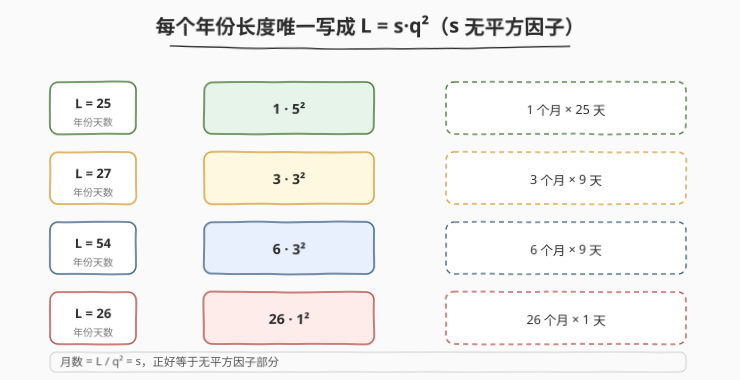
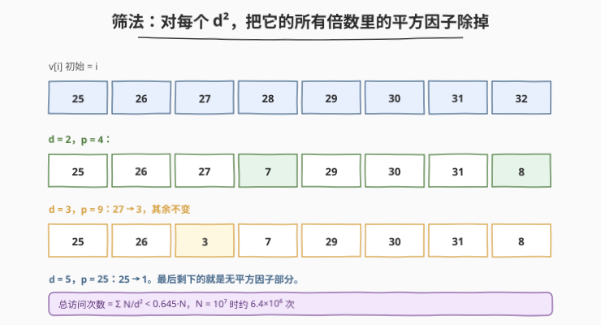

# Codeforces 172D 伯兰的日历改革 题解

## 1. 题目概述

- **题目链接**：https://codeforces.com/problemset/problem/172/D
- **比赛来源**：Croc Champ 2012 - Qualification Round · Problem D（UTC 2012-04-03）
- **难度**：1500
- **标签**：数论、筛法、平方因子
- **评测类型**：普通
- **限制**：时间 2 s / 内存 256 MB

**题意**：改革后的日历里，第 $k$ 年的天数是 $L=a+k-1$（$k=1,\dots,n$），即年份长度从 $a$ 逐年递增到 $a+n-1$。每个月天数必须是某个整数的平方，且同一年内每月天数相同、年天数必须被月天数整除。为了省纸，每年要选**最大的**满足条件的月天数。

对每个 $L$，月天数就是 $L$ 的**最大平方因子** $q^2$（$q$ 尽量大、$q^2\mid L$），于是这一年的月数（也就是要印的日历张数）为 $L/q^2$。求 $n$ 年一共要印多少张：

$$p=\sum_{L=a}^{a+n-1}\frac{L}{q(L)^2},\qquad q(L)^2=\max\{d^2: d^2\mid L\}.$$

**约束**：

- $1\le a,n\le 10^7$，且 $a+n-1\le 10^7$。年份上限 $N=a+n-1\le 10^7$ 是关键：它允许 $O(N)$ 或 $O(N\log\log N)$ 的筛法，但排除了对每个 $L$ 做 $O(\sqrt L)$ 试除（$10^7\times 3163$ 太大），也排除了 $O(N\sqrt N)$ 的任何写法。
- 题面额外提醒"程序在最大测试上不要跑超过四秒"，而实际时限是 2 s，所以要留足常数余量：目标是把 $10^7$ 个数的处理压到 $10^7$ 量级的操作。
- 答案上界：$\sum_{L\le10^7}L\approx5\times10^{13}$，超过 `int`，必须 `long long`。
- 题面原文有一条古老提示："不要用 `%lld` 读写 64 位整数"——那是 2012 年 Windows 评测机的遗留问题。现代 Codeforces 用 Linux + `%I64d` 已废弃，用 `scanf("%lld")` / `cout` 都可以；本文代码用 `printf("%lld")`，在现行评测机上没有问题。

## 2. 示例与观察

官方样例 1（输入 / 输出原样）：

```text
输入：
25 3

输出：
30
```

三年长度分别是 25、26、27：

| $L$ | 分解 | 最大平方因子 $q^2$ | 月天数 | 月数 $=L/q^2$ |
|-----|------|--------------------|--------|----------------|
| 25 | $5^2$ | 25 | 25 | 1 |
| 26 | $2\cdot13$ | 1 | 1 | 26 |
| 27 | $3^3=3\cdot3^2$ | 9 | 9 | 3 |

合计 $1+26+3=30$，与输出一致。注意 27：$9\mid 27$ 比 $1\mid27$ 更省纸，所以月天数是 9 而不是 1；月数 3。

官方样例 2（输入 / 输出原样）：

```text
输入：
50 5

输出：
125
```

| $L$ | $50$ | $51$ | $52$ | $53$ | $54$ |
|-----|------|------|------|------|------|
| 分解 | $2\cdot5^2$ | $3\cdot17$ | $2^2\cdot13$ | 素数 | $2\cdot3^3$ |
| 月数 | 2 | 51 | 13 | 53 | 6 |

合计 $2+51+13+53+6=125$。

**观察**：把 $L$ 写成 $L=s\cdot q^2$，其中 $s$ 无平方因子（squarefree，即每个素因子的指数都是 0 或 1）。这样的分解是唯一的：$q^2$ 就是最大平方因子，$s=L/q^2$ 就是"无平方因子部分"。于是

$$\text{第 }L\text{ 年的月数}=s(L),\qquad p=\sum_{L=a}^{a+n-1}s(L).$$

问题变成"求一段区间内所有数的无平方因子部分之和"。



## 3. 解题思路

### 3.1 朴素做法与瓶颈

最直接的做法是对每个 $L$ 试除到 $\sqrt L$ 求最大平方因子：$10^7$ 个数、每个最多 $\sqrt{10^7}\approx3163$ 次除法，总量 $3\times10^{10}$，2 s 内不可能。即便只试除到 $\sqrt L$ 中的平方数（$d^2\le L$，约 $10^7/2$ 个候选）也还是 $10^{10}$ 量级。

换个方向：答案是**每个数独立贡献**的和，而"去掉平方因子"这件事对所有数可以**同步**做——这就是筛法。

### 3.2 核心观察：把 $d^2$ 的倍数一起除



准备数组 $v[0..N]$，初始 $v[i]=i$。对 $d=2,3,\dots,\lfloor\sqrt N\rfloor$，令 $p=d^2$，把所有 $p$ 的倍数 $j=p,2p,3p,\dots$ 拿出来，反复执行

$$\text{while } p\mid v[j]:\quad v[j]\leftarrow v[j]/p .$$

全部做完后 $v[i]$ 就是 $i$ 的无平方因子部分 $s(i)$。

为什么这是对的？把 $i$ 写成 $i=\prod \ell^{e_\ell}$。对每个素数 $\ell$，当 $d$ 取到 $\ell$ 时，$p=\ell^2$ 会整除 $i$，内层 `while` 每次把 $v$ 里的 $\ell$ 指数减 2，直到剩下 $e_\ell\bmod 2\in\{0,1\}$。因为 $d$ 从小到大枚举，$\ell^2$ 那一轮一定会被执行；之后即使 $v[j]$ 变化，也不会把已经处理好的指数再变回去（只是继续除其它平方数）。最终每个素因子的指数都变成 0 或 1，且 $v[i]$ 始终整除 $i$、$i/v[i]$ 始终是完全平方数，所以 $v[i]$ 就是唯一的无平方因子部分。

**复杂度**：$d$ 从 2 到 $\sqrt N$，第 $d$ 轮访问 $\lfloor N/d^2\rfloor$ 个下标，于是总访问次数为

$$\sum_{d=2}^{\sqrt N}\frac{N}{d^2}<N\left(\frac{\pi^2}{6}-1\right)\approx 0.645N .$$

$N=10^7$ 时约 $6.4\times10^6$ 次，每轮多数情况只做一次取模就退出内层 `while`。这就是 $O(N)$ 级别的做法。

### 3.3 算法流程

1. 读入 $a,n$，令 $N=a+n-1$。
2. 分配 `v[0..N]`，`v[i] ← i`。
3. 对 $d=2,3,\dots$ 且 $d^2\le N$：令 $p=d^2$；对 $j=p,2p,3p,\dots\le N$：`while (v[j] % p == 0) v[j] /= p;`。
4. 求和 `ans ← Σ_{i=a}^{N} v[i]`，输出。

也可以不建 $0..N$ 全表、只建 $[a,N]$ 的偏移表，但 $N\le10^7$ 时全表只要 40 MB，直接开更省事。

### 3.4 样例走查：$a=25,n=3$

$N=27$，数组初值 $v[i]=i$。

| 轮次 $d$ | $p=d^2$ | 受影响的 $j\in[25,27]$ | 操作后 $v[j]$ |
|----------|---------|-------------------------|----------------|
| $d=2$ | 4 | 无（25..27 都不是 4 的倍数） | 25, 26, 27 |
| $d=3$ | 9 | 27 | $27/9=3$ |
| $d=4$ | 16 | 无 | — |
| $d=5$ | 25 | 25 | $25/25=1$ |
| $d\ge6$ | $d^2>27$ | 停 | — |

最终 $v[25..27]=(1,26,3)$，和 $=30$，与官方输出一致。

再走一遍样例 2 的 $L=54$：$d=3$ 时 $9\mid54$，$v[54]=54/9=6$；此后 $4\nmid6$、$25\nmid6$…… 得 $s(54)=6$，正是上表的"月数 6"。

## 4. 正确性证明

**引理 1（分解唯一）**：每个正整数 $L$ 可唯一写成 $L=s\cdot q^2$，其中 $s$ 无平方因子、$q\ge1$。

**证明**：把 $L=\prod\ell^{e_\ell}$，令 $q=\prod \ell^{\lfloor e_\ell/2\rfloor}$、$s=\prod\ell^{e_\ell\bmod 2}$，则 $s q^2=L$ 且 $s$ 的每个指数都是 0 或 1，即无平方因子。唯一性：若 $L=s_1q_1^2=s_2q_2^2$，对每个素数比较指数得 $e_\ell = v_\ell(s_1)+2v_\ell(q_1)=v_\ell(s_2)+2v_\ell(q_2)$，由于 $v_\ell(s_i)\in\{0,1\}$，两者模 2 相等故 $v_\ell(s_1)=v_\ell(s_2)$，进而 $v_\ell(q_1)=v_\ell(q_2)$。∎

**引理 2（筛法不变式）**：处理完 $d=2,\dots,D$ 之后，对任意 $i$，$v[i]=s(i)\cdot r_i^2$，其中 $r_i$ 的所有素因子都 $>D$。特别地，$D\ge\sqrt N$ 时 $r_i=1$。

**证明**：对 $D$ 归纳。$D=1$ 时 $v[i]=i=s(i)\cdot q_i^2$，$r_i=q_i$ 成立。设 $D-1$ 时成立，处理 $d=D$ 时只把 $v[j]$ 反复除以 $D^2$（当 $D^2\mid v[j]$）。设处理前 $v[j]=s(j)r^2$，其中 $r$ 的素因子 $>D-1$。若 $D$ 是素数，$D^2\mid v[j]$ 等价于 $D^2\mid r^2$ 等价于 $D\mid r$，每除一次 $D^2$ 相当于把 $r$ 里的 $D$ 指数减 1，直到 $D\nmid r$，此时 $r$ 的素因子都 $>D$；若 $D$ 不是素数，$D^2$ 的每个素因子都 $\le D-1$，而 $r$ 不含这些素因子，故 $D^2\nmid v[j]$，`while` 一次都不执行，不变式自动保持。∎

**引理 3**：$D=\lfloor\sqrt N\rfloor$ 时，对一切 $i\le N$ 有 $r_i=1$，即 $v[i]=s(i)$。

**证明**：由引理 2，$r_i$ 的素因子都 $>\sqrt N$，故 $r_i=1$ 或 $r_i^2>N\ge i=v[i]\ge r_i^2$，后者矛盾（$v[i]\ge r_i^2$ 且 $v[i]=s(i)r_i^2\le i\le N$，若 $r_i>1$ 则 $r_i^2>N\ge i\ge r_i^2$，矛盾）。所以 $r_i=1$。∎

**引理 4（最大平方因子）**：$q(L)^2$ 是 $L$ 的最大平方因子，当且仅当 $L=s(L)\cdot q(L)^2$ 且 $s$ 无平方因子。

**证明**：设 $d^2\mid L$，由引理 1 的唯一性，$d\mid q$ 当且仅当 $d^2\mid q^2$；故 $q^2$ 是最大的平方因子。反之若 $L=t\cdot e^2$ 且 $t$ 无平方因子、$e^2$ 最大，则 $t$ 的每个素因子指数都是 0/1，由唯一性 $t=s(L)$、$e=q(L)$。∎

**定理**：算法输出的 $p$ 等于题面要求的日历总张数。

**证明**：由引理 4，第 $L$ 年的月天数是 $q(L)^2$、月数是 $L/q(L)^2=s(L)$；由引理 3，算法求和时 `v[L]` 恰好是 $s(L)$，故求和结果就是 $\sum_{L=a}^{a+n-1}s(L)$，即总张数。∎

## 5. 复杂度分析

- **时间**：筛法部分 $O\!\left(\sum_{d\le\sqrt N}N/d^2\right)=O(N)$，常数约 $0.645$，即 $N=10^7$ 时约 $6.4\times10^6$ 次下标访问（绝大多数只做一次取模）；求和部分 $O(N)$。总计约 $1.6\times10^7$ 次基本操作。
- **空间**：$O(N)$，一个 `vector<int>` 装 $10^7+1$ 个 32 位整数，约 40 MB，远低于 256 MB。
- **数值范围**：答案最大约 $5\times10^{13}$，`long long`（$9.2\times10^{18}$）绰绰有余；`int` 会在求和处溢出。$p=d^2$ 与 $j$ 用 `long long` 计算，避免 $d^2$ 在 $d$ 接近 $10^5$ 时溢出（虽然本题 $d\le3163$，写成 `long long` 更稳）。
- **与时限的关系**：实测 $N=10^7$ 时 C++ 端到端 28 ms（含读入与求和），相对 2 s 余量 70 倍以上；Python 版用等价公式，25 ms。

## 6. 参考代码

### C++17

```cpp
#include <bits/stdc++.h>
using namespace std;

int main() {
    int a, n;
    if (scanf("%d %d", &a, &n) != 2) return 0;
    int N = a + n - 1;                 // 最大的年份长度

    vector<int> v(N + 1);
    for (int i = 0; i <= N; ++i) v[i] = i;   // 先放原值

    for (long long d = 2; d * d <= N; ++d) {
        long long p = d * d;                  // 只处理完全平方数
        for (long long j = p; j <= N; j += p) {
            while (v[j] % p == 0) v[j] /= p;  // 反复除掉 d^2
        }
    }

    long long ans = 0;
    for (int i = a; i <= N; ++i) ans += v[i]; // 剩下的就是无平方因子部分
    printf("%lld\n", ans);
    return 0;
}
```

### Python3

```python
import sys
from math import isqrt


def main() -> None:
    data = sys.stdin.buffer.read().split()
    a, n = int(data[0]), int(data[1])
    b = a + n - 1

    lim = isqrt(b)                       # 只需要到 sqrt(b) 的 Möbius 值
    mu = [0] * (lim + 1)
    mu[1] = 1
    primes = []
    comp = bytearray(lim + 1)
    for i in range(2, lim + 1):
        if not comp[i]:
            primes.append(i)
            mu[i] = -1
        for p in primes:
            if i * p > lim:
                break
            comp[i * p] = 1
            if i % p == 0:
                mu[i * p] = 0
                break
            mu[i * p] = -mu[i]

    cache = {}

    def sqfree_sum(y):                   # 所有 <= y 的无平方因子数之和
        if y <= 0:
            return 0
        if y in cache:
            return cache[y]
        total = 0
        for d in range(1, isqrt(y) + 1):
            m = mu[d]
            if m:
                t = y // (d * d)
                total += m * d * d * (t * (t + 1) // 2)
        cache[y] = total
        return total

    def prefix(x):                       # sum_{L<=x} 无平方因子部分(L)
        if x <= 0:
            return 0
        return sum(sqfree_sum(x // (q * q)) for q in range(1, isqrt(x) + 1))

    sys.stdout.write(str(prefix(b) - prefix(a - 1)) + "\n")


main()
```

两版算的是同一个量，但走了两条路：C++ 用 $O(N)$ 的筛法；Python 用下面的等价公式，把 $10^7$ 的循环压成 $3\times10^3$ 量级——

$$\sum_{L\le x}s(L)=\sum_{q\ge1}S\!\left(\left\lfloor \frac{x}{q^2}\right\rfloor\right),\qquad S(y)=\sum_{d\ge1}\mu(d)\,d^2\,\frac{t(t+1)}{2},\ \ t=\left\lfloor \frac{y}{d^2}\right\rfloor .$$

（推导：$L=s q^2$ 唯一，故 $\sum_{L\le x}s(L)=\sum_{q\ge1}\sum_{s\le x/q^2,\ s\ \text{无平方}}\!\!s$；而 $\sum_{s\le y,\ s\text{ 无平方}}s=\sum_{d}\mu(d)\sum_{d^2\mid s\le y}s$，内层是 $d^2\cdot(1+2+\dots+\lfloor y/d^2\rfloor)$。）之所以 Python 不用筛法，是因为 CPython 里长度为 $10^7$ 的 `list` 要 300 MB 以上（每个整数是独立对象），会超内存；而这条公式只需要 $O(\sqrt N)$ 的空间。

## 7. 边界情况与易错点

1. **答案超过 32 位**：$p$ 可达 $5\times10^{13}$，`int` 溢出。求和变量必须是 `long long`；`ans += v[i]` 里 `v[i]` 是 `int`，会自动提升，但 `ans` 本身不能是 `int`。
2. **$d^2$ 的溢出**：写 `for (long long d = 2; d * d <= N; ++d)`，若把 `d` 定义成 `int` 且 $N$ 接近 $2^{31}$ 会溢出；本题 $N\le10^7$ 时 `d\le3163` 尚安全，但用 `long long` 是好习惯。
3. **`while` 而不是 `if`**：$2^6=64$ 要除两次 4（$64\to16\to4$），$3^5=243$ 要除两次 9。写成 `if` 会得到 $4$ 或 $27$ 这种仍含平方因子的结果。
4. **$N=1$ 或 $N<a$ 的退化**：$a=n=1$ 时 $N=1$，`d*d<=N` 不成立，直接求和 $v[1]=1$，输出 1。数组必须开到 $N+1$，否则 `v[1]` 越界。
5. **下标从 0 还是 1 开始**：$0$ 也放在数组里（$v[0]=0$）不影响求和，但若从 $a=1$ 求和而数组只开到 $N$，注意 `vector<int> v(N+1)` 的边界；本题求和区间是 $[a,N]$，闭区间。
6. **$a$ 很大但 $n=1$**：此时 $N=a$ 可能达到 $10^7$，数组照样要开到 $10^7$，不能因为"只有一个年份"就改成试除（那样虽然可行但没必要，且容易在实现里写错边界）。
7. **平方因子为 1 的情形**：$L$ 无平方因子时月数就是 $L$ 本身（如 $L=26$ 输出 26），不要把"最大平方因子"误当成"最大素因子"。

## 8. 验证记录

- **编译环境与命令**：`Apple clang 21.0.0` + `codeforces/tools/include/bits/stdc++.h` 兼容头（`clang++ -std=c++17 -O2`）；Python 3.9.6。`python3 codeforces/tools/verify_solution.py codeforces/contests/0101-0203/172/D_伯兰的日历改革.md` 输出 C++ 2/2、Python 2/2。
- **官方样例**：2 / 2 通过（分别覆盖"含平方因子年份"与"五种不同形态混排"）。
- **独立暴力对拍**：暴力程序对区间里每个 $L$ 直接**试除分解**：从 $d=2$ 到 $\lfloor\sqrt L\rfloor$ 统计每个素因子的指数，把偶数次的部分乘出 $q^2$，得到 $L/q^2$ 再求和——完全不经过筛法。随机取 $a\in[1,3000]$、$n\in[1,2000]$（含 $n=1$、$a$ 本身是完全平方、区间跨越 $10^3$ 等情形）共 **260 组**，与正文 C++ 逐 token 比对，全部一致。
- **第二份独立实现交叉验证**：Python 版走 Möbius 反演公式（与筛法完全不同的数学路径），在 $a\le3000$ 的 200 组随机区间上与 C++ 版逐一相同；三组大范围（$a=1,n=10^7$；$a=10^7,n=1$；$a=5\times10^6,n=5\times10^6$）两者输出也完全一致（如 $a=1,n=10^7$ 时均为 $32898872196712$），这足以支撑"结果正确"而不只是"两版都没崩"。
- **最大约束性能**：$a=1,n=10^7$，C++ 端到端 27 ms（筛法约 $6.4\times10^6$ 次访问 + $10^7$ 次求和），峰值内存 41 MB；Python（Möbius 版）23 ms、内存 < 2 MB。
- **图片校验**：两张 SVG（`cf172d_factor.svg`、`cf172d_sieve.svg`）通过 `xml.etree.ElementTree.parse`，文本包围盒均在 `viewBox` 内。
- **复核状态**：verified（样例、260 组试除对拍、200 组双实现交叉验证、最大规模性能、图片五项实跑通过）。

## 相关题目与扩展

- [Codeforces 172B 伪随机序列周期](https://codeforces.com/problemset/problem/172/B)：同场 B 题，数论味道的实现题，状态只有 $m$ 种。
- [Codeforces 172A 城市电话区号](https://codeforces.com/problemset/problem/172/A)：同场 A 题，字符串版的"一遍扫描"。
- [LeetCode 204. 计数质数](https://leetcode.cn/problems/count-primes/)：最基础的筛法，可以对照本题"按 $d^2$ 筛倍数"的写法。
- [Codeforces 17A Noldbach problem](https://codeforces.com/problemset/problem/17/A)：同样是"预处理到上限再查询"的套路，规模更小。

**延伸思考**：

1. **如果要求输出每一年的月数**：筛法直接给出 $v[L]$，$O(N)$ 输出即可；Möbius 公式则不适合（它只给区间和），此时应当选筛法。
2. **如果 $N$ 涨到 $10^9$**：$O(N)$ 的数组放不下。此时可以用"枚举 $q$，把 $s\cdot q^2$ 的贡献累加"的思路：$\sum_{L\le x}s(L)=\sum_{q\le\sqrt x}\sum_{s\le x/q^2,\ s\text{ 无平方}}s$，再配合 $S(y)$ 的整除分块，可以做到 $O(x^{2/3})$ 甚至 $O(x^{1/2}\log x)$。
3. **如果月天数要求是"立方数"而不是"平方数"**：完全同样的筛法，把 $d^2$ 换成 $d^3$，复杂度变成 $\sum N/d^3=O(N)$ 且常数更小（约 $0.2N$）。这说明本题的核心不是"平方"，而是"某个幂次整除"。
4. **如果 $a+n-1$ 超过 $10^7$ 但 $n$ 很小**：筛法的 $O(N)$ 取决于上限而不是区间长度，这时应当改回逐个试除（每个数 $O(\sqrt L)$），$n\sqrt{\max L}$ 反而更快——算法选择要跟着"区间长度 vs 上限"的比例走。
