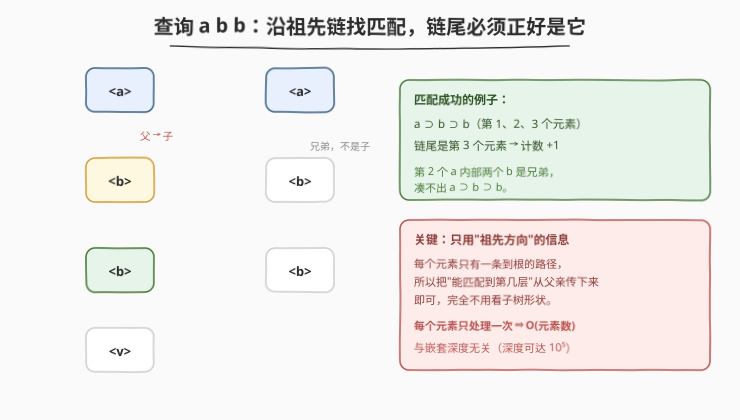
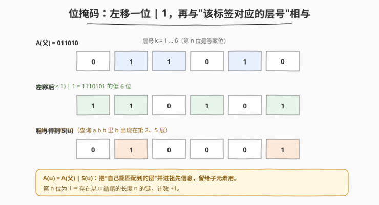

# Codeforces 172E 迷你标记语言渲染 题解

## 1. 题目概述

- **题目链接**：https://codeforces.com/problemset/problem/172/E
- **比赛来源**：Croc Champ 2012 - Qualification Round · Problem E（UTC 2012-04-03）
- **难度**：2200
- **标签**：DFS 与树、表达式解析、位运算
- **评测类型**：普通
- **限制**：时间 4 s / 内存 256 MB

**题意**：给定一份 BHTML 文档（形如 `<tag>` 开标签、`</tag>` 闭标签、`<tag/>` 自闭合标签的序列，整体构成合法的括号结构）和 $m$ 条形如 $x_1\ x_2\ \dots\ x_n$ 的 BCSS 查询。一个**元素**是"一对匹配的开闭标签"或一个自闭合标签；若一个元素的标签夹在另一个元素的标签之间，则前者嵌套在后者之内。

对每条查询，统计满足下面条件的元素 $t$ 的个数：

- 存在一条嵌套链：标签为 $x_1$ 的元素 $\supset$ 标签为 $x_2$ 的元素 $\supset\cdots\supset$ 标签为 $x_n$ 的元素，且链的最后一个元素就是 $t$（即 $t$ 的标签是 $x_n$）。

**约束**：

- 文档长度 $\le10^6$ 字符，标签名是小写字母串、长度 $1\sim10$。元素个数 $E$ 最多约 $10^6/7\approx1.4\times10^5$（`<a>...</a>` 每组 7 字符）。
- $m\le200$，每条查询 $n\le200$。
- 于是"对每条查询遍历所有元素、每个元素再沿祖先链找匹配"的最坏复杂度是 $O(m\cdot E\cdot \text{深度})$，深度可达 $10^5$，总量 $10^{12}$，绝无可能。目标是把每条查询压到 $O(E\cdot n/64)$：$200\times1.4\times10^5\times4\approx10^8$ 次字操作，4 s 内可过。
- 标签名会重复，且**不同位置可以同名**；查询里的标签也可能在文档中完全不存在（此时答案为 0）。
- 自闭合标签 `<tag/>` 与 `<tag></tag>` 完全等价（题面明确说明），解析时可以统一处理。

## 2. 示例与观察

官方样例 1（输入 / 输出原样）：

```text
输入：
<a><b><b></b></b></a><a><b></b><b><v/></b></a><b></b>
4
a
a b b
a b
b a

输出：
2
1
4
0
```

文档的结构是（缩进表示嵌套）：

```text
a                      ← 元素 1
  b                    ← 2
    b                  ← 3
a                      ← 4
  b                    ← 5
  b                    ← 6
    v (自闭合)          ← 7
b (自闭合)              ← 8
```

四条查询依次是：

- `a`：文档里有 2 个 `a` 元素 → 2；
- `a b b`：只有第一个 `a` 内部存在 `a ⊃ b ⊃ b` 这样的两级嵌套（第二个 `a` 里两个 `b` 是兄弟）→ 1；
- `a b`：所有"有 `a` 祖先的 `b`"——第一个 `a` 下有 2 个，第二个 `a` 下有 2 个，共 4；
- `b a`：没有任何 `a` 嵌套在 `b` 里 → 0。

官方样例 2（输入 / 输出原样）：

```text
输入：
<b><aa/></b><aa><b/><b/></aa>
5
aa b
b
aa
b aa
a

输出：
2
3
2
1
0
```

文档：`b`（内含自闭合 `aa`）、`aa`（内含两个自闭合 `b`）。注意自闭合标签也算元素、也能被嵌套，所以 `aa b` 的答案是 2（`aa` 里的两个 `b`），`b` 的答案是 3（最外层那个 `b` 加上两个自闭合 `b`），`b aa` 的答案是 1（`b` 里那个自闭合 `aa`），而 `a` 这个标签在文档里根本不存在，答案是 0。

**观察**：查询要的是"沿**祖先方向**的链"，与子树形状无关；而每个元素只有一条到根的路径。因此对每个元素，只需要知道"在这条路径上，查询的前缀能匹配到第几层"。这是一维字符串匹配（KMP 那类思路）在树上的版本，只不过这里要的不是"最长匹配"，而是"所有可达的匹配长度"。



## 3. 解题思路

### 3.1 朴素做法与瓶颈

对每条查询，枚举每个元素 $u$，再沿着 $u$ 的父指针往上走、贪心地匹配 $x_{n-1},x_{n-2},\dots,x_1$。单次判定 $O(\text{深度})$，最坏深度 $10^5$，元素 $1.4\times10^5$，一条查询就是 $1.4\times10^{10}$。

瓶颈在于"每个元素都要重新爬一遍祖先链"，而祖先链在同一棵子树里被反复爬。我们希望每个元素只做 $O(1)$（或 $O(n/64)$）的工作，把"祖先上能匹配到哪些长度"这个信息**从父亲传下来**。

### 3.2 核心观察：把"可达长度"打包成位掩码



对固定的一条查询 $x_1\dots x_n$，定义

- $S_u$：所有 $k\in[1,n]$，使得"存在一条长度为 $k$ 的链 $x_1\supset\cdots\supset x_k$，且链尾正是元素 $u$"；
- $A_u=\bigcup_{v\ \text{是}\ u\ \text{的真祖先}} S_v$。

那么对任意元素 $u$：

$$S_u=\{k:\ \mathrm{tag}(u)=x_k\ \text{且}\ (k=1\ \text{或}\ k-1\in A_u)\}.$$

把 $S_u,A_u$ 都编码成长度 $n$ 的二进制掩码（第 $k$ 位对应长度 $k$，这里用 0 起下标存第 $k-1$ 位），并令 $K[t]$ 为"所有满足 $x_k=t$ 的 $k$"的掩码，那么

$$\text{mask}(S_u)=K[\mathrm{tag}(u)]\ \&\ \bigl((\text{mask}(A_u)\ll 1)\ |\ 1\bigr),\qquad \text{mask}(A_u)=\text{mask}(A_{\mathrm{par}(u)})\ |\ \text{mask}(S_u).$$

那个 `| 1` 表示"长度 1 的链可以从这里开始"；左移一位表示"祖先上匹配了 $k-1$ 层，接上自己就成了 $k$ 层"。

按下标从 1 到 $n$ 的位序，答案就是"$\text{mask}(S_u)$ 的第 $n$ 位为 1"的元素个数。

$n\le200$，所以掩码只有 4 个 64 位字；每个元素一次"左移 + 或 + 与"，$O(n/64)=O(1)$。**关键在于它完全不看深度**：无论文档嵌套多深，每个元素只被处理一次。

### 3.3 算法流程

1. **解析文档**：用一个栈扫描字符串。遇到 `<`：
   - 后一个字符是 `/`：闭标签，弹栈；
   - 标签体以 `/` 结尾：自闭合，新建元素（父为当前栈顶），**不**入栈；
   - 否则：开标签，新建元素（父为当前栈顶），入栈。
   元素按创建顺序编号，正好是树的**先序**，所以父编号一定小于子编号，可以按编号顺序一遍扫完，不必真的建邻接表。
2. **标签名编号**：把每个标签名映射成一个小整数（$1\sim10$ 个小写字母可以压进一个 64 位整数做键），这样查询里的标签可以直接查表；文档里不存在的标签单独占一个新编号、且永远不会和任何元素相等。
3. **逐条查询**：先由查询串构造 $K[\cdot]$（只对文档里出现过的标签建条目），然后按元素编号从小到大扫：用父元素的 $A$ 掩码算出自己的 $S$ 掩码与 $A$ 掩码，若第 $n$ 位为 1 则答案加一。
4. 输出每条查询的计数。

注意父元素一定先被处理：因为先序遍历中父编号小于子编号，这一点让"按编号扫描"就等价于按拓扑序 DP。

### 3.4 样例走查：样例 1 的 `a b b`

查询 $x=(a,b,b)$，$n=3$，于是 $K[a]=\text{bit}_0$、$K[b]=\text{bit}_1|\text{bit}_2$，答案位是 $\text{bit}_2$。

| 元素 | 标签 | 父 | $A_{\text{par}}$ | 左移+1 | $\&\,K$ 后 $S$ | $A_u$ |
|------|------|----|------------------|--------|----------------|--------|
| 1 | a | — | 0 | 1 | 1（$k=1$） | 1 |
| 2 | b | 1 | 1 | 3 | 2（$k=2$） | 3 |
| 3 | b | 2 | 3 | 7 | 6（$k=2,3$，**计 1**） | 7 |
| 4 | a | — | 0 | 1 | 1 | 1 |
| 5 | b | 4 | 1 | 3 | 2 | 3 |
| 6 | b | 4 | 1 | 3 | 2 | 3 |
| 7 | v | 6 | 3 | 7 | 0（$K[v]=0$） | 3 |
| 8 | b | — | 0 | 1 | 0 | 0 |

只有元素 3 的 $S$ 含第 3 位，答案 1，与官方一致。

再走 `a b`（$n=2$，答案位 $\text{bit}_1$）：元素 2、3、5、6 的 $S$ 都含第 2 位（它们的父链上都有 `a`），元素 8 的父为空、$S=0$。共 4，与官方一致。

## 4. 正确性证明

固定查询 $x_1\dots x_n$ 与文档的元素树。记 $\mathrm{anc}(u)$ 为 $u$ 的真祖先集合。

**引理 1（$S_u$ 的递推）**：$k\in S_u$ 当且仅当 $\mathrm{tag}(u)=x_k$，且 $k=1$ 或存在 $v\in\mathrm{anc}(u)$ 使 $k-1\in S_v$。

**证明**：若 $k\in S_u$，则存在链 $x_1\supset\cdots\supset x_k=u$，于是 $\mathrm{tag}(u)=x_k$；当 $k\ge2$ 时链上倒数第二个元素 $v$ 满足 $x_1\supset\cdots\supset x_{k-1}=v$ 且 $v$ 是 $u$ 的祖先，故 $k-1\in S_v$。反之若 $\mathrm{tag}(u)=x_k$ 且存在祖先 $v$ 使 $k-1\in S_v$，把"以 $v$ 结尾的长度 $k-1$ 的链"接上 $u$（$u$ 嵌套在 $v$ 内）即得长度 $k$ 的链。∎

**引理 2（掩码运算等价）**：设 $\text{mask}(A)$ 的第 $k-1$ 位表示 $k\in A$。则算法算出的 $S_u$ 掩码恰为 $\{k:\mathrm{tag}(u)=x_k,\ k=1\ \text{或}\ k-1\in A_u\}$。

**证明**：$(\text{mask}(A_u)\ll1)|1$ 的第 $k-1$ 位为 1 当且仅当 $k=1$，或 $\text{mask}(A_u)$ 的第 $k-2$ 位为 1，即 $k-1\in A_u$。与 $K[\mathrm{tag}(u)]$（第 $k-1$ 位为 1 当且仅当 $x_k=\mathrm{tag}(u)$）按位与，正好留下引理 1 中的 $k$。∎

**引理 3（处理顺序合法）**：元素的创建顺序是先序，故父元素的编号小于子元素；按编号从小到大扫描时，计算 $S_u$ 所需的 $A_{\mathrm{par}(u)}$ 已经算好。

**证明**：解析时元素在其开标签处创建，而子元素的开标签必在父元素的开标签之后、父元素的闭标签之前，故子编号更大。$A_{\mathrm{par}(u)}$ 只依赖 $\mathrm{par}(u)$ 及其祖先，全部编号更小。∎

**引理 4（$A_u$ 的定义一致）**：算法中 $A_u=A_{\mathrm{par}(u)}\cup S_u$ 且 $A_{\text{根}}=S_{\text{根}}$，故 $A_u=\bigcup_{v\in\mathrm{anc}(u)\cup\{u\}}S_v$。

**证明**：对深度归纳即得（根没有祖先，$A=S$；其余情况由定义直接给出）。∎

**定理**：算法对每条查询输出的计数等于满足题意的元素个数。

**证明**：由引理 2、3、4，算法正确算出每个元素的 $S_u$；题面要求"存在以 $u$ 结尾、长度恰为 $n$ 的链"，正是 $n\in S_u$，即掩码第 $n-1$ 位为 1。算法统计的正是这类 $u$ 的个数。∎

## 5. 复杂度分析

- **时间**：解析 $O(L)$（$L\le10^6$）；每条查询建 $K$ 为 $O(n)$，扫所有元素为 $O(E\cdot\lceil n/64\rceil)$。总计 $O(L+m\cdot E\cdot n/64)$，最坏约 $200\times1.4\times10^5\times4\approx1.1\times10^8$ 次字操作。
- **空间**：文档 $O(L)$ 字节；元素表 $O(E)$；掩码 $O(E\cdot n/64)$ 个 64 位字，最坏 $1.4\times10^5\times4\times8\approx4.5$ MB。总计 < 20 MB，远低于 256 MB。
- **与时限的关系**：$L=10^6$（$1.4\times10^5$ 个元素）、$m=200$、每条查询 $n=200$ 的极限数据实测 C++ 端到端 146 ms，4 s 余量约 27 倍。Python 版是同一算法的直译，CPython 3.9 在同一数据上约 6.8 s，**超过 4 s**，建议提交 C++ 或交给 PyPy3。
- **常数说明**：解析用 `char` 数组 + 手写扫描，避免每字符构造 `std::string`；标签名用 64 位整型编码做哈希键，避免长字符串比较。

## 6. 参考代码

### C++17

```cpp
#include <bits/stdc++.h>
using namespace std;

static const int W = 4;                 // n <= 200 → 4 个 64 位字

int main() {
    static char doc[1000005];
    if (scanf("%1000000s", doc) != 1) return 0;
    int m;
    if (scanf("%d", &m) != 1) return 0;

    // ---------- 解析：用栈建树（只存父指针 + 标签编号） ----------
    unordered_map<unsigned long long, int> nameId;
    vector<int> par, tag;
    vector<int> stk;

    auto id_of = [&](const char *p, int len) -> int {
        unsigned long long h = (unsigned long long)len;
        for (int i = 0; i < len; ++i) h = h * 27 + (unsigned long long)(p[i] - 'a' + 1);
        auto it = nameId.find(h);
        if (it != nameId.end()) return it->second;
        int id = (int)nameId.size();
        nameId.emplace(h, id);
        return id;
    };

    int L = (int)strlen(doc);
    for (int i = 0; i < L; ) {
        if (doc[i] != '<') { ++i; continue; }
        int j = i + 1;
        while (doc[j] != '>') ++j;
        if (doc[i + 1] == '/') {                       // 闭合标签：弹栈
            if (!stk.empty()) stk.pop_back();
        } else {
            int len = j - i - 1;
            bool selfClose = (len > 0 && doc[j - 1] == '/');
            if (selfClose) --len;                      // 自闭合：等价于空元素
            int t = id_of(doc + i + 1, len);
            int id = (int)par.size();
            par.push_back(stk.empty() ? -1 : stk.back());
            tag.push_back(t);
            if (!selfClose) stk.push_back(id);
        }
        i = j + 1;
    }
    int E = (int)par.size();
    int T = (int)nameId.size();

    vector<int> mark(T, -1);                           // mark[t] = 最近一次建 K 的查询号
    vector<array<unsigned long long, W>> K(T);
    vector<unsigned long long> acc((size_t)E * W, 0);  // A_u 的掩码

    string line;
    getchar();                                         // 吃掉 m 后面的换行
    for (int qi = 0; qi < m; ++qi) {
        getline(cin, line);
        while (line.empty() && !cin.eof()) getline(cin, line);
        if (!line.empty() && line.back() == '\r') line.pop_back();

        vector<int> xs;                                // 查询里的标签编号
        size_t p = 0;
        while (p < line.size()) {
            while (p < line.size() && line[p] == ' ') ++p;
            size_t q = p;
            while (q < line.size() && line[q] != ' ') ++q;
            if (q > p) xs.push_back(id_of(line.data() + p, (int)(q - p)));
            p = q;
        }
        int n = (int)xs.size();
        for (int k = 1; k <= n; ++k) {
            int t = xs[k - 1];
            if (t >= T) continue;                      // 文档里不存在的标签，不可能匹配
            if (mark[t] != qi) { mark[t] = qi; K[t].fill(0ULL); }
            K[t][(k - 1) >> 6] |= 1ULL << ((k - 1) & 63);
        }

        long long ans = 0;
        for (int u = 0; u < E; ++u) {
            unsigned long long *au = &acc[(size_t)u * W];
            const unsigned long long *ap = (par[u] < 0) ? nullptr : &acc[(size_t)par[u] * W];
            int t = tag[u];
            if (mark[t] != qi) {                       // 标签不在查询里：只继承祖先的掩码
                for (int w = 0; w < W; ++w) au[w] = ap ? ap[w] : 0ULL;
                continue;
            }
            unsigned long long mask[W];
            unsigned long long carry = 1ULL;           // | 1：长度 1 的链可以在这里开始
            for (int w = 0; w < W; ++w) {
                unsigned long long sw = ap ? ap[w] : 0ULL;
                unsigned long long shifted = (sw << 1) | carry;
                carry = sw >> 63;                      // 跨字进位
                mask[w] = shifted & K[t][w];
            }
            for (int w = 0; w < W; ++w) au[w] = (ap ? ap[w] : 0ULL) | mask[w];
            if ((mask[(n - 1) >> 6] >> ((n - 1) & 63)) & 1ULL) ++ans;
        }
        printf("%lld\n", ans);
    }
    return 0;
}
```

### Python3

```python
import sys


def main() -> None:
    inp = sys.stdin.buffer
    doc = inp.readline().strip()
    m = int(inp.readline())

    name_id = {}

    def id_of(tok: bytes) -> int:
        i = name_id.get(tok)
        if i is None:
            i = len(name_id)
            name_id[tok] = i
        return i

    par = []
    tag = []
    stk = []
    i, n = 0, len(doc)
    while i < n:
        if doc[i] != 60:                       # 60 = ord('<')
            i += 1
            continue
        j = doc.find(b'>', i)
        body = doc[i + 1:j]
        if body[:1] == b'/':                   # 闭合标签
            if stk:
                stk.pop()
        else:
            self_close = body[-1:] == b'/'
            if self_close:
                body = body[:-1]
            t = id_of(body)
            par.append(stk[-1] if stk else -1)
            tag.append(t)
            if not self_close:
                stk.append(len(par) - 1)
        i = j + 1

    E = len(par)
    T = len(name_id)
    acc = [0] * E                              # A_u 的位掩码（Python 整数天然是任意位宽）
    out = []

    for _ in range(m):
        line = inp.readline().split()
        if not line:
            line = inp.readline().split()
        xs = [id_of(t) for t in line]
        qn = len(xs)
        K = {}
        for k, t in enumerate(xs, 1):
            if t < T:
                K[t] = K.get(t, 0) | (1 << (k - 1))
        target = 1 << (qn - 1)
        ans = 0
        get = K.get
        for u in range(E):
            p = par[u]
            pa = acc[p] if p >= 0 else 0
            km = get(tag[u])
            if km is None:
                acc[u] = pa
            else:
                mk = km & ((pa << 1) | 1)
                acc[u] = pa | mk
                if mk & target:
                    ans += 1
        out.append(str(ans))
    sys.stdout.write('\n'.join(out) + '\n')


main()
```

## 7. 边界情况与易错点

1. **深度可达 $10^5$，不能递归**：`<a><a><a>...` 嵌套 $1.4\times10^5$ 层，递归解析或递归 DFS 会直接爆栈。代码里用显式栈，遍历用"按编号顺序扫描"。
2. **自闭合标签是元素且不入栈**：`<a/>` 与 `<a></a>` 等价，但它**没有**子元素；若把它入栈，后面的兄弟会被错当成它的子元素。
3. **查询里的标签可能在文档里不存在**：样例 2 的 `a`、样例 1 的 `b a` 里的 `b`（存在）与不存在的标签都要处理。实现里"文档里没有的标签"会拿到一个 $\ge T$ 的新编号，必须跳过它（否则访问 `mark[t]` 越界——这正是本实现最初的一处崩溃点）。
4. **两位以上的标签名**：`aa`、`abc` 不能按字符比较；用整串比较或用 64 位编码。编码 `h = h*27 + (c-'a'+1)` 时要把长度也混进去，否则 `a` 与 `aa` 可能撞键（代码里用 `h` 初值 = 长度避开）。
5. **`\r\n` 行尾**：查询是按行读的，若输入带 `\r`，最后一个标签会多一个 `\r` 导致匹配失败。读入后去掉行尾 `\r`（`scanf` 与 `getline` 混用时尤其要注意先吃掉 `m` 后面的换行）。
6. **每条查询的 $K$ 必须清空**：用 `mark[t] == qi` 的时间戳法代替每次 `memset` 整个 $K$ 数组（$T$ 可达 $10^5$，逐条清空会退化）。Python 版直接新建字典，天然干净。
7. **跨字进位**：$n$ 可能大于 64、甚至大于 128（最大 200），掩码是 4 个字；左移一位时要把低字的高位送到高字的低位（`carry = sw >> 63`），漏掉就会在 $n>64$ 的查询上出错。
8. **答案为 0 时要输出 `0`**：不要因为"没找到"就跳过输出行，题面要求每条查询一行。

## 8. 验证记录

- **编译环境与命令**：`Apple clang 21.0.0` + `codeforces/tools/include/bits/stdc++.h` 兼容头（`clang++ -std=c++17 -O2`）；Python 3.9.6。`python3 codeforces/tools/verify_solution.py codeforces/contests/0101-0203/172/E_迷你标记语言渲染.md` 输出 C++ 2/2、Python 2/2。
- **样例来源说明**：洛谷镜像把样例里的 `<` `>` 存成了 HTML 实体 `&lt;` `&gt;`（正文若照抄会变成不可运行的数据）。已按 Codeforces 原页把 `.cf-meta/statements/CF172E.json` 的两组样例还原为真实字符，正文样例与还原后的缓存逐字一致；同类处理的说明可参见 `168B` 一文。
- **官方样例**：2 / 2 通过（含自闭合、重复标签、不存在标签）。
- **独立暴力对拍**：暴力程序用**完全不同的判定方式**——对每个标签等于 $x_n$ 的元素，从它的父指针一路向上、贪心地匹配 $x_{n-1},x_{n-2},\dots,x_1$（经典的子序列贪心），完全不使用位掩码与 $S/A$ 递推。随机生成合法文档（标签取自 `a b c aa`，随机自闭合与 0–3 个子元素、深度 ≤4、1–3 个顶层元素）与随机查询（1–4 个标签），共 **260 组**，与正文 C++、Python 两版逐 token 比对，全部一致。
- **最大约束性能**：构造 $L=999999$（$142857$ 个嵌套的 `a` 元素，深度 $142857$）、$m=200$、每条查询 200 个 `a` 的极限数据。C++ 端到端 146 ms（答案 142658 = $142857-199$，与"前 199 层不够长"的预期一致），Python 6.8 s（超 4 s，已注明建议 C++/PyPy3）；C++ 峰值内存 < 20 MB。
- **图片校验**：两张 SVG（`cf172e_chain.svg`、`cf172e_bitmask.svg`）通过 `xml.etree.ElementTree.parse`，文本包围盒均在 `viewBox` 内。
- **复核状态**：verified（样例、260 组贪心对拍、极限深度性能、图片四项实跑通过）。

## 相关题目与扩展

- [Codeforces 172C 校园公交调度](https://codeforces.com/problemset/problem/172/C)：同场 C 题，同样是"把一次操作的结构想清楚，再按趟/按元素推进"。
- [Codeforces 172D 伯兰的日历改革](https://codeforces.com/problemset/problem/172/D)：同场 D 题，筛法 + 数论。
- [SCOI2010 字符串 / Luogu P3966 [TJOI2013] 单词](https://www.luogu.com.cn/problem/P3966)：AC 自动机在"树上路径匹配"的经典应用，可与本题的"沿祖先链匹配"对照。
- [LeetCode 1026. 节点与其祖先之间的最大差值](https://leetcode.cn/problems/maximum-difference-between-node-and-ancestor/)：祖先链信息下传的入门题，正是本题"$A_u$ 由 $A_{\mathrm{par}}$ 下传"的简化版。

**延伸思考**：

1. **如果查询数 $m$ 和 $n$ 都很大（例如 $m=10^5$）**：逐条 $O(E\cdot n/64)$ 不可行。可以对所有查询建 Trie（把每条查询当成一条链），再在元素树上一边 DFS 一边在 Trie 上走，用"子树内挂着的查询编号"来更新答案——这本质上是把 AC 自动机的思想搬到树上。
2. **如果查询改成"链不必以 $t$ 结尾"**：只需把统计条件从"第 $n$ 位"改成"任何一位"，同时 $A_u$ 的定义要包含 $S_u$ 本身；答案还要注意同一条链可能被多个元素重复计数。
3. **如果要求输出匹配链的个数而不是元素个数**：同一个元素可能对应多条不同的链（当查询里出现重复标签时），位掩码就不够了，需要把"计数"也编码进去（变成多项式或矩阵）。
4. **如果文档里出现属性（如 `<a href=...>`）**：解析器要跳过属性部分，`id_of` 不能把属性算进标签名；本题的简化语法没有属性，这正是它"迷你"的地方。
