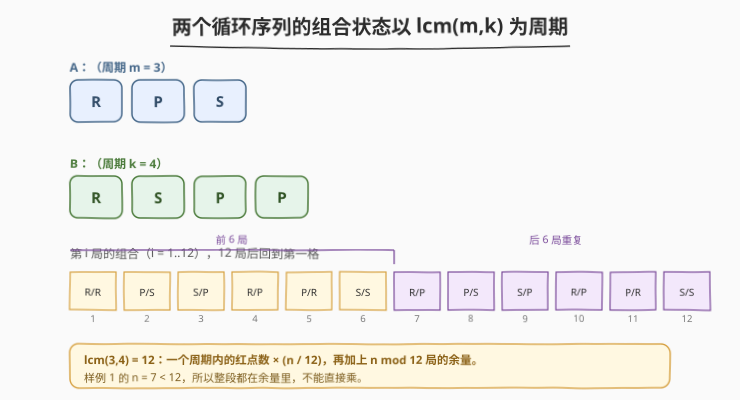
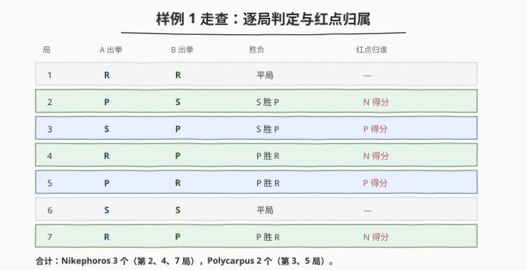

# Codeforces 173A 石头剪刀布对决 题解

## 1. 题目概述

- **题目链接**：https://codeforces.com/problemset/problem/173/A
- **比赛来源**：Croc Champ 2012 - Round 1 · Problem A（UTC 2012-04-06）
- **难度**：1300
- **标签**：实现、数学、周期
- **评测类型**：普通
- **限制**：时间 3 s / 内存 256 MB

**题意**：Nikephoros 与 Polycarpus 玩 $n$ 局石头剪刀布。两人各自预先选定一个序列并**循环**出拳：Nikephoros 的序列是长度 $m$ 的字符串 $A$（只含 `R` 石头、`S` 剪刀、`P` 布），Polycarpus 的是长度 $k$ 的字符串 $B$；第 $i$ 局两人分别出 $A[(i-1)\bmod m]$ 与 $B[(i-1)\bmod k]$。每局输的人被掐一下、身上多一个红点（平局不产生红点）。求 $n$ 局后两人各自的红点数，先输出 Nikephoros 的、再输出 Polycarpus 的。

**约束**：

- $1\le n\le 2\times10^9$，$1\le m,k\le 1000$。$n$ 大到不能逐局模拟（$2\times10^9$ 次游戏，3 s 内不可能）。
- 两人出拳的组合只由 $(i\bmod m,\ i\bmod k)$ 决定，而这一对值的周期是 $\operatorname{lcm}(m,k)\le 10^6$。这是唯一需要的结构：先算一个完整周期里的红点数，再乘以周期数、补上余数即可。
- 红点数最大 $2\times10^9$，`int` 上限约 $2.147\times10^9$，虽然刚好能装下，但乘法（每周期红点数 × 周期数）很容易越界，统一用 `long long`。
- $m,k$ 都只有 1000，$\operatorname{lcm}$ 最大 $10^6$，一个周期的模拟完全在 3 s 之内。

## 2. 示例与观察

官方样例 1（输入 / 输出原样）：

```text
输入：
7
RPS
RSPP

输出：
3 2
```

七局逐一推演（$A$ 周期 3、$B$ 周期 4）：

| 局 | $A$ | $B$ | 结果 | 红点归属 |
|----|-----|-----|------|----------|
| 1 | R | R | 平 | — |
| 2 | P | S | S 胜 P | Polycarpus 输，Nikephoros 得分 |
| 3 | S | P | S 胜 P | Nikephoros 赢，Polycarpus 得分 |
| 4 | R | P | P 胜 R | Nikephoros 输 |
| 5 | P | R | P 胜 R | Polycarpus 输 |
| 6 | S | S | 平 | — |
| 7 | R | P | P 胜 R | Nikephoros 输 |

Nikephoros 的红点在 2、4、7 局，共 3 个；Polycarpus 的在 3、5 局，共 2 个。与输出 `3 2` 一致。

官方样例 2（输入 / 输出原样）：

```text
输入：
5
RRRRRRRR
R

输出：
0 0
```

两人永远出石头，全部平局，红点数为 0。

**观察**：注意 $\operatorname{lcm}(3,4)=12>7=n$，所以样例 1 连一个完整周期都没走完。这提示实现里要小心：**不能假设 $n\ge\operatorname{lcm}$**，余数部分必须单独算。



## 3. 解题思路

### 3.1 朴素做法与瓶颈

逐局模拟：$i$ 从 1 到 $n$，比较 $A[(i-1)\bmod m]$ 与 $B[(i-1)\bmod k]$。逻辑完全正确，但要执行 $n\le2\times10^9$ 次，每次两次取模一次判断，3 s 内做不到（现代 CPU 每秒约 $10^9$ 次简单操作，还要加上分支预测失败的开销）。

关键在于：两人的"共同状态"是二元组 $(i\bmod m,\ i\bmod k)$，它只有 $m\cdot k\le10^6$ 种取值，而且变化完全确定。所以游戏过程一定是**纯周期**的（没有前导段），周期就是 $\operatorname{lcm}(m,k)$。

### 3.2 核心观察：周期是 lcm，不是 m·k

对第 $i$ 局与第 $i+L$ 局（$L=\operatorname{lcm}(m,k)$）：

$$i\bmod m=(i+L)\bmod m,\qquad i\bmod k=(i+L)\bmod k,$$

因为 $m\mid L$ 且 $k\mid L$。于是两局两人的出拳完全相同，胜负也相同。周期的最小性在这里不重要——我们只需要"$L$ 是一个周期"就够了，因为重复的部分可以整段乘起来。



### 3.3 算法流程

1. 读入 $n$、$A$、$B$，长度分别为 $m,k$；算 $L=\operatorname{lcm}(m,k)=m/\gcd(m,k)\cdot k$。
2. 在一个完整周期上模拟 $i=0,1,\dots,L-1$（用 0 起下标），统计 Nikephoros 的红点数 $c_A$ 与 Polycarpus 的红点数 $c_B$。
3. `full = n / L`，`rem = n % L`；答案初值为 $(c_A\cdot \text{full},\ c_B\cdot\text{full})$。
4. 再模拟 $i=0,1,\dots,\text{rem}-1$ 这几局，把红点加到对应的人身上。
5. 输出 `ansA ansB`。

写代码时可以把"第 $i$ 局的胜负"抽成一个函数，`full` 与 `rem` 两段共用，避免两份判定逻辑不一致。

### 3.4 样例走查：样例 1 为什么不是一个周期

$m=3,k=4$，$L=12$，而 $n=7$。所以 `full=0`、`rem=7`，答案完全来自第 4 步的余数循环——前七个状态是
$(0,0),(1,1),(2,2),(0,3),(1,0),(2,1),(0,2)$（下标 0 起），正好覆盖上表七局，得到 $(3,2)$。

如果换成 $n=12$，则 $c_A,c_B$ 由完整周期给出，`rem=0`；若 $n=100$，则 `full=8`、`rem=4`，答案是 $8(c_A,c_B)$ 再加上前四局。

## 4. 正确性证明

设第 $i$ 局（$0$ 起）的红点归属函数为 $g(i)\in\{A,B,\varnothing\}$，$L=\operatorname{lcm}(m,k)$。

**引理 1（周期为 $L$）**：对任意 $i\ge0$，$g(i+L)=g(i)$。

**证明**：第 $i$ 局两人出 $A[i\bmod m]$ 与 $B[i\bmod k]$。由于 $m\mid L$，$(i+L)\bmod m=i\bmod m$；由于 $k\mid L$，$(i+L)\bmod k=i\bmod k$。出拳相同则胜负相同，故红点归属相同。∎

**引理 2（分段计数）**：把 $n$ 写成 $n=qL+r$（$0\le r<L$），则前 $n$ 局中 Nikephoros 的红点数等于 $q\cdot c_A+\sum_{i=0}^{r-1}[g(i)=A]$，其中 $c_A=\sum_{i=0}^{L-1}[g(i)=A]$；Polycarpus 同理。

**证明**：区间 $[0,n)$ 被分成 $q$ 个完整的 $[tL,(t+1)L)$ 与末尾的 $[qL,qL+r)$。由引理 1，每个完整段内的红点归属序列与 $[0,L)$ 完全相同，各贡献 $c_A$；末尾段贡献即为所写之和。∎

**定理**：算法输出的 $(ansA,ansB)$ 等于 $n$ 局后两人身上的红点数。

**证明**：算法第 2 步正确统计了 $[0,L)$ 上两人的红点数（逐局模拟，与定义一致），第 3、4 步按引理 2 的分解累加，故答案正确。∎

## 5. 复杂度分析

- **时间**：$O(L+r)\le O(2\cdot10^6)$，其中 $L\le10^6$ 是 $\operatorname{lcm}$ 的上界、$r<L$。每一局只做两次取模与至多三次字符比较。$n=2\times10^9$ 的规模被完全消掉。
- **空间**：$O(m+k)$，只需要存两个字符串（各至多 1001 字节）。
- **数值范围**：$c_A,c_B\le L\le10^6$，乘以 $q\le n/L$ 之后总和不超 $n\le2\times10^9$；中间量用 `long long` 就不会有溢出风险。
- **与时限的关系**：$L\approx10^6$ 时 C++ 端到端 13 ms、Python 约 208 ms，相对 3 s 余量分别是 200 倍与 14 倍。

## 6. 参考代码

### C++17

```cpp
#include <bits/stdc++.h>
using namespace std;

int main() {
    long long n;
    char A[1005], B[1005];
    if (scanf("%lld %s %s", &n, A, B) != 3) return 0;
    int la = (int)strlen(A), lb = (int)strlen(B);

    long long x = la, y = lb;                 // 辗转相除求 gcd
    while (y) { long long t = x % y; x = y; y = t; }
    long long L = (long long)la / x * lb;     // lcm(la, lb)

    // 返回 1：Nikephoros 输（Polycarpus 得分）；-1：Polycarpus 输；0：平局
    auto judge = [&](long long i) -> int {
        char a = A[i % la], b = B[i % lb];
        if (a == b) return 0;
        if ((a == 'R' && b == 'S') || (a == 'S' && b == 'P') || (a == 'P' && b == 'R')) return -1;
        return 1;
    };

    long long ca = 0, cb = 0;                 // 一个完整周期内两人的红点数
    for (long long i = 0; i < L; ++i) {
        int r = judge(i);
        if (r > 0) ++ca; else if (r < 0) ++cb;
    }

    long long full = n / L, rem = n % L;
    long long ansA = ca * full, ansB = cb * full;
    for (long long i = 0; i < rem; ++i) {     // 余数部分逐局补上
        int r = judge(i);
        if (r > 0) ++ansA; else if (r < 0) ++ansB;
    }
    printf("%lld %lld\n", ansA, ansB);
    return 0;
}
```

### Python3

```python
import sys
from math import gcd


def main() -> None:
    data = sys.stdin.buffer.read().split()
    n = int(data[0])
    A = data[1].decode()
    B = data[2].decode()
    la, lb = len(A), len(B)
    L = la // gcd(la, lb) * lb            # lcm(la, lb)

    win = {'R': 'S', 'S': 'P', 'P': 'R'}  # 键胜值

    def judge(i):
        a, b = A[i % la], B[i % lb]
        if a == b:
            return 0
        return 1 if win[b] == a else -1   # 1：B 输；-1：A 输

    ca = cb = 0
    for i in range(L):
        r = judge(i)
        if r > 0:
            ca += 1
        elif r < 0:
            cb += 1

    full, rem = divmod(n, L)
    ans_a, ans_b = ca * full, cb * full
    for i in range(rem):
        r = judge(i)
        if r > 0:
            ans_a += 1
        elif r < 0:
            ans_b += 1
    sys.stdout.write(f"{ans_a} {ans_b}\n")


main()
```

## 7. 边界情况与易错点

1. **$n<\operatorname{lcm}$ 时不能直接乘**：样例 1 就是这种情形（$n=7<12$）。必须用 `full=n/L`、`rem=n%L` 的分解，否则会输出 $0$ 或把余数漏掉。
2. **输出顺序是"先 Nikephoros 后 Polycarpus"**：红点属于**输**的人。若把胜负判定写反（`win[a]==b` 而不是 `win[b]==a`），会得到 `2 3` 而不是 `3 2`。
3. **`int` 溢出隐患**：$c_A\cdot\text{full}$ 可达 $2\times10^9$，虽然贴着 `int` 上限，但中间乘法可能先溢出。用 `long long`（Python 无需关心）。
4. **`lcm` 用先乘后除还是先除后乘**：$m\cdot k\le10^6$ 时不溢出，但写成 $m/\gcd\cdot k$ 更稳；`__gcd` 是 GCC 扩展，clang/libc++ 下不可用，自己写辗转相除最保险。
5. **$m=k$ 且序列相同**：全部平局，答案是 `0 0`；此时 $L=m$，余数与整周期都对。
6. **长度 1 的序列**：如 $A=$`R`、$B=$`S`，则每局结果相同，答案是 `0 n`（Polycarpus 一直输）。$L=1$、`rem=0`，逻辑自然成立。
7. **多测清空**：本题只有一组数据；若改成多组，`ca,cb` 必须在每组的开头清零，别沿用上一组的累计值。

## 8. 验证记录

- **编译环境与命令**：`Apple clang 21.0.0` + `codeforces/tools/include/bits/stdc++.h` 兼容头（`clang++ -std=c++17 -O2`）；Python 3.9.6。`python3 codeforces/tools/verify_solution.py codeforces/contests/0101-0203/173/A_石头剪刀布对决.md` 输出 C++ 2/2、Python 2/2。
- **官方样例**：2 / 2 通过（含 $n<\operatorname{lcm}$ 与全平局两种情形）。
- **独立暴力对拍**：暴力程序**逐局模拟全部 $n$ 局**（不做任何周期压缩），随机取 $n\in[1,300]$、$m,k\in[1,8]$、字符随机取自 `RSP`，共 **300 组**，与正文 C++、Python 两版逐 token 比对，全部一致。这组数据里既有 $n<L$、也有 $n$ 跨多个完整周期的情况。
- **最大约束性能**：$n=2\times10^9$、$m=999$、$k=1000$（$\gcd=1$，$L=999000$）随机序列，C++ 端到端 13 ms、Python 约 208 ms；峰值内存 < 2 MB。
- **图片校验**：两张 SVG（`cf173a_lcm.svg`、`cf173a_walkthrough.svg`）通过 `xml.etree.ElementTree.parse`，文本包围盒均在 `viewBox` 内。
- **复核状态**：verified（样例、300 组逐局模拟对拍、最大规模性能、图片四项实跑通过）。

## 相关题目与扩展

- [Codeforces 172B 伪随机序列周期](https://codeforces.com/problemset/problem/172/B)：另一个"周期"来源——状态重复形成的环；本题是"两个固定周期的最小公倍数"。
- [Codeforces 173B Chamber of Secrets](https://codeforces.com/problemset/problem/173/B)：同场 B 题，网格上的最短路。
- [LeetCode 957. N 天后的牢房](https://leetcode.cn/problems/prison-cells-after-n-days/)：同样是"状态周期 + 大 $n$ 取模"的套路。
- [Codeforces 148A Insomnia cure](https://codeforces.com/problemset/problem/148/A)：倍数计数入门题。

**延伸思考**：

1. **如果三人在玩（循环周期 $m,k,t$）**：组合状态周期变成 $\operatorname{lcm}(m,k,t)$，仍是一个完整周期 × 整数倍的思路；但"谁得分"的规则变成多人胜负，处理时要小心循环赛的传递性（石头剪刀布对三人不是可传递的）。
2. **如果序列不循环，而是给定 $n$ 长的两个串**：直接逐局比较，$O(n)$；周期压缩失效，因为没有重复。
3. **如果要输出每一局的结果**：只能逐局，但可以在 $n$ 巨大时用"周期内的结果序列"去匹配前缀，仍然是 $O(L)$ 存储。
4. **如果 $m,k$ 涨到 $10^6$**：$L$ 可能到 $10^{12}$，一个周期都模拟不完；但此时 $n\le2\times10^9$，直接逐局模拟反而是 $O(\min(n,L))$，应当比较两者取小——算法的选择取决于 $\min(n,\operatorname{lcm})$。
